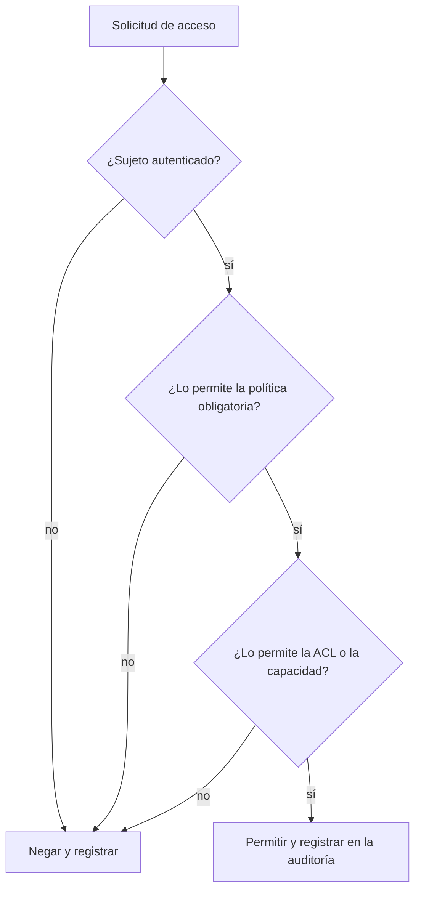

# Sistemas Operativos - Seguridad

## 5.1 Políticas y mecanismos; sistemas seguros; mecanismos de protección.

---

Un sistema operativo comparte la misma máquina entre usuarios y programas que no necesariamente confían entre sí, y es la última línea de defensa de sus datos. La **protección** es el conjunto de mecanismos internos que controlan el acceso de procesos y usuarios a los recursos; la **seguridad** es el objetivo más amplio de que el sistema resista ataques deliberados, e incluye la autenticación, la integridad del software y la defensa frente a amenazas externas. Este tema presenta los objetivos de la seguridad, la separación de políticas y mecanismos, los principios de diseño de Saltzer y Schroeder, los modelos formales de Bell-LaPadula y Biba, la matriz de acceso con sus implementaciones, listas de control de acceso y capacidades, la autenticación con contraseñas y los criterios de evaluación de sistemas seguros.

### Objetivos y amenazas

La seguridad suele resumirse en tres propiedades: **confidencialidad**, que la información solo la lean los autorizados; **integridad**, que solo la modifiquen los autorizados, y **disponibilidad**, que esté accesible cuando se necesita. Se agregan la **autenticidad** y el **no repudio**. Las amenazas incluyen la lectura o modificación no autorizada, la denegación de servicio, el **malware**, virus, gusanos, troyanos y ransomware, y la explotación de errores de programación, como los desbordamientos de buffer, para ejecutar código con privilegios.

### Políticas y mecanismos

Como en el resto del sistema (tema 1.1), conviene separar la **política**, *qué* está permitido, por ejemplo que solo el personal de finanzas lea la nómina, del **mecanismo**, *cómo* se hace cumplir, como los permisos de archivo, las listas de control de acceso o la verificación en cada llamada al sistema. Un mismo mecanismo sirve para muchas políticas, y una política se puede cambiar sin cambiar el mecanismo.

### Principios de diseño

Saltzer y Schroeder (1975) enunciaron principios que siguen vigentes:

- **mínimo privilegio:** cada programa y usuario debe tener solo los privilegios que necesita para su tarea;
- **valores seguros por omisión:** negar por defecto y permitir explícitamente;
- **mediación completa:** verificar **cada** acceso, no solo el primero;
- **diseño abierto:** la seguridad no debe depender del secreto del diseño, solo de las claves, como pedía Kerckhoffs en 1883;
- **economía del mecanismo:** mecanismos simples y pequeños, que puedan revisarse;
- **separación de privilegios:** requerir varias condiciones, como una contraseña y un dispositivo;
- **mínimo mecanismo común** y **aceptabilidad psicológica:** si la seguridad estorba, los usuarios la evitan.

La parte del sistema que debe ser correcta para que se cumpla la política es la **base de cómputo confiable** (TCB), y el **monitor de referencia** es el componente que media todos los accesos: debe ser inviolable, invocado siempre y lo bastante pequeño para verificarse.

### Modelos formales

El modelo de **Bell-LaPadula** (1973), para la **confidencialidad** en ambientes militares, asigna a sujetos y objetos niveles de seguridad ordenados, como no clasificado, confidencial, secreto y alto secreto, y exige:

- **propiedad simple:** un sujeto puede leer un objeto solo si su nivel es mayor o igual, *no leer hacia arriba*;
- **propiedad estrella:** un sujeto puede escribir un objeto solo si su nivel es menor o igual, *no escribir hacia abajo*, para que un programa con acceso a secretos no pueda filtrarlos copiándolos a un archivo menos protegido.

El modelo de **Biba** (1977), para la **integridad**, es el dual: *no leer hacia abajo*, para no contaminarse con datos poco confiables, y *no escribir hacia arriba*. El control de integridad obligatorio de Windows, con sus niveles bajo, medio, alto y de sistema, aplica una forma de la segunda regla.

### Control de acceso

- **Discrecional** (DAC): el dueño de un objeto decide quién accede; son los permisos de UNIX y las ACL de Windows.
- **Obligatorio** (MAC): el sistema impone la política con etiquetas que los usuarios no pueden cambiar; SELinux, AppArmor y Bell-LaPadula.
- **Basado en roles** (RBAC): los permisos se asignan a roles, como gerente o contador, y los usuarios reciben roles; es lo habitual en las organizaciones.

La **matriz de acceso** de Lampson (1971) tiene una fila por sujeto, una columna por objeto, y en cada celda los derechos. Es enorme y casi vacía, así que se guarda de dos formas:

- por columnas, las **listas de control de acceso** (ACL): cada objeto guarda quién puede hacer qué con él. Es fácil saber y revocar quién tiene acceso a un objeto, pero no qué puede hacer un sujeto. Los permisos de UNIX, dueño, grupo y otros con `rwx`, son una ACL abreviada, y las ACL POSIX, con `setfacl` y `getfacl`, la completan;
- por filas, las **capacidades**: cada sujeto guarda fichas que le dan derechos sobre objetos, como los descriptores de archivo abiertos de UNIX. Una capacidad debe ser **infalsificable**: se guarda en el núcleo, en memoria etiquetada por el hardware o se firma criptográficamente. Delegar es fácil, revocar es difícil.

### Autenticación

La autenticación se basa en algo que el usuario **sabe**, una contraseña; algo que **tiene**, un teléfono o una llave física, o algo que **es**, una huella; la autenticación de **múltiples factores** combina varios. Las contraseñas nunca se guardan en claro: se guarda el resultado de una función de derivación **lenta** con una **sal** aleatoria distinta por usuario, como bcrypt, scrypt, Argon2 o PBKDF2 con cientos de miles de iteraciones. La sal hace que la misma contraseña produzca resúmenes distintos e impide las tablas precalculadas; la lentitud hace costoso el ataque de fuerza bruta (tema 1.1). La comparación debe hacerse en **tiempo constante**, para no revelar por el tiempo de respuesta cuántos bytes coinciden.

### Sistemas seguros y su evaluación

Un sistema operativo seguro combina protección de memoria y aislamiento de procesos, control de acceso en cada llamada al sistema, auditoría, arranque verificado y actualizaciones. El **Libro Naranja**, los TCSEC del Departamento de Defensa de los Estados Unidos (1983), definía las clases D, C1 y C2, B1, B2 y B3, y A1, de protección mínima a diseño verificado formalmente. Lo reemplazaron los **Criterios Comunes**, ISO/IEC 15408, con sus niveles de garantía EAL1 a EAL7.



### Implementación en Python

El programa implementa la política del ejercicio 1 como reglas explícitas y muestra la matriz de acceso que produce; un sistema de capacidades firmadas con HMAC y revocables con un número de versión para el ejercicio 2; los modelos de Bell-LaPadula y Biba para el ejercicio 3, y el almacenamiento de contraseñas con sal, PBKDF2 y comparación en tiempo constante.

```python
import hashlib, hmac, json

# ---------- Ejercicio 1: política de acceso por departamento y rol ----------
USUARIOS = {"ana": ("Finanzas", "empleado"), "beto": ("Finanzas", "gerente"), "carla": ("RH", "gerente"),
            "diego": ("RH", "empleado"), "elena": ("Ventas", "gerente"), "fer": ("Ventas", "empleado")}
ARCHIVOS = {"nomina_2026.xlsx": ("Finanzas", "general"), "reporte_octubre.pdf": ("Finanzas", "reporte_mensual"),
            "vacaciones.docx": ("RH", "general")}
def permitido(usuario, archivo, accion):                 # la política, escrita como reglas explícitas
    depto, rol = USUARIOS[usuario]; dueño, tipo = ARCHIVOS[archivo]
    if depto == dueño: return True                       # regla 1: cada departamento accede a lo suyo
    if tipo == "reporte_mensual" and rol == "gerente" and accion == "leer": return True   # regla 2: excepción
    return False                                         # por omisión, negar (valores seguros por defecto)
print("ejercicio 1: matriz de acceso que produce la política (L = leer, E = escribir)")
print("   " + " " * 15 + "".join(f"{a:>21}" for a in ARCHIVOS))
for u in USUARIOS:
    celdas = ["".join(c for c, acc in (("L", "leer"), ("E", "escribir")) if permitido(u, a, acc)) or "-" for a in ARCHIVOS]
    print(f"   {u:6} {USUARIOS[u][0][:3] + '/' + USUARIOS[u][1][:3]:8}" + "".join(f"{c:>21}" for c in celdas))

# ---------- Ejercicio 2: capacidades infalsificables y revocables con HMAC ----------
CLAVE = b"clave-secreta-del-servidor-de-archivos"            # solo la conoce el servidor
version = {"plan.txt": 1, "datos.csv": 1}                    # incrementarla revoca todas las capacidades del objeto
def emite(objeto, derechos, sujeto):
    cuerpo = {"obj": objeto, "der": sorted(derechos), "suj": sujeto, "ver": version[objeto]}
    msg = json.dumps(cuerpo, sort_keys=True).encode()
    return cuerpo, hmac.new(CLAVE, msg, hashlib.sha256).hexdigest()
def verifica(cap, derecho):
    cuerpo, firma = cap; msg = json.dumps(cuerpo, sort_keys=True).encode()
    if not hmac.compare_digest(firma, hmac.new(CLAVE, msg, hashlib.sha256).hexdigest()): return "rechazada: firma inválida"
    if cuerpo["ver"] != version[cuerpo["obj"]]: return "rechazada: revocada"
    return "permitido" if derecho in cuerpo["der"] else f"rechazada: no incluye {derecho}"
cap = emite("plan.txt", ["leer"], "ana")
print("ejercicio 2: capacidad emitida:", cap[0], "firma", cap[1][:16] + "…")
print("   ana lee plan.txt:", verifica(cap, "leer"))
print("   ana intenta escribir:", verifica(cap, "escribir"))
falsa = (dict(cap[0], der=["escribir", "leer"]), cap[1])
print("   ana altera la capacidad para agregarse escritura:", verifica(falsa, "escribir"))
version["plan.txt"] += 1
print("   tras revocar plan.txt (versión 2):", verifica(cap, "leer"))

# ---------- Ejercicio 3: Bell-LaPadula y Biba ----------
NIVEL = {"No clasificado": 0, "Confidencial": 1, "Secreto": 2, "Alto secreto": 3}
def blp(sujeto, objeto, accion):                         # confidencialidad
    s, o = NIVEL[sujeto], NIVEL[objeto]
    return s >= o if accion == "leer" else s <= o        # no leer hacia arriba; no escribir hacia abajo (propiedad *)
def biba(sujeto, objeto, accion):                        # integridad: el dual
    s, o = NIVEL[sujeto], NIVEL[objeto]
    return s <= o if accion == "leer" else s >= o
print("ejercicio 3: Bell-LaPadula")
for suj, obj, acc in (("Confidencial", "Secreto", "leer"), ("Secreto", "Confidencial", "leer"), ("Secreto", "Confidencial", "escribir"),
                      ("Confidencial", "Secreto", "escribir"), ("Secreto", "Secreto", "escribir")):
    print(f"   sujeto {suj:13} {acc:8} objeto {obj:13}: {'permitido' if blp(suj, obj, acc) else 'prohibido'}"
          f" | con Biba: {'permitido' if biba(suj, obj, acc) else 'prohibido'}")

# ---------- Contraseñas: sal, derivación lenta y comparación en tiempo constante ----------
def guarda(contraseña, sal, iteraciones=600_000):
    return sal + hashlib.pbkdf2_hmac("sha256", contraseña.encode(), sal, iteraciones)
def comprueba(guardado, contraseña, iteraciones=600_000):
    sal, resumen = guardado[:16], guardado[16:]
    return hmac.compare_digest(resumen, hashlib.pbkdf2_hmac("sha256", contraseña.encode(), sal, iteraciones))
g1, g2 = guarda("Tlaloc#2026", b"\x01" * 16), guarda("Tlaloc#2026", b"\x02" * 16)
print(f"contraseñas: misma contraseña con sales distintas, resúmenes iguales: {g1[16:] == g2[16:]}; "
      f"correcta: {comprueba(g1, 'Tlaloc#2026')}; incorrecta: {comprueba(g1, 'tlaloc#2026')}")
```

Salida:

```text
ejercicio 1: matriz de acceso que produce la política (L = leer, E = escribir)
                       nomina_2026.xlsx  reporte_octubre.pdf      vacaciones.docx
   ana    Fin/emp                    LE                   LE                    -
   beto   Fin/ger                    LE                   LE                    -
   carla  RH/ger                      -                    L                   LE
   diego  RH/emp                      -                    -                   LE
   elena  Ven/ger                     -                    L                    -
   fer    Ven/emp                     -                    -                    -
ejercicio 2: capacidad emitida: {'obj': 'plan.txt', 'der': ['leer'], 'suj': 'ana', 'ver': 1} firma e5a35fbc9cf116f7…
   ana lee plan.txt: permitido
   ana intenta escribir: rechazada: no incluye escribir
   ana altera la capacidad para agregarse escritura: rechazada: firma inválida
   tras revocar plan.txt (versión 2): rechazada: revocada
ejercicio 3: Bell-LaPadula
   sujeto Confidencial  leer     objeto Secreto      : prohibido | con Biba: permitido
   sujeto Secreto       leer     objeto Confidencial : permitido | con Biba: prohibido
   sujeto Secreto       escribir objeto Confidencial : prohibido | con Biba: permitido
   sujeto Confidencial  escribir objeto Secreto      : permitido | con Biba: prohibido
   sujeto Secreto       escribir objeto Secreto      : permitido | con Biba: permitido
contraseñas: misma contraseña con sales distintas, resúmenes iguales: False; correcta: True; incorrecta: False
```

En Linux, la política del ejercicio 1 se implementa con grupos y ACL POSIX:

```bash
groupadd finanzas; groupadd gerentes
chown -R root:finanzas /srv/finanzas
chmod 2770 /srv/finanzas /srv/finanzas/reportes          # solo el grupo; setgid: lo nuevo hereda el grupo
setfacl -m g:gerentes:--x /srv/finanzas                  # los gerentes atraviesan el directorio sin listarlo
setfacl -m g:gerentes:r-x /srv/finanzas/reportes         # y listan los reportes
setfacl -m g:gerentes:r-- /srv/finanzas/reportes/*.pdf   # y los leen
setfacl -d -m g:gerentes:r-- /srv/finanzas/reportes      # ACL por omisión: también los reportes futuros
getfacl /srv/finanzas/reportes/reporte_octubre.pdf
```

### Ejercicios Propuestos

1. **Análisis de políticas.** Una empresa tiene tres departamentos, Finanzas, RH y Ventas. Los archivos de Finanzas solo deben ser accesibles por el personal de Finanzas, excepto los reportes mensuales, que pueden leer los gerentes de todos los departamentos. Propón una política de seguridad adecuada.

2. **Capacidades.** Diseña un sistema de capacidades para un sistema de archivos en el que cada usuario pueda tener distintos niveles de acceso a distintos archivos, las capacidades sean verificables pero no falsificables, y puedan revocarse.

3. **Modelo formal.** Modela con Bell-LaPadula el siguiente requisito: en una organización militar, los documentos clasificados como secretos no pueden ser leídos por personal con autorización confidencial, pero el personal con autorización secreta puede escribir en documentos confidenciales.

### Soluciones

**Ejercicio 1.** La política, con valores seguros por omisión y mínimo privilegio, tiene dos reglas y una negación por defecto: cada departamento lee y escribe sus propios archivos; los **gerentes** de cualquier departamento pueden **leer**, pero no modificar, los archivos de Finanzas de tipo reporte mensual, y todo lo demás se niega. La matriz que produce el programa lo confirma: Carla, gerente de RH, y Elena, gerente de Ventas, solo tienen L en el reporte de octubre; Diego y Fer, empleados, no tienen acceso a nada de Finanzas. Es una política RBAC con atributos, el departamento y el tipo de documento. Se completa con la **auditoría** de los accesos a la nómina, un procedimiento para clasificar un documento como reporte mensual, y la revisión periódica de quién tiene el rol de gerente. La implementación en Linux con grupos y ACL está arriba.

**Ejercicio 2.** Cada capacidad contiene el objeto, los derechos, el sujeto y una **versión** del objeto, y el servidor de archivos la firma con un HMAC con una clave que solo él conoce. Es **verificable**: el servidor recalcula la firma; **infalsificable**: cambiar cualquier campo, como agregarse el derecho de escritura, invalida la firma, y sin la clave no se puede firmar una nueva, y **revocable**: incrementar la versión del objeto invalida todas sus capacidades anteriores, como muestra el programa. Para revocaciones selectivas se usa una lista de capacidades revocadas o capacidades con fecha de expiración, y para delegar con menos derechos, una cadena de firmas, como las *macaroons* de Google. El ejemplo del material original generaba un *token* aleatorio que no dependía del objeto ni de los derechos, de modo que no permitía verificar nada.

**Ejercicio 3.** Con los niveles no clasificado < confidencial < secreto < alto secreto, la primera parte del requisito es exactamente la propiedad simple: un sujeto confidencial no puede leer un objeto secreto. Pero la segunda parte **viola la propiedad estrella**: un sujeto secreto que escribe en un objeto confidencial podría filtrar información secreta a quien solo tiene autorización confidencial, y Bell-LaPadula lo prohíbe, como muestra el programa. El requisito no puede modelarse directamente. Las soluciones del modelo son que el personal secreto inicie sesión con un **nivel actual** confidencial, sin acceso a los secretos durante esa sesión, para escribir en el documento; o que un **sujeto confiable**, exento de la propiedad estrella y auditado, desclasifique la información revisada. En Biba, en cambio, escribir hacia abajo está permitido y leer hacia abajo no, lo que muestra que confidencialidad e integridad imponen reglas opuestas.

El material original incluía la regla de Bayes como fórmula de la autenticación, sin relación con el tema; su función `verify_password` comparaba los resúmenes con `==`, que no es de tiempo constante, y la sección sobre Windows mezclaba la palabra inglesa *both*.

### Referencias

1. Saltzer, J. H., and Schroeder, M. D., The protection of information in computer systems. _Proceedings of the IEEE_ 63(9), 1975.
2. Lampson, B. W., Protection. _Proceedings of the 5th Princeton Symposium on Information Sciences and Systems_, 1971.
3. Bell, D. E., and LaPadula, L. J., Secure computer systems: mathematical foundations. MITRE, 1973.
4. Biba, K. J., Integrity considerations for secure computer systems. MITRE, 1977.
5. Anderson, R., _Security Engineering_. 3a ed., Wiley, 2020.
6. Silberschatz, A., Galvin, P. B., and Gagne, G., _Operating System Concepts_. 10a ed., Wiley, 2018. Capítulos 16 y 17.
7. Birgisson, A., et al., Macaroons: cookies with contextual caveats for decentralized authorization in the cloud. _NDSS_, 2014.
