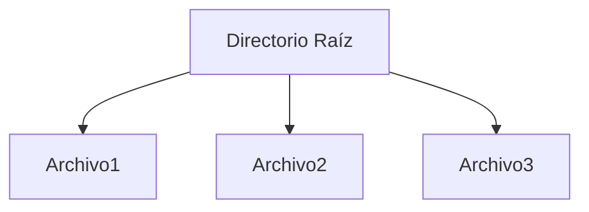
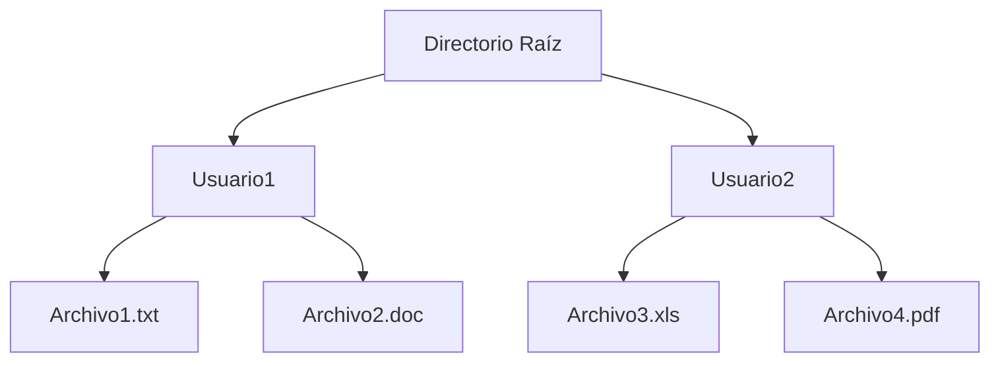
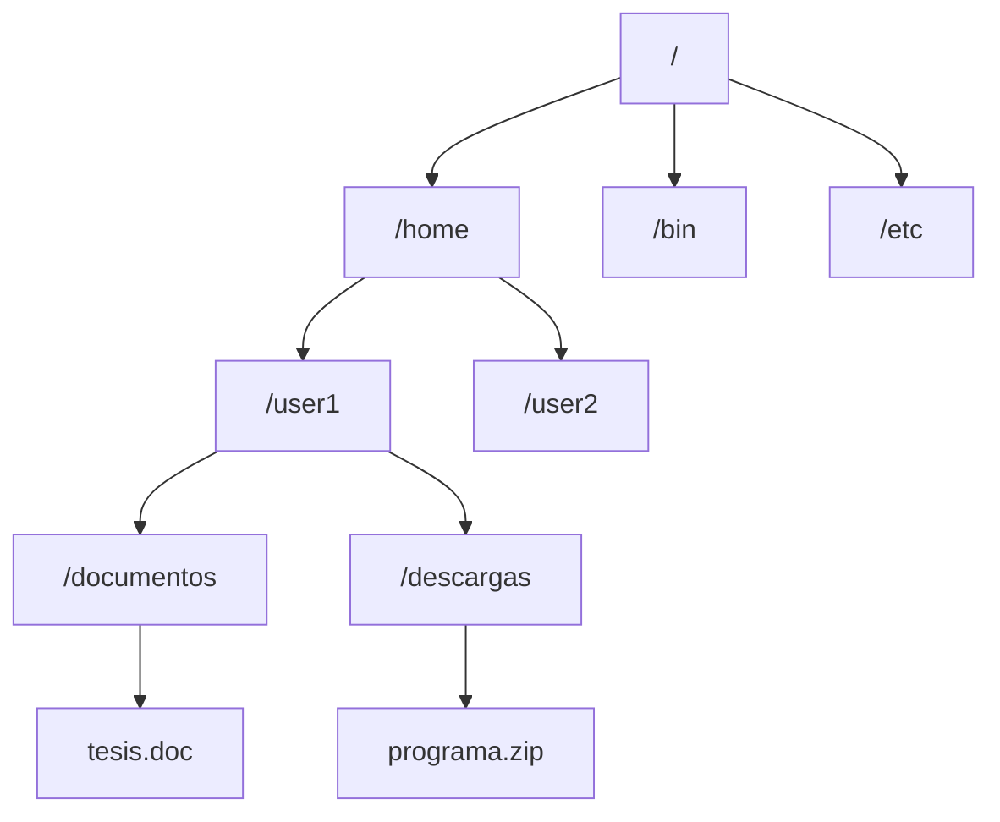
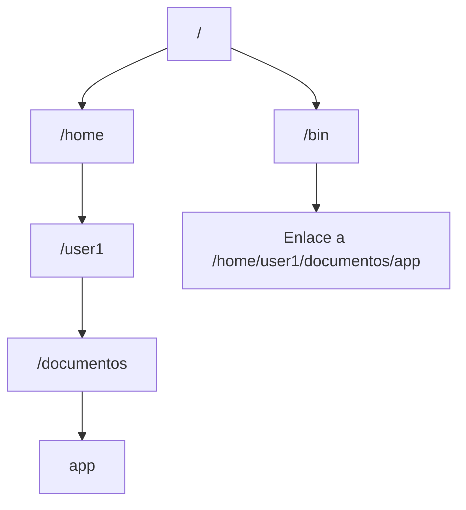

# Sistemas Operativos - Sistemas de archivos

## 6.1 Datos y meta-datos; archivos y su organización; directorios; problemas de implantación; seguridad.

---

Un sistema de archivos es un componente fundamental de cualquier sistema operativo, responsable de la organización, almacenamiento, recuperación y gestión de datos en dispositivos de almacenamiento secundario. Proporciona una abstracción lógica sobre el almacenamiento físico, permitiendo a los usuarios y aplicaciones interactuar con los datos sin preocuparse por los detalles de bajo nivel.

### Datos y Meta-datos

#### Definición de Datos

Los datos son la información real contenida en un archivo. Representan el contenido sustancial que el usuario desea almacenar, como texto, imágenes, código ejecutable, etc.

#### Definición de Meta-datos

Los meta-datos son "datos sobre los datos" - información que describe las características de un archivo pero no su contenido real. Incluyen:

- Nombre del archivo
- Tamaño
- Fechas de creación, modificación y último acceso
- Permisos de acceso
- Ubicación física en el disco
- Tipo de archivo
- Propietario y grupo

**Ejemplo de estructura de meta-datos (inodo en UNIX):**

```c
struct inode {
    unsigned long i_ino;        // Número de inodo
    umode_t i_mode;             // Permisos y tipo de archivo
    uid_t i_uid;                // ID del propietario
    gid_t i_gid;                // ID del grupo
    off_t i_size;               // Tamaño en bytes
    time_t i_atime;             // Tiempo de último acceso
    time_t i_mtime;             // Tiempo de última modificación
    time_t i_ctime;             // Tiempo de último cambio de meta-datos
    unsigned long i_blocks;     // Número de bloques asignados
    // Punteros a bloques de datos
};
```

### Archivos y su Organización

#### Concepto de Archivo

Un archivo es una colección nombrada de información relacionada que se almacena en un dispositivo de almacenamiento secundario.

#### Organización de Archivos

Los sistemas operativos organizan los archivos utilizando diferentes estructuras:

##### Asignación Contigua

Los archivos ocupan un conjunto de bloques contiguos en el disco.

- **Ventaja**: Acceso rápido (acceso directo)
- **Desventaja**: Fragmentación externa

##### Asignación Enlazada

Cada bloque contiene un puntero al siguiente bloque.

- **Ventaja**: Sin fragmentación externa
- **Desventaja**: Acceso secuencial solamente

##### Asignación Indexada

Todos los punteros se almacenan en un bloque índice separado.

- **Ventaja**: Acceso directo y sin fragmentación externa
- **Desventaja**: Overhead del bloque índice

**Fórmula para cálculo de desplazamiento:**
Para un sistema con bloques de tamaño $B$ bytes, el bloque lógico $K$ que contiene el byte en posición $P$ se calcula como:

$$K = \left\lfloor \frac{P}{B} \right\rfloor$$

Y el desplazamiento dentro del bloque es:

$$D = P \mod B$$

#### Ejemplo de organización con asignación indexada

```python
def encontrar_bloque(archivo, posicion_byte, tamano_bloque):
    # Calcular bloque lógico
    bloque_logico = posicion_byte // tamano_bloque
    # Obtener bloque físico desde la tabla de índices
    bloque_fisico = archivo.tabla_indices[bloque_logico]
    desplazamiento = posicion_byte % tamano_bloque
    return bloque_fisico, desplazamiento

# Ejemplo de uso
tamano_bloque = 4096  # 4KB
posicion_deseada = 15000
bloque, offset = encontrar_bloque(mi_archivo, posicion_deseada, tamano_bloque)
print(f"Bloque físico: {bloque}, Offset: {offset}")
```

### Directorios

#### Definición y Función

Un directorio es un archivo especial que contiene información sobre otros archivos. Actúa como una tabla que mapea nombres de archivos a sus meta-datos o ubicaciones físicas.

#### Estructuras de Directorios

##### Directorio de un Solo Nivel

Todos los archivos están en un mismo directorio.



##### Directorio de Dos Niveles

Cada usuario tiene su propio directorio.



##### Directorios Jerárquicos (Árbol)

Estructura en árbol con directorios y subdirectorios.



##### Directorios Acíclicos (Con enlaces)

Permiten que un archivo o directorio aparezca en múltiples directorios.



#### Operaciones con Directorios

- Búsqueda de archivos
- Creación y eliminación de archivos
- Listado de contenidos
- Traversing (navegación entre directorios)

### Problemas de Implantación

#### Asignación de Espacio en Disco

##### Gestión de Espacio Libre

- **Mapa de bits**: Cada bloque está representado por un bit (1 = ocupado, 0 = libre)
- **Lista enlazada**: Bloques libres se enlazan entre sí
- **Agrupación**: Se mantiene un array de direcciones de bloques libres
- **Conteo**: Se almacenan pares (dirección, número de bloques contiguos libres)

**Ejemplo de mapa de bits:**

```
Bloques: 0 1 2 3 4 5 6 7 8 9 10 11 12 13 14 15
Estado:  1 1 0 0 1 0 1 1 0 0  0  1  1  0  0  1
```

Donde: 1 = ocupado, 0 = libre

#### Rendimiento y Optimización

##### Tamaño de Bloque

El tamaño óptimo del bloque depende del patrón de uso:

- Bloques grandes: Bueno para transferencias secuenciales
- Bloques pequeños: Reducen la fragmentación interna

**Cálculo de fragmentación interna:**

$$ \text{Fragmentación Interna} = \left(1 - \frac{\text{Tamaño Archivo}}{\text{Tamaño Bloques Asignados}}\right) \times 100\% $$

##### Algoritmos de Asignación de Espacio

- **First Fit**: Asigna el primer bloque libre que sea suficientemente grande
- **Best Fit**: Asigna el bloque libre más pequeño que sea suficientemente grande
- **Worst Fit**: Asigna el bloque libre más grande disponible

#### Confiabilidad y Recuperación

##### Journaling (Bitácora)

Mantiene un registro de las operaciones pendientes para recuperarse de fallos.

**Ejemplo de sistema con journaling:**


##### Sistemas de Archivos con Copy-on-Write

Nunca sobrescriben datos existentes, escriben en nuevas ubicaciones.

#### Ejercicio Propuesto 1

Calcula la fragmentación interna para los siguientes casos:

1. Archivo de 15KB con bloques de 4KB
2. Archivo de 9KB con bloques de 2KB
3. Archivo de 25KB con bloques de 8KB

**Solución:**

1. Se necesitan 4 bloques (16KB): Fragmentación = $ (1 - 15/16) \times 100\% = 6.25\% $
2. Se necesitan 5 bloques (10KB): Fragmentación = $ (1 - 9/10) \times 100\% = 10\% $
3. Se necesitan 4 bloques (32KB): Fragmentación = $ (1 - 25/32) \times 100\% = 21.875\% $

### Seguridad en Sistemas de Archivos

#### Control de Acceso

Mecanismos para restringir el acceso a archivos basados en la identidad del usuario.

##### Listas de Control de Acceso (ACL)

Cada archivo tiene una lista de usuarios y sus permisos.

**Estructura típica de ACL:**

```
Archivo: documento.txt
Propietario: usuario1 (rwx)
Grupo: equipo (r-x)
Otros: (r--)
Usuario específico: usuario2 (rw-)
```

##### Capacidades

Cada usuario tiene una lista de archivos a los que puede acceder y los permisos correspondientes.

#### Modelos de Protección

##### Protección por Contraseñas

Cada archivo puede tener su propia contraseña.

##### Permisos UNIX

Sistema de permisos basado en tres categorías: propietario, grupo y otros.

**Cálculo de permisos en octal:**
$$Permisos = (4 \times r) + (2 \times w) + (1 \times x)$$
Donde r, w, x valen 1 si el permiso está concedido y 0 si no.

**Ejemplo:** rwxr-xr-- se calcula como:

- Propietario: 4+2+1 = 7
- Grupo: 4+0+1 = 5
- Otros: 4+0+0 = 4
  Resultado: 754

#### Cifrado de Archivos

Protección de datos mediante transformación criptográfica.

##### Cifrado a Nivel de Archivo

Solo archivos específicos se cifran.

##### Cifrado a Nivel de Sistema de Archivos

Todo el sistema de archivos se cifra transparentemente.

#### Ejercicio Propuesto 2

Dados los siguientes permisos en notación simbólica, conviértelos a notación octal:

1. rwxr-xr-x
2. rw-r-----
3. rwxrwxrwx
4. r--------

**Solución:**

1. 755
2. 640
3. 777
4. 400

#### Integridad y Verificación

Mecanismos para detectar modificaciones no autorizadas:

- Sumas de verificación (checksums)
- Hashes criptográficos
- Firmas digitales

### Ejemplos Prácticos

#### Comandos UNIX para Gestión de Meta-datos

```bash
# Ver meta-datos de un archivo
stat archivo.txt

# Cambiar permisos
chmod 755 script.sh

# Cambiar propietario
chown usuario:grupo archivo.txt

# Ver los bloques asignados a un archivo
filefrag -v archivo_grande.iso
```

#### Implementación de un Sistema Simple de Archivos

```c
#include <stdio.h>
#include <stdlib.h>
#include <string.h>

#define NUM_BLOQUES 100
#define TAM_BLOQUE 512

// Estructura de meta-datos
typedef struct {
    char nombre[50];
    int tamano;
    int bloque_inicio;
    int num_bloques;
    time_t fecha_creacion;
} metadata_archivo;

// Simulación de disco
char disco[NUM_BLOQUES][TAM_BLOQUE];
int mapa_bits[NUM_BLOQUES] = {0}; // 0 = libre, 1 = ocupado

// Función para encontrar bloques libres
int encontrar_bloques_libres(int num_bloques_necesarios) {
    int bloques_encontrados = 0;
    int inicio = -1;

    for (int i = 0; i < NUM_BLOQUES; i++) {
        if (mapa_bits[i] == 0) {
            if (inicio == -1) inicio = i;
            bloques_encontrados++;

            if (bloques_encontrados == num_bloques_necesarios) {
                return inicio;
            }
        } else {
            inicio = -1;
            bloques_encontrados = 0;
        }
    }

    return -1; // No hay suficientes bloques contiguos
}
```

### Ejercicios Propuestos

#### Ejercicio 3: Cálculo de Capacidad

Un disco tiene las siguientes características:

- Tamaño total: 1TB
- Tamaño de bloque: 4KB
- Tamaño de inodo: 256 bytes
- Porcentaje de espacio reservado para inodos: 5%

Calcula:

1. Número total de bloques en el disco
2. Número máximo de inodos
3. Espacio utilizable para datos

#### Ejercicio 4: Diseño de Estructura de Directorios

Diseña una estructura de directorios para una empresa con:

- Departamentos: Ventas, Marketing, Desarrollo
- Cada departamento tiene: Documentos, Proyectos, Recursos
- Algunos proyectos son colaborativos entre departamentos

Representa tu diseño usando diagramas y justifica las decisiones tomadas.

### Referencias

#### Bibliografía Básica

1. Tanenbaum, A. S. (2007). _Modern Operating Systems_ (3rd ed.). Prentice Hall. (Capítulo 4: File Systems)
2. Silberschatz, A., Galvin, P. B., & Gagne, G. (2008). _Operating Systems Concepts_ (8th ed.). John Wiley and sons. (Capítulo 10: File System)
3. Stallings, W. (2011). _Operating Systems: Internals and Design Principles_ (7th ed.). Prentice Hall. (Capítulo 12: File Management)

#### Bibliografía Complementaria

1. Bach, M. (1986). _The Design of the UNIX Operating System_. Prentice Hall.
2. Bovet, D. P., & Cesati, M. (2000). _Understanding the Linux Kernel_. O'Reilly. (Capítulo 12: The Virtual Filesystem)
3. Silberschatz, A., Galvin, P. B., & Gagne, G. (2009). _Operating System Concepts with Java_ (8th ed.). John Wiley and sons.

#### Recursos Adicionales

- Documentación del sistema de archivos ext4 en el kernel de Linux
- RFCs relacionados con sistemas de archivos en red (NFS, SMB)
- Artículos sobre sistemas de archivos modernos (ZFS, Btrfs)
