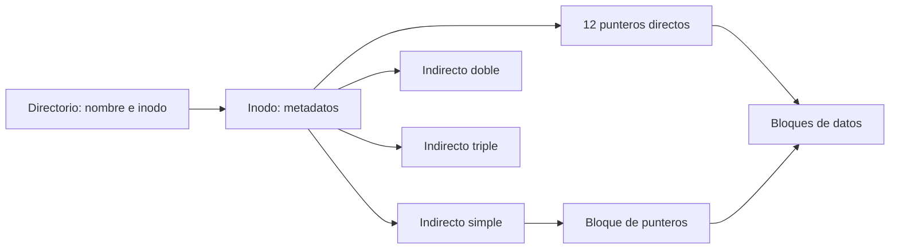

# Sistemas Operativos - Sistemas de archivos

## 6.1 Datos y meta-datos; archivos y su organización; directorios; problemas de implantación; seguridad.

---

Un disco es, para el hardware, una secuencia de bloques numerados. El **sistema de archivos** construye sobre ella la abstracción que usan las personas y los programas: archivos con nombre, organizados en directorios, con dueño, permisos y fechas, que sobreviven al apagado y a las fallas. Este tema presenta los datos y los metadatos, las formas de asignar los bloques de un archivo, la organización de los directorios, los problemas de implantación, el espacio libre, el tamaño de bloque y la consistencia ante caídas, y la seguridad de los archivos.

### Datos y metadatos

Los **datos** son el contenido del archivo; los **metadatos**, la información sobre él: tamaño, dueño, grupo, permisos, fechas y ubicación de sus bloques. En UNIX, los metadatos de cada archivo están en un **inodo**, identificado por un número; el **nombre** no está en el inodo sino en la entrada del directorio, que asocia nombre e inodo. Por eso un archivo puede tener varios nombres, los **enlaces duros**, y el inodo guarda cuántos tiene. Las tres fechas de un inodo son `atime`, el último acceso; `mtime`, la última modificación del contenido, y `ctime`, el último **cambio del inodo**, no la creación, que ext4 guarda aparte como `crtime`. El comando `stat` muestra el inodo de un archivo.

### Asignación de bloques

- **Contigua:** el archivo ocupa bloques consecutivos, y basta guardar el inicio y la longitud. El acceso secuencial y el directo son rápidos, pero sufre fragmentación externa y es difícil hacer crecer un archivo; se usa en medios de solo lectura, como los CD.
- **Enlazada:** cada bloque apunta al siguiente. No hay fragmentación externa, pero llegar al bloque $k$ requiere leer los $k$ anteriores, y un puntero dañado pierde el resto del archivo. La **FAT** de MS-DOS saca los punteros a una tabla en memoria, con lo que el acceso directo solo recorre la tabla.
- **Indexada:** un bloque índice contiene los punteros a todos los bloques del archivo. Permite acceso directo sin fragmentación externa, a costa del bloque índice. El inodo de UNIX es una variante con niveles: 12 punteros **directos**, uno **indirecto simple**, que apunta a un bloque de punteros, uno **doble** y uno **triple**, de modo que los archivos pequeños no necesitan bloques índice y los grandes pueden crecer mucho.
- **Por extensiones:** ext4, NTFS y XFS guardan pares (inicio, longitud) de rangos contiguos, que combinan la eficiencia de la asignación contigua con la flexibilidad de la indexada.

Para el byte $P$ de un archivo con bloques de $B$ bytes, el bloque lógico es $\lfloor P/B \rfloor$ y el desplazamiento $P \bmod B;$ la asignación traduce el bloque lógico a uno físico.

### Directorios

Un directorio es una tabla de nombres y referencias a archivos. Las estructuras posibles son de **un nivel**, todos los archivos en un solo directorio, con conflictos de nombres; de **dos niveles**, un directorio por usuario; en **árbol**, con rutas absolutas desde la raíz y relativas desde el directorio actual, y en **grafo acíclico**, que permite compartir un archivo o subdirectorio desde varios lugares con enlaces. Los **enlaces duros** son entradas que apuntan al mismo inodo y solo se permiten a archivos, para no crear ciclos; los **simbólicos** son archivos que contienen una ruta, pueden apuntar a directorios y quedar colgando si el destino desaparece. Los directorios grandes se indexan con árboles B o tablas de dispersión, como el HTree de ext4, para no buscar linealmente.

### Problemas de implantación

- **Espacio libre:** con un **mapa de bits**, un bit por bloque, es fácil encontrar bloques contiguos y cabe en memoria: 32 MiB para un disco de 1 TiB con bloques de 4 KiB. Las alternativas son la lista enlazada, la agrupación y los pares de inicio y cuenta.
- **Tamaño de bloque:** los bloques grandes aumentan la tasa de transferencia, y los pequeños reducen la fragmentación interna, la porción no usada del último bloque de cada archivo, que en promedio es medio bloque por archivo. Como la mayoría de los archivos son pequeños pero la mayoría de los bytes está en archivos grandes, 4 KiB es el compromiso habitual.
- **Caché:** el sistema conserva en memoria los bloques usados recientemente, la caché de páginas, y escribe los modificados después, lo que acelera mucho pero arriesga perderlos en una caída; `fsync` fuerza la escritura.
- **Consistencia:** crear un archivo modifica varias estructuras, el mapa de bits, el inodo y el directorio, que se escriben en momentos distintos. Una caída a la mitad deja el sistema inconsistente, y antes había que revisarlo completo con `fsck` al reiniciar. La **bitácora** (*journaling*) escribe primero las modificaciones en un registro, luego un **registro de confirmación**, y solo después en su lugar; al reiniciar, repite las transacciones confirmadas y descarta las incompletas. ext4, NTFS y XFS la usan, normalmente solo para los metadatos. Los sistemas de **copia al escribir**, como ZFS y Btrfs, nunca sobrescriben un bloque en uso: escriben la nueva versión en otro lugar y cambian atómicamente el puntero de la raíz, lo que además permite instantáneas baratas.

### Seguridad

Los permisos de UNIX asignan lectura, escritura y ejecución, `rwx`, al dueño, al grupo y a los demás, y se escriben en octal sumando 4 por `r`, 2 por `w` y 1 por `x`: `rwxr-xr--` es 754. En un directorio, `r` permite listar, `w` crear y borrar entradas, y `x` atravesarlo. Los bits especiales son **setuid** y **setgid**, que ejecutan un programa con los privilegios de su dueño o su grupo, y el **bit pegajoso**, que en un directorio como `/tmp` impide borrar archivos ajenos. Las **ACL** POSIX permiten permisos por usuario y grupo adicionales (tema 5.1). La confidencialidad frente al robo del disco requiere **cifrado**: por archivo o directorio, como fscrypt, o del dispositivo completo, como LUKS, BitLocker y FileVault. La **integridad** se verifica con sumas de verificación de los bloques, como hacen ZFS y Btrfs, o con hashes y firmas de los archivos del sistema, como dm-verity en Android.



### Implementación en Python

El programa resuelve los cálculos de los ejercicios 1 a 3, verificando la conversión a octal con el módulo `stat` de la biblioteca estándar; compara las lecturas que requieren las tres formas de asignación; calcula el tamaño máximo de un archivo con el inodo de ext2 y por qué puntero se llega a varios bytes; simula una caída a mitad de la creación de un archivo con y sin bitácora, y muestra la estructura de directorios del ejercicio 4.

```python
import stat

# ---------- Ejercicio 1: fragmentación interna ----------
print("ejercicio 1:")
for archivo, bloque in ((15, 4), (9, 2), (25, 8)):
    n = -(-archivo // bloque); asignado = n * bloque
    print(f"   {archivo} KB en bloques de {bloque} KB: {n} bloques = {asignado} KB, desperdicio {asignado - archivo} KB = {(1 - archivo / asignado):.3%}")

# ---------- Ejercicio 2: permisos simbólicos a octal ----------
def a_octal(simb):
    return "".join(str(sum(v for c, v in zip(simb[i:i + 3], (4, 2, 1)) if c != "-")) for i in (0, 3, 6))
for s in ("rwxr-xr-x", "rw-r-----", "rwxrwxrwx", "r--------", "rwxr-xr--"):
    o = a_octal(s); assert stat.filemode(int(o, 8) | stat.S_IFREG)[1:] == s      # verificación con la biblioteca estándar
    print(f"ejercicio 2: {s} = {o}")

# ---------- Ejercicio 3: capacidad de un disco ----------
for nombre, total in (("1 TiB = 2^40 bytes", 2 ** 40), ("1 TB = 10^12 bytes", 10 ** 12)):
    bloques = total // 4096; espacio_inodos = total * 5 // 100; inodos = espacio_inodos // 256
    print(f"ejercicio 3: {nombre}: {bloques:,} bloques de 4 KiB; 5 % para inodos = {espacio_inodos / 2 ** 30:.1f} GiB → {inodos:,} inodos de 256 bytes; "
          f"datos {(total - espacio_inodos) / 2 ** 30:.1f} GiB")
print(f"   con la proporción por omisión de ext4, un inodo por cada 16 KiB: {2 ** 40 // 16384:,} inodos, {2 ** 40 // 16384 * 256 / 2 ** 30:.0f} GiB = {256 / 16384:.2%} del disco")

# ---------- Asignación contigua, enlazada e indexada: lecturas de disco para llegar al byte P ----------
B = 4096
def lecturas(metodo, P):
    k = P // B
    if metodo == "contigua": return 1                          # inicio + k, directo
    if metodo == "enlazada": return k + 1                      # recorrer k punteros, sin FAT en memoria
    if metodo == "indexada": return 2                          # bloque índice + bloque de datos
for P in (15000, 4_000_000):
    print(f"acceso al byte {P:,} (bloque lógico {P // B}, desplazamiento {P % B}): " + ", ".join(f"{m} {lecturas(m, P)}" for m in ("contigua", "enlazada", "indexada")) + " lecturas")

# ---------- El inodo de ext2: tamaño máximo con punteros directos e indirectos ----------
punteros = B // 4
directo, simple, doble, triple = 12 * B, punteros * B, punteros ** 2 * B, punteros ** 3 * B
print(f"inodo con 12 directos + indirecto simple, doble y triple, bloques de 4 KiB: {directo // 1024} KiB + {simple // 2 ** 20} MiB + "
      f"{doble // 2 ** 30} GiB + {triple // 2 ** 40} TiB = {(directo + simple + doble + triple) / 2 ** 40:.3f} TiB")
for P in (40_000, 2_000_000, 3_000_000_000):
    k = P // B
    nivel = "directo" if k < 12 else "indirecto simple" if k < 12 + punteros else "indirecto doble" if k < 12 + punteros + punteros ** 2 else "triple"
    extra = {"directo": 0, "indirecto simple": 1, "indirecto doble": 2, "triple": 3}[nivel]
    print(f"   byte {P:>13,}: bloque lógico {k:,}, por el puntero {nivel}: {extra + 1} {"lectura" if extra == 0 else "lecturas"} con el inodo en memoria")

# ---------- Bitácora: consistencia tras una caída a mitad de una operación ----------
# crear un archivo escribe 3 estructuras: el mapa de bits, el inodo y la entrada del directorio
PASOS = ["mapa de bits", "inodo", "directorio"]
def estado_tras_caida(escritos):
    e = set(escritos)
    if e == set(PASOS): return "consistente: archivo creado"
    if not e: return "consistente: como antes"
    if "directorio" in e and "inodo" not in e: return "INCONSISTENTE: la entrada apunta a un inodo basura"
    if "inodo" in e and "directorio" not in e: return "INCONSISTENTE: inodo huérfano, espacio perdido"
    return "INCONSISTENTE: bloque marcado como usado sin dueño"
print("bitácora: caída después de escribir k de las 3 estructuras en su lugar")
for k in range(4):
    sin = estado_tras_caida(PASOS[:k])
    # con bitácora: se escriben las 3 en la bitácora, luego el registro de confirmación, luego en su lugar
    con = "se descarta la transacción incompleta: como antes" if k < 3 else "se repite la transacción confirmada: archivo creado"
    print(f"   k = {k}: sin bitácora → {sin} | con bitácora, caída antes de confirmar si k < 3 → {con}")

# ---------- Ejercicio 4: estructura de directorios ----------
ARBOL = {"/srv/empresa": {"ventas": ["documentos", "proyectos", "recursos"], "marketing": ["documentos", "proyectos", "recursos"],
                          "desarrollo": ["documentos", "proyectos", "recursos"], "proyectos-compartidos": ["lanzamiento-2027", "portal-clientes"]}}
ENLACES = {"/srv/empresa/ventas/proyectos/lanzamiento-2027": "/srv/empresa/proyectos-compartidos/lanzamiento-2027",
           "/srv/empresa/marketing/proyectos/lanzamiento-2027": "/srv/empresa/proyectos-compartidos/lanzamiento-2027",
           "/srv/empresa/desarrollo/proyectos/portal-clientes": "/srv/empresa/proyectos-compartidos/portal-clientes",
           "/srv/empresa/ventas/proyectos/portal-clientes": "/srv/empresa/proyectos-compartidos/portal-clientes"}
print("ejercicio 4:")
for raiz, deptos in ARBOL.items():
    print(f"   {raiz}/")
    for d, subs in deptos.items():
        print(f"      {d}/  (grupo {d if d != 'proyectos-compartidos' else 'uno por proyecto'})")
        for s in subs:
            print(f"         {s}/")
            for enlace, destino in ENLACES.items():
                if enlace.startswith(f"{raiz}/{d}/{s}/"): print(f"            {enlace.rsplit('/', 1)[1]} -> {destino}")
```

Salida:

```text
ejercicio 1:
   15 KB en bloques de 4 KB: 4 bloques = 16 KB, desperdicio 1 KB = 6.250%
   9 KB en bloques de 2 KB: 5 bloques = 10 KB, desperdicio 1 KB = 10.000%
   25 KB en bloques de 8 KB: 4 bloques = 32 KB, desperdicio 7 KB = 21.875%
ejercicio 2: rwxr-xr-x = 755
ejercicio 2: rw-r----- = 640
ejercicio 2: rwxrwxrwx = 777
ejercicio 2: r-------- = 400
ejercicio 2: rwxr-xr-- = 754
ejercicio 3: 1 TiB = 2^40 bytes: 268,435,456 bloques de 4 KiB; 5 % para inodos = 51.2 GiB → 214,748,364 inodos de 256 bytes; datos 972.8 GiB
ejercicio 3: 1 TB = 10^12 bytes: 244,140,625 bloques de 4 KiB; 5 % para inodos = 46.6 GiB → 195,312,500 inodos de 256 bytes; datos 884.8 GiB
   con la proporción por omisión de ext4, un inodo por cada 16 KiB: 67,108,864 inodos, 16 GiB = 1.56% del disco
acceso al byte 15,000 (bloque lógico 3, desplazamiento 2712): contigua 1, enlazada 4, indexada 2 lecturas
acceso al byte 4,000,000 (bloque lógico 976, desplazamiento 2304): contigua 1, enlazada 977, indexada 2 lecturas
inodo con 12 directos + indirecto simple, doble y triple, bloques de 4 KiB: 48 KiB + 4 MiB + 4 GiB + 4 TiB = 4.004 TiB
   byte        40,000: bloque lógico 9, por el puntero directo: 1 lectura con el inodo en memoria
   byte     2,000,000: bloque lógico 488, por el puntero indirecto simple: 2 lecturas con el inodo en memoria
   byte 3,000,000,000: bloque lógico 732,421, por el puntero indirecto doble: 3 lecturas con el inodo en memoria
bitácora: caída después de escribir k de las 3 estructuras en su lugar
   k = 0: sin bitácora → consistente: como antes | con bitácora, caída antes de confirmar si k < 3 → se descarta la transacción incompleta: como antes
   k = 1: sin bitácora → INCONSISTENTE: bloque marcado como usado sin dueño | con bitácora, caída antes de confirmar si k < 3 → se descarta la transacción incompleta: como antes
   k = 2: sin bitácora → INCONSISTENTE: inodo huérfano, espacio perdido | con bitácora, caída antes de confirmar si k < 3 → se descarta la transacción incompleta: como antes
   k = 3: sin bitácora → consistente: archivo creado | con bitácora, caída antes de confirmar si k < 3 → se repite la transacción confirmada: archivo creado
ejercicio 4:
   /srv/empresa/
      ventas/  (grupo ventas)
         documentos/
         proyectos/
            lanzamiento-2027 -> /srv/empresa/proyectos-compartidos/lanzamiento-2027
            portal-clientes -> /srv/empresa/proyectos-compartidos/portal-clientes
         recursos/
      marketing/  (grupo marketing)
         documentos/
         proyectos/
            lanzamiento-2027 -> /srv/empresa/proyectos-compartidos/lanzamiento-2027
         recursos/
      desarrollo/  (grupo desarrollo)
         documentos/
         proyectos/
            portal-clientes -> /srv/empresa/proyectos-compartidos/portal-clientes
         recursos/
      proyectos-compartidos/  (grupo uno por proyecto)
         lanzamiento-2027/
         portal-clientes/
```

### Ejercicios Propuestos

1. **Fragmentación interna.** Calcula la fragmentación interna de un archivo de 15 KB con bloques de 4 KB, uno de 9 KB con bloques de 2 KB y uno de 25 KB con bloques de 8 KB.

2. **Permisos.** Convierte a notación octal los permisos `rwxr-xr-x`, `rw-r-----`, `rwxrwxrwx` y `r--------`.

3. **Capacidad.** Un disco de 1 TB tiene bloques de 4 KB, inodos de 256 bytes y reserva el 5 % del espacio para inodos. Calcula el número total de bloques, el número máximo de inodos y el espacio utilizable para datos.

4. **Estructura de directorios.** Diseña una estructura de directorios para una empresa con los departamentos de Ventas, Marketing y Desarrollo, cada uno con documentos, proyectos y recursos, y algunos proyectos colaborativos entre departamentos. Justifica las decisiones.

### Soluciones

**Ejercicio 1.** Un archivo de 15 KB necesita $\lceil 15/4 \rceil = 4$ bloques, 16 KB, y desperdicia 1 KB, el 6.25 % de lo asignado. Uno de 9 KB necesita 5 bloques de 2 KB, 10 KB, y desperdicia 1 KB, el 10 %. Uno de 25 KB necesita 4 bloques de 8 KB, 32 KB, y desperdicia 7 KB, el 21.875 %. El desperdicio absoluto nunca llega a un bloque, y su proporción importa sobre todo en archivos pequeños; por eso algunos sistemas, como Btrfs y ext4 con *inline data*, guardan los archivos muy pequeños dentro del propio inodo.

**Ejercicio 2.** Cada grupo de tres letras es un dígito octal: `rwxr-xr-x` = 755, el permiso típico de programas y directorios públicos; `rw-r-----` = 640, un archivo que el dueño edita y su grupo lee; `rwxrwxrwx` = 777, que casi nunca es buena idea, y `r--------` = 400, solo lectura para el dueño, como una clave privada SSH. El programa verifica las conversiones contra la función `stat.filemode` de Python.

**Ejercicio 3.** Primero hay que fijar la unidad: con 1 TiB, $2^{40}$ bytes, hay $2^{40}/2^{12} = 2^{28} = 268\,435\,456$ bloques. El 5 % son 51.2 GiB, que alcanzan para 214 748 364 inodos de 256 bytes, y quedan 972.8 GiB para datos. Con 1 TB de fabricante, $10^{12}$ bytes, son 244 140 625 bloques, 195 312 500 inodos y 884.8 GiB de datos, la razón por la que un disco "de 1 TB" aparece con unos 931 GiB en el sistema. Del espacio de datos aún hay que restar el superbloque y sus copias, los mapas de bits y la bitácora. Un 5 % para inodos es mucho: permite un inodo por cada 5 KiB de disco. ext4 usa por omisión uno por cada 16 KiB, 67 108 864 inodos en 16 GiB, el 1.56 % del disco, y el número de inodos se fija al formatear: si se agotan, no se pueden crear archivos aunque quede espacio.

**Ejercicio 4.** El diseño es un árbol con un directorio por departamento, cada uno con `documentos`, `proyectos` y `recursos`, y un directorio aparte, `proyectos-compartidos`, con un subdirectorio por proyecto colaborativo; en el `proyectos` de cada departamento que participa hay un **enlace simbólico** al proyecto compartido. Las razones:

- cada proyecto colaborativo tiene **una sola ubicación real**, con un dueño claro y sin copias que diverjan, y aparece donde cada departamento lo busca;
- los permisos siguen a la estructura: cada departamento es un grupo con acceso a su directorio, y cada proyecto compartido tiene su propio grupo, o una ACL, con los miembros de los departamentos participantes; el bit setgid en los directorios hace que los archivos nuevos hereden el grupo;
- los enlaces simbólicos, a diferencia de los duros, pueden apuntar a directorios, y si un proyecto termina y se archiva, basta mover el directorio real y borrar los enlaces;
- los respaldos y las cuotas se aplican por departamento y por proyecto de forma independiente.

La estructura es un grafo acíclico: los enlaces no forman ciclos porque solo apuntan de los departamentos hacia `proyectos-compartidos`.

El ejemplo en C del material original usaba `time_t` sin incluir `<time.h>`, y describía la asignación enlazada como de acceso solo secuencial, lo que no se cumple con una FAT en memoria.

### Referencias

1. Arpaci-Dusseau, R. H., and Arpaci-Dusseau, A. C., _Operating Systems: Three Easy Pieces_. 2023. Capítulos 39 a 45.
2. Silberschatz, A., Galvin, P. B., and Gagne, G., _Operating System Concepts_. 10a ed., Wiley, 2018. Capítulos 13 a 15.
3. McKusick, M. K., Joy, W. N., Leffler, S. J., and Fabry, R. S., A fast file system for UNIX. _ACM Transactions on Computer Systems_ 2(3), 1984.
4. Rosenblum, M., and Ousterhout, J. K., The design and implementation of a log-structured file system. _ACM Transactions on Computer Systems_ 10(1), 1992.
5. Bonwick, J., and Moore, B., ZFS: the last word in file systems. Sun Microsystems, 2008.
6. Kerrisk, M., _The Linux Programming Interface_. No Starch Press, 2010. Capítulos 14 a 18.
