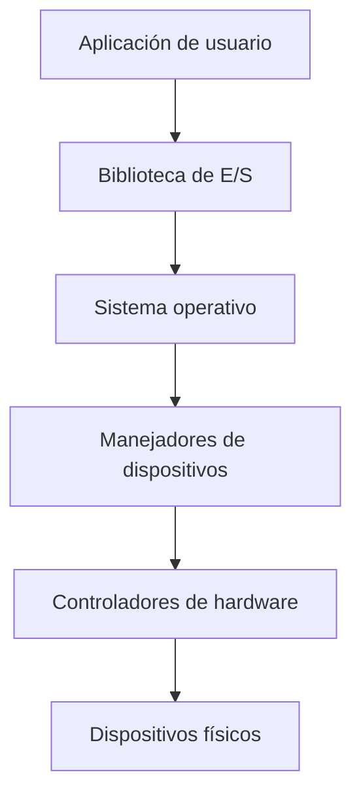
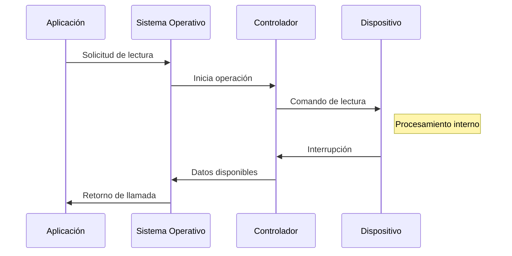
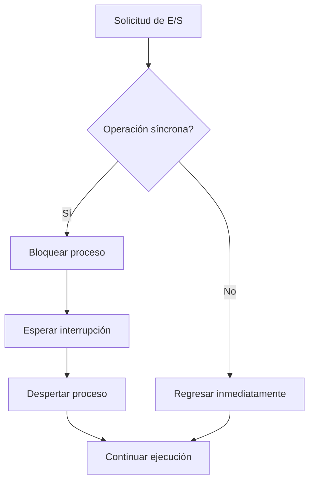

# Sistemas Operativos - Entrada-salida

## 7.1 Problemas de hardware; problemas de software; manejo de discos; manejo de terminales; manejo del reloj.

---

### Introducción a la Gestión de Entrada-Salida

La gestión de Entrada-Salida (E/S) es un componente fundamental de cualquier sistema operativo, responsable de controlar todos los dispositivos de E/S y transferir datos entre la memoria principal y los dispositivos periféricos.

### Problemas de Hardware en E/S

#### Definición y Desafíos

Los problemas de hardware en E/S surgen de la naturaleza heterogénea de los dispositivos periféricos y sus diferentes características:

- **Velocidades variables**: Desde teclados (bytes/segundo) hasta discos duros (Gbytes/segundo)
- **Modos de transferencia**: Por caracter, por bloque, o por paquetes
- **Formatos de datos**: Diferentes codificaciones y estructuras
- **Interfaces diversas**: Puerto serie, USB, SATA, PCIe, etc.

#### Mapeo de Direcciones

Los dispositivos de E/S pueden ser mapeados de dos formas:

1. **E/S mapeada en memoria**: Los registros de dispositivos aparecen como posiciones de memoria
2. **E/S por puertos separados**: Instrucciones especiales para acceder a dispositivos (IN/OUT)

```assembly
; Ejemplo de E/S por puertos en x86
IN AL, 60h     ; Leer del teclado (puerto 60h)
OUT 20h, AL    ; Escribir al controlador de interrupciones
```

#### Control de Dispositivos

Los dispositivos típicamente tienen tres tipos de registros:

1. **Registro de datos**: Para transferir datos
2. **Registro de control**: Para enviar comandos
3. **Registro de estado**: Para verificar el estado del dispositivo

### Problemas de Software en E/S

#### Objetivos del Software de E/S

El software de E/S debe cumplir con varios objetivos fundamentales:

- **Independencia de dispositivos**: Programas que funcionen con diferentes dispositivos
- **Manejo uniforme de errores**: Tratamiento consistente de errores
- **Transferencias síncronas y asíncronas**: Soporte para ambos modos de operación
- **Buffering**: Almacenamiento temporal de datos

#### Niveles de Software de E/S



#### Interrupciones vs. Polling

**Polling**:

```c
// Ejemplo de polling para verificar estado de dispositivo
while ((inb(STATUS_PORT) & BUSY_BIT) != 0) {
    // Esperar activamente
}
// Dispositivo listo, proceder
```

**Interrupciones**:

```c
// Manejador de interrupción
void interrupt_handler(int irq) {
    // Procesar datos del dispositivo
    acknowledge_interrupt(irq);
}
```

### Manejo de Discos

#### Estructura de Discos

Los discos se organizan en:

- **Pistas**: Círculos concéntricos
- **Sectores**: Divisiones angulares (típicamente 512 bytes o 4K)
- **Cilindros**: Conjunto de pistas a misma distancia del centro

#### Planificación de Accesos a Disco

El tiempo total de acceso a disco se calcula como:

$$ T\_{acceso} = T\_{\text{búsqueda}} + T\_{\text{rotación}} + T\_{transferencia} $$

Donde:

- $T\_{\text{búsqueda}}$: Tiempo para mover el cabezal a la pista correcta
- $T\_{\text{rotación}}$: Tiempo de espera hasta que el sector gira bajo el cabezal
- $T\_{transferencia}$: Tiempo para leer/ escribir los datos

##### Algoritmos de Planificación

1. **FCFS (First-Come, First-Served)**: Atiende solicitudes en orden de llegada
2. **SSTF (Shortest Seek Time First)**: Atiende la solicitud más cercana
3. **SCAN**: El brazo se mueve en una dirección sirviendo solicitudes
4. **C-SCAN**: Versión circular de SCAN
5. **LOOK**: Similar a SCAN pero solo hasta la última solicitud
6. **C-LOOK**: Versión circular de LOOK

#### Ejemplo de Planificación

Supongamos solicitudes en cilindros: 98, 183, 37, 122, 14, 124, 65, 67
y posición inicial del cabezal en 53.

**SSTF**:

```python
# Implementación simplificada de SSTF
def sstf(requests, start):
    current = start
    total_seek = 0
    sequence = []

    while requests:
        # Encontrar la solicitud más cercana
        closest = min(requests, key=lambda x: abs(x - current))
        total_seek += abs(closest - current)
        sequence.append(closest)
        current = closest
        requests.remove(closest)

    return sequence, total_seek

requests = [98, 183, 37, 122, 14, 124, 65, 67]
start = 53
sequence, seek_time = sstf(requests.copy(), start)
print(f"Secuencia: {sequence}, Tiempo de búsqueda: {seek_time}")
```

#### RAID (Redundant Array of Independent Disks)

Niveles comunes de RAID:

- **RAID 0**: Striping (distribución sin redundancia)
- **RAID 1**: Mirroring (duplicación de datos)
- **RAID 5**: Striping con paridad distribuida
- **RAID 6**: Similar a RAID 5 con doble paridad

### Manejo de Terminales

#### Características de las Terminales

Las terminales presentan desafíos únicos:

- **Entrada por caracteres**: Teclado genera interrupciones por cada tecla
- **Salida por pantalla**: Requiere gestión eficiente de refresco
- **Buffering de línea**: Edición de línea antes de enviar al sistema

#### Modos de Operación

1. **Modo canónico**: Entrada procesada por líneas
2. **Modo no canónico**: Entrada disponible inmediatamente

#### Dispositivos de Caracteres

En UNIX, las terminales se manejan como archivos especiales de caracteres:

```c
// Ejemplo de lectura/escritura a terminal en C
#include <unistd.h>

int main() {
    char buffer[100];
    // Leer de entrada estándar (terminal)
    ssize_t bytes_read = read(STDIN_FILENO, buffer, sizeof(buffer));

    // Escribir a salida estándar (terminal)
    write(STDOUT_FILENO, buffer, bytes_read);

    return 0;
}
```

### Manejo del Reloj

#### Funciones del Reloj del Sistema

El reloj del sistema proporciona varias funciones críticas:

1. **Mantenimiento de la hora del día**
2. **Prevención de monopolización de procesos**
3. **Accounting**: Medición de uso de recursos
4. **Alarmas para procesos de usuario**
5. **Profiling**: Monitoreo del comportamiento del sistema

#### Implementación del Reloj

La mayoría de sistemas usa:

- **Cristal de cuarzo**: Para precisión
- **Contador de intervalos**: Para generar interrupciones periódicas

#### Temporizadores de Kernel

Los sistemas operativos implementan diferentes tipos de temporizadores:

```c
// Estructura típica de un temporizador en kernel
struct timer_list {
    struct list_head entry;
    unsigned long expires;
    void (*function)(unsigned long);
    unsigned long data;
};
```

#### Algoritmo del Reloj

El algoritmo del reloj (segunda oportunidad) para reemplazo de páginas:

```python
def clock_algorithm(pages, reference_bits):
    pointer = 0
    while True:
        if reference_bits[pointer] == 0:
            return pointer  # Página para reemplazar
        else:
            reference_bits[pointer] = 0  # Dar segunda oportunidad
            pointer = (pointer + 1) % len(pages)
```

### Ejercicios Propuestos

1. **Problema de planificación de disco**: Dadas las solicitudes [38, 180, 130, 10, 50, 15, 190, 90, 150] con cabezal en 100 y dirección hacia valores menores, calcule la secuencia y distancia total para algoritmos SCAN y C-SCAN.

2. **Cálculo de tiempo de acceso a disco**: Un disco gira a 7200 RPM, tiempo de seek promedio de 9ms, y transferencia de 100 MB/s. Calcule el tiempo para leer un sector de 4KB.

3. **Implementación de algoritmo LOOK**: Escriba un programa que implemente el algoritmo LOOK para planificación de disco.

4. **Manejo de interrupciones**: Describa el proceso completo cuando un dispositivo de E/S genera una interrupción, desde la solicitud hasta el retorno a la aplicación.

5. **Problema de buffers**: Analice el problema de productor-consumer aplicado a la gestión de buffers para dispositivos de E/S.

### Diagramas de Referencia





### Referencias

#### Bibliografía Básica

1. Tanenbaum, A. S. (2007). _Modern Operating Systems_ (3rd ed.). Prentice Hall. (Capítulo 5)
2. Silberschatz, A., Galvin, P. B., & Gagne, G. (2008). _Operating Systems Concepts_ (8th ed.). John Wiley and Sons. (Capítulo 13)
3. Stallings, W. (2011). _Operating Systems: Internals and Design Principles_ (7th ed.). Prentice Hall. (Capítulo 11)

#### Bibliografía Complementaria

1. Bach, M. (1986). _The Design of the UNIX Operating System_. Prentice Hall.
2. Bovet, D. P., & Cesati, M. (2000). _Understanding the Linux Kernel_. O'Reilly. (Capítulo 13)

#### Recursos Adicionales

- Documentación del kernel de Linux: https://www.kernel.org/doc/
- Tutoriales sobre gestión de dispositivos: https://www.tldp.org/LDP/tlk/dd/drivers.html
