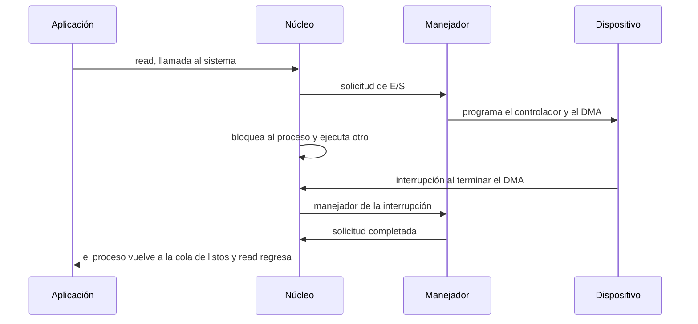

# Sistemas Operativos - Entrada-salida

## 7.1 Problemas de hardware; problemas de software; manejo de discos; manejo de terminales; manejo del reloj.

---

La entrada y salida es la parte más diversa del sistema operativo: un teclado produce unos pocos bytes por segundo, un disco duro 200 MB/s, una unidad NVMe varios GB/s y una tarjeta de red de 100 Gb/s más de 10 GB/s, con interfaces, formatos y errores distintos. El subsistema de E/S debe ocultar esa diversidad tras una interfaz uniforme, aprovechar el paralelismo entre la CPU y los dispositivos, y hacerlo de forma eficiente. Este tema presenta el hardware de E/S, la organización del software en capas, el manejo de discos con su tiempo de acceso, la planificación y RAID, el manejo de terminales y el del reloj.

### Hardware de E/S

Cada dispositivo tiene un **controlador** con **registros** de datos, de estado y de control. La CPU los accede de dos maneras: con **puertos de E/S**, un espacio de direcciones aparte con instrucciones especiales, como `in` y `out` en x86, o con **E/S mapeada en memoria**, en la que los registros aparecen como direcciones de memoria y se usan con instrucciones normales, la forma dominante hoy. Para saber cuándo termina una operación hay tres técnicas:

- **E/S programada** o sondeo (*polling*): la CPU lee el registro de estado en un ciclo hasta que el dispositivo está listo; desperdicia CPU, pero tiene la menor latencia para dispositivos muy rápidos;
- **por interrupciones:** el dispositivo avisa al terminar, y la CPU trabaja en otra cosa mientras tanto;
- **acceso directo a memoria** (DMA): el controlador de DMA copia bloques completos entre el dispositivo y la memoria, e interrumpe una sola vez al final.

Los sistemas de red y almacenamiento rápidos combinan las técnicas: interrumpen con poca carga y sondean con mucha, como NAPI en Linux, para no ahogarse en interrupciones.

### Software de E/S

Los objetivos del software de E/S son la **independencia del dispositivo**, que un programa lea igual de un disco, una memoria USB o una tubería; los **nombres uniformes**; el **manejo de errores** lo más cerca posible del hardware, por ejemplo reintentando una lectura; las transferencias **síncronas**, que bloquean, y **asíncronas**; los **buffers**, y el manejo de dispositivos compartidos y dedicados. Se organiza en capas:

1. **manejadores de interrupciones**, que reconocen la interrupción, guardan el estado y despiertan al manejador correspondiente;
2. **manejadores de dispositivo** (*drivers*), con el código específico de cada controlador;
3. **software independiente del dispositivo**: nombres, protección, buffers, cachés, asignación y reporte de errores;
4. **software en espacio de usuario**: bibliotecas como `stdio` y servicios como la cola de impresión.

### Discos

Un disco duro tiene **platos** que giran a velocidad constante, divididos en **pistas** concéntricas y **sectores** de 512 bytes o 4 KiB, con un **cilindro** formado por las pistas a la misma distancia en todos los platos. El tiempo de acceso es la suma de tres componentes:

$$T_{\text{acceso}} = T_{\text{búsqueda}} + T_{\text{rotación}} + T_{\text{transferencia}}$$

la **búsqueda** mueve el brazo a la pista, unos milisegundos; la **latencia rotacional** espera a que el sector pase bajo la cabeza, en promedio media vuelta, y la **transferencia** lee los datos. Las dos primeras dominan, y por eso el acceso aleatorio es cientos de veces más lento que el secuencial. Los **SSD** no tienen partes móviles: leen en decenas de microsegundos sin importar la posición, pero escriben por páginas y borran por bloques grandes, y su controlador hace la **nivelación de desgaste** y la recolección de basura.

Cuando hay varias solicitudes pendientes, el orden en que se atienden cambia la distancia total de búsqueda:

- **FCFS:** en orden de llegada; justo pero ineficiente;
- **SSTF:** la más cercana a la cabeza; reduce mucho la distancia, pero puede dejar en inanición a las solicitudes lejanas;
- **SCAN**, el algoritmo del elevador: el brazo recorre el disco en una dirección hasta el extremo, atendiendo lo que encuentra, y regresa;
- **C-SCAN:** como SCAN, pero al llegar al extremo vuelve al inicio sin atender, lo que da tiempos de espera más uniformes;
- **LOOK** y **C-LOOK:** como SCAN y C-SCAN, pero solo llegan hasta la última solicitud en cada dirección.

En los SSD la posición no importa, y Linux usa con ellos planificadores simples, como `none` o `mq-deadline`, que solo agrupan y ordenan por plazos.

**RAID** (Patterson, Gibson y Katz, 1988) combina varios discos: RAID 0 reparte los datos en franjas, sin redundancia; RAID 1 los duplica en espejo; RAID 5 reparte franjas con **paridad** distribuida, y tolera la falla de un disco, y RAID 6 usa dos paridades y tolera dos. La paridad de una franja es el XOR de sus bloques, y un bloque perdido se reconstruye con el XOR de los demás.

### Terminales

Una terminal, hoy casi siempre una **pseudoterminal** de un emulador de terminal o una conexión SSH, es un dispositivo de caracteres con una **disciplina de línea** en el núcleo entre el teclado y el programa. En **modo canónico**, la disciplina acumula una línea y procesa los caracteres de edición, retroceso, borrar línea, fin de archivo con Ctrl-D, y genera señales, como `SIGINT` con Ctrl-C; el programa recibe la línea ya editada al pulsar Enter. En **modo no canónico**, o crudo, cada carácter llega de inmediato y sin procesar, como necesitan los editores de pantalla completa y los juegos. Se configura con `termios` o con el comando `stty`. La salida a la pantalla se controla con **secuencias de escape** ANSI para mover el cursor, borrar o cambiar colores.

### Reloj

El hardware de reloj tiene un **oscilador de cuarzo** que decrementa un contador; al llegar a cero genera una **interrupción**, el *tic*, y se recarga. Con los tics, el sistema mantiene la **hora del día**, expulsa al proceso que agotó su **quantum**, contabiliza el **uso de la CPU**, atiende las **alarmas** y los **temporizadores** de los procesos y del núcleo, y hace el **perfilado**. Como hay muchos temporizadores pendientes, se guardan ordenados en una **lista de diferencias**, en la que cada entrada guarda los tics que faltan después de la anterior, de modo que cada tic solo decrementa la cabeza; Linux usa una **rueda de temporizadores** jerárquica, y temporizadores de alta resolución con un árbol rojo-negro. Los núcleos modernos son *tickless*: programan la siguiente interrupción para el próximo temporizador en lugar de interrumpir periódicamente, lo que ahorra energía.



### Implementación en Python

El programa calcula la secuencia y la distancia de seis algoritmos de planificación del disco para el ejercicio 1, incluida la implementación de LOOK del ejercicio 3; el tiempo de acceso del ejercicio 2; simula la lectura con cero, uno y dos buffers para el ejercicio 5; abre una pseudoterminal y le envía la misma secuencia de teclas en modo canónico y no canónico, y simula una lista de temporizadores con diferencias.

```python
import os, termios, select

# ---------- Ejercicios 1 y 3: planificación del disco ----------
SOL, INICIO, MAX = [38, 180, 130, 10, 50, 15, 190, 90, 150], 100, 199
def recorre(orden, inicio=INICIO, saltos=()):
    pos, total, sin_salto = inicio, 0, 0
    for c in orden:
        d = abs(c - pos); total += d; sin_salto += 0 if (pos, c) in saltos else d; pos = c
    return total, sin_salto
def fcfs(s, ini): return list(s), set()
def sstf(s, ini):
    pend, pos, orden = list(s), ini, []
    while pend:
        c = min(pend, key=lambda x: (abs(x - pos), x)); orden.append(c); pend.remove(c); pos = c
    return orden, set()
def scan(s, ini):                                  # hacia abajo hasta el extremo del disco, y de regreso
    menores, mayores = sorted([c for c in s if c < ini], reverse=True), sorted(c for c in s if c >= ini)
    return menores + [0] + mayores, set()
def cscan(s, ini):                                 # hasta 0, salto al otro extremo, y de nuevo hacia abajo
    menores, mayores = sorted([c for c in s if c < ini], reverse=True), sorted((c for c in s if c >= ini), reverse=True)
    return menores + [0, MAX] + mayores, {(0, MAX)}
def look(s, ini):                                  # como SCAN pero solo hasta la última solicitud
    menores, mayores = sorted([c for c in s if c < ini], reverse=True), sorted(c for c in s if c >= ini)
    return menores + mayores, set()
def clook(s, ini):
    menores, mayores = sorted([c for c in s if c < ini], reverse=True), sorted((c for c in s if c >= ini), reverse=True)
    return menores + mayores, {(menores[-1], mayores[0])}
print(f"ejercicios 1 y 3: solicitudes {SOL}, cabezal en {INICIO} hacia abajo, cilindros 0 a {MAX}")
for nombre, alg in (("FCFS", fcfs), ("SSTF", sstf), ("SCAN", scan), ("C-SCAN", cscan), ("LOOK", look), ("C-LOOK", clook)):
    orden, saltos = alg(SOL, INICIO); total, sin = recorre(orden, saltos=saltos)
    extra = f" ({sin} sin contar el regreso)" if saltos else ""
    print(f"   {nombre:6}: {orden} → {total} cilindros{extra}")

# ---------- Ejercicio 2: tiempo de acceso ----------
rpm, busqueda_ms, tasa = 7200, 9.0, 100e6
rotacion_ms = 0.5 * 60_000 / rpm; transf_ms = 4096 / tasa * 1000
print(f"ejercicio 2: búsqueda {busqueda_ms} ms + media vuelta {rotacion_ms:.3f} ms + transferencia de 4 KiB {transf_ms:.4f} ms = {busqueda_ms + rotacion_ms + transf_ms:.3f} ms")
print(f"   lectura secuencial de 100 MB: {100e6 / tasa * 1000:.0f} ms; 25 600 lecturas aleatorias de 4 KiB: {25600 * (busqueda_ms + rotacion_ms + transf_ms) / 1000:.0f} s")

# ---------- Ejercicio 5: buffers entre el dispositivo y el proceso ----------
def simula(n, T, C, buffers, M=1.0):
    """Tiempo para leer (T) y procesar (C) n bloques. Con un buffer del sistema, el proceso copia el bloque (M) y lo libera;
    con dos, el dispositivo llena uno mientras el proceso trabaja sobre el otro."""
    if buffers == 0: return n * (T + C)                                         # el proceso espera cada lectura
    lleno, fin_proc, libre = 0.0, 0.0, [0.0] * buffers
    for k in range(n):
        b = k % buffers
        lleno = max(lleno, libre[b]) + T                                        # el dispositivo llena el buffer b
        inicio = max(lleno, fin_proc)
        if buffers == 1: libre[b] = inicio + M; fin_proc = inicio + M + C      # copia y libera, luego procesa
        else: fin_proc = inicio + C; libre[b] = fin_proc                       # procesa en el buffer y lo libera al final
    return fin_proc
for td, tp in ((10, 10), (10, 4), (4, 10)):
    print(f"ejercicio 5: lectura {td} ms, proceso {tp} ms, 100 bloques: sin buffer {simula(100, td, tp, 0):.0f} ms | "
          f"un buffer, con copia de 1 ms {simula(100, td, tp, 1):.0f} ms | dos buffers {simula(100, td, tp, 2):.0f} ms | cota n · max(T, C) = {100 * max(td, tp)} ms")

# ---------- Terminales: modo canónico y no canónico con una pseudoterminal ----------
maestro, esclavo = os.openpty()
def prueba(canonico, entrada):
    a = termios.tcgetattr(esclavo)
    if canonico: a[3] |= termios.ICANON
    else: a[3] &= ~termios.ICANON; a[6][termios.VMIN], a[6][termios.VTIME] = 1, 0
    a[3] &= ~termios.ECHO; termios.tcsetattr(esclavo, termios.TCSANOW, a)
    os.write(maestro, entrada); leido = b""
    while select.select([esclavo], [], [], 0.2)[0]: leido += os.read(esclavo, 100)
    return leido
tecleo = b"holo\x7fa\n"                                  # "holo", retroceso, "a", Enter
print(f"terminal: se teclea {tecleo!r}; modo canónico entrega {prueba(True, tecleo)!r}; no canónico entrega {prueba(False, tecleo)!r}")

# ---------- Reloj: lista de temporizadores con diferencias, como en Tanenbaum ----------
ahora, vencimientos = 4200, [4203, 4207, 4213, 4215, 4216]
deltas = [v - p for p, v in zip([ahora] + vencimientos, vencimientos)]
print(f"reloj: en t = {ahora}, temporizadores en {vencimientos} → lista de diferencias {deltas}; cada tic solo decrementa la cabeza")
t, lista, disparos = ahora, list(deltas), []
while lista:
    t += 1; lista[0] -= 1
    while lista and lista[0] == 0: lista.pop(0); disparos.append(t)
print(f"   disparos en {disparos}")
```

Salida:

```text
ejercicios 1 y 3: solicitudes [38, 180, 130, 10, 50, 15, 190, 90, 150], cabezal en 100 hacia abajo, cilindros 0 a 199
   FCFS  : [38, 180, 130, 10, 50, 15, 190, 90, 150] → 784 cilindros
   SSTF  : [90, 50, 38, 15, 10, 130, 150, 180, 190] → 270 cilindros
   SCAN  : [90, 50, 38, 15, 10, 0, 130, 150, 180, 190] → 290 cilindros
   C-SCAN: [90, 50, 38, 15, 10, 0, 199, 190, 180, 150, 130] → 368 cilindros (169 sin contar el regreso)
   LOOK  : [90, 50, 38, 15, 10, 130, 150, 180, 190] → 270 cilindros
   C-LOOK: [90, 50, 38, 15, 10, 190, 180, 150, 130] → 330 cilindros (150 sin contar el regreso)
ejercicio 2: búsqueda 9.0 ms + media vuelta 4.167 ms + transferencia de 4 KiB 0.0410 ms = 13.208 ms
   lectura secuencial de 100 MB: 1000 ms; 25 600 lecturas aleatorias de 4 KiB: 338 s
ejercicio 5: lectura 10 ms, proceso 10 ms, 100 bloques: sin buffer 2000 ms | un buffer, con copia de 1 ms 1110 ms | dos buffers 1010 ms | cota n · max(T, C) = 1000 ms
ejercicio 5: lectura 10 ms, proceso 4 ms, 100 bloques: sin buffer 1400 ms | un buffer, con copia de 1 ms 1104 ms | dos buffers 1004 ms | cota n · max(T, C) = 1000 ms
ejercicio 5: lectura 4 ms, proceso 10 ms, 100 bloques: sin buffer 1400 ms | un buffer, con copia de 1 ms 1104 ms | dos buffers 1004 ms | cota n · max(T, C) = 1000 ms
terminal: se teclea b'holo\x7fa\n'; modo canónico entrega b'hola\n'; no canónico entrega b'holo\x7fa\n'
reloj: en t = 4200, temporizadores en [4203, 4207, 4213, 4215, 4216] → lista de diferencias [3, 4, 6, 2, 1]; cada tic solo decrementa la cabeza
   disparos en [4203, 4207, 4213, 4215, 4216]
```

### Ejercicios Propuestos

1. **Planificación del disco.** Con las solicitudes 38, 180, 130, 10, 50, 15, 190, 90 y 150, la cabeza en el cilindro 100 y moviéndose hacia valores menores, calcula la secuencia y la distancia total con SCAN y C-SCAN.

2. **Tiempo de acceso.** Un disco gira a 7 200 RPM, con tiempo de búsqueda promedio de 9 ms y transferencia de 100 MB/s. Calcula el tiempo para leer un sector de 4 KB.

3. **LOOK.** Escribe un programa que implemente el algoritmo LOOK.

4. **Interrupciones.** Describe el proceso completo cuando un dispositivo de E/S genera una interrupción, desde la solicitud hasta el regreso a la aplicación.

5. **Buffers.** Analiza el problema del productor-consumidor aplicado a los buffers de los dispositivos de E/S.

### Soluciones

**Ejercicio 1.** Suponiendo cilindros de 0 a 199, con **SCAN** la cabeza atiende hacia abajo 90, 50, 38, 15 y 10, llega al extremo 0, regresa y atiende 130, 150, 180 y 190: recorre $100 + 190 = 290$ cilindros. Con **C-SCAN**, baja igual hasta 0, salta al extremo 199 y sigue hacia abajo: 190, 180, 150 y 130. Son $100 + 199 + 69 = 368$ cilindros contando el regreso, o 169 sin contarlo; los libros difieren en esta convención, y conviene decir cuál se usa. Como comparación, FCFS recorre 784, SSTF y LOOK 270, y C-LOOK 330, o 150 sin el regreso. C-SCAN recorre más que SCAN, pero trata igual a todas las posiciones: con SCAN, las solicitudes de los extremos esperan hasta dos recorridos completos, y las del centro uno.

**Ejercicio 2.** A 7 200 RPM, una vuelta tarda $60\,000/7\,200 = 8.33$ ms, y la latencia rotacional promedio es media vuelta, 4.17 ms. La transferencia de 4 096 bytes a 100 MB/s tarda 0.041 ms. El total es $9 + 4.17 + 0.04 = 13.21$ ms, casi todo búsqueda y rotación. Por eso, leer 100 MB de forma secuencial tarda 1 s, pero en 25 600 lecturas aleatorias de 4 KiB tarda 338 s: el acceso aleatorio es unas 340 veces más lento.

**Ejercicio 3.** La función `look` del programa separa las solicitudes menores que la posición actual, que atiende en orden descendente porque la cabeza baja, y las mayores, que atiende después en orden ascendente, sin ir hasta los extremos del disco. Con los datos del ejercicio 1 da 90, 50, 38, 15, 10, 130, 150, 180 y 190, con 270 cilindros, 20 menos que SCAN por no llegar al cilindro 0. Para la dirección inicial contraria basta invertir los dos grupos. En un sistema real, las solicitudes llegan mientras se atiende, y la cola se reordena en cada paso.

**Ejercicio 4.** Para un `read` de un archivo:

1. el proceso hace la llamada al sistema; el núcleo verifica los argumentos y busca los datos en la caché de páginas;
2. si no están, el sistema de archivos traduce el desplazamiento a un bloque y envía la solicitud a la capa de bloques, que la ordena con las demás;
3. el manejador programa el controlador con la dirección del bloque y la dirección física del buffer para el DMA;
4. el proceso queda **bloqueado** y el planificador ejecuta otro;
5. al terminar la transferencia, el controlador genera una **interrupción**; la CPU termina la instrucción en curso, cambia a modo núcleo, guarda el estado mínimo y salta al manejador de la interrupción por la tabla de vectores;
6. la parte urgente del manejador, la **mitad superior**, reconoce la interrupción en el controlador y agenda el resto, la **mitad inferior**, que revisa errores, marca la solicitud como terminada y pasa el proceso a la cola de **listos**;
7. cuando el planificador lo elige, el núcleo copia los datos de la caché al buffer del usuario y la llamada **regresa** con el número de bytes leídos.

El diagrama de secuencia de arriba resume el recorrido.

**Ejercicio 5.** El dispositivo es el **productor** de bloques y el proceso el **consumidor**, con los buffers del núcleo como el buffer limitado, y se sincronizan con la interrupción de fin de la E/S y el bloqueo del proceso. Sin buffer, el proceso espera cada lectura y el tiempo es $n\,(T + C):$ 2 000 ms para 100 bloques de 10 ms de lectura y 10 ms de proceso. Con un **buffer** del sistema, el dispositivo lee el bloque siguiente mientras el proceso trabaja con su copia del anterior, a cambio de la copia $M:$ 1 110 ms. Con **dos buffers**, el dispositivo llena uno mientras el proceso usa el otro, sin copia: 1 010 ms, cerca de la cota $n \cdot \max(T, C) = 1\,000.$ Con velocidades distintas, el más lento dicta el ritmo, y los buffers solo absorben las variaciones; un **buffer circular** de más lugares absorbe ráfagas, como en el audio, la red o el teclado. El buffer debe proteger contra el desbordamiento si el productor es más rápido, bloqueando al dispositivo o descartando datos, y contra el vaciado si el consumidor lo es.

El material original incluía el algoritmo del reloj para el reemplazo de páginas en la sección del manejo del reloj, con el que solo comparte el nombre, y atribuía velocidades de gigabytes por segundo a los discos duros, cuando eso corresponde a las unidades NVMe.

### Referencias

1. Tanenbaum, A. S., and Bos, H., _Modern Operating Systems_. 5a ed., Pearson, 2023. Capítulo 5.
2. Silberschatz, A., Galvin, P. B., and Gagne, G., _Operating System Concepts_. 10a ed., Wiley, 2018. Capítulos 11 y 12.
3. Patterson, D. A., Gibson, G., and Katz, R. H., A case for redundant arrays of inexpensive disks (RAID). _SIGMOD_, 1988.
4. Stallings, W., _Operating Systems: Internals and Design Principles_. 9a ed., Pearson, 2018. Capítulo 11.
5. Kerrisk, M., _The Linux Programming Interface_. No Starch Press, 2010. Capítulos 62 y 64.
6. Corbet, J., Rubini, A., and Kroah-Hartman, G., _Linux Device Drivers_. 3a ed., O'Reilly, 2005.
