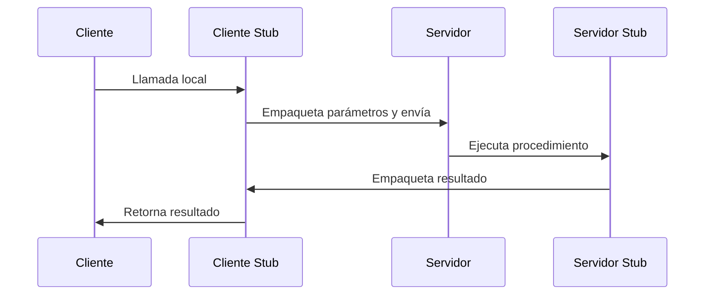
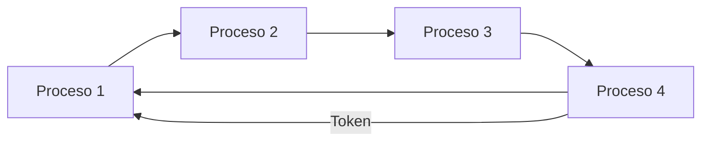
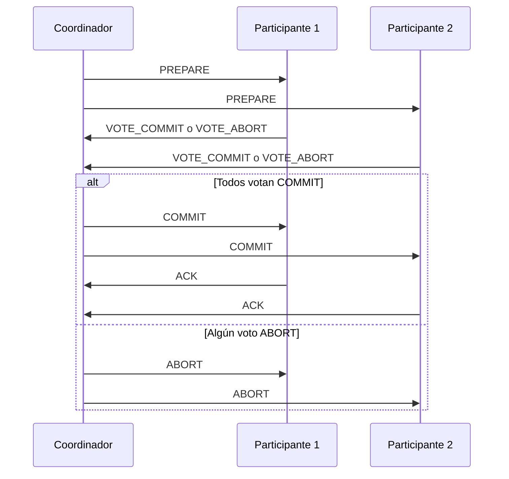

# Sistemas Operativos - Sistemas operativos modernos

## 8.1 Sistemas operativos distribuidos: Características generales; problemas de comunicación en sistemas distribuidos; sincronización.

---

Un sistema operativo distribuido es aquel que gestiona un conjunto de computadoras independientes y las presenta ante los usuarios como un sistema único y coherente. A diferencia de los sistemas centralizados, un sistema distribuido se caracteriza por la ausencia de memoria compartida y relojes globales, lo que introduce desafíos únicos en la comunicación y sincronización.

### Características Generales de los Sistemas Operativos Distribuidos

#### Transparencia

El sistema debe ocultar la naturaleza distribuida de los recursos, presentándose como una sola entidad. Existen varios tipos:

- **Transparencia de acceso**: Acceso uniforme a recursos locales y remotos.
- **Transparencia de ubicación**: Los usuarios no conocen la ubicación física de los recursos.
- **Transparencia de concurrencia**: Múltiples usuarios pueden compartir recursos automáticamente.
- **Transparencia de replicación**: Oculta la existencia de múltiples copias de recursos.

#### Escalabilidad

Capacidad del sistema para crecer y adaptarse a aumentos en la carga de trabajo o número de usuarios. Se logra mediante técnicas como:

- Distribución de funcionalidades
- Replicación de servicios
- Algoritmos descentralizados

#### Tolerancia a Fallos

Capacidad para continuar operando correctamente incluso en presencia de fallos en alguno de sus componentes. Se basa en:

- **Redundancia**: Réplicas de hardware y software.
- **Detección de fallos**: Mecanismos como "heartbeats" o latidos.
- **Recuperación**: Protocolos para restaurar el estado consistente.

#### Flexibilidad

Facilidad para agregar, modificar o quitar componentes sin afectar el funcionamiento general del sistema.

### Problemas de Comunicación en Sistemas Distribuidos

#### Comunicación por Mensajes

La comunicación entre procesos se realiza mediante el intercambio de mensajes a través de una red. Dos modelos principales:

##### Paso de Mensajes Síncrono

El emisor espera hasta que el receptor acepte el mensaje.

```python
# Ejemplo simplificado de envío síncrono
def proceso_emisor():
    mensaje = "Datos importantes"
    resultado = canal_envio_sincrono(destino, mensaje)
    # Espera hasta confirmación de recepción
    if resultado == EXITO:
        print("Mensaje entregado")
```

##### Paso de Mensajes Asíncrono

El emisor continúa inmediatamente después de enviar el mensaje, sin esperar confirmación.

```python
# Ejemplo simplificado de envío asíncrono
def proceso_emisor():
    mensaje = "Datos importantes"
    canal_envio_asincrono(destino, mensaje)
    # Continúa inmediatamente
    realizar_otra_tarea()
```

#### Llamada a Procedimiento Remoto (RPC)

Extiende el concepto de llamada a procedimiento local para invocar funciones en procesos remotos de manera transparente.



#### Problemas Comunes en la Comunicación

##### Latencia de Red

Tiempo que tarda un mensaje en viajar desde el origen al destino. Afecta el rendimiento del sistema.

##### Pérdida de Mensajes

Los mensajes pueden perderse debido a fallos en la red. Requiere mecanismos de retransmisión.

##### Mensajes Duplicados

Pueden llegar múltiples copias del mismo mensaje, necesitando detectores de duplicados.

##### Orden de Mensajes

Los mensajes pueden llegar en un orden diferente al enviado, requiriendo secuenciación.

### Sincronización en Sistemas Distribuidos

#### Relojes y Ordenamiento de Eventos

##### Relojes Físicos

En sistemas distribuidos, mantener la sincronización de relojes es complejo debido a:

- **Deriva de reloj**: Cada reloj avanza a velocidad ligeramente diferente.
- **Algoritmo de Cristian**: Para sincronizar relojes consultando un servidor de tiempo.
  $$
  T_{cliente} = T_{servidor} + \frac{(T_1 - T_0)}{2}
  $$
  Donde:
  - $T_0$: Tiempo cuando el cliente envía la solicitud
  - $T_1$: Tiempo cuando el cliente recibe la respuesta
  - $T_{servidor}$: Tiempo del servidor al responder

##### Relojes Lógicos (Lamport)

Lamport propuso relojes lógicos para establecer un orden causal entre eventos sin necesidad de sincronización física perfecta.

**Algoritmo de Lamport:**

1. Cada proceso mantiene un contador local $C_i$
2. Antes de un evento, incrementa $C_i = C_i + 1$
3. Al enviar un mensaje, incluye su tiempo $t = C_i$
4. Al recibir un mensaje con tiempo $t$, ajusta $C_i = max(C_i, t) + 1$

#### Exclusión Mutua Distribuida

##### Algoritmo Centralizado

Un coordinador central gestiona el acceso a la sección crítica.

**Ventajas:** Simple de implementar.
**Desventajas:** Punto único de fallo.

##### Algoritmo Distribuido (Ricart-Agrawala)

Requiere que los procesos soliciten permiso a todos los demás procesos.

```python
# Esquema del algoritmo Ricart-Agrawala
class Proceso:
    def solicitar_seccion_critica(self):
        reloj_local += 1
        timestamp = reloj_local
        enviar_solicitud(timestamp, id_proceso)
        esperar_respuestas_todos()
        # Entrar a sección crítica

    def recibir_solicitud(self, timestamp_remoto, id_remoto):
        if estado == "SC" or (estado == "SOLICITANDO" and
           (timestamp_local, id_local) < (timestamp_remoto, id_remoto)):
            encolar_solicitud(id_remoto)
        else:
            enviar_respuesta(id_remoto)
```

##### Algoritmo Token Ring

Los procesos se organizan en un anillo lógico y un token circula permitiendo el acceso a la sección crítica.



#### Elección de Coordinador

##### Algoritmo de Bully

Cuando un proceso detecta que el coordinador ha fallado:

1. Envía mensaje de elección a procesos con ID mayor
2. Si no responde nadie, se declara coordinador
3. Si responde alguien, espera mensaje de coordinador

##### Algoritmo de Anillo

Los procesos se organizan en anillo y circulan mensajes de elección hasta determinar el nuevo coordinador.

#### Consistencia y Replicación

##### Protocolo de Two-Phase Commit (2PC)

Para asegurar atomicidad en transacciones distribuidas:



### Ejercicios Propuestos

1. **Problema de Sincronización**: En un sistema distribuido con 5 procesos, aplica el algoritmo de Lamport a la siguiente secuencia:
   - Proceso 1: evento A (local), envía mensaje a P2
   - Proceso 2: recibe mensaje de P1, evento B (local)
   - Proceso 3: evento C (local)
   - Proceso 1: evento D (local)

   Determina los tiempos lógicos de cada evento.

2. **Exclusión Mutua**: Describe paso a paso cómo el algoritmo de Ricart-Agrawala manejaría dos procesos solicitando simultáneamente la sección crítica, donde P1 tiene ID menor que P2.

3. **Two-Phase Commit**: Analiza qué sucede en el protocolo 2PC si:
   a) Un participante falla después de votar COMMIT
   b) El coordinador falla después de recibir todos los votos COMMIT

4. **Sincronización de Relojes**: Un cliente solicita la hora a un servidor a las 10:00:00 (tiempo del cliente). El servidor responde inmediatamente con su hora 10:00:05. El mensaje tarda 2 segundos en llegar en cada dirección. ¿Qué hora debe ajustar el cliente según el algoritmo de Cristian?

### Código de Ejemplo

```python
# Implementación simplificada de reloj lógico de Lamport
class LamportClock:
    def __init__(self):
        self.time = 0

    def increment(self):
        self.time += 1
        return self.time

    def update(self, received_time):
        self.time = max(self.time, received_time) + 1
        return self.time

    def get_time(self):
        return self.time

# Uso del reloj en un proceso distribuido
clock = LamportClock()

# Evento local
timestamp_local = clock.increment()
print(f"Evento local con tiempo: {timestamp_local}")

# Al recibir mensaje con tiempo t
timestamp_recibido = 5  # Ejemplo
nuevo_tiempo = clock.update(timestamp_recibido)
print(f"Tiempo actualizado después de recibir mensaje: {nuevo_tiempo}")
```

### Referencias

#### Bibliografía Básica

1. Tanenbaum, A. S. (2007). _Modern Operating Systems_ (3rd ed.). Prentice Hall. (Capítulos 8-10)
2. Silberschatz, A., Galvin, P. B., & Gagne, G. (2008). _Operating Systems Concepts_ (8th ed.). John Wiley and Sons. (Capítulos 16-18)
3. Tanenbaum, A. S., & Woodhull, A. S. (2006). _Operating Systems: Design and Implementation_ (3rd ed.). Prentice Hall. (Capítulos 10-11)
4. Bic, L., & Shaw, A. (2003). _Operating Systems Principles_. Pearson Education. (Capítulos 12-14)
5. Stallings, W. (2011). _Operating Systems: Internals and Design Principles_ (7th ed.). Prentice Hall. (Capítulos 16-18)

#### Bibliografía Complementaria

1. Bach, M. (1986). _The Design of the UNIX Operating System_. Prentice Hall.
2. Bovet, D. P., & Cesati, M. (2000). _Understanding the Linux Kernel_. O'Reilly.
3. Silberschatz, A., Galvin, P. B., & Gagne, G. (2009). _Operating System Concepts with Java_ (8th ed.). John Wiley and Sons.

#### Recursos Adicionales

- [Distributed Systems: Principles and Paradigms](https://www.distributed-systems.net/) por Andrew S. Tanenbaum
- [Notes on Distributed Systems](https://www.allthingsdistributed.com/) por Werner Vogels (Amazon CTO)
- [Distributed Systems Lecture Notes](https://www.cs.cornell.edu/courses/cs5414/2019sp/) - Universidad de Cornell
