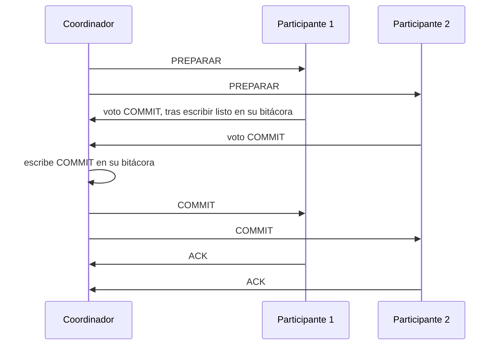

# Sistemas Operativos - Sistemas operativos modernos

## 8.1 Sistemas operativos distribuidos: Características generales; problemas de comunicación en sistemas distribuidos; sincronización.

---

Un **sistema distribuido** es un conjunto de computadoras independientes que se presenta a sus usuarios como un solo sistema coherente. Lamport lo definió con ironía: es aquel en el que la falla de una computadora que ni siquiera sabías que existía puede dejar inutilizable la tuya. Las computadoras no comparten memoria ni reloj, se comunican solo por mensajes que pueden retrasarse, perderse o duplicarse, y fallan de forma independiente. Este tema presenta las metas de los sistemas distribuidos, la comunicación por mensajes y RPC con sus problemas, y la sincronización: relojes físicos y lógicos, exclusión mutua, elección de coordinador y compromiso atómico de transacciones.

### Características

- **Transparencia:** ocultar la distribución, de acceso, ubicación, migración, replicación, concurrencia y fallas; nunca es completa, porque la latencia y las fallas parciales se notan.
- **Escalabilidad:** en tamaño, en extensión geográfica y en administración; se logra evitando componentes centralizados, con replicación, cachés y particionamiento.
- **Tolerancia a fallas:** seguir funcionando cuando fallan partes, con redundancia y recuperación.
- **Apertura y heterogeneidad:** interfaces estándar entre componentes de distintos fabricantes.

Los **sistemas operativos distribuidos** propiamente dichos, como Amoeba, Sprite o Plan 9, gestionaban un conjunto de máquinas como un solo sistema; hoy la distribución vive sobre todo en el **middleware** y en plataformas como Kubernetes, sobre sistemas operativos de red convencionales.

### Comunicación

El **paso de mensajes** puede ser **síncrono**, el emisor se bloquea hasta que el mensaje es recibido, o **asíncrono**, el emisor continúa y el mensaje se guarda en un buffer. La **llamada a procedimiento remoto** (RPC), de Birrell y Nelson (1984), hace que una llamada a otra máquina parezca local: un **talón** en el cliente empaqueta los argumentos, los envía, espera la respuesta y la desempaqueta, y otro en el servidor hace lo inverso. gRPC y REST sobre HTTP son sus formas actuales.

La transparencia de RPC es engañosa, porque la red introduce problemas que no existen localmente:

- **latencia:** una llamada remota tarda de cientos de microsegundos a cientos de milisegundos, millones de veces más que una local;
- **pérdida:** si no llega la respuesta, el cliente no sabe si la solicitud se perdió, si se perdió la respuesta o si el servidor cayó a la mitad; reintentar puede ejecutar dos veces la operación;
- **duplicados:** se detectan con identificadores de solicitud, y se mitigan con operaciones **idempotentes**, que pueden repetirse sin efecto adicional;
- **orden:** los mensajes de distintos emisores pueden llegar en distinto orden a distintos receptores.

Las semánticas posibles son *al menos una vez*, con reintentos; *a lo más una vez*, con detección de duplicados, y *exactamente una vez*, que en general no puede garantizarse ante fallas sin cooperación de la aplicación.

### Relojes físicos

Los relojes de cuarzo se desvían unos $10^{-5}$ a $10^{-6}$ segundos por segundo, del orden de un segundo cada uno a once días, y deben sincronizarse. En el algoritmo de **Cristian** (1989), el cliente pide la hora a un servidor de tiempo en $T_0,$ recibe la respuesta $T_s$ en $T_1$ y, suponiendo que la ida y la vuelta tardan lo mismo, estima

$$T = T_s + \frac{T_1 - T_0}{2}$$

con un error de a lo más la mitad del tiempo de ida y vuelta. El algoritmo de **Berkeley** promedia los relojes de un grupo sin servidor de referencia, y **NTP** organiza servidores en estratos y filtra las mediciones, con precisión de milisegundos en Internet. Un reloj nunca debe retroceder: si va adelantado, se frena poco a poco.

### Relojes lógicos

Para ordenar eventos, a menudo basta saber cuál **pudo causar** a cuál. Lamport (1978) definió la relación **sucedió antes**, $a \to b:$ si $a$ y $b$ son del mismo proceso y $a$ ocurre primero, si $a$ es el envío de un mensaje y $b$ su recepción, o por transitividad. Si ni $a \to b$ ni $b \to a,$ los eventos son **concurrentes**. Los **relojes de Lamport** asignan a cada evento un número $C:$ cada proceso incrementa su contador antes de cada evento, incluidos los envíos, y al recibir un mensaje con marca $t$ hace $C = \max(C, t) + 1.$ Así, $a \to b$ implica $C(a) \lt C(b),$ pero no al revés: un número menor no prueba causalidad. Los **relojes vectoriales** (Fidge, Mattern, 1988) guardan un contador por proceso y cumplen la equivalencia: $a \to b$ si y solo si $V(a) \lt V(b)$ componente a componente. Desempatando con el identificador del proceso, los relojes de Lamport dan un **orden total** consistente con la causalidad.

### Exclusión mutua distribuida

- **Centralizada:** un coordinador concede el permiso; 3 mensajes por entrada, pero es un punto único de falla.
- **Ricart y Agrawala** (1981): quien quiere entrar envía una solicitud con su marca de Lamport a todos y espera $N - 1$ respuestas; un proceso responde de inmediato, salvo si está en la sección crítica o la pidió con una marca menor, en cuyo caso difiere la respuesta hasta salir. Usa $2(N - 1)$ mensajes por entrada y no tiene coordinador, pero la falla de cualquier proceso lo bloquea.
- **Anillo con ficha:** una ficha circula y solo quien la tiene entra; hay que detectar la pérdida de la ficha.

### Elección de coordinador

En el algoritmo del **abusón** (García-Molina, 1982), el proceso que detecta la caída del coordinador envía ELECCIÓN a los de identificador mayor; si nadie responde, se proclama coordinador, y si alguien responde, este toma el relevo, hasta que el mayor vivo gana. En el algoritmo del **anillo**, un mensaje de elección recorre el anillo acumulando identificadores, y gana el mayor.

### Compromiso de dos fases

Una transacción que modifica datos en varias máquinas debe confirmarse en todas o en ninguna. En el **compromiso de dos fases** (2PC), el coordinador pide a los participantes que se **preparen**; cada uno escribe sus cambios y un registro *listo* en su bitácora y vota COMMIT, o vota ABORT. Si todos votaron COMMIT, el coordinador escribe la decisión en su bitácora y envía COMMIT; si alguno votó ABORT o no respondió, envía ABORT. Su debilidad es el **bloqueo**: un participante que votó COMMIT ya no puede decidir solo y debe esperar al coordinador. El compromiso de tres fases y los protocolos de consenso como **Paxos** y **Raft** evitan el bloqueo con una mayoría de réplicas.



### Implementación en Python

El programa calcula los relojes de Lamport y vectoriales del ejercicio 1 y determina qué eventos son concurrentes; simula Ricart-Agrawala con dos solicitudes con la misma marca de tiempo; muestra el estado de los participantes de 2PC en las dos fallas del ejercicio 3; aplica el algoritmo de Cristian al ejercicio 4, y simula una elección por el algoritmo del abusón.

```python
from datetime import datetime, timedelta

# ---------- Ejercicio 1: relojes de Lamport y relojes vectoriales ----------
class Proceso:
    def __init__(self, i, n): self.i, self.L, self.V = i, 0, [0] * n
    def local(self): self.L += 1; self.V[self.i] += 1; return self.L, tuple(self.V)
    def envia(self): return self.local()                     # enviar también es un evento
    def recibe(self, msg):
        L, V = msg; self.L = max(self.L, L) + 1
        self.V = [max(a, b) for a, b in zip(self.V, V)]; self.V[self.i] += 1; return self.L, tuple(self.V)
P = [Proceso(i, 5) for i in range(5)]
ev = {}
ev["A"] = P[0].local(); ev["envío"] = msg = P[0].envia()
ev["recepción"] = P[1].recibe(msg); ev["B"] = P[1].local()
ev["C"] = P[2].local(); ev["D"] = P[0].local()
print("ejercicio 1: evento: (Lamport, vector)")
for k, (L, V) in ev.items(): print(f"   {k:10}: L = {L}, V = {list(V)}")
def antes(a, b): return all(x <= y for x, y in zip(a, b)) and a != b
for x, y in (("A", "B"), ("C", "B"), ("D", "B")):
    va, vb = ev[x][1], ev[y][1]
    rel = "→" if antes(va, vb) else "←" if antes(vb, va) else "‖"
    print(f"   {x} {rel} {y}{', concurrentes' if rel == '‖' else ''} (Lamport {ev[x][0]} y {ev[y][0]})")

# ---------- Ejercicio 2: Ricart-Agrawala con dos solicitudes simultáneas ----------
def ricart_agrawala(solicitudes, n):
    """solicitudes: {proceso: marca de tiempo}. Devuelve la traza de mensajes y el orden de entrada."""
    traza, diferidas, respuestas = [], {p: [] for p in range(1, n + 1)}, {p: 0 for p in solicitudes}
    for p, t in solicitudes.items():
        for q in range(1, n + 1):
            if q != p: traza.append(f"P{p}→P{q} SOLICITUD({t}, {p})")
    for p, t in solicitudes.items():                         # cada proceso decide ante cada solicitud recibida
        for q in range(1, n + 1):
            if q == p: continue
            if q in solicitudes and (solicitudes[q], q) < (t, p):
                diferidas[q].append(p); traza.append(f"P{q} difiere a P{p}: ({solicitudes[q]}, {q}) < ({t}, {p})")
            else: respuestas[p] += 1; traza.append(f"P{q}→P{p} RESPUESTA")
    orden = []
    for p in sorted(solicitudes, key=lambda p: (solicitudes[p], p)):
        respuestas[p] += sum(1 for q in orden if p in diferidas[q])
        if respuestas[p] == n - 1: orden.append(p); traza.append(f"P{p} entra a la sección crítica")
        for d in diferidas[p]: traza.append(f"P{p} sale y envía la RESPUESTA diferida a P{d}")
        for d in diferidas[p]:
            respuestas[d] += 1
            if respuestas[d] == n - 1 and d not in orden: orden.append(d); traza.append(f"P{d} entra a la sección crítica")
    return traza, orden
traza, orden = ricart_agrawala({1: 8, 2: 8}, 3)
print("ejercicio 2: P1 y P2 piden con la misma marca de tiempo 8, con P3 sin interés")
for t in traza: print("   " + t)
print(f"   orden de entrada {['P' + str(p) for p in orden]}; mensajes por entrada 2(N − 1) = {2 * (3 - 1)}")

# ---------- Ejercicio 3: 2PC con fallas ----------
def dos_fases(falla):
    log = {"C": [], "P1": [], "P2": []}; estado = {}
    for p in ("P1", "P2"): log[p].append("listo"); estado[p] = "votó COMMIT, incierto"
    if falla == "participante":
        estado["P1"] = "caído tras votar"; log["C"].append("commit"); estado["P2"] = "COMMIT"
        estado["P1"] = "al reiniciar lee 'listo' en su bitácora, pregunta al coordinador → COMMIT"
    elif falla == "coordinador":
        estado["C"] = "caído con los dos votos, sin escribir la decisión"
        for p in ("P1", "P2"): estado[p] = "BLOQUEADO: votó COMMIT, no puede decidir solo ni con el otro participante"
    return estado
print("ejercicio 3a:", dos_fases("participante"))
print("ejercicio 3b:", dos_fases("coordinador"))

# ---------- Ejercicio 4: algoritmo de Cristian ----------
T0 = datetime(2026, 1, 1, 10, 0, 0); ida = vuelta = timedelta(seconds=2)
T_serv = datetime(2026, 1, 1, 10, 0, 5); T1 = T0 + ida + vuelta                 # según el reloj del cliente
estimada = T_serv + (T1 - T0) / 2
print(f"ejercicio 4: el cliente envía a las {T0:%H:%M:%S}, recibe a las {T1:%H:%M:%S} de su reloj; el servidor dijo {T_serv:%H:%M:%S}")
print(f"   hora estimada = {T_serv:%H:%M:%S} + RTT/2 ({(T1 - T0).seconds / 2:.0f} s) = {estimada:%H:%M:%S}; el reloj del cliente va {(estimada - T1).seconds} s atrasado")

# ---------- Elección por el abusón ----------
def abuson(vivos, detecta):
    traza, candidato = [], detecta
    while True:
        mayores = [q for q in vivos if q > candidato]
        traza.append(f"P{candidato} envía ELECCIÓN a {['P' + str(q) for q in sorted(q for q in range(candidato + 1, 8))]}")
        if not mayores: traza.append(f"nadie mayor responde: P{candidato} anuncia COORDINADOR"); return traza
        traza.append(f"responden {['P' + str(q) for q in mayores]}; toma el relevo P{min(mayores)}"); candidato = min(mayores)
print("elección: procesos 1 a 7, cae el coordinador P7, P4 lo detecta")
for t in abuson([1, 2, 3, 4, 5, 6], 4): print("   " + t)
```

Salida:

```text
ejercicio 1: evento: (Lamport, vector)
   A         : L = 1, V = [1, 0, 0, 0, 0]
   envío     : L = 2, V = [2, 0, 0, 0, 0]
   recepción : L = 3, V = [2, 1, 0, 0, 0]
   B         : L = 4, V = [2, 2, 0, 0, 0]
   C         : L = 1, V = [0, 0, 1, 0, 0]
   D         : L = 3, V = [3, 0, 0, 0, 0]
   A → B (Lamport 1 y 4)
   C ‖ B, concurrentes (Lamport 1 y 4)
   D ‖ B, concurrentes (Lamport 3 y 4)
ejercicio 2: P1 y P2 piden con la misma marca de tiempo 8, con P3 sin interés
   P1→P2 SOLICITUD(8, 1)
   P1→P3 SOLICITUD(8, 1)
   P2→P1 SOLICITUD(8, 2)
   P2→P3 SOLICITUD(8, 2)
   P2→P1 RESPUESTA
   P3→P1 RESPUESTA
   P1 difiere a P2: (8, 1) < (8, 2)
   P3→P2 RESPUESTA
   P1 entra a la sección crítica
   P1 sale y envía la RESPUESTA diferida a P2
   P2 entra a la sección crítica
   orden de entrada ['P1', 'P2']; mensajes por entrada 2(N − 1) = 4
ejercicio 3a: {'P1': "al reiniciar lee 'listo' en su bitácora, pregunta al coordinador → COMMIT", 'P2': 'COMMIT'}
ejercicio 3b: {'P1': 'BLOQUEADO: votó COMMIT, no puede decidir solo ni con el otro participante', 'P2': 'BLOQUEADO: votó COMMIT, no puede decidir solo ni con el otro participante', 'C': 'caído con los dos votos, sin escribir la decisión'}
ejercicio 4: el cliente envía a las 10:00:00, recibe a las 10:00:04 de su reloj; el servidor dijo 10:00:05
   hora estimada = 10:00:05 + RTT/2 (2 s) = 10:00:07; el reloj del cliente va 3 s atrasado
elección: procesos 1 a 7, cae el coordinador P7, P4 lo detecta
   P4 envía ELECCIÓN a ['P5', 'P6', 'P7']
   responden ['P5', 'P6']; toma el relevo P5
   P5 envía ELECCIÓN a ['P6', 'P7']
   responden ['P6']; toma el relevo P6
   P6 envía ELECCIÓN a ['P7']
   nadie mayor responde: P6 anuncia COORDINADOR
```

### Ejercicios Propuestos

1. **Relojes de Lamport.** En un sistema con 5 procesos, P1 tiene un evento local A y envía un mensaje a P2; P2 recibe el mensaje y tiene un evento local B; P3 tiene un evento local C, y P1 tiene un evento local D. Determina los tiempos lógicos de cada evento.

2. **Exclusión mutua.** Describe paso a paso cómo maneja el algoritmo de Ricart-Agrawala dos procesos que solicitan la sección crítica simultáneamente, si P1 tiene un identificador menor que P2.

3. **Compromiso de dos fases.** ¿Qué sucede en 2PC si un participante falla después de votar COMMIT? ¿Y si el coordinador falla después de recibir todos los votos COMMIT?

4. **Sincronización de relojes.** Un cliente pide la hora a un servidor a las 10:00:00 según su reloj. El servidor responde de inmediato con su hora, 10:00:05, y el mensaje tarda 2 segundos en cada dirección. ¿Qué hora debe ajustar el cliente según el algoritmo de Cristian?

### Soluciones

**Ejercicio 1.** Con la regla de incrementar antes de cada evento, y contando el envío como evento, P1 tiene A en 1 y el envío en 2; P2 recibe con $\max(0, 2) + 1 = 3$ y tiene B en 4; P3 tiene C en 1, y P1 tiene D en 3. Si el envío se considera parte de A, el mensaje lleva 1, la recepción es 2 y B es 3. Los relojes vectoriales del programa muestran algo que Lamport no puede: $A \to B,$ porque hay una cadena de mensajes, pero C y D son **concurrentes** con B, aunque $C(D) = 3 \lt 4 = C(B):$ el número menor de D no significa que haya ocurrido antes en un sentido causal. P4 y P5 no participan y conservan su reloj en 0.

**Ejercicio 2.** Supón que P1 y P2 piden la sección crítica con la misma marca de Lamport, 8, en un sistema de 3 procesos. Cada uno envía su solicitud a los otros dos. P3, que no está interesado, responde a ambos. P2 recibe la solicitud (8, 1) de P1 y la compara con la suya, (8, 2): como $(8, 1) \lt (8, 2),$ P1 tiene prioridad, y P2 le **responde**. P1 recibe la solicitud (8, 2) de P2: como la suya es menor, la **difiere**. P1 reúne sus 2 respuestas y entra; P2 tiene solo la de P3 y espera. Al salir, P1 envía la respuesta diferida a P2, que completa sus 2 respuestas y entra. El desempate por identificador hace que el orden sea total, y la regla garantiza la exclusión mutua y la ausencia de inanición, porque las marcas crecen. Se usaron $2(N - 1) = 4$ mensajes por entrada.

**Ejercicio 3.** **a)** Un participante que cae después de votar COMMIT ya escribió *listo* en su bitácora, con sus cambios. El coordinador, que recibió todos los votos, decide COMMIT y lo reintenta con el participante caído. Al reiniciar, este encuentra *listo* sin decisión en su bitácora, no puede abortar por su cuenta porque ya prometió confirmar, y pregunta al coordinador, que le responde COMMIT. La transacción se confirma en todos. **b)** Si el coordinador cae después de recibir los votos pero antes de escribir y enviar la decisión, los participantes quedan **bloqueados** en estado incierto: votaron COMMIT, así que no pueden abortar, porque el coordinador podría haber decidido confirmar, ni confirmar, porque podría haber decidido abortar por un tiempo de espera. Preguntarse entre ellos solo ayuda si alguno recibió la decisión o no votó COMMIT; si todos votaron y nadie la recibió, deben esperar a que el coordinador se recupere, reteniendo los cerrojos de los datos. Es la limitación fundamental de 2PC, que el compromiso de tres fases y Paxos Commit resuelven.

**Ejercicio 4.** El cliente envía en $T_0 =$ 10:00:00 de su reloj; la solicitud tarda 2 s, el servidor responde con 10:00:05, y la respuesta tarda otros 2 s, de modo que el cliente la recibe en $T_1 =$ 10:00:04 de su reloj. Cristian estima $10{:}00{:}05 + (T_1 - T_0)/2 = 10{:}00{:}05 + 2\,\text{s} =$ **10:00:07**. Como su reloj marca 10:00:04, el cliente está 3 s atrasado y debe adelantarse; adelantar es seguro, pero si estuviera adelantado debería frenar poco a poco para no hacer retroceder el tiempo. La estimación es exacta aquí porque la ida y la vuelta tardan lo mismo; si no, el error sería a lo más la mitad del tiempo de ida y vuelta, 2 s.

El código de Ricart-Agrawala del material original no actualizaba el reloj de Lamport al recibir una solicitud, lo que puede violar el orden causal.

### Referencias

1. Tanenbaum, A. S., and van Steen, M., _Distributed Systems_. 4a ed., 2023. Capítulos 4 a 8.
2. Lamport, L., Time, clocks, and the ordering of events in a distributed system. _Communications of the ACM_ 21(7), 1978.
3. Ricart, G., and Agrawala, A. K., An optimal algorithm for mutual exclusion in computer networks. _Communications of the ACM_ 24(1), 1981.
4. Cristian, F., Probabilistic clock synchronization. _Distributed Computing_ 3, 1989.
5. Garcia-Molina, H., Elections in a distributed computing system. _IEEE Transactions on Computers_ C-31(1), 1982.
6. Birrell, A. D., and Nelson, B. J., Implementing remote procedure calls. _ACM Transactions on Computer Systems_ 2(1), 1984.
7. Gray, J., and Lamport, L., Consensus on transaction commit. _ACM Transactions on Database Systems_ 31(1), 2006.
