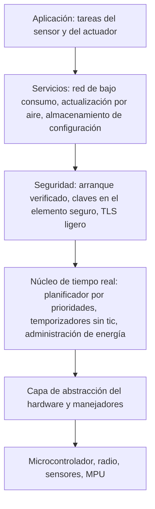

# Sistemas Operativos - Sistemas operativos modernos

## 8.2 Nuevas arquitecturas para los sistemas operativos

---

Las estructuras clásicas de los sistemas operativos, monolítica, por capas y micronúcleo (tema 1.4), se diseñaron para computadoras con uno o pocos procesadores, memoria uniforme y usuarios humanos. El hardware y el uso cambiaron: procesadores con decenas o cientos de núcleos y memoria no uniforme, aceleradores como GPU y TPU, teléfonos con batería, millones de dispositivos de IoT con kilobytes de memoria, centros de datos donde casi todo corre en máquinas virtuales o contenedores, y amenazas de seguridad que exigen aislamiento fuerte. Este tema presenta las arquitecturas que responden a esos cambios: exonúcleos, multinúcleos, sistemas para móviles, IoT y nube, unikernels y sistemas para contenedores, y arquitecturas orientadas a la seguridad con capacidades y ejecución confiable.

### Exonúcleos

El **exonúcleo** (Engler, Kaashoek y O'Toole, 1995) lleva al extremo la separación de mecanismo y política: el núcleo solo **protege** y **multiplexa** el hardware, asignando bloques de disco, marcos de memoria o tiempo de CPU con verificación de propiedad, y las abstracciones, archivos, procesos, memoria virtual, las implementa cada aplicación con un **sistema operativo de biblioteca** (libOS). Una base de datos puede administrar su propio caché y el orden de sus escrituras sin pelear con las políticas genéricas del núcleo. Las ideas reaparecen hoy en las pilas de red y almacenamiento en espacio de usuario, como DPDK y SPDK, y en los unikernels.

### Multinúcleos

Con muchos núcleos, compartir estructuras del núcleo protegidas por cerrojos deja de escalar: el tráfico de coherencia de las cachés domina. El **multinúcleo** (*multikernel*), propuesto con Barrelfish (Baumann y otros, 2009), trata a la máquina como un **sistema distribuido**: un núcleo independiente por procesador, sin memoria compartida entre ellos, que se comunican por **mensajes** y **replican** el estado del sistema, como en el tema 8.1. Los sistemas comerciales siguen siendo de memoria compartida, pero han adoptado técnicas parecidas: estructuras por núcleo, RCU, colas de planificación por núcleo, y planificación consciente de NUMA y de la jerarquía de cachés.

### Móviles, IoT y nube

- **Móviles:** Android usa un núcleo Linux con una capa de abstracción del hardware, el entorno de ejecución ART y un marco de aplicaciones, con cada aplicación en su propio usuario y su caja de arena; iOS usa XNU. La prioridad es la **energía**: estados de suspensión agresivos, planificación consciente de núcleos grandes y pequeños, como ARM big.LITTLE, y límites a la ejecución en segundo plano.
- **IoT:** sistemas de tiempo real para microcontroladores con kilobytes de memoria, como FreeRTOS, Zephyr y RIOT. No suelen tener MMU, así que el aislamiento, si lo hay, viene de una unidad de protección de memoria, MPU, o de TrustZone-M; la configuración se fija al compilar para incluir solo lo necesario, y la energía obliga a dormir casi siempre y despertar por interrupciones.
- **Nube:** el sistema anfitrión es un hipervisor (tema 1.2), y los huéspedes, sistemas Linux mínimos, configurados automáticamente al arrancar y desechables. Para contenedores existen distribuciones mínimas e **inmutables**, con actualizaciones atómicas de toda la imagen y una partición de respaldo, como Fedora CoreOS, Flatcar y Bottlerocket, sucesoras de CoreOS Container Linux, que terminó su soporte en 2020.

### Unikernels

Un **unikernel** (Madhavapeddy y otros, 2013) compila una sola aplicación con solo las partes del sistema operativo que necesita, en una imagen que se ejecuta directamente sobre un hipervisor, en un único espacio de direcciones y sin distinción de modos. Las imágenes son de unos pocos megabytes, arrancan en milisegundos y tienen una superficie de ataque pequeña, porque no hay intérprete de comandos ni servicios innecesarios. A cambio, depurarlas es difícil y cada cambio requiere recompilar. MirageOS, Unikraft y OSv son ejemplos.

### Aceleradores y muchos núcleos

Los sistemas tratan cada vez más a las **GPU** y otros aceleradores como recursos de primera clase: memoria unificada con traducción de direcciones compartida, planificación y expropiación de trabajos en la GPU, y aislamiento entre clientes, como la partición MIG de las GPU de NVIDIA. En los procesadores de muchos núcleos, la **afinidad** es esencial: mantener una tarea en el mismo núcleo, o al menos en el mismo grupo que comparte caché, conserva sus datos calientes, y el **balance de carga** debe migrar tareas solo cuando el desequilibrio compensa el costo de enfriar sus cachés.

### Seguridad por diseño

- **Capacidades:** en lugar de verificar la identidad del solicitante contra una ACL, el acceso se concede a quien presenta una capacidad para el objeto (tema 5.1). seL4 se basa por completo en capacidades, y **CHERI** (Watson y otros, 2015) lleva las capacidades al hardware: los punteros llevan límites y permisos que el procesador verifica, lo que elimina clases enteras de errores de memoria; Arm Morello es un prototipo de ese diseño.
- **Verificación formal:** núcleos con demostraciones matemáticas de corrección, como seL4.
- **Lenguajes seguros:** Rust en el núcleo de Linux desde 2022 y en Windows, para evitar errores de memoria.
- **Ejecución confiable:** **enclaves** y máquinas virtuales confidenciales que protegen el código y los datos incluso del sistema operativo y del hipervisor, como Intel SGX y TDX, AMD SEV-SNP y Arm CCA, y el **TPM**, un chip que guarda claves y mide la cadena de arranque para la atestación remota. Intel retiró SGX de sus procesadores de consumo desde la undécima generación, y los ataques de canal lateral han mostrado los límites de los enclaves.


### Implementación en Python

El programa calcula la eficiencia y la aceleración del ejercicio 3, con el efecto adicional de la ley de Amdahl; implementa el planificador con afinidad, prioridades y balance de carga del ejercicio 4 y lo compara con una asignación al azar en 16 núcleos en grupos de 4 que comparten caché, con tareas que se bloquean y despiertan, y simula el problema del diputado confundido con ACL y con capacidades para el ejercicio 5.

```python
import heapq, random

# ---------- Ejercicio 3: eficiencia y aceleración con 64 núcleos ----------
n, sobrecarga = 64, 0.15
eficiencia = 1 - sobrecarga                                   # útil / (útil + sobrecarga), con la sobrecarga como fracción del total
print(f"ejercicio 3: eficiencia = (1 − 0.15) / 1 = {eficiencia:.2f}; aceleración efectiva = {eficiencia:.2f} × {n} = {eficiencia * n:.1f}")
for serial in (0.01, 0.05):
    print(f"   con además una parte secuencial de {serial:.0%}, Amdahl limita la aceleración a {1 / (serial + (1 - serial) / n):.1f} con {n} núcleos")

# ---------- Ejercicio 4: planificador con afinidad, prioridades y balance de carga ----------
class Planificador:
    def __init__(self, nucleos=16, por_grupo=4, afinidad=True):
        self.grupos = [list(range(g, g + por_grupo)) for g in range(0, nucleos, por_grupo)]
        self.colas = {c: [] for c in range(nucleos)}           # una cola de prioridad por núcleo
        self.afinidad, self.ultimo, self.secuencia = afinidad, {}, 0
        self.calientes = self.frias = self.migraciones = 0
    def grupo_de(self, c): return c // len(self.grupos[0])
    def carga(self, c): return len(self.colas[c])
    def encola(self, tarea, prioridad, rng):
        if self.afinidad and tarea in self.ultimo:             # 1) preferir el último núcleo, 2) su grupo, 3) el menos cargado
            previo = self.ultimo[tarea]; grupo = self.grupos[self.grupo_de(previo)]
            c = previo if self.carga(previo) <= min(map(self.carga, grupo)) + 1 else min(grupo, key=self.carga)
            if min(map(self.carga, self.colas)) + 2 < self.carga(c): c = min(self.colas, key=self.carga)   # balance global
        elif self.afinidad: c = min(self.colas, key=self.carga)
        else: c = rng.randrange(len(self.colas))
        self.secuencia += 1; heapq.heappush(self.colas[c], (-prioridad, self.secuencia, tarea))
    def ejecuta_un_turno(self):
        corridas = []
        for c, cola in self.colas.items():
            if not cola: continue
            _, _, tarea = heapq.heappop(cola); previo = self.ultimo.get(tarea)
            if previo is None or previo == c: self.calientes += previo is not None
            elif self.grupo_de(previo) == self.grupo_de(c): self.calientes += 1        # caché L2/L3 compartida
            else: self.frias += 1; self.migraciones += 1
            self.ultimo[tarea] = c; corridas.append(tarea)
        return corridas
def experimento(afinidad, semilla=0, tareas=48, turnos=300):
    rng = random.Random(semilla); p = Planificador(afinidad=afinidad); prioridad = {t: rng.randint(1, 10) for t in range(tareas)}
    dormidas = []                                                                # (turno en que despierta, tarea)
    for t in range(tareas): p.encola(t, prioridad[t], rng)
    for turno in range(turnos):
        for t in p.ejecuta_un_turno():
            if rng.random() < 0.2: dormidas.append((turno + rng.randint(1, 6), t))   # espera E/S unos turnos
            else: p.encola(t, prioridad[t], rng)                                     # sigue lista
        for d in [d for d in dormidas if d[0] == turno]: dormidas.remove(d); p.encola(d[1], prioridad[d[1]], rng)
    total = p.calientes + p.frias; cargas = [p.carga(c) for c in p.colas]
    return p.calientes / total, p.migraciones, max(cargas) - min(cargas)
for afin in (True, False):
    calor, migr, desbalance = experimento(afin)
    print(f"ejercicio 4: {'con afinidad y balance' if afin else 'asignación al azar   '}: ejecuciones con caché caliente {calor:.1%}, "
          f"migraciones entre grupos {migr}, diferencia de carga final {desbalance}")

# ---------- Ejercicio 5: el diputado confundido, con ACL y con capacidades ----------
ACL = {"/sys/facturacion": {"compilador"}, "/home/ana/salida.o": {"ana", "compilador"}}
def compilador_acl(salida_pedida):                            # el servicio escribe con SUS permisos
    return "escribe" if "compilador" in ACL[salida_pedida] else "negado"
def compilador_cap(capacidad):                                # el servicio escribe con la capacidad que le da el cliente
    objeto, derechos = capacidad
    return f"escribe {objeto}" if "escribir" in derechos else "negado"
caps_de_ana = {"/home/ana/salida.o": ("/home/ana/salida.o", {"escribir"})}
print("ejercicio 5: Ana pide al compilador que escriba su resultado en /sys/facturacion")
print(f"   con ACL: el compilador tiene permiso sobre la facturación → {compilador_acl('/sys/facturacion')} (¡la sobrescribe por encargo de Ana!)")
cap = caps_de_ana.get("/sys/facturacion")
print(f"   con capacidades: Ana no tiene una capacidad para /sys/facturacion → {'no puede pedirlo' if cap is None else compilador_cap(cap)}; "
      f"con la suya: {compilador_cap(caps_de_ana['/home/ana/salida.o'])}")
```

Salida:

```text
ejercicio 3: eficiencia = (1 − 0.15) / 1 = 0.85; aceleración efectiva = 0.85 × 64 = 54.4
   con además una parte secuencial de 1%, Amdahl limita la aceleración a 39.3 con 64 núcleos
   con además una parte secuencial de 5%, Amdahl limita la aceleración a 15.4 con 64 núcleos
ejercicio 4: con afinidad y balance: ejecuciones con caché caliente 99.7%, migraciones entre grupos 16, diferencia de carga final 1
ejercicio 4: asignación al azar   : ejecuciones con caché caliente 25.6%, migraciones entre grupos 2890, diferencia de carga final 7
ejercicio 5: Ana pide al compilador que escriba su resultado en /sys/facturacion
   con ACL: el compilador tiene permiso sobre la facturación → escribe (¡la sobrescribe por encargo de Ana!)
   con capacidades: Ana no tiene una capacidad para /sys/facturacion → no puede pedirlo; con la suya: escribe /home/ana/salida.o
```

### Ejercicios Propuestos

1. **Comparación.** Compara un exonúcleo con un micronúcleo tradicional, con tres ventajas y tres desventajas de cada uno.

2. **Diseño para IoT.** Diseña la arquitectura de un sistema operativo para dispositivos de IoT considerando las restricciones de energía, los requisitos de seguridad y las limitaciones de memoria, con un diagrama.

3. **Eficiencia.** En un sistema con 64 núcleos, si la comunicación representa el 15 % del tiempo total de ejecución, ¿cuál es la eficiencia, definida como trabajo útil entre trabajo útil más comunicación?

4. **Planificador con afinidad.** Escribe un planificador de tareas para un sistema de muchos núcleos con afinidad, que considere grupos de núcleos con caché compartida, prioridades de las tareas y balance de carga.

5. **Capacidades.** Analiza cómo una arquitectura basada en capacidades mejora la seguridad frente a las listas de control de acceso, con un ejemplo concreto.

### Soluciones

**Ejercicio 1.** Ambos reducen el núcleo, pero en direcciones distintas: el micronúcleo saca los **servicios** a procesos servidores con abstracciones fijas, y el exonúcleo saca las **abstracciones** mismas a bibliotecas dentro de cada aplicación.

| | Exonúcleo | Micronúcleo |
| - | --------- | ----------- |
| Ventajas | cada aplicación elige sus políticas, como el reemplazo de páginas o la disposición en disco; sin cruces de proceso para usar un servicio, solo llamadas a la biblioteca; núcleo muy pequeño | servicios aislados que pueden fallar y reiniciarse; abstracciones comunes que comparten todas las aplicaciones; núcleo pequeño y verificable, como seL4 |
| Desventajas | cada aplicación, o su biblioteca, carga con la complejidad de la gestión; compartir recursos entre aplicaciones con libOS distintas es difícil, como dos sistemas de archivos sobre los mismos bloques; poca adopción y herramientas | el costo del IPC en cada servicio; las políticas de los servidores siguen siendo genéricas; diseñar los protocolos entre servidores es complejo |

**Ejercicio 2.** Un diseño en capas para un microcontrolador de 256 KiB de memoria flash y 64 KiB de RAM:



Las decisiones responden a cada restricción. Para la **energía**, un núcleo sin tic periódico que duerme en el estado más profundo posible hasta la siguiente interrupción o temporizador, manejadores que apagan los periféricos sin uso y una radio que transmite en ráfagas. Para la **memoria**, todo se configura al compilar, sin asignación dinámica en tiempo de ejecución, con pilas de tamaño fijo por tarea y solo los componentes usados, como hace Zephyr con Kconfig. Para la **seguridad**, arranque verificado con firmas, actualizaciones por aire firmadas y con respaldo para revertir, aislamiento de las tareas con la MPU, claves en un elemento seguro o en TrustZone-M y comunicación cifrada.

**Ejercicio 3.** Si la comunicación es el 15 % del tiempo total, el trabajo útil es el 85 %, y la eficiencia es $0.85/(0.85 + 0.15) = 0.85.$ El número de núcleos no aparece en la fórmula: interviene al calcular la **aceleración** efectiva, $0.85 \times 64 = 54.4,$ es decir, los 64 núcleos rinden como 54.4 trabajando sin sobrecarga. Si además hay una parte secuencial, la ley de Amdahl, $1/(s + (1 - s)/n),$ es mucho más severa: con solo 1 % secuencial la aceleración máxima con 64 núcleos es 39.3, y con 5 %, 15.4.

**Ejercicio 4.** El planificador del programa tiene una cola de prioridad por núcleo, de modo que cada núcleo elige siempre su tarea de mayor prioridad sin tocar las colas de los demás, y decide dónde encolar una tarea que vuelve a estar lista en tres pasos: su último núcleo, si no está más cargado que el resto de su grupo; si no, el núcleo menos cargado del **mismo grupo**, que comparte la caché; y solo si el desequilibrio global supera un umbral, el núcleo menos cargado del sistema. Con 48 tareas en 16 núcleos, con tareas que se bloquean y despiertan, el 99.7 % de las ejecuciones encuentra la caché caliente, con 16 migraciones entre grupos y cargas casi iguales; la asignación al azar solo encuentra la caché caliente el 25.6 % de las veces, la probabilidad de caer en el mismo grupo, con 2 890 migraciones y cargas desiguales. El umbral es el compromiso entre afinidad y balance: Linux usa una idea parecida con sus **dominios de planificación**, que balancean con más frecuencia dentro de un grupo de caché que entre nodos NUMA. El código del material original asignaba a la siguiente tarea de la cola a cualquier núcleo que se liberara, sin considerar su afinidad ni su prioridad.

**Ejercicio 5.** Con ACL, el sistema decide según **quién** pide el acceso, y un servicio que actúa por encargo de otros usa sus propios permisos. Es el problema del **diputado confundido** (Hardy, 1988): un compilador con permiso para escribir el archivo de facturación, para registrar el uso, acepta que el usuario indique dónde escribir su resultado; Ana le pide escribir en el archivo de facturación, y el compilador, con su permiso legítimo, lo sobrescribe, como muestra el programa. Ninguna ACL está mal configurada: el problema es que la **autoridad** y la **designación** del objeto viajan por separado. Con capacidades, Ana no pasa un nombre sino una capacidad para el archivo de salida, y el compilador escribe con esa capacidad, no con su propia autoridad: como Ana no tiene una capacidad para la facturación, no puede dársela. Las capacidades permiten además el mínimo privilegio fino, porque un programa recibe exactamente lo que necesita, y la delegación con menos derechos. Los descriptores de archivo de UNIX, pasados entre procesos por sockets, y Capsicum en FreeBSD son capacidades en sistemas convencionales.

El material original escribía "Sistemoperativos" y "comparedo"; presentaba a CoreOS Container Linux y rkt como actuales, aunque ambos se descontinuaron en 2020; describía a Zephyr con un nanonúcleo, que eliminó en 2016 al unificar su núcleo, y mostraba llamadas `sgx_call_enclave` que no existen en el SDK de SGX, donde las funciones del enclave se invocan con funciones generadas a partir de su interfaz EDL. El nombre "CapSeC" tampoco corresponde a una arquitectura conocida.

### Referencias

1. Engler, D. R., Kaashoek, M. F., and O'Toole, J., Exokernel: an operating system architecture for application-level resource management. _SOSP_, 1995.
2. Baumann, A., et al., The multikernel: a new OS architecture for scalable multicore systems. _SOSP_, 2009.
3. Madhavapeddy, A., et al., Unikernels: library operating systems for the cloud. _ASPLOS_, 2013.
4. Hardy, N., The confused deputy, or why capabilities might have been invented. _ACM SIGOPS Operating Systems Review_ 22(4), 1988.
5. Watson, R. N. M., et al., CHERI: a hybrid capability-system architecture for scalable software compartmentalization. _IEEE Symposium on Security and Privacy_, 2015.
6. Watson, R. N. M., Anderson, J., Laurie, B., and Kennaway, K., Capsicum: practical capabilities for UNIX. _USENIX Security_, 2010.
7. Tanenbaum, A. S., and Bos, H., _Modern Operating Systems_. 5a ed., Pearson, 2023. Capítulos 8 y 10.
