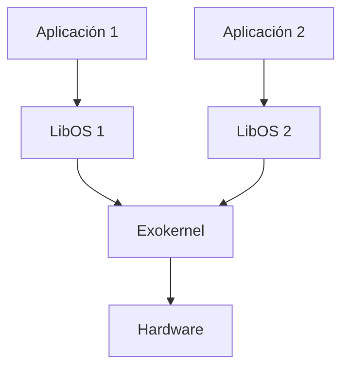
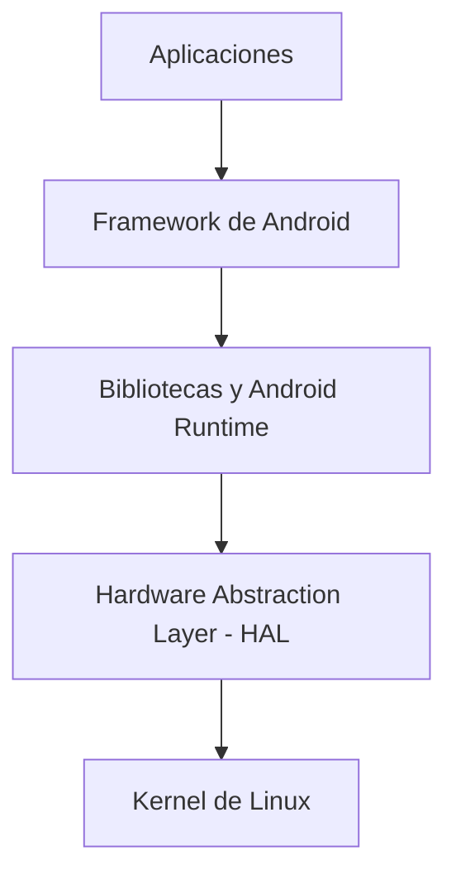

# Sistemas Operativos - Sistemas operativos modernos

## 8.2 Nuevas arquitecturas para los sistemas operativos

---

Las arquitecturas de los sistemas operativos han evolucionado significativamente para adaptarse a nuevos paradigmas de computación, hardware especializado y requisitos modernos de eficiencia, seguridad y escalabilidad. Esta guía explora las arquitecturas emergentes que están redefiniendo el diseño de los sistemas operativos.

### Evolución de las Arquitecturas de Sistemas Operativos

#### Arquitecturas Tradicionales

- **Arquitectura monolítica**: Todos los componentes del SO se ejecutan en espacio kernel
- **Arquitectura por capas**: Componentes organizados en niveles con interfaces bien definidas
- **Micronúcleos (Microkernels)**: Mínimas funcionalidades en kernel space, servicios en user space

#### Limitaciones de los Enfoques Tradicionales

- Falta de flexibilidad para hardware especializado
- Problemas de seguridad en arquitecturas monolíticas
- Overhead de comunicación en micronúcleos
- Dificultad para adaptarse a entornos heterogéneos

### Arquitecturas Modernas de Sistemas Operativos

#### Sistemas Operativos de Exonúcleos (Exokernels)

Los exonúcleos proporcionan una abstracción de hardware mínima, delegando las decisiones de gestión de recursos a bibliotecas de espacio de usuario.

**Principales características:**

- Separación entre protección y gestión de recursos
- Aplicaciones pueden implementar sus propias abstracciones
- Mayor eficiencia y personalización



**Ventajas:**

- Mejor rendimiento al eliminar capas de abstracción
- Personalización de políticas por aplicación
- Mayor flexibilidad

**Desventajas:**

- Complejidad para los desarrolladores de aplicaciones
- Potencial reducción de portabilidad

#### Sistemas Operativos Multinúcleo (Multikernels)

Arquitectura diseñada específicamente para sistemas con muchos núcleos de procesamiento, tratando cada núcleo como un sistema independiente.

**Características principales:**

- Modelo de memoria distribuida
- Comunicación por mensajes entre núcleos
- Replicación de estructuras de datos del kernel

$$
\text{Eficiencia} = \frac{\text{Trabajo útil}}{\text{Trabajo útil} + \text{Overhead de comunicación}}
$$

#### Sistemas Operativos para Dispositivos Móviles

Arquitecturas optimizadas para restricciones de energía, recursos limitados y requisitos de seguridad específicos.

**Ejemplo: Android Architecture**



#### Sistemas Operativos para Computación en la Nube

Arquitecturas diseñadas para entornos virtualizados y escalabilidad masiva.

**Características:**

- Soporte nativo para virtualización
- Aislamiento mejorado entre tenants
- Gestión eficiente de recursos distribuidos

#### Sistemas Operativos para Internet de las Cosas (IoT)

Diseñados para dispositivos con recursos extremadamente limitados y requisitos de eficiencia energética.

**Ejemplo: Arquitectura de Zephyr OS**

```
+------------------------+
|      Aplicaciones      |
+------------------------+
|   Servicios del SO     |
+------------------------+
|  Kernel Nanokernel     |
+------------------------+
|   Drivers de Hardware  |
+------------------------+
|       Hardware         |
+------------------------+
```

### Arquitecturas Basadas en Contenedores

#### Container OS

Sistemoperativos minimalistas diseñados específicamente para ejecutar contenedores.

**Ejemplo: CoreOS Container Linux**

- Sistema dual para actualizaciones atómicas
- Soporte nativo para Docker y rkt
- Gestión de clústeres integrada

#### Arquitectura Unikernel

Enfoque que compila la aplicación junto con las bibliotecas del sistema operativo necesarias en una imagen especializada.

```python
# Ejemplo conceptual de unikernel
def construir_unikernel(aplicacion, bibliotecas_necesarias):
    kernel_minimo = obtener_kernel_minimo()
    componentes = kernel_minimo + bibliotecas_necesarias + aplicacion
    imagen = compilar(componentes)
    return imagen

# Uso
mi_aplicacion = cargar_aplicacion()
bibliotecas = ["red", "sistema_archivos"]
imagen_unikernel = construir_unikernel(mi_aplicacion, bibliotecas)
```

**Ventajas:**

- Tamaño mínimo
- Mayor seguridad
- Mejor rendimiento

### Sistemas Operativos para Hardware Especializado

#### Arquitecturas para GPUs y TPUs

Sistemas operativos que gestionan eficientemente procesadores heterogéneos y aceleradores especializados.

**Características:**

- Planificación consciente del acelerador
- Modelos de memoria unificada
- Soporte para transferencias DMA eficientes

#### Sistemas Operativos para Procesadores Many-Core

Arquitecturas optimizadas para CPUs con decenas o cientos de núcleos.

**Técnicas de optimización:**

- Planificación por grupos de núcleos
- Balance de carga dinámico
- Affinity scheduling inteligente

### Arquitecturas Orientadas a la Seguridad

#### Sistemas Operativos con Seguridad por Diseño

Arquitecturas que incorporan principios de seguridad desde su concepción.

**CapSeC (Capability-Based Security):**
$$ P \text{ has } Capability \Rightarrow P \text{ can } Access Resource $$

**Principios:**

- Mínimo privilegio por defecto
- Verificación formal de componentes
- Aislamiento de procesos garantizado

#### Arquitecturas con Soporte para SGX y TPM

Sistemas operativos con soporte nativo para tecnologías de hardware seguro.

```c
// Ejemplo conceptual de uso de SGX
enclave_handle_t mi_enclave;

// Crear enclave seguro
sgx_create_enclave("mi_enclave.so", &mi_enclave);

// Ejecutar código dentro del enclave
sgx_call_enclave(mi_enclave, funcion_segura, datos_sensibles);
```

### Sistemas Operativos para Computación Cuántica

Arquitecturas emergentes para gestionar recursos de computación cuántica.

**Componentes clave:**

- Gestión de qubits y estabilidad
- Scheduling de operaciones cuánticas
- Coexistencia con computación clásica

### Ejercicios Propuestos

1. **Análisis Comparativo**: Compare la arquitectura de un exonúcleo con un micronúcleo tradicional, identificando tres ventajas y tres desventajas de cada enfoque.

2. **Diseño de Arquitectura**: Diseñe la arquitectura de un sistema operativo para dispositivos IoT considerando:
   - Restricciones de energía
   - Requisitos de seguridad
   - Limitaciones de memoria
     Utilice diagramas Mermaid para ilustrar su diseño.

3. **Cálculo de Eficiencia**: En un sistema multinúcleo con 64 cores, si el overhead de comunicación representa el 15% del tiempo total de ejecución, ¿cuál es la eficiencia del sistema según la fórmula proporcionada?

4. **Implementación Conceptual**: Escriba pseudocódigo para un planificador de tareas en un sistema many-core que implemente affinity scheduling considerando:
   - Grupos de núcleos con memoria caché compartida
   - Prioridades de tareas
   - Balance de carga

5. **Análisis de Seguridad**: Analice cómo una arquitectura basada en capabilities mejora la seguridad comparedo con el modelo tradicional de listas de control de acceso (ACLs). Proporcione un ejemplo concreto.

### Código de Ejemplo

```python
# Simulación de planificación en arquitectura many-core
class ManyCoreScheduler:
    def __init__(self, num_cores):
        self.cores = [None] * num_cores
        self.affinity_groups = self._create_affinity_groups(num_cores)
        self.task_queue = []

    def _create_affinity_groups(self, num_cores):
        # Agrupar núcleos con caché compartida (simulación)
        groups = []
        cores_per_group = 4  # Suponiendo grupos de 4 núcleos
        for i in range(0, num_cores, cores_per_group):
            groups.append(list(range(i, min(i+cores_per_group, num_cores))))
        return groups

    def assign_task(self, task, preferred_group=None):
        if preferred_group is not None and preferred_group < len(self.affinity_groups):
            # Intentar asignar al grupo preferido
            for core in self.affinity_groups[preferred_group]:
                if self.cores[core] is None:
                    self.cores[core] = task
                    return core

        # Asignar a cualquier núcleo disponible
        for core in range(len(self.cores)):
            if self.cores[core] is None:
                self.cores[core] = task
                return core

        # Si no hay núcleos disponibles, encolar
        self.task_queue.append(task)
        return -1

    def complete_task(self, core_id):
        if 0 <= core_id < len(self.cores) and self.cores[core_id] is not None:
            completed_task = self.cores[core_id]
            self.cores[core_id] = None

            # Asignar siguiente tarea si hay en cola
            if self.task_queue:
                next_task = self.task_queue.pop(0)
                self.cores[core_id] = next_task

            return completed_task
        return None

# Uso del planificador
scheduler = ManyCoreScheduler(16)  # 16 núcleos
task1 = {"id": 1, "priority": 10, "affinity_group": 2}
assigned_core = scheduler.assign_task(task1, preferred_group=2)
print(f"Tarea 1 asignada al núcleo {assigned_core}")
```

### Referencias

#### Bibliografía Básica

1. Tanenbaum, A. S. (2007). _Modern Operating Systems_ (3rd ed.). Prentice Hall. (Capítulos 1, 4, 12)
2. Silberschatz, A., Galvin, P. B., & Gagne, G. (2008). _Operating Systems Concepts_ (8th ed.). John Wiley and Sons. (Capítulos 2, 18, 19)
3. Tanenbaum, A. S., & Woodhull, A. S. (2006). _Operating Systems: Design and Implementation_ (3rd ed.). Prentice Hall. (Capítulos 1, 10)
4. Bic, L., & Shaw, A. (2003). _Operating Systems Principles_. Pearson Education. (Capítulos 2, 15)
5. Stallings, W. (2011). _Operating Systems: Internals and Design Principles_ (7th ed.). Prentice Hall. (Capítulos 2, 18)

#### Bibliografía Complementaria

1. Bach, M. (1986). _The Design of the UNIX Operating System_. Prentice Hall.
2. Bovet, D. P., & Cesati, M. (2000). _Understanding the Linux Kernel_. O'Reilly.
3. Silberschatz, A., Galvin, P. B., & Gagne, G. (2009). _Operating System Concepts with Java_ (8th ed.). John Wiley and Sons.

#### Recursos Adicionales

- [The Exokernel Operating System Architecture](http://pdos.csail.mit.edu/exo.html)
- [Multikernel: A new OS architecture for scalable multicore systems](https://www.sigops.org/s/conferences/sosp/2009/papers/baumwald-sosp09.pdf)
- [Zephyr Project](https://www.zephyrproject.org/)
- [Unikernel Systems](https://unikernel.org/)
- [Intel SGX Documentation](https://software.intel.com/content/www/us/en/develop/topics/software-guard-extensions.html)

Esta guía proporciona una visión completa de las nuevas arquitecturas para sistemas operativos, desde exonúcleos y multikernels hasta sistemas especializados para IoT, cloud computing y hardware seguro. Los ejercicios propuestos permiten aplicar los conceptos teóricos y desarrollar una comprensión práctica de estos avanzados paradigmas de diseño de sistemas operativos.
