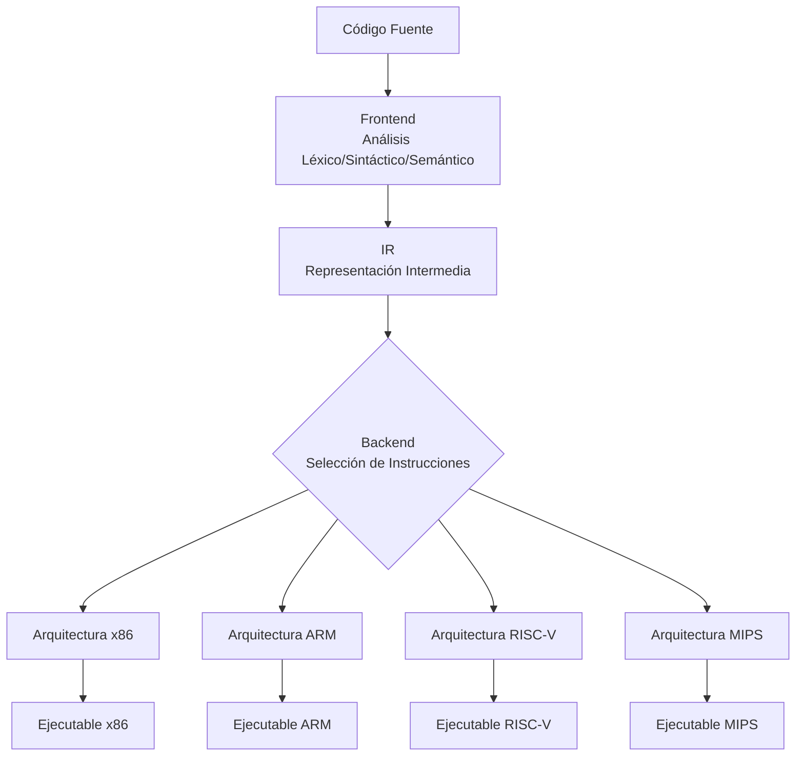

# Compiladores - Elección de instrucciones

## 10.1 Importancia para la portabilidad.

---

La elección de instrucciones es una fase crítica en el proceso de compilación donde el compilador selecciona las instrucciones del lenguaje máquina objetivo que implementarán las operaciones representadas en el código intermedio. Esta selección tiene implicaciones directas en la portabilidad del código compilado entre diferentes arquitecturas.

### Definición de Elección de Instrucciones

La elección de instrucciones es el proceso mediante el cual un compilador mapea las operaciones representadas en un código intermedio a las instrucciones específicas disponibles en el conjunto de instrucciones de la arquitectura objetivo.

Matemáticamente, podemos representar este proceso como una función:

$$f: IR \rightarrow IS_{target}$$

Donde:

- $IR$ es el conjunto de representaciones intermedias
- $IS_{target}$ es el conjunto de instrucciones de la arquitectura objetivo

### Importancia de la Elección de Instrucciones para la Portabilidad

#### Concepto de Portabilidad en Compiladores

La portabilidad se refiere a la capacidad de un programa para ejecutarse en diferentes arquitecturas de hardware con modificaciones mínimas o nulas. En el contexto de compiladores, la portabilidad se logra mediante:

1. **Separación entre front-end y back-end**
2. **Uso de representaciones intermedias independientes de la máquina**
3. **Selección adaptativa de instrucciones**

#### Mecanismo de Portabilidad mediante Elección de Instrucciones



#### Ventajas de un Sistema Portable

1. **Mantenimiento simplificado**: Un único código fuente para múltiples plataformas
2. **Reducción de costos**: Menor necesidad de reescribir código para diferentes arquitecturas
3. **Ampliación de mercado**: El software puede ejecutarse en más dispositivos
4. **Future-proofing**: Preparación para arquitecturas futuras

### Técnicas de Elección de Instrucciones para Portabilidad

#### Coincidencia de Patrones

La elección de instrucciones frecuentemente se implementa como un proceso de coincidencia de patrones donde se buscan secuencias específicas en el IR que puedan ser mapeadas a instrucciones de la arquitect objetivo.

**Ejemplo**: Coincidencia para operación de multiplicación

```
// Representación Intermedia
t1 = a * 2

// Patrones coincidentes
ADD r1, r2, r2    // x86: a + a
SHL r1, r2, 1     // x86: desplazamiento izquierdo
MUL r1, r2, 2     // ARM: multiplicación inmediata
```

#### Uso de Descripciones Formales de Instrucciones

Muchos compiladores utilizan descripciones formales del conjunto de instrucciones que permiten la generación automática de componentes de selección de instrucciones.

```cpp
// Ejemplo de descripción formal (pseudocódigo)
instruction ADD {
    format: "ADD Rd, Rn, Rm",
    operation: Rd = Rn + Rm,
    constraints: [Rn, Rm registros; Rd registro],
    cost: 1,
    latency: 1
}

instruction ADDI {
    format: "ADDI Rd, Rn, imm",
    operation: Rd = Rn + imm,
    constraints: [Rn registro; imm valor inmediato],
    cost: 1,
    latency: 1
}
```

### Ejemplos Prácticos

#### Ejemplo 1: Diferentes implementaciones para la misma operación

**Operación**: Asignación con constante cero

```c
// Código C
int x = 0;
```

**Selección de instrucciones por arquitectura**:

```assembly
// x86
mov eax, 0

// ARM (varias opciones)
mov r0, #0
eor r0, r0, r0    ; XOR consigo mismo

// MIPS
add $t0, $zero, $zero
```

#### Ejemplo 2: Operaciones aritméticas complejas

```c
// Código C
int result = (a * 5) + (b * 3);
```

**Selección optimizada para x86**:

```assembly
; x86 con capacidades de direccionamiento complejo
mov eax, [a]
lea eax, [eax*4 + eax]    ; a * 5
mov ebx, [b]
lea ebx, [ebx*2 + ebx]    ; b * 3
add eax, ebx
mov [result], eax
```

**Selección para ARM**:

```assembly
; ARM con operaciones de desplazamiento
ldr r0, [a]
add r1, r0, r0, lsl #2    ; r1 = r0 + (r0 << 2) = a * 5
ldr r0, [b]
add r2, r0, r0, lsl #1    ; r2 = r0 + (r0 << 1) = b * 3
add r0, r1, r2
str r0, [result]
```

### Retos en la Elección de Instrucciones para Portabilidad

#### Heterogeneidad Arquitectónica

Diferentes arquitecturas ofrecen conjuntos de instrucciones variables:

1. **CISC vs RISC**: Instrucciones complejas vs. simples
2. **Registros**: Cantidad y tipos de registros disponibles
3. **Modos de direccionamiento**: Variedad en formas de acceder a memoria
4. **Restricciones**: Límites en valores inmediatos, alineamiento, etc.

#### Ejemplo de reto: Valores inmediatos

```c
// Código C con constante grande
int value = 0x12345;
```

**Problema**: Algunas arquitecturas tienen límites en valores inmediatos

**Solución alternativa**:

```assembly
; ARM (límite de 12 bits para valores inmediatos)
ldr r0, =0x12345    ; El ensamblador resuelve esta carga

; MIPS (límite de 16 bits)
lui $t0, 0x1        ; Carga los 16 bits superiores
ori $t0, $t0, 0x2345 ; Combina con los 16 bits inferiores
```

### Ejercicios Propuestos

#### Ejercicio 1: Análisis de Portabilidad

Analiza el siguiente fragmento de código y propone cómo se compilaría en tres arquitecturas diferentes (x86, ARM, MIPS):

```c
int factorial(int n) {
    if (n <= 1) return 1;
    return n * factorial(n - 1);
}
```

#### Ejercicio 2: Selección de Instrucciones

Dada la siguiente representación intermedia:

```
t1 = a + b
t2 = t1 * 2
t3 = t2 + c
```

Propón secuencias de instrucciones para:

1. Arquitectura x86 (usando registros eax, ebx, ecx)
2. Arquitectura ARM (usando registros r0, r1, r2)
3. Arquitectura MIPS (usando registros $t0, $t1, $t2)

#### Ejercicio 3: Optimización para Portabilidad

Identifica las potenciales problemas de portabilidad en el siguiente código y propone una versión más portable:

```c
// Código original con supuestos de arquitectura
void memory_copy(char* dest, char* src, int size) {
    // Supone que int es de 32 bits y alineamiento a 4 bytes
    int* idest = (int*)dest;
    int* isrc = (int*)src;

    for (int i = 0; i < size / 4; i++) {
        idest[i] = isrc[i];
    }
}
```

### Técnicas Avanzadas para Mejorar la Portabilidad

#### Compilación Cruzada (Cross-Compilation)

La compilación cruzada permite generar código para una arquitectura diferente a la del sistema donde se ejecuta el compilador.

```
// Ejemplo de compilación cruzada con GCC
gcc -target arm-linux-gnueabihf -o programa programa.c
```

#### Uso de Representaciones Intermedias Portables

**LLVM IR**: Representación intermedia que permite optimizaciones independientes de la arquitectura.

```llvm
; Ejemplo de LLVM IR
define i32 @factorial(i32 %n) {
  %1 = icmp sle i32 %n, 1
  br i1 %1, label %base, label %recursive

base:
  ret i32 1

recursive:
  %2 = sub i32 %n, 1
  %3 = call i32 @factorial(i32 %2)
  %4 = mul i32 %n, %3
  ret i32 %4
}
```

#### Técnicas de "Retargeting"

El retargeting permite adaptar un compilador a nuevas arquitecturas con mínimo esfuerzo mediante:

1. **Descripciones formales** del conjunto de instrucciones
2. **Generadores de generadores de código** (como BEG)
3. **Máquinas de plantillas** para la selección de instrucciones

### Conclusión

La elección de instrucciones es fundamental para lograr portabilidad en los compiladores. Al separar la generación de código intermedio de la selección específica de instrucciones, los compiladores modernos pueden targetear múltiples arquitecturas desde una única implementación del front-end. Las técnicas de coincidencia de patrones, descripciones formales y representaciones intermedias estandarizadas son cruciales para este propósito.

### Referencias

1. Aho, A. V., Lam, M. S., Sethi, R., & Ullman, J. D. (2007). Compilers: Principles, Techniques, and Tools (2nd ed.). Pearson Education. (Capítulo 8: Generación de Código)

2. Cooper, K. D., & Torczon, L. (2004). Engineering a Compiler. Morgan Kaufmann. (Capítulo 7: Selección de Instrucciones)

3. Scott, M. L. (2009). Programming Language Pragmatics. Morgan Kaufmann. (Capítulo 15: Implementación de Ejecutables)

4. Muchnick, S. S. (1997). Advanced Compiler Design and Implementation. Morgan Kaufmann. (Capítulo 13: Generación de Código para Arquitecturas CISC y RISC)

5. Fraser, C. W., & Hanson, D. R. (1995). A Retargetable C Compiler: Design and Implementation. Addison-Wesley.
