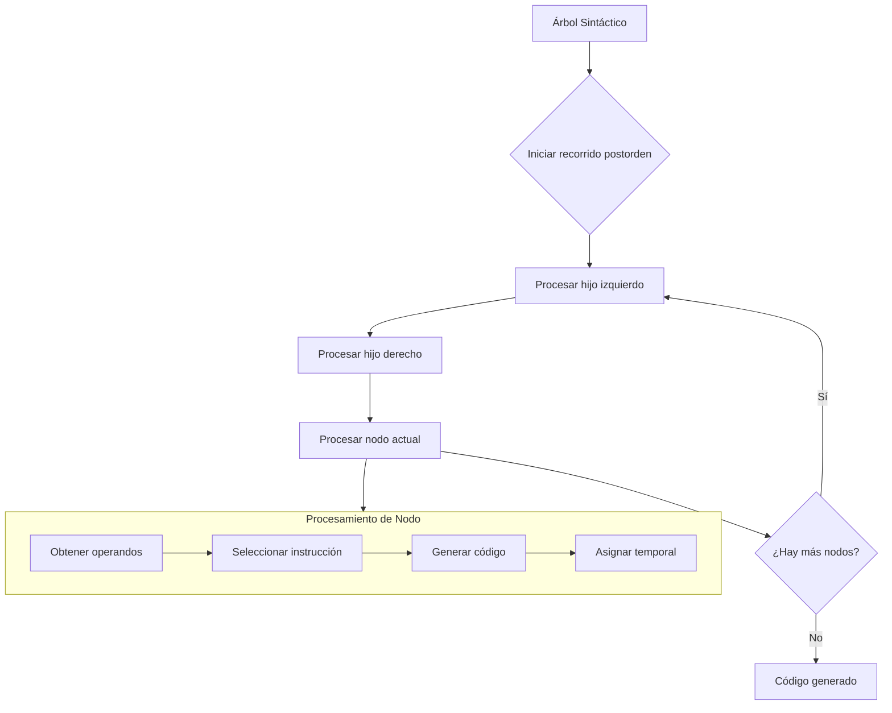

# Compiladores - Elección de instrucciones

## 10.2 Esquema simple de recorrido de árboles.

---

El esquema simple de recorrido de árboles es una técnica fundamental para la generación de código a partir de árboles sintácticos o de representación intermedia. Este enfoque sistemático permite seleccionar instrucciones de máquina de manera eficiente mediante el recorrido ordenado de estructuras arbóreas.

### Definición del Esquema Simple de Recorrido de Árboles

El esquema simple de recorrido de árboles es un algoritmo que visita los nodos de un árbol en un orden específico (generalmente postorden) para generar código de máquina. Cada nodo del árbol representa una operación, y las hojas representan operandos.

Matemáticamente, para un árbol T con n nodos, el recorrido se define como:

$$ R(T) = \begin{cases} \text{visitar}(\text{raíz}) & \text{si } n = 1 \\\ R(T_1), R(T_2), ..., R(T_k), \text{visitar}(\text{raíz}) & \text{si } n > 1 \end{cases} $$

Donde $T_1, T_2, ..., T_k$ son los subárboles de la raíz.

### Fundamentos del Recorrido de Árboles

#### Tipos de Recorrido

1. **Postorden (LRN)**: Primero el hijo izquierdo, luego el hijo derecho, finalmente la raíz
2. **Preorden (NLR)**: Primero la raíz, luego el hijo izquierdo, finalmente el hijo derecho
3. **Inorden (LNR)**: Primero el hijo izquierdo, luego la raíz, finalmente el hijo derecho

Para generación de código, el recorrido en **postorden** es el más utilizado porque garantiza que los operandos se procesen antes que las operaciones.

#### Estructura de un Nodo

Cada nodo en el árbol sintáctico contiene:

- Tipo de operación
- Valor o operador
- Referencias a hijos
- Información de tipo de datos
- Ubicación para almacenar resultado temporal

### Proceso de Generación de Código mediante Recorrido de Árboles



### Algoritmo de Recorrido para Generación de Código

#### Algoritmo Básico

```
función generarCódigo(nodo):
    si nodo es hoja entonces
        return dirección del operando
    sino
        para cada hijo en nodo.hijos hacer
            temporal = generarCódigo(hijo)
        fin para

        instrucción = seleccionarInstrucción(nodo.operador, temporales)
        emitir(instrucción)
        return temporalResultado
    fin si
```

#### Implementación en Pseudocódigo

```python
def generate_code(node, register_pool):
    if node.is_leaf():
        # Para hojas, cargar valor en registro
        reg = allocate_register(register_pool)
        emit(f"LOAD {reg}, {node.value}")
        return reg

    # Procesar operandos primero
    operands = []
    for child in node.children:
        operand_reg = generate_code(child, register_pool)
        operands.append(operand_reg)

    # Seleccionar instrucción para operación
    opcode = select_instruction(node.operator, operands)
    result_reg = allocate_register(register_pool)

    # Emitir instrucción
    if node.operator == '=':
        emit(f"STORE {operands[0]}, {result_reg}")
    else:
        emit(f"{opcode} {result_reg}, {', '.join(operands)}")

    # Liberar registros de operandos
    for reg in operands:
        free_register(reg, register_pool)

    return result_reg
```

### Ejemplos Prácticos

#### Ejemplo 1: Expresión Aritmética Simple

**Expresión**: `a + b * c`

**Árbol sintáctico**:

```
     +
    / \
   a   *
      / \
     b   c
```

**Recorrido y generación de código**:

1. Visitar a (hoja): `LOAD R1, a`
2. Visitar b (hoja): `LOAD R2, b`
3. Visitar c (hoja): `LOAD R3, c`
4. Visitar * (operación): `MUL R4, R2, R3`
5. Visitar + (operación): `ADD R5, R1, R4`

#### Ejemplo 2: Expresión con Paréntesis

**Expresión**: `(a + b) * c`

**Árbol sintáctico**:

```
      *
     / \
    +   c
   / \
  a   b
```

**Recorrido y generación de código**:

1. Visitar a (hoja): `LOAD R1, a`
2. Visitar b (hoja): `LOAD R2, b`
3. Visitar + (operación): `ADD R3, R1, R2`
4. Visitar c (hoja): `LOAD R4, c`
5. Visitar * (operación): `MUL R5, R3, R4`

### Consideraciones de Registros

#### Gestión de Registros

En el esquema simple, es crucial gestionar eficientemente los registros:

$$R_{disponibles} = R_{totales} - R_{reservados}$$

**Estrategias**:

1. **Registros ilimitados**: Approach teórico, no práctico
2. **Volcado a memoria**: Cuando se acaban los registros
3. **Algoritmo de Sethi-Ullman**: Para orden óptimo de evaluación

#### Ejemplo con Registros Limitados

Supongamos solo 2 registros disponibles para `a + b * c + d`:

1. `LOAD R1, b`
2. `LOAD R0, c`
3. `MUL R1, R1, R0` // R1 = b * c
4. `LOAD R0, a`
5. `ADD R1, R0, R1` // R1 = a + (b * c)
6. `LOAD R0, d`
7. `ADD R1, R1, R0` // R1 = (a + b * c) + d

### Ventajas y Limitaciones

#### Ventajas

- **Sencillez**: Fácil de implementar y entender
- **Sistematicidad**: Approach metódico y predecible
- **Portabilidad**: Se adapta a diferentes conjuntos de instrucciones
- **Mantenibilidad**: Código claro y modular

#### Limitaciones

- **Suboptimalidad**: No siempre produce el mejor código posible
- **Ineficiencia con registros**: Uso no óptimo de registros
- **Falta de consideración de características específicas**: No aprovecha instrucciones especializadas

### Ejercicios Propuestos

#### Ejercicio 1: Generación de Código

Dada la expresión: `x = (a + b) * (c - d) / e`

1. Construye el árbol sintáctico
2. Aplica el esquema de recorrido de árboles en postorden
3. Genera el código assembly resultante
4. Asume 4 registros disponibles (R0-R3)

#### Ejercicio 2: Optimización de Registros

Para la expresión: `a * b + c * d + e * f`

1. Genera código usando el esquema simple
2. Identifica el número máximo de registros necesarios
3. Propone una reordenación del árbol para minimizar el uso de registros
4. Implementa tu solución y compara el código generado

#### Ejercicio 3: Análisis de Differentes Órdenes

Dada la expresión: `a + b * c - d / e`

1. Genera código con recorrido postorden estándar
2. Genera código con recorrido inorden
3. Genera código con recorrido preorden
4. Compara los resultados y explica las diferencias

### Técnicas de Mejora

#### Integración con Otras Técnicas

El esquema simple puede mejorarse combinándolo con:

1. **Coincidencia de patrones**: Identificar patrones de árboles que mapean a instrucciones específicas
2. **Selección de instrucciones basada en costos**: Elegir instrucciones según criterios de costo
3. **Reordenamiento de árboles**: Reorganizar el árbol para mejor uso de registros

#### Ejemplo de Coincidencia de Patrones

Para el patrón de multiplicación por 2:

```
  *
 / \
x   2
```

Puede reemplazarse por:

```
  <<
 /  \
x    1
```

Y generar `SHL R1, R0, 1` en lugar de `MUL R1, R0, 2`

### Referencias

1. Aho, A. V., Lam, M. S., Sethi, R., & Ullman, J. D. (2007). Compilers: Principles, Techniques, and Tools (2nd ed.). Pearson Education. (Capítulo 8: Generación de Código)

2. Cooper, K. D., & Torczon, L. (2004). Engineering a Compiler. Morgan Kaufmann. (Capítulo 7: Selección de Instrucciones)

3. Appel, A. W. (1998). Modern Compiler Implementation in C. Cambridge University Press. (Capítulo 7: Traducción a Código de Máquina)

4. Muchnick, S. S. (1997). Advanced Compiler Design and Implementation. Morgan Kaufmann. (Capítulo 13: Generación de Código)

5. Wilhelm, R., & Seidl, H. (2019). Compiler Design: Synthesis and Analysis. Springer. (Capítulo 4: Generación de Código para Máquinas de Registro)
