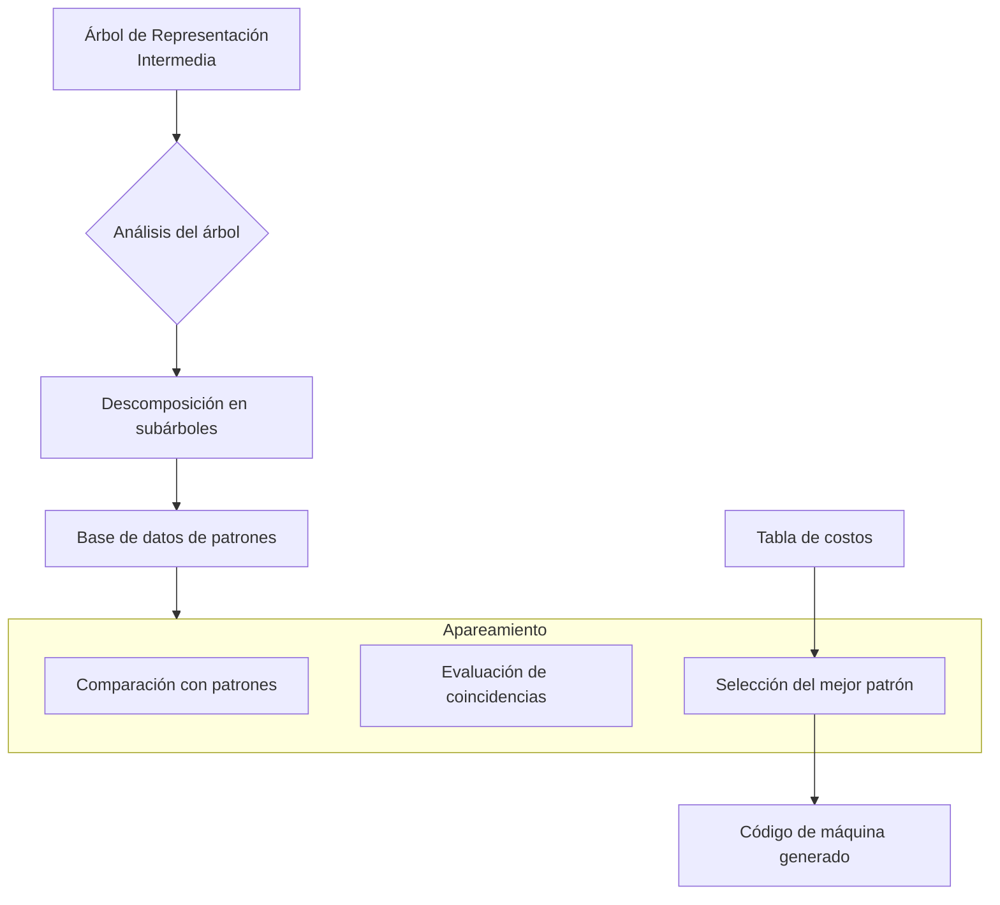

# Compiladores - Elección de instrucciones

## 10.3 Selección de instrucciones mediante apareamiento de árboles.

---

El apareamiento de árboles (tree matching) es una técnica avanzada para la selección de instrucciones que permite identificar patrones en árboles sintácticos intermedios y mapearlos a instrucciones específicas del conjunto de instrucciones objetivo. Este enfoque es fundamental en compiladores modernos para generar código altamente optimizado.

### Definición del Apareamiento de Árboles

El apareamiento de árboles es un algoritmo que busca isomorfismos entre subárboles de la representación intermedia y patrones definidos en el conjunto de instrucciones de la arquitectura objetivo.

Formalmente, dado un árbol $T$ y un patrón $P$, el apareamiento busca un mapeo $f: Nodos(P) \rightarrow Nodos(T)$ tal que:

1. $ f(\text{raíz}(P)) = \text{raíz}(T) $
2. Para cada nodo $n$ en $P$ con hijos $n_1, n_2, ..., n_k$, $f(n)$ en $T$ tiene hijos $f(n_1), f(n_2), ..., f(n_k)$ en el mismo orden
3. Las etiquetas de los nodos coinciden: $etiqueta(n) = etiqueta(f(n))$ o $etiqueta(n)$ es comodín

### Fundamentos del Apareamiento de Árboles

#### Componentes del Sistema

1. **Árbol de entrada**: Representación intermedia del código fuente
2. **Patrones de instrucciones**: Árboles que representan instrucciones de la máquina objetivo
3. **Algoritmo de apareamiento**: Procedimiento para encontrar coincidencias
4. **Selección de mejores coincidencias**: Criterios para elegir el patrón óptimo

#### Tipos de Patrones

- **Patrones simples**: Operaciones básicas (ADD, MUL, etc.)
- **Patrones complejos**: Instrucciones especializadas (FMA, instrucciones SIMD)
- **Patrones con restricciones**: Coincidencias con condiciones específicas

### Proceso de Selección por Apareamiento de Árboles



### Algoritmos de Apareamiento

#### Algoritmo de Aho-Corasick para Árboles

Extensión del algoritmo clásico de coincidencia de cadenas para estructuras arbóreas:

```python
def tree_matching(root, patterns):
    matches = []
    # Recorrer el árbol en postorden
    for node in postorder_traversal(root):
        for pattern in patterns:
            if match_pattern(node, pattern):
                matches.append((node, pattern))
                # Marcar nodos cubiertos
                mark_covered_nodes(node, pattern)
    return select_best_matches(matches)
```

#### Coincidencia con Autómatas de Estados Finitos

Se puede modelar como un autómata donde:

$$Q = \{q_0, q_1, ..., q_n\} \text{ (estados)}$$
$$\Sigma = \text{ conjunto de operadores y operandos}$$
$$\delta: Q \times \Sigma \rightarrow Q \text{ (función de transición)}$$

### Implementación del Sistema de Patrones

#### Base de Datos de Patrones

```cpp
// Estructura de un patrón de instrucción
struct InstructionPattern {
    string instruction_name;
    Tree pattern_tree;
    int cost;
    vector<Constraint> constraints;
    function<bool(MatchContext)> predicate;

    // Método para verificar coincidencia
    bool matches(TreeNode* node) {
        return matchTree(node, pattern_tree);
    }
};

// Ejemplo de patrón para multiplicación-accumulación (FMA)
InstructionPattern fma_pattern = {
    .instruction_name = "FMA",
    .pattern_tree = Tree("+", Tree("*", Wildcard("a"), Wildcard("b")), Wildcard("c")),
    .cost = 2,
    .constraints = {TypeConstraint("float")},
    .predicate = [](MatchContext ctx) {
        return ctx.target_architecture.supports_fma;
    }
};
```

#### Algoritmo de Coincidencia de Patrones

```python
def match_pattern(tree_node, pattern_node, bindings={}):
    if pattern_node.is_wildcard():
        # Los comodines coinciden con cualquier nodo
        bindings[pattern_node.name] = tree_node
        return True, bindings

    if tree_node.operator != pattern_node.operator:
        return False, bindings

    if len(tree_node.children) != len(pattern_node.children):
        return False, bindings

    # Coincidencia recursiva con hijos
    for i in range(len(tree_node.children)):
        match, new_bindings = match_pattern(
            tree_node.children[i],
            pattern_node.children[i],
            bindings
        )
        if not match:
            return False, bindings
        bindings.update(new_bindings)

    return True, bindings
```

### Ejemplos Prácticos

#### Ejemplo 1: Coincidencia de Instrucciones SIMD

**Expresión**: `a[0] + a[1] + a[2] + a[3]`

**Árbol intermedio**:

```
        +
       / \
      +   a[3]
     / \
    +   a[2]
   / \
 a[0] a[1]
```

**Patrón coincidente**: Instrucción SIMD de suma de 4 elementos

**Código generado**: `VADDPS xmm0, [a], xmm1`

#### Ejemplo 2: Instrucción de Multiplicación-Acumulación (FMA)

**Expresión**: `a * b + c`

**Árbol intermedio**:

```
    +
   / \
  *   c
 / \
a   b
```

**Patrón coincidente**: Instrucción FMA

**Código generado**: `VFMADD213SS xmm1, xmm2, xmm3`

#### Ejemplo 3: Desplazamiento y Suma

**Expresión**: `x * 5`

**Árbol intermedio**:

```
  *
 / \
x   5
```

**Patrón alternativo**: `(x << 2) + x`

**Código generado**:

```
SHL r1, r0, 2    ; x * 4
ADD r1, r1, r0   ; + x = x * 5
```

### Sistema de Costos y Selección Óptima

#### Función de Costo

La selección del mejor patrón se basa en una función de costo:

$$ Costo(total) = \sum\_{i=1}^{n} Costo(\text{instrucción}\_{i}) + \sum\_{j=1}^{m} Costo(registro\_j) $$

#### Algoritmo de Selección Óptima

```python
def select_optimal_cover(tree, matches):
    # Dynamic programming approach
    dp = {}  # dp[node] = (best_cost, best_pattern, child_matches)

    for node in postorder_traversal(tree):
        candidates = []

        # Considerar patrones que coinciden en este nodo
        for pattern, cost in matches.get(node, []):
            pattern_cost = cost
            child_costs = 0

            # Verificar hijos cubiertos por el patrón
            for child in node.children:
                if child in pattern.covered_nodes:
                    child_costs += dp[child][0]
                else:
                    # Hijo no cubierto, necesita cobertura separada
                    child_costs += dp[child][0]

            total_cost = pattern_cost + child_costs
            candidates.append((total_cost, pattern))

        # También considerar no cubrir este nodo con patrón grande
        if node not in must_cover:
            child_only_cost = sum(dp[child][0] for child in node.children)
            candidates.append((child_only_cost, None))

        # Seleccionar el mejor candidato
        dp[node] = min(candidates, key=lambda x: x[0])

    return dp[root]
```

### Ejercicios Propuestos

#### Ejercicio 1: Diseño de Patrones

Para la arquitectura x86, diseña patrones para las siguientes instrucciones:

1. `LEA` para aritmética compleja de direcciones
2. Instrucciones AVX para operaciones vectoriales
3. Instrucciones de manipulación de bits (BSF, BSR)

Implementa los patrones en formato de árbol y define sus restricciones.

#### Ejercicio 2: Algoritmo de Apareamiento

Dado el siguiente árbol de expresión para `(a * b) + (c * d)`:

```
     +
    / \
   /   \
  *     *
 / \   / \
a   b c   d
```

Y los patrones:

1. Patrón MUL: `*(reg, reg)`
2. Patrón ADD: `+(reg, reg)`
3. Patrón FMA: `+(*(reg, reg), reg)`

Aplica el algoritmo de apareamiento de árboles y determina:

- Qué patrones coinciden y en qué nodos
- Cuál sería la selección óptima con costos MUL=2, ADD=1, FMA=3

#### Ejercicio 3: Sistema de Restricciones

Extiende el sistema de apareamiento para incluir restricciones de:

1. Tipos de datos (enteros, flotantes, etc.)
2. Alineamiento de memoria
3. Disponibilidad de registros
4. Preferencias arquitectónicas

Implementa la verificación de restricciones en el algoritmo de coincidencia.

### Técnicas Avanzadas

#### Apareamiento con Grafos de Flujo de Datos

Extensión del apareamiento de árboles a grafos completos:

```python
def dataflow_graph_matching(cfg, patterns):
    matches = {}
    for basic_block in cfg.blocks:
        for node in basic_block.dfg_nodes:
            for pattern in patterns:
                if pattern_matches_dfg(node, pattern):
                    matches.add((node, pattern))

    return select_optimal_dfg_cover(matches)
```

#### Aprendizaje Automático para Selección de Patrones

Uso de modelos de ML para predecir los mejores patrones:

$$ P(\text{patrón}\_i | \text{características}) = \frac{e ^ {w\_i ^ T x}}{\sum\_{j = 1} ^ {k} e ^ {w\_j ^ T x}} $$

Donde las características incluyen:

- Tipo de operación
- Tipos de operandos
- Contexto del código
- Metadatos arquitectónicos

### Referencias

1. Aho, A. V., Lam, M. S., Sethi, R., & Ullman, J. D. (2007). Compilers: Principles, Techniques, and Tools (2nd ed.). Pearson Education. (Capítulo 8: Generación de Código)

2. Cooper, K. D., & Torczon, L. (2004). Engineering a Compiler. Morgan Kaufmann. (Capítulo 7: Selección de Instrucciones)

3. Fraser, C. W., & Hanson, D. R. (1995). A Retargetable C Compiler: Design and Implementation. Addison-Wesley. (Capítulo 12: Code Generation)

4. Henry, R. R. (1984). Graham-Glanville Code Generators. PhD thesis, University of California, Berkeley.

5. Pelegri-Llopart, E., & Graham, S. L. (1988). Optimal Code Generation for Expression Trees. Proceedings of the 15th ACM SIGPLAN-SIGACT Symposium on Principles of Programming Languages.

6. Ertl, M. A., & Gregg, D. (2003). The Behavior of Efficient Virtual Machine Interpreters on Modern Architectures. Euro-Par 2003 Parallel Processing.
