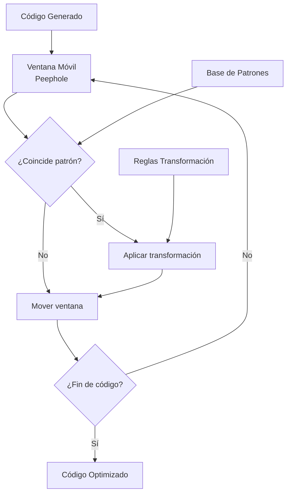
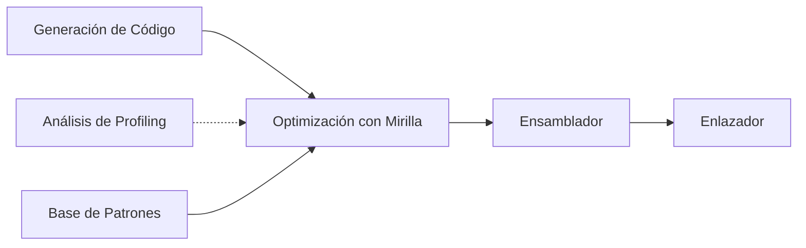

# Compiladores - Elección de instrucciones

## 10.4 Selección usando optimización con mirilla (peephole).

---

La optimización con mirilla (peephole optimization) es una técnica de bajo nivel que examina pequeñas ventanas de código generado (la "mirilla") para identificar y reemplazar patrones ineficientes por secuencias equivalentes más eficientes. Esta técnica es crucial en la fase final de generación de código.

### Definición de Optimización con Mirilla

La optimización con mirilla es un método de mejora de código que analiza ventanas pequeñas de instrucciones consecutivas (típicamente 2-5 instrucciones) y aplica transformaciones locales para mejorar el rendimiento o reducir el tamaño del código.

Formalmente, dado un conjunto de instrucciones $S = \{i_1, i_2, ..., i_n\}$, una optimización con mirilla aplica transformaciones $T$ cuando detecta patrones específicos $P$:

$$ T(S) = \begin{cases} S' & \text{si } \exists P \subset S \text{ que coincide con patrón optimizable} \\\ S & \text{en caso contrario} \end{cases}$$

### Fundamentos de la Optimización con Mirilla

#### Características Principales

1. **Localidad**: Opera sobre secuencias cortas de instrucciones
2. **Independencia**: No requiere análisis de flujo de datos global
3. **Multi-paso**: Aplicación iterativa hasta que no se encuentren más optimizaciones
4. **Arquitectura-específica**: Las optimizaciones dependen del conjunto de instrucciones objetivo

#### Componentes del Sistema



### Patrones Comunes de Optimización

#### Eliminación de Código Redundante

**Patrón 1**: Cargas redundantes
```
LOAD R1, A
LOAD R1, A  ← Redundante
```

**Transformación**:
```
LOAD R1, A
```

**Patrón 2**: Almacenamientos innecesarios
```
STORE R1, A
LOAD R2, A  ← Puede usar R1 directamente
```

**Transformación**:
```
STORE R1, A
MOVE R2, R1
```

#### Simplificación Algebraica

**Patrón**: Operaciones con identidades
```
ADD R1, R2, 0
MUL R3, R4, 1
```

**Transformación**:
```
MOVE R1, R2
MOVE R3, R4
```

**Patrón**: Doble negación
```
NEG R1, R2
NEG R3, R1
```

**Transformación**:
```
MOVE R3, R2
```

#### Optimización de Saltos

**Patrón**: Saltos consecutivos
```
JMP L1
...
L1: JMP L2
```

**Transformación**:
```
JMP L2
...
L1: JMP L2
```

**Patrón**: Saltos condicionales a siguiente instrucción
```
CMP R1, R2
JEQ NEXT_INSTRUCTION
```

**Transformación**: Eliminar salto

### Implementación del Optimizador con Mirilla

#### Estructura de Datos

```python
class PeepholeOptimizer:
    def __init__(self, patterns_file):
        self.patterns = self.load_patterns(patterns_file)
        self.window_size = 3  # Tamaño de la mirilla

    def load_patterns(self, filename):
        # Cargar patrones y sus reemplazos
        patterns = []
        with open(filename, 'r') as f:
            for line in f:
                pattern, replacement = line.split('=>')
                patterns.append((pattern.strip(), replacement.strip()))
        return patterns

    def optimize(self, code):
        changed = True
        while changed:
            changed = False
            i = 0
            while i <= len(code) - self.window_size:
                window = code[i:i+self.window_size]
                for pattern, replacement in self.patterns:
                    if self.match_pattern(window, pattern):
                        # Aplicar transformación
                        new_code = self.apply_replacement(window, replacement)
                        code[i:i+self.window_size] = new_code
                        changed = True
                        break
                i += 1
        return code
```

#### Algoritmo de Coincidencia de Patrones

```python
def match_pattern(self, instructions, pattern):
    pattern_ops = pattern.split()
    if len(instructions) != len(pattern_ops):
        return False

    for i, (instr, pattern_op) in enumerate(zip(instructions, pattern_ops)):
        if pattern_op == '*':
            continue  # Comodín, coincide con cualquier instrucción
        if not self.instructions_match(instr, pattern_op):
            return False

    return True

def instructions_match(self, instruction, pattern):
    # Comparar opcode
    if instruction.opcode != pattern.opcode:
        return False

    # Comparar operandos (manejar comodines y valores específicos)
    for op_actual, op_pattern in zip(instruction.operands, pattern.operands):
        if op_pattern.startswith('$'):  # Variable patrón
            var_name = op_pattern[1:]
            if var_name in self.bindings:
                if self.bindings[var_name] != op_actual:
                    return False
            else:
                self.bindings[var_name] = op_actual
        elif op_actual != op_pattern:
            return False

    return True
```

### Ejemplos Prácticos Detallados

#### Ejemplo 1: Eliminación de Código Muerto

**Código original**:
```assembly
MOV R1, 5
ADD R2, R3, R4  ; R1 no se usa de nuevo
MOV R5, R2
```

**Después de optimización**:
```assembly
ADD R2, R3, R4
MOV R5, R2
```

#### Ejemplo 2: Fortaleza de Reducción

**Código original**:
```assembly
MUL R1, R2, 2
```

**Transformación** (si la arquitectura tiene desplazamiento):
```assembly
SHL R1, R2, 1
```

#### Ejemplo 3: Fusión de Operaciones

**Código original**:
```assembly
CMP R1, 0
JNE label
```

**Transformación** (si la arquitectura tiene saltos basados en banderas):
```assembly
TEST R1, R1
JNZ label
```

### Sistema de Reglas para Optimización

#### Formato de Reglas

Cada regla de optimización sigue el formato:
```
patrón => reemplazo [condición]
```

**Ejemplos**:

1. **Carga redundante**:
```
LOAD $reg, $addr
LOAD $reg, $addr => LOAD $reg, $addr
```

2. **Suma con cero**:
```
ADD $dest, $src, 0 => MOVE $dest, $src [not_volatile($src)]
```

3. **Desplazamiento en lugar de multiplicación**:
```
MUL $dest, $src, $power => SHL $dest, $src, $log [is_power_of_2($power)]
```

#### Implementación de Reglas con Condiciones

```python
def apply_rule(self, instructions, pattern, replacement):
    bindings = {}
    if self.match_with_bindings(instructions, pattern, bindings):
        # Verificar condiciones
        if self.check_conditions(replacement, bindings):
            new_instructions = self.generate_replacement(replacement, bindings)
            return new_instructions
    return None

def check_conditions(self, replacement, bindings):
    conditions = replacement.get('conditions', [])
    for condition in conditions:
        if not self.evaluate_condition(condition, bindings):
            return False
    return True

def evaluate_condition(self, condition, bindings):
    if condition == 'not_volatile':
        reg = bindings.get('$reg')
        return not self.is_volatile_register(reg)
    elif condition.startswith('is_power_of_2'):
        value = bindings.get(condition.split('(')[1][:-1])
        return (value & (value - 1)) == 0 and value != 0
    # ... otras condiciones
    return True
```

### Ejercicios Propuestos

#### Ejercicio 1: Diseño de Reglas de Optimización

Para la arquitectura x86, diseña reglas de optimización con mirilla para:

1. **Instrucciones de pila**: Optimizar secuencias de PUSH/POP
2. **Instrucciones de cadena**: Optimizar operaciones con REP prefix
3. **Instrucciones SIMD**: Optimizar operaciones vectoriales

Implementa al menos 5 reglas con sus condiciones correspondientes.

#### Ejercicio 2: Implementación de Optimizador

Implementa un optimizador con mirilla que maneje los siguientes patrones:

1. Eliminación de movimientos redundantes
2. Reducción de fuerza (multiplicación → desplazamiento)
3. Optimización de saltos

Prueba tu implementación con el siguiente código:
```assembly
MOV R1, R2
MOV R3, R1
ADD R4, R5, 0
MUL R6, R7, 8
JMP L1
L1: JMP L2
```

#### Ejercicio 3: Análisis de Patrones Complejos

Analiza y propone optimizaciones para secuencias complejas:

1. **Secuencia de inicialización**:
```assembly
MOV R1, 0
MOV R2, 0
MOV R3, 0
```

2. **Secuencia de comparación**:
```assembly
CMP R1, R2
JG label1
CMP R1, R2
JE label2
```

3. **Acceso a memoria**:
```assembly
LOAD R1, [A]
ADD R2, R1, 5
STORE R2, [A]
```

### Técnicas Avanzadas

#### Optimización con Mirilla de Múltiples Pasadas

```python
def multi_pass_optimize(code, patterns_list):
    for patterns in patterns_list:
        optimizer = PeepholeOptimizer(patterns)
        code = optimizer.optimize(code)
        # Verificar convergencia
        if not optimizer.changed:
            break
    return code
```

#### Aprendizaje Automático para Detección de Patrones

Uso de modelos para identificar patrones optimizables:

$$P(optimizable | instrucciones) = \sigma(w^T \phi(instrucciones))$$

Donde $\phi$ extrae características de la ventana de instrucciones.

#### Integración con el Pipeline de Compilación



### Referencias

1. Aho, A. V., Lam, M. S., Sethi, R., & Ullman, J. D. (2007). Compilers: Principles, Techniques, and Tools (2nd ed.). Pearson Education. (Capítulo 8.7: Peephole Optimization)

2. Cooper, K. D., & Torczon, L. (2004). Engineering a Compiler. Morgan Kaufmann. (Capítulo 11.4: Peephole Optimization)

3. Muchnick, S. S. (1997). Advanced Compiler Design and Implementation. Morgan Kaufmann. (Capítulo 18: Peephole Optimization)

4. Davidson, J. W., & Fraser, C. W. (1984). "Code Selection through Object Code Optimization". ACM Transactions on Programming Languages and Systems.

5. Tanenbaum, A. S., van Staveren, H., & Stevenson, J. W. (1982). "Using Peephole Optimization on Intermediate Code". ACM Transactions on Programming Languages and Systems.

6. Proebsting, T. A. (1995). "Optimizing ANSI C with Peephole Optimization". Software: Practice and Experience.
