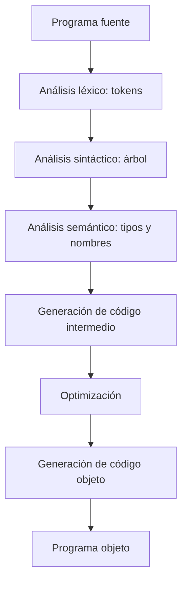

# Compiladores - Introducción a lo que es un compilador

## 1.1 Justificación.

---

Un **compilador** es un programa que traduce un programa escrito en un lenguaje, el **lenguaje fuente**, a un programa equivalente en otro, el **lenguaje objeto**, que suele ser código de máquina o el lenguaje de una máquina virtual. Es el puente entre la forma en que las personas expresan un cálculo, con variables, funciones, tipos y estructuras de control, y la forma en que el hardware lo ejecuta, con registros, direcciones e instrucciones. Este tema presenta la definición de compilador, la diferencia con un intérprete, las fases de la compilación y las razones para estudiarlos: eficiencia, portabilidad, detección temprana de errores, optimización y productividad, y el hecho de que sus técnicas aparecen en muchas otras áreas.

### Definición

Formalmente, un compilador es una función $C$ que a cada programa $P$ del lenguaje fuente $L_1$ le asocia un programa $C(P)$ del lenguaje objeto $L_2$ con el **mismo significado**: para toda entrada $x,$ ejecutar $C(P)$ con $x$ produce lo mismo que $P$ con $x.$ Esta **corrección** es la propiedad fundamental; todo lo demás, la velocidad del código, la calidad de los mensajes o la rapidez de la compilación, es secundario. Además, el compilador debe **rechazar** los programas que no pertenecen al lenguaje e informar por qué.

Un **intérprete**, en cambio, no produce un programa: ejecuta directamente el programa fuente, o una representación interna de él, con sus entradas. La frontera es difusa: Java se compila a *bytecode* que una máquina virtual interpreta y además compila **justo a tiempo** (JIT) a código de máquina; CPython compila a *bytecode* y lo interpreta; los motores de JavaScript combinan un intérprete con varios niveles de compilación.

### Fases



Las tres primeras fases forman el **análisis**, o *front-end*, que entiende el programa y detecta errores; las tres últimas, la **síntesis**, o *back-end*, que construye el programa objeto. La **representación intermedia** separa ambas partes: con $m$ lenguajes fuente y $n$ máquinas, bastan $m$ *front-ends* y $n$ *back-ends* en lugar de $m \cdot n$ compiladores, como hacen GCC y LLVM. La **tabla de símbolos**, con la información de cada identificador, la usan todas las fases.

### Por qué estudiar compiladores

1. **Eficiencia.** La traducción se hace una sola vez, antes de ejecutar, y el código resultante no paga en cada ejecución el costo de analizar el programa. Si compilar cuesta $T_c,$ ejecutar el programa compilado $T_e$ e interpretarlo $T_i,$ el costo total de $N$ ejecuciones es $T_c + N\,T_e$ frente a $N\,T_i,$ y compilar conviene cuando

    $$N \gt \frac{T_c}{T_i - T_e}$$

    La diferencia entre $T_i$ y $T_e$ varía mucho: un intérprete simple de un lenguaje dinámico puede ser de 10 a 100 veces más lento que el código compilado, y un buen JIT reduce la diferencia a casi nada.

2. **Portabilidad.** El mismo programa en C se compila para x86-64, ARM o RISC-V; el *back-end* de cada arquitectura se encarga de las diferencias.

3. **Detección temprana de errores.** El compilador rechaza programas mal formados o mal tipados antes de que se ejecuten, en lugar de que fallen en producción.

4. **Optimización.** El compilador transforma el programa en uno equivalente más rápido: calcula en tiempo de compilación las expresiones constantes, elimina código que no influye en el resultado, mueve cálculos fuera de los ciclos y asigna las variables a registros.

5. **Productividad.** Los lenguajes de alto nivel permiten escribir en pocas líneas lo que en ensamblador requeriría cientos, y el compilador garantiza que la traducción sea correcta y eficiente.

6. **Técnicas transferibles.** Las mismas técnicas se usan en intérpretes, motores de bases de datos que optimizan consultas, herramientas de análisis estático, formateadores e IDE, traductores entre lenguajes, compiladores de *shaders* y de modelos de aprendizaje automático, y en cualquier programa que procese un formato con estructura, como JSON o un archivo de configuración. Y un compilador es un ejemplo excepcional de ingeniería de software: combina teoría de lenguajes formales, algoritmos de grafos, problemas NP-completos resueltos con heurísticas y conocimiento detallado de la arquitectura.

### Implementación en Python

El programa resuelve los tres ejercicios con herramientas reales: calcula el punto de equilibrio del ejercicio 1; compila con `javac` el programa del ejercicio 2, antes y después de corregir el primer error, para ver qué fase detecta cada uno, y compila con `gcc` el código del ejercicio 3 sin optimización y con `-O2`, mostrando el ensamblador resultante; finalmente repite el plegado de constantes sobre el árbol sintáctico de Python.

```python
import ast, os, re, subprocess, tempfile

DIR = tempfile.mkdtemp()
def corre(cmd):                                   # salida y errores, sin el aviso de JAVA_TOOL_OPTIONS del entorno
    r = subprocess.run(cmd, capture_output=True, text=True, cwd=DIR)
    return [l for l in (r.stdout + r.stderr).splitlines() if not l.startswith("Picked up")]

# ---------- Ejercicio 1: ¿cuándo conviene compilar? ----------
Tc, Te, Ti = 2.0, 0.1, 1.2
N = Tc / (Ti - Te)
print(f"ejercicio 1: N > {Tc} / ({Ti} − {Te}) = {N:.3f} → compilar conviene desde la ejecución {int(N) + 1}")
for n in (1, 2, 3, 10):
    print(f"   {n:2} ejecuciones: compilar {Tc + n * Te:5.1f} s | interpretar {n * Ti:5.1f} s")

# ---------- Ejercicio 2: en qué fase se detecta cada error, con javac ----------
FUENTE = """public class Test {
    public static void main(String[] args) {
        int x = 5
        int y = "hola";
        int z = x + y;
        resultado = z * 2;
    }
}
"""
def javac(fuente):
    open(os.path.join(DIR, "Test.java"), "w").write(fuente)
    return [re.sub(r"^.*Test\.java", "Test.java", l) for l in corre(["javac", "-Xlint:none", "Test.java"]) if "Test.java" in l]
print("ejercicio 2: javac con el programa original:")
for l in javac(FUENTE): print("   " + l)
print("   javac después de agregar el punto y coma:")
for l in javac(FUENTE.replace("int x = 5\n", "int x = 5;\n")): print("   " + l)

# ---------- Ejercicio 3: plegado y propagación de constantes ----------
C = """int calcular() {
    int a = 10 * 5;
    int b = a + 2;
    int c = b * 0;
    return c + a;
}
"""
open(os.path.join(DIR, "calc.c"), "w").write(C)
for nivel in ("-O0", "-O2"):
    corre(["gcc", nivel, "-S", "-fno-asynchronous-unwind-tables", "-fcf-protection=none", "-o", "calc.s", "calc.c"])
    asm = [" ".join(l.split()) for l in open(os.path.join(DIR, "calc.s")) if l.startswith("\t") and not l.strip().startswith(".")]
    print(f"ejercicio 3: gcc {nivel}: {len(asm)} instrucciones: " + " | ".join(asm))

class Plegador(ast.NodeTransformer):              # el mismo razonamiento, sobre un árbol de Python
    def __init__(self): self.const, self.pasos = {}, []
    def visit_Name(self, n): return ast.Constant(self.const[n.id]) if n.id in self.const else n
    def visit_BinOp(self, n):
        self.generic_visit(n)
        izq, der = n.left, n.right
        if isinstance(izq, ast.Constant) and isinstance(der, ast.Constant):
            v = eval(compile(ast.fix_missing_locations(ast.Expression(n)), "", "eval")); self.pasos.append(f"{ast.unparse(n)} = {v}"); return ast.Constant(v)
        if isinstance(n.op, ast.Mult) and any(isinstance(x, ast.Constant) and x.value == 0 for x in (izq, der)):
            self.pasos.append(f"{ast.unparse(n)} = 0, porque x · 0 = 0"); return ast.Constant(0)
        return n
    def visit_Assign(self, n):
        self.generic_visit(n)
        if isinstance(n.value, ast.Constant): self.const[n.targets[0].id] = n.value.value
        return n
arbol = ast.parse("a = 10 * 5\nb = a + 2\nc = b * 0\nresultado = c + a")
p = Plegador(); arbol = p.visit(arbol)
print("   plegado paso a paso:", "; ".join(p.pasos), "→ return", p.const["resultado"])
```

Salida, con javac 21 y gcc 13 en x86-64:

```text
ejercicio 1: N > 2.0 / (1.2 − 0.1) = 1.818 → compilar conviene desde la ejecución 2
    1 ejecuciones: compilar   2.1 s | interpretar   1.2 s
    2 ejecuciones: compilar   2.2 s | interpretar   2.4 s
    3 ejecuciones: compilar   2.3 s | interpretar   3.6 s
   10 ejecuciones: compilar   3.0 s | interpretar  12.0 s
ejercicio 2: javac con el programa original:
   Test.java:3: error: ';' expected
   javac después de agregar el punto y coma:
   Test.java:4: error: incompatible types: String cannot be converted to int
   Test.java:6: error: cannot find symbol
ejercicio 3: gcc -O0: 12 instrucciones: pushq %rbp | movq %rsp, %rbp | movl $50, -12(%rbp) | movl -12(%rbp), %eax | addl $2, %eax | movl %eax, -8(%rbp) | movl $0, -4(%rbp) | movl -4(%rbp), %edx | movl -12(%rbp), %eax | addl %edx, %eax | popq %rbp | ret
ejercicio 3: gcc -O2: 2 instrucciones: movl $50, %eax | ret
   plegado paso a paso: 10 * 5 = 50; 50 + 2 = 52; 52 * 0 = 0; 0 + 50 = 50 → return 50
```

### Ejercicios Propuestos

1. **Rentabilidad.** Un programa tarda 2 segundos en compilarse, 0.1 segundos en ejecutarse compilado y 1.2 segundos en ejecutarse interpretado. ¿A partir de cuántas ejecuciones conviene compilar?

2. **Fases.** Identifica en qué fase del compilador se detectaría cada error del siguiente código:

    ```java
    public class Test {
        public static void main(String[] args) {
            int x = 5
            int y = "hola";
            int z = x + y;
            resultado = z * 2;
        }
    }
    ```

3. **Optimización.** Optimiza el siguiente fragmento:

    ```c
    int calcular() {
        int a = 10 * 5;
        int b = a + 2;
        int c = b * 0;
        return c + a;
    }
    ```

### Soluciones

**Ejercicio 1.** Compilar conviene cuando $N \gt 2/(1.2 - 0.1) = 1.82,$ es decir, a partir de la segunda ejecución: con una, compilar y ejecutar cuesta 2.1 s frente a 1.2 s de interpretar; con dos, 2.2 s frente a 2.4 s, y con diez, 3 s frente a 12 s. El modelo supone que compilar es un costo fijo que se paga una vez, y que el programa no cambia entre ejecuciones; durante el desarrollo, cuando se compila tras cada cambio, la cuenta favorece a la interpretación o a la compilación incremental.

**Ejercicio 2.** El programa tiene tres errores, de fases distintas:

- la falta del punto y coma en `int x = 5` es un error **sintáctico**: la secuencia de tokens no corresponde a la gramática de Java;
- `int y = "hola"` es un error **semántico** de tipos: es sintácticamente válido, pero se asigna una cadena a un entero;
- `resultado = z * 2` es un error **semántico** de nombres: `resultado` no está declarado, y lo detecta la consulta a la tabla de símbolos.

La línea `int z = x + y` **no** tiene error, porque `y` está declarada como `int`; el valor incorrecto de su inicialización ya se reportó. `javac` lo confirma: con el programa original solo reporta el error sintáctico, porque un error sintáctico impide construir el árbol sobre el que trabaja el análisis semántico; al corregirlo, reporta los dos semánticos, en las líneas 4 y 6. Ningún error de este programa es léxico: todos los tokens son válidos. Un error léxico sería, por ejemplo, un carácter que no pertenece al lenguaje, como `@` fuera de una anotación, o una cadena sin cerrar.

**Ejercicio 3.** Por **plegado de constantes**, $10 \cdot 5$ es 50; por **propagación de constantes**, $b = 50 + 2 = 52;$ como $b \cdot 0 = 0$ para cualquier entero, $c = 0,$ y el resultado es $0 + 50 = 50.$ Las variables `b` y `c` ya no se usan, y la **eliminación de código muerto** las quita:

```c
int calcular() {
    return 50;
}
```

`gcc` hace exactamente eso: sin optimización genera 12 instrucciones que guardan cada variable en la pila, y con `-O2` solo dos, cargar 50 en el registro de retorno `eax` y regresar. La simplificación $b \cdot 0 = 0$ es válida para enteros, pero no para números de punto flotante, porque $\infty \cdot 0$ y $\text{NaN} \cdot 0$ dan NaN y $-5.0 \cdot 0$ da $-0.0;$ por eso los compiladores solo la aplican a flotantes con opciones como `-ffast-math`.

En el material original, el ejemplo de abstracción y productividad era una expresión de Python que CPython no compila a código de máquina sino a *bytecode* que luego interpreta, y la conclusión usaba la palabra inglesa *beyond*.

### Referencias

1. Aho, A. V., Lam, M. S., Sethi, R., and Ullman, J. D., _Compilers: Principles, Techniques, and Tools_. 2a ed., Pearson, 2007. Capítulo 1.
2. Cooper, K. D., and Torczon, L., _Engineering a Compiler_. 3a ed., Morgan Kaufmann, 2022. Capítulo 1.
3. Appel, A. W., _Modern Compiler Implementation in Java_. 2a ed., Cambridge University Press, 2002.
4. Scott, M. L., _Programming Language Pragmatics_. 4a ed., Morgan Kaufmann, 2015.
5. Nystrom, R., _Crafting Interpreters_. Genever Benning, 2021.
