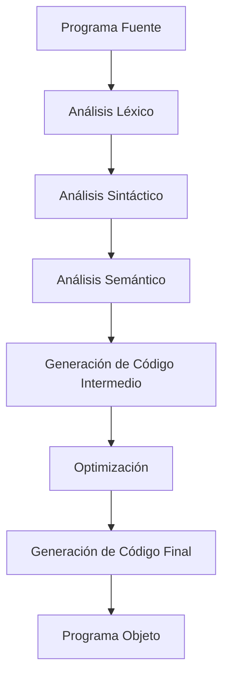

# Compiladores - Introducción a lo que es un compilador

## 1.1 Justificación.

---

Un compilador es un programa que traduce código escrito en un lenguaje de programación (lenguaje fuente) a otro lenguaje (generalmente lenguaje de destino o código objeto). La justificación de su estudio radica en su papel fundamental como puente entre la abstracción de los lenguajes de programación y la ejecución eficiente en hardware.

### Definición Formal

Un compilador es un programa que acepta como entrada un programa escrito en un lenguaje $L_1$ (lenguaje fuente) y lo traduce a un programa equivalente en otro lenguaje $L_2$ (lenguaje destino), preservando el significado del programa original.

### Funciones Principales de un Compilador

Las funciones esenciales de un compilador pueden representarse mediante el siguiente diagrama:



#### Proceso de Compilación

El proceso de compilación puede dividirse en dos fases principales:

1. **Fase de Análisis (Front-end)**
   - Análisis léxico
   - Análisis sintáctico
   - Análisis semántico

2. **Fase de Síntesis (Back-end)**
   - Generación de código intermedio
   - Optimización de código
   - Generación de código final

### Justificación del Estudio de Compiladores

#### 1. Eficiencia en la Ejecución

Los programas compilados se ejecutan significativamente más rápido que los interpretados, ya que el trabajo de traducción se realiza antes de la ejecución. La relación de velocidad puede expresarse como:

$$T_{\text{compilado}} = T_{\text{compilación}} + \frac{T_{\text{interpretado}}}{R}$$

Donde $R$ es el factor de mejora (típicamente entre 10 y 100).

#### 2. Portabilidad entre Plataformas

Los compiladores permiten que el mismo código fuente pueda ejecutarse en diferentes arquitecturas mediante la recompilación:

```c
// Ejemplo de código portable en C
#include <stdio.h>

int main() {
    printf("Hello, World!\n");
    return 0;
}
```

El mismo código puede compilarse para x86, ARM, u otras arquitecturas.

#### 3. Detección Temprana de Errores

Los compiladores realizan verificaciones exhaustivas que permiten detectar errores antes de la ejecución:

```java
// Ejemplo de error detectado en compilación
public class Test {
    public static void main(String[] args) {
        int x = "hello";  // Error de tipo detectado en compilación
    }
}
```

#### 4. Optimización de Código

Los compiladores aplican transformaciones que mejoran el rendimiento del código:

**Antes de la optimización:**

```c
int calculo() {
    int x = 5 * 2;      // Puede calcularse en tiempo de compilación
    return x + 10;
}
```

**Después de la optimización (equivalente):**

```c
int calculo() {
    return 20;          // Resultado precalculado
}
```

#### 5. Abstracción y Productividad

Permiten el uso de lenguajes de alto nivel que son más fáciles de entender y mantener:

```python
# Código de alto nivel
resultado = sum(x * x for x in range(10) if x % 2 == 0)
```

Que se traduce a operaciones de bajo nivel eficientes.

### Fórmulas Relacionadas

#### Tiempo Total de Ejecución

El tiempo total de ejecución considerando compilación es:

$$T_{\text{total}} = T_c + N \times T_e$$

Donde:

- $T_c$ = Tiempo de compilación
- $N$ = Número de ejecuciones
- $T_e$ = Tiempo de ejecución por invocación

#### Rentabilidad de la Compilación

La compilación es rentable cuando:

$$N > \frac{T_c}{T_i - T_e}$$

Donde $T_i$ es el tiempo de ejecución interpretado.

### Ejercicios Propuestos

1. **Análisis de Rentabilidad:**
   Suponiendo que un programa tarda 2 segundos en compilarse, 0.1 segundos en ejecutarse compilado, y 1.2 segundos en ejecutarse interpretado. ¿A partir de cuántas ejecuciones es rentable compilar?

   **Solución:**
   $$N > \frac{2}{1.2 - 0.1} = \frac{2}{1.1} \approx 1.82$$
   Por lo tanto, a partir de 2 ejecuciones es rentable.

2. **Identificación de Fases:**
   Dado el siguiente código, identifique en qué fase del compilador se detectaría cada error:

   ```java
   public class Test {
       public static void main(String[] args) {
           int x = 5
           int y = "hola";
           int z = x + y;
           resultado = z * 2;
       }
   }
   ```

3. **Optimización Básica:**
   Optimice el siguiente fragmento de código:
   ```c
   int calcular() {
       int a = 10 * 5;
       int b = a + 2;
       int c = b * 0;
       return c + a;
   }
   ```

### Referencias

#### Bibliografía Básica

1. Aho, A. V., Lam, M. S., Sethi, R., & Ullman, J. D. (2007). Compilers: Principles, Techniques, and Tools (2nd ed.). Pearson Education.
2. Cooper, K. D., & Torczon, L. (2004). Engineering a Compiler. Morgan Kaufmann.
3. Scott, M. L. (2009). Programming Language Pragmatics. Morgan Kaufmann.

#### Bibliografía Complementaria

1. Grune, D., Bal, H. E., Jacobs, C. J. H., & Langendoen, K. G. (2000). Modern Compiler Design. John Wiley & Sons.
2. Wilhelm, R., & Maurer, D. (1995). Compiler Design. Addison-Wesley.

### Conclusión

El estudio de compiladores está justificado por su papel crucial en la transformación eficiente de abstracciones de alto nivel en código ejecutable optimizado, permitiendo el desarrollo de software portable, eficiente y confiable. Los conceptos aprendidos en el diseño de compiladores tienen aplicaciones beyond la compilación tradicional, incluyendo procesamiento de lenguaje natural, análisis estático de código y optimización de consultas en bases de datos.
