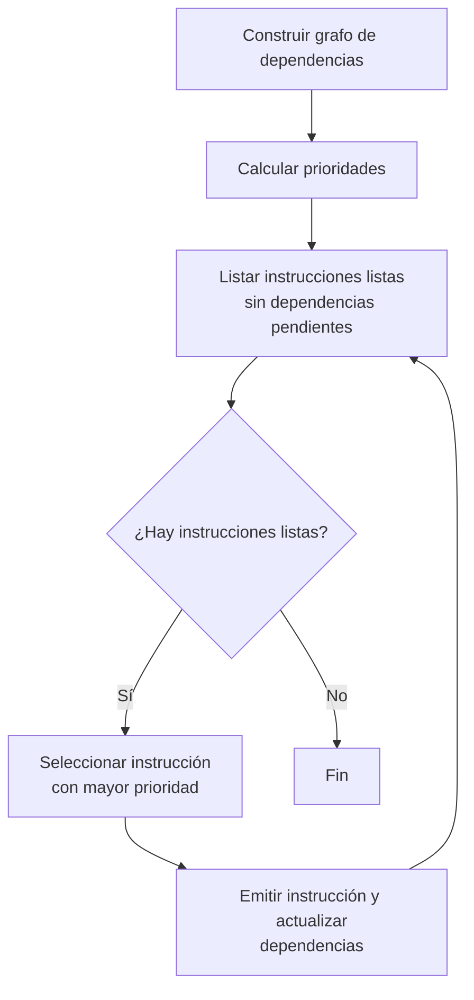

# Compiladores - Programación de instrucciones

## 11.1 Aspectos importantes.

---

La programación de instrucciones es una fase crítica en el proceso de compilación que se encarga de seleccionar y secuenciar las instrucciones de máquina para implementar las operaciones del código intermedio. Según Cooper y Torczon (2004), este proceso determina en gran medida la eficiencia del código ejecutable resultante.

### Definiciones Fundamentales

#### Instrucción de Máquina

Una operación elemental que puede ejecutar directamente el procesador objetivo. Cada instrucción typically tiene un código de operación (opcode) y cero o más operandos.

#### Costo de Instrucción

Medida cuantitativa del "precio" de ejecutar una instrucción, que puede basarse en:

- Ciclos de reloj
- Consumo energético
- Tamaño en memoria

  $$CostoTotal = \sum_{i=1}^{n} (frecuencia_i \times costo_i)$$

#### Secuencia de Instrucciones

Ordenamiento específico de instrucciones de máquina que implementa una operación o conjunto de operaciones.

### Aspectos Clave en la Programación de Instrucciones

#### Selección de Instrucciones

Proceso de elegir la secuencia de instrucciones de máquina que implementa una operación del código intermedio. Según Aho et al. (2007), este proceso debe minimizar el costo total.

**Ejemplo**: Implementación de una operación aritmética

```c
// Código intermedio: t1 = a + b * c

// Implementación ineficiente
LOAD R1, b
LOAD R2, c
MUL R3, R1, R2  ; R3 = b * c
LOAD R4, a
ADD R5, R4, R3  ; R5 = a + (b * c)
STORE t1, R5

// Implementación optimizada (usando instrucciones combinadas)
LOAD R1, c
LOAD R2, b
MUL R3, R1, R2  ; R3 = b * c
ADD R3, R3, a   ; R3 = a + (b * c)
STORE t1, R3
```

#### Asignación de Registros

Proceso de decidir qué valores residen en registros en cada punto del programa. Existen dos enfoques principales:

1. **Asignación de registros por uso** (register per variable)
2. **Asignación de registros por live-ranges** (basado en análisis de vida de variables)

**Fórmula para el número mínimo de registros**:

$$Reg_{min} = max_{v \in bloques}(live(v))$$

Donde $live(v)$ es el número de variables vivas en el punto $v$.

#### Secuenciación de Instrucciones

Ordenamiento de instrucciones para minimizar stalls de pipeline y maximizar el paralelismo a nivel de instrucción (ILP).

**Ejemplo de reordenamiento**:

```asm
; Secuencia original (con stalls)
LOAD R1, [address1]  ; Ciclo 1
ADD R2, R1, R3       ; Ciclo 3 (stall de 1 ciclo esperando R1)
MUL R4, R2, R5       ; Ciclo 5 (stall de 1 ciclo esperando R2)

; Secuencia optimizada
LOAD R1, [address1]  ; Ciclo 1
OTRA_OPERACION R6, R7, R8  ; Ciclo 2 (instrucción independiente)
ADD R2, R1, R3       ; Ciclo 3 (sin stall)
MUL R4, R2, R5       ; Ciclo 4 (sin stall)
```

#### Consideraciones Arquitectónicas

Diferentes arquitecturas imponen diferentes restricciones:

- **CISC**: Instrucciones complejas, múltiples modos de direccionamiento
- **RISC**: Instrucciones simples, modos de direccionamiento limitados
- **VLIW**: Múltiples operaciones por instrucción
- **SIMD**: Operaciones vectoriales

### Algoritmos Importantes

#### Algoritmo de Sethi-Ullman para generación de código con registros limitados

Para expresiones aritméticas, determina el orden de evaluación que minimiza el uso de registros:

```python
def sethi_ullman(nodo):
    if nodo es hoja:
        return 1
    else:
        izquierdo = sethi_ullman(nodo.izquierdo)
        derecho = sethi_ullman(nodo.derecho)
        if izquierdo == derecho:
            return izquierdo + 1
        else:
            return max(izquierdo, derecho)
```

#### Algoritmo de ordenamiento de instrucciones para pipeline



### Ejercicios Propuestos

#### Ejercicio 1: Selección de Instrucciones

Dada la expresión intermedia `x = (a + b) * (c - d) / e`:

1. Genere dos secuencias de instrucciones diferentes
2. Calcule el costo de cada secuencia asumiendo:
   - LOAD/STORE: 3 ciclos
   - Operaciones aritméticas: 1 ciclo
3. Identifique cuál es más eficiente

#### Ejercicio 2: Asignación de Registros

Para el siguiente fragmento de código:

```c
a = b + c;
d = a * e;
f = d + g;
h = f - a;
```

1. Realice el análisis de liveness
2. Determine el número mínimo de registros necesarios
3. Asigne registros usando el algoritmo de coloring con 4 registros disponibles

#### Ejercicio 3: Secuenciación para Pipeline

Reordene las siguientes instrucciones para minimizar stalls en un pipeline de 5 etapas con:

- Hazard de datos: 1 ciclo de stall si el operando es el resultado de la instrucción anterior

```asm
LOAD R1, [A]
ADD R2, R1, R3
MUL R4, R2, R5
SUB R6, R4, R7
STORE [B], R6
```

### Técnicas Avanzadas

#### Instrucciones Especializadas

Muchos procesadores modernos incluyen instrucciones especializadas que pueden realizar múltiples operaciones:

- **Instrucciones de multiplicación-acumulación (MAC)**: `R1 = R1 + (R2 * R3)`
- **Instrucciones de movimiento condicional**: `CMOVcc dest, src`
- **Instrucciones SIMD**: Operaciones vectoriales sobre múltiples datos

#### Consideraciones de Energía y Potencia

En sistemas embebidos y móviles, la selección de instrucciones afecta el consumo energético:

$$E_{total} = \sum_{i=1}^{n} (frecuencia_i \times energia_i)$$

Donde $energia_i$ es el consumo energético de la instrucción $i$.

### Referencias

1. Cooper, K. D., & Torczon, L. (2004). _Engineering a Compiler_. Morgan Kaufmann. (Capítulo 7: Instruction Selection)
2. Aho, A. V., Lam, M. S., Sethi, R., & Ullman, J. D. (2007). _Compilers: Principles, Techniques, and Tools_ (2nd ed.). Pearson Education. (Capítulo 8: Code Generation)
3. Scott, M. L. (2009). _Programming Language Pragmatics_. Morgan Kaufmann. (Capítulo 15: Code Generation and Improvement)

### Recursos Adicionales

- Herramientas para experimentación: GCC, LLVM, SPIM (simulador MIPS)
- Bibliografía complementaria sobre arquitecturas específicas (ARM, x86, RISC-V)
- Papers sobre técnicas avanzadas de selección de instrucciones basadas en árboles y DAGs
