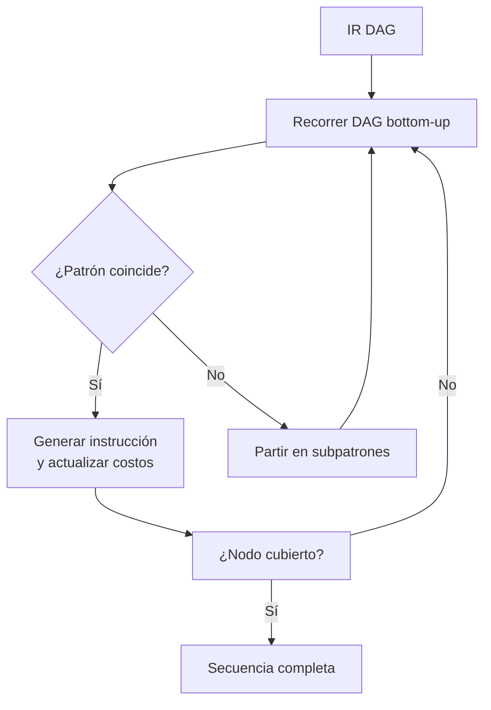

# Compiladores - Programación de instrucciones

## 11.2 El problema de la programación de instrucciones.

---

El problema de la programación de instrucciones es fundamental en el diseño de compiladores. Según Aho et al. (2007), consiste en transformar una representación intermedia de un programa en una secuencia de instrucciones de máquina que implemente correctamente la semántica del programa mientras optimiza uno o más criterios como el tiempo de ejecución, el uso de memoria o el consumo energético.

### Definición Formal

El problema de la programación de instrucciones puede definirse como:

Dado:

- Un programa en representación intermedia $P_{ir}$
- Un conjunto de instrucciones de máquina $I = \{i_1, i_2, ..., i_n\}$
- Un conjunto de restricciones arquitectónicas $C$
- Una función de costo $f: Secuencias \rightarrow \mathbb{R}^+$

Encontrar:

- Una secuencia de instrucciones $S = [i_{j_1}, i_{j_2}, ..., i_{j_m}]$ donde $i_{j_k} \in I$
- Que implemente correctamente $P_{ir}$
- Que satisfaga todas las restricciones en $C$
- Que minimice (o maximice) $f(S)$

### Componentes del Problema

#### 1. Espacio de Búsqueda

El conjunto de todas las secuencias de instrucciones válidas que implementan correctamente el programa intermedio. Para incluso fragmentos pequeños de código, este espacio puede ser extremadamente grande.

$$ |Espacio| = \prod_{k=1}^{n} O(m^{a_k}) $$

Donde $m$ es el número de instrucciones disponibles y $a_k$ es el número de operaciones en el bloque básico $k$.

#### 2. Restricciones Arquitectónicas

Las restricciones típicas incluyen:

- **Limitaciones de registros**: Número finito de registros disponibles
- **Dependencias de datos**: Deben preservarse los órdenes de lectura-escritura
- **Restricciones de direccionamiento**: Ciertas instrucciones solo funcionan con modos de direccionamiento específicos
- **Latencia de instrucciones**: Algunas instrucciones requieren múltiples ciclos

#### 3. Función de Costo

La función objetivo a optimizar puede ser:

$$ Costo(S) = \sum_{i=1}^{n} ciclos(i) \times frecuencia(i) $$

O alternativamente para tamaño de código:

$$ \text{Tamaño}(S) = \sum_{i=1}^{n} bytes(i) $$

### Complejidad Computacional

El problema general de la programación de instrucciones es NP-completo. Esto se demuestra mediante la reducción del problema del conjunto de cubierta (set cover) al problema de selección de instrucciones.

### Enfoques de Solución

#### 1. Enfoque basado en Coincidencia de Patrones



#### 2. Algoritmo de Selección de Instrucciones

```python
def seleccionar_instrucciones(dag, patrones):
    # Inicializar costos
    costos = {nodo: float('inf') for nodo in dag.nodos}
    instrucciones = {nodo: None for nodo in dag.nodos}

    # Recorrer nodos en orden bottom-up
    for nodo in orden_topologico_inverso(dag):
        for patron in patrones_compatibles(nodo, patrones):
            costo_patron = calcular_costo(patron)
            cubiertos = nodos_cubiertos(patron, nodo)
            costo_total = costo_patron + sum(costos[n] for n in cubiertos if n != nodo)

            if costo_total < costos[nodo]:
                costos[nodo] = costo_total
                instrucciones[nodo] = patron

    return reconstruir_secuencia(instrucciones, dag)
```

#### 3. Programación Dinámica para Expresiones

Para expresiones aritméticas, podemos usar el algoritmo de Sethi-Ullman:

$$ need(n) = \begin{cases}  1 & \text{if } n \text{ es hoja} \\\ max(need(left(n)), need(right(n))) & \text{if } need(left(n)) \neq need(right(n)) \\\ need(left(n)) + 1 & \text{if } need(left(n)) = need(right(n))  \end{cases} $$

### Ejemplo Detallado

**Expresión intermedia**: `t = (a + b) * c`

**Patrones disponibles**:

- `LOAD r, m` (costo: 2, carga de memoria a registro)
- `ADD r1, r2, r3` (costo: 1, suma de registros)
- `MUL r1, r2, r3` (costo: 3, multiplicación de registros)
- `ADD r1, r2, m` (costo: 2, suma de registro con memoria)

**Posibles secuencias**:

1. Secuencia con 3 registros:

   ```
   LOAD R1, a
   LOAD R2, b
   ADD R3, R1, R2
   LOAD R1, c
   MUL R2, R3, R1
   STORE t, R2
   Costo: 2+2+1+2+3 = 10
   ```

2. Secuencia con 2 registros (óptima):
   ```
   LOAD R1, a
   ADD R1, R1, b   ; Usando modo de direccionamiento con memoria
   MUL R1, R1, c   ; Usando modo de direccionamiento con memoria
   STORE t, R1
   Costo: 2+2+3 = 7
   ```

### Ejercicios Propuestos

#### Ejercicio 1: Análisis de Complejidad

Para la expresión `(a * b) + (c * d) + (e * f)`:

1. Construya el DAG de la expresión
2. Calcule el número mínimo de registros necesarios usando el algoritmo de Sethi-Ullman
3. Encuentre al menos dos secuencias de instrucciones diferentes
4. Calcule el costo de cada secuencia

#### Ejercicio 2: Problema de Decisión

Demuestre que el siguiente problema es NP-completo:
"Dado un DAG de expresión y un número k, ¿existe una secuencia de instrucciones con costo ≤ k?"

#### Ejercicio 3: Algoritmo de Programación Dinámica

Implemente el algoritmo de programación dinámica para la selección de instrucciones de una expresión aritmética simple. Asuma:

- 4 patrones de instrucciones básicos
- Costos arbitrarios para cada instrucción
- Número ilimitado de registros

### Retos y Consideraciones Prácticas

#### 1. Interacción con la Asignación de Registros

La selección de instrucciones y la asignación de registros están íntimamente relacionadas. Una decisión óptima localmente para la selección de instrucciones puede llevar a una asignación de registros subóptima globalmente.

#### 2. Arquitecturas con Restricciones Especiales

Algunas arquitecturas tienen restricciones particulares:

- Instrucciones que solo operan en registros específicos
- Restricciones de alineamiento de memoria
- Modos de direccionamiento limitados

#### 3. Optimizaciones Basadas en Perfil

La programación de instrucciones puede beneficiarse de información de perfil de ejecución:

$$ CostoEfectivo(i) = \sum_{caminos} probabilidad(camino) \times costo(i, camino) $$

### Referencias

1. Aho, A. V., Lam, M. S., Sethi, R., & Ullman, J. D. (2007). Compilers: Principles, Techniques, and Tools (2nd ed.). Pearson Education. (Capítulo 8: Code Generation)

2. Cooper, K. D., & Torczon, L. (2004). Engineering a Compiler. Morgan Kaufmann. (Capítulo 7: Instruction Selection)

3. Aho, A. V., & Johnson, S. C. (1976). Optimal code generation for expression trees. Journal of the ACM, 23(3), 488-501.

4. Fraser, C. W., & Hanson, D. R. (1995). A Retargetable C Compiler: Design and Implementation. Addison-Wesley.

### Conclusión

El problema de la programación de instrucciones es un desafío complejo que combina aspectos de diseño de algoritmos, teoría de complejidad computacional y conocimiento arquitectónico. Los compiladores modernos utilizan una combinación de técnicas heurísticas, programación dinámica y coincidencia de patrones para encontrar soluciones cercanas al óptimo en tiempo razonable.

La comprensión de este problema fundamental es esencial para cualquier ingeniero de compiladores, ya que impacta directamente en la eficiencia del código generado y, por extensión, en el rendimiento de las aplicaciones compiladas.
