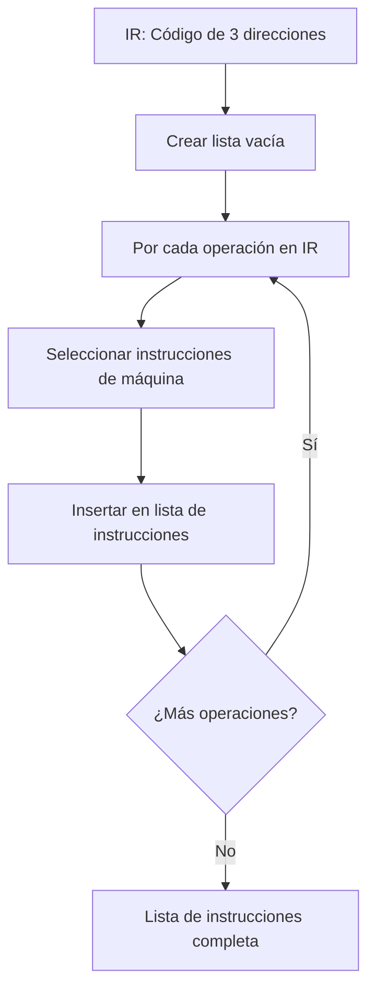

# Compiladores - Programación de instrucciones

## 11.3 Programación en listas.

---

La programación en listas es una técnica fundamental en la generación de código que permite organizar y manipular secuencias de instrucciones de manera eficiente. Según Cooper y Torczon (2004), este enfoque es particularmente útil para representar y transformar código durante las fases de selección y optimización de instrucciones.

### Definición

La **programación en listas** se refiere a la representación y manipulación de secuencias de instrucciones mediante estructuras de datos de tipo lista, donde cada nodo contiene una instrucción y referencias a sus predecesoras y sucesoras. Esta representación facilita operaciones como inserción, eliminación y reordenamiento de instrucciones.

Formalmente, una lista de instrucciones $L$ puede definirse como:

$$L = \{i_1, i_2, i_3, ..., i_n\}$$

donde cada instrucción $i_k$ tiene:

- Un código de operación $op_k$
- Operandos de entrada $in_{k,1}, in_{k,2}, ..., in_{k,m}$
- Operandos de salida $out_{k,1}, out_{k,2}, ..., out_{k,p}$
- Punteros a instrucciones precedentes y siguientes

### Estructura de Datos para Listas de Instrucciones

```c
typedef struct Instruction {
    int opcode;          // Código de operación
    Operand *inputs;     // Lista de operandos de entrada
    Operand *outputs;    // Lista de operandos de salida
    int latency;         // Latencia de la instrucción
    int cost;            // Costo de ejecución
    struct Instruction *prev;  // Instrucción anterior
    struct Instruction *next;  // Instrucción siguiente
} Instruction;

typedef struct InstructionList {
    Instruction *head;   // Primera instrucción
    Instruction *tail;   // Última instrucción
    int length;          // Longitud de la lista
} InstructionList;
```

### Operaciones Básicas sobre Listas de Instrucciones

#### 1. Inserción de Instrucciones

```python
def insert_instruction(lista, nueva_instruccion, posicion):
    if lista.head is None:  # Lista vacía
        lista.head = nueva_instruccion
        lista.tail = nueva_instruccion
    elif posicion == "inicio":
        nueva_instruccion.next = lista.head
        lista.head.prev = nueva_instruccion
        lista.head = nueva_instruccion
    elif posicion == "final":
        lista.tail.next = nueva_instruccion
        nueva_instruccion.prev = lista.tail
        lista.tail = nueva_instruccion
    else:  # Inserción después de una instrucción específica
        temp = lista.head
        while temp is not None and temp != posicion:
            temp = temp.next
        if temp is not None:
            nueva_instruccion.next = temp.next
            nueva_instruccion.prev = temp
            if temp.next is not None:
                temp.next.prev = nueva_instruccion
            temp.next = nueva_instruccion
            if temp == lista.tail:
                lista.tail = nueva_instruccion
    lista.length += 1
```

#### 2. Eliminación de Instrucciones

```python
def remove_instruction(lista, instruccion):
    if instruccion.prev is not None:
        instruccion.prev.next = instruccion.next
    else:
        lista.head = instruccion.next

    if instruccion.next is not None:
        instruccion.next.prev = instruccion.prev
    else:
        lista.tail = instruccion.prev

    lista.length -= 1
    return instruccion
```

#### 3. Búsqueda en la Lista

```python
def find_instruction(lista, criterio):
    resultados = []
    actual = lista.head
    while actual is not None:
        if criterio(actual):  # Función que evalúa el criterio
            resultados.append(actual)
        actual = actual.next
    return resultados
```

### Aplicaciones en Compiladores

#### 1. Generación de Código Básico



#### 2. Reordenamiento de Instrucciones

Las listas facilitan el reordenamiento para optimizar el pipeline:

```python
def reorder_for_pipeline(instruction_list):
    # Crear lista de instrucciones listas para ejecutar
    ready_list = [inst for inst in get_all_instructions(instruction_list)
                 if has_no_unfulfilled_dependencies(inst)]

    ordered_list = InstructionList()

    while ready_list:
        # Seleccionar instrucción con mayor prioridad
        next_inst = select_highest_priority(ready_list)
        remove_from_list(ready_list, next_inst)

        # Añadir a la lista ordenada
        append_instruction(ordered_list, next_inst)

        # Actualizar dependencias y añadir nuevas instrucciones listas
        for successor in get_successors(next_inst):
            if is_now_ready(successor):
                ready_list.append(successor)

    return ordered_list
```

#### 3. Eliminación de Código Muerto

```python
def dead_code_elimination(instruction_list):
    changed = True
    while changed:
        changed = False
        current = instruction_list.tail  # Empezar desde el final

        while current is not None:
            if is_dead(current):  # La salida no se usa posteriormente
                remove_instruction(instruction_list, current)
                changed = True
            current = current.prev
```

### Ejemplo: Generación de Código para una Expresión Aritmética

**Expresión**: `z = (a + b) * (c - d)`

**Código de tres direcciones**:

```
t1 = a + b
t2 = c - d
z = t1 * t2
```

**Lista de instrucciones generada**:

```asm
LOAD R1, a      ; Instrucción 1
LOAD R2, b      ; Instrucción 2
ADD R3, R1, R2  ; Instrucción 3
LOAD R4, c      ; Instrucción 4
LOAD R5, d      ; Instrucción 5
SUB R6, R4, R5  ; Instrucción 6
MUL R7, R3, R6  ; Instrucción 7
STORE z, R7     ; Instrucción 8
```

### Ejercicios Propuestos

#### Ejercicio 1: Implementación de Lista de Instrucciones

Implemente en C++ o Python una estructura de datos para listas de instrucciones con las siguientes operaciones:

- Inserción al inicio, final y posición arbitraria
- Eliminación por posición o por valor
- Búsqueda por código de operación
- Búsqueda por operandos
- Conteo de instrucciones por tipo

#### Ejercicio 2: Optimización de Lista

Dada la siguiente lista de instrucciones:

```asm
1. LOAD R1, a
2. LOAD R2, b
3. ADD R3, R1, R2
4. STORE temp, R3
5. LOAD R4, temp
6. LOAD R5, c
7. MUL R6, R4, R5
8. STORE result, R6
```

Escriba un algoritmo que:

1. Identifique las instrucciones redundantes (4 y 5)
2. Elimine las instrucciones redundantes
3. Actualice las referencias apropiadamente

#### Ejercicio 3: Reordenamiento para Pipeline

Para la siguiente secuencia con dependencias:

```asm
1. LOAD R1, [x]    ; Depende de: ninguna
2. LOAD R2, [y]    ; Depende de: ninguna
3. ADD R3, R1, R2  ; Depende de: 1, 2
4. MUL R4, R3, R2  ; Depende de: 2, 3
5. STORE [z], R4   ; Depende de: 4
```

Aplique un algoritmo de reordenamiento considerando:

- Latencia de LOAD: 3 ciclos
- Latencia de ADD: 2 ciclos
- Latencia de MUL: 4 ciclos
- Latencia de STORE: 1 ciclo

### Consideraciones de Implementación

#### 1. Eficiencia en el Manipulación de Listas

Las operaciones sobre listas de instrucciones deben ser eficientes. Para compiladores que manejan grandes cantidades de código, se utilizan estructuras especializadas:

```c
// Estructura optimizada para listas de instrucciones
typedef struct OptimizedInstructionList {
    Instruction **array;     // Array para acceso rápido por índice
    Instruction *head;       // Para recorrido secuencial
    Instruction *tail;
    int capacity;            // Capacidad del array
    int size;                // Número actual de instrucciones
    HashTable *opcode_index; // Tabla hash para búsqueda por opcode
} OptimizedInstructionList;
```

#### 2. Mantenimiento de Dependencias

Al manipular listas de instrucciones, es crucial mantener actualizadas las dependencias entre instrucciones:

$$ D(i_j) = \{i_k | i_k \text{ define un operando usado por } i_j\} $$

#### 3. Integración con Otras Fases del Compilador

Las listas de instrucciones interactúan con múltiples fases del compilador:

- Análisis de liveliness
- Asignación de registros
- Optimización de bucles
- Planificación de instrucciones

### Referencias

1. Cooper, K. D., & Torczon, L. (2004). _Engineering a Compiler_. Morgan Kaufmann. (Capítulo 7: Instruction Selection)

2. Aho, A. V., Lam, M. S., Sethi, R., & Ullman, J. D. (2007). _Compilers: Principles, Techniques, and Tools_ (2nd ed.). Pearson Education. (Capítulo 8: Code Generation)

3. Muchnick, S. S. (1997). _Advanced Compiler Design and Implementation_. Morgan Kaufmann. (Capítulo 7: Intermediate Representations)

4. Fraser, C. W., & Hanson, D. R. (1995). _A Retargetable C Compiler: Design and Implementation_. Addison-Wesley. (Capítulo 5: Intermediate Representation)

La programación en listas es una técnica fundamental que proporciona la flexibilidad necesaria para implementar transformaciones y optimizaciones complejas en compiladores modernos.
