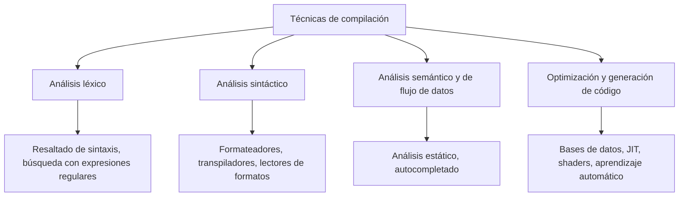

# Compiladores - Introducción a lo que es un compilador

## 1.2 Áreas de aplicación.

---

Un compilador es, en esencia, un programa que lee un texto con estructura, lo entiende y produce otro texto o una acción con el mismo significado. Esa capacidad sirve mucho más allá de traducir C a código de máquina: está en los motores de bases de datos, los navegadores, las tarjetas gráficas, los editores de código, las herramientas que buscan errores sin ejecutar los programas y los sistemas de aprendizaje automático. Este tema recorre las principales áreas de aplicación de las técnicas de compilación, con ejemplos ejecutables de traducción entre lenguajes, optimización de consultas y análisis estático.

### Compilación tradicional y cruzada

La aplicación clásica traduce un lenguaje de alto nivel a código de máquina: C, C++, Rust, Go o Fortran a x86-64, ARM o RISC-V. Un **compilador cruzado** se ejecuta en una arquitectura y genera código para otra, como se hace para microcontroladores, teléfonos o sistemas embebidos, que no pueden alojar un compilador; GCC y Clang lo hacen eligiendo el *back-end* con una **tripleta de destino**, como `aarch64-linux-gnu`. Java, C# y Kotlin se compilan a **bytecode** para una máquina virtual, y el mismo archivo se ejecuta en cualquier plataforma que la tenga.

### Compilación justo a tiempo

Un **JIT** compila durante la ejecución, cuando ya sabe qué partes del programa se usan mucho y con qué tipos de datos. La máquina virtual de Java, los motores de JavaScript como V8 y PyPy empiezan interpretando, cuentan cuántas veces se ejecuta cada función o ciclo y compilan las partes **calientes**, con optimizaciones basadas en lo observado; si una suposición deja de cumplirse, por ejemplo llega un tipo nuevo, **desoptimizan** y vuelven al intérprete. El costo de compilar se amortiza en las ejecuciones: si una función compilada una vez se ejecuta $f$ veces, su costo por ejecución es $T_e + T_c/f,$ que tiende a $T_e$ cuando $f$ crece.

### Traducción entre lenguajes

Un **transpilador** traduce entre lenguajes de nivel parecido: TypeScript a JavaScript, código moderno de JavaScript a versiones antiguas con Babel, C++ a C en los primeros compiladores de C++, o Python a C en Cython. Es un compilador completo, con análisis léxico y sintáctico, aunque la síntesis es más sencilla porque el lenguaje objeto tiene estructuras parecidas.

### Lenguajes específicos del dominio y bases de datos

Un **lenguaje específico del dominio** (DSL) se diseña para un área concreta: SQL para consultas, expresiones regulares para patrones de texto, HTML y CSS para documentos, LaTeX, Make, o los lenguajes de configuración de infraestructura. Los motores de bases de datos son compiladores de SQL: analizan la consulta, la convierten en un **plan lógico** de operadores del álgebra relacional, lo **reescriben**, por ejemplo convirtiendo subconsultas en *semijoins* o empujando los filtros hacia las tablas, y eligen un **plan físico**, qué índices usar y en qué orden combinar las tablas, con un modelo de costos basado en estadísticas de los datos. PostgreSQL y otros compilan además a código de máquina con LLVM las expresiones de las consultas más costosas.

### Análisis estático y herramientas de desarrollo

Las herramientas de **análisis estático** usan el *front-end* y el análisis de flujo de datos de un compilador para encontrar errores sin ejecutar el programa: desreferencias de valores nulos, variables sin usar, recursos sin cerrar, desbordamientos o vulnerabilidades. Ejemplos son los avisos de los propios compiladores, Clang Static Analyzer, SpotBugs, Infer, ESLint y Pylint. Los **editores** y entornos de desarrollo usan un analizador léxico para el resaltado y uno sintáctico tolerante a errores para el autocompletado y la navegación, hoy mediante el protocolo LSP; los **formateadores** reimprimen el árbol sintáctico.

### Gráficos, aprendizaje automático y hardware

Los **shaders**, programas que se ejecutan en la GPU para calcular la posición de cada vértice o el color de cada píxel, se escriben en GLSL, HLSL o WGSL y se compilan, a menudo al ejecutarse el programa, al código de cada fabricante, mediante representaciones intermedias como SPIR-V. Los compiladores de **aprendizaje automático**, como XLA, TVM y el de PyTorch, convierten un grafo de operaciones con tensores en código optimizado para GPU o aceleradores, fusionando operaciones para no escribir resultados intermedios en memoria. Los **lenguajes de descripción de hardware**, Verilog y VHDL, se sintetizan a circuitos.

### Otras áreas

Las técnicas de análisis sintáctico se aplican al **procesamiento de lenguaje natural**, aunque las gramáticas de los idiomas son ambiguas y los métodos actuales son estadísticos; los motores de **Prolog** compilan las reglas a una máquina abstracta, la WAM de Warren, y los **procesadores de documentos** y formatos de datos, como JSON, XML o los protocolos de red, necesitan analizadores.



### Implementación en Python

El programa implementa un pequeño traductor de un subconjunto de Python a JavaScript con el módulo `ast` y ejecuta el resultado con Node.js; ejecuta en SQLite la consulta del ejercicio 2 y dos reescrituras, comparando los resultados y los planes de ejecución, sin y con un índice; implementa un análisis estático de nulidad y de variables sin usar para el método del ejercicio 3, y calcula la ley de Amdahl del ejercicio 4.

```python
import ast, os, sqlite3, subprocess, tempfile

# ---------- Ejercicio 1: un traductor de un subconjunto de Python a JavaScript ----------
OPS = {ast.Add: "+", ast.Sub: "-", ast.Mult: "*", ast.Div: "/", ast.Mod: "%", ast.LtE: "<=", ast.Lt: "<",
       ast.GtE: ">=", ast.Gt: ">", ast.Eq: "===", ast.NotEq: "!=="}
class AJavaScript(ast.NodeVisitor):
    def __init__(self): self.declaradas = set()
    def expr(self, n):
        if isinstance(n, ast.Constant): return repr(n.value)
        if isinstance(n, ast.Name): return n.id
        if isinstance(n, ast.BinOp):
            if isinstance(n.op, ast.FloorDiv): return f"Math.floor({self.expr(n.left)} / {self.expr(n.right)})"   # // no existe en JS
            return f"({self.expr(n.left)} {OPS[type(n.op)]} {self.expr(n.right)})"
        if isinstance(n, ast.Compare): return f"({self.expr(n.left)} {OPS[type(n.ops[0])]} {self.expr(n.comparators[0])})"
        if isinstance(n, ast.IfExp): return f"({self.expr(n.test)} ? {self.expr(n.body)} : {self.expr(n.orelse)})"
        if isinstance(n, ast.Call):
            nombre = "console.log" if n.func.id == "print" else n.func.id
            return f"{nombre}({', '.join(self.expr(a) for a in n.args)})"
        raise NotImplementedError(type(n).__name__)
    def stmt(self, n, s=""):
        if isinstance(n, ast.FunctionDef):
            cuerpo = "\n".join(self.stmt(x, s + "  ") for x in n.body)
            return f"{s}function {n.name}({', '.join(a.arg for a in n.args.args)}) {{\n{cuerpo}\n{s}}}"
        if isinstance(n, ast.Return): return f"{s}return {self.expr(n.value)};"
        if isinstance(n, ast.Assign):
            v = n.targets[0].id; decl = "" if v in self.declaradas else "let "; self.declaradas.add(v)
            return f"{s}{decl}{v} = {self.expr(n.value)};"
        if isinstance(n, ast.Expr): return f"{s}{self.expr(n.value)};"
        raise NotImplementedError(type(n).__name__)
    def traduce(self, fuente): return "\n".join(self.stmt(n) for n in ast.parse(fuente).body)
PY = "def factorial(n):\n    return 1 if n <= 1 else n * factorial(n-1)\n\nresultado = factorial(5)\nprint(resultado)\n"
js = AJavaScript().traduce(PY)
print("ejercicio 1: JavaScript generado:"); print("\n".join("   " + l for l in js.splitlines()))
ruta = os.path.join(tempfile.mkdtemp(), "f.js"); open(ruta, "w").write(js)
print("   node imprime:", subprocess.run(["node", ruta], capture_output=True, text=True).stdout.strip())

# ---------- Ejercicio 2: reescritura de una consulta, con SQLite ----------
db = sqlite3.connect(":memory:")
db.executescript("""
CREATE TABLE productos (id INTEGER PRIMARY KEY, nombre TEXT, precio REAL);
CREATE TABLE ventas (id INTEGER PRIMARY KEY, producto_id INTEGER REFERENCES productos(id), fecha TEXT);
""")
db.executemany("INSERT INTO productos VALUES (?, ?, ?)", [(i, f"p{i}", 50 + (i * 37) % 200) for i in range(1, 201)])
db.executemany("INSERT INTO ventas VALUES (?, ?, ?)", [(i, 1 + (i * 13) % 200, f"202{2 + i % 3}-{1 + i % 12:02d}-15") for i in range(1, 1001)])
CONSULTAS = {
    "original, IN con subconsulta": "SELECT * FROM productos WHERE precio > 100 AND id IN (SELECT producto_id FROM ventas WHERE fecha > '2023-01-01')",
    "JOIN sin DISTINCT (incorrecta)": "SELECT p.* FROM productos p JOIN ventas v ON v.producto_id = p.id WHERE p.precio > 100 AND v.fecha > '2023-01-01'",
    "EXISTS con columnas concretas": "SELECT p.id, p.nombre, p.precio FROM productos p WHERE p.precio > 100 AND EXISTS (SELECT 1 FROM ventas v WHERE v.producto_id = p.id AND v.fecha > '2023-01-01')",
}
def plan(q): return "; ".join(r[3] for r in db.execute("EXPLAIN QUERY PLAN " + q))
print("ejercicio 2:")
for indice in (False, True):
    if indice: db.execute("CREATE INDEX ventas_producto_fecha ON ventas(producto_id, fecha)")
    for nombre, q in CONSULTAS.items():
        filas = db.execute(q).fetchall()
        print(f"   {'con' if indice else 'sin'} índice | {nombre:31}: {len(filas):3} filas | plan: {plan(q)}")

# ---------- Ejercicio 3: un análisis estático de nulidad y de variables no usadas ----------
METODO = [  # el método procesar(String str), como lista de operaciones con su línea
    (3, "deref", "str", "equals"),     # if (str.equals("hola"))
    (4, "llamada", "System.out.println"),
    (6, "asigna", "length", ("deref", "str", "length")),
]
def analiza(ops, parametros_anulables={"str"}):
    puede_ser_nulo, asignadas, leidas, avisos = set(parametros_anulables), {}, set(), []
    for linea, tipo, *args in ops:
        derefs = [args] if tipo == "deref" else [list(args[1][1:])] if tipo == "asigna" and args[1][0] == "deref" else []
        for var, metodo in derefs:
            if var in puede_ser_nulo:
                avisos.append(f"línea {linea}: {var}.{metodo}() puede lanzar NullPointerException; {var} no se verificó")
                puede_ser_nulo.discard(var)              # si siguió la ejecución, ya no era nulo
            leidas.add(var)
        if tipo == "asigna": asignadas[args[0]] = linea
    avisos += [f"línea {l}: la variable {v} se asigna pero nunca se usa" for v, l in asignadas.items() if v not in leidas]
    return avisos
for a in analiza(METODO): print("ejercicio 3:", a)

# ---------- Ejercicio 4: Ley de Amdahl ----------
P, s = 0.30, 2.5
print(f"ejercicio 4: S = 1 / ((1 − {P}) + {P}/{s}) = {1 / ((1 - P) + P / s):.4f}; con aceleración infinita de esa parte: {1 / (1 - P):.4f}")
```

Salida, con SQLite 3.45 y Node.js 22:

```text
ejercicio 1: JavaScript generado:
   function factorial(n) {
     return ((n <= 1) ? 1 : (n * factorial((n - 1))));
   }
   let resultado = factorial(5);
   console.log(resultado);
   node imprime: 120
ejercicio 2:
   sin índice | original, IN con subconsulta   : 149 filas | plan: SEARCH productos USING INTEGER PRIMARY KEY (rowid=?); LIST SUBQUERY 1; SCAN ventas
   sin índice | JOIN sin DISTINCT (incorrecta) : 495 filas | plan: SCAN v; SEARCH p USING INTEGER PRIMARY KEY (rowid=?)
   sin índice | EXISTS con columnas concretas  : 149 filas | plan: SCAN p; CORRELATED SCALAR SUBQUERY 1; SCAN v
   con índice | original, IN con subconsulta   : 149 filas | plan: SEARCH productos USING INTEGER PRIMARY KEY (rowid=?); LIST SUBQUERY 1; SCAN ventas
   con índice | JOIN sin DISTINCT (incorrecta) : 495 filas | plan: SCAN v; SEARCH p USING INTEGER PRIMARY KEY (rowid=?)
   con índice | EXISTS con columnas concretas  : 149 filas | plan: SCAN p; CORRELATED SCALAR SUBQUERY 1; SEARCH v USING COVERING INDEX ventas_producto_fecha (producto_id=? AND fecha>?)
ejercicio 3: línea 3: str.equals() puede lanzar NullPointerException; str no se verificó
ejercicio 3: línea 6: la variable length se asigna pero nunca se usa
ejercicio 4: S = 1 / ((1 − 0.3) + 0.3/2.5) = 1.2195; con aceleración infinita de esa parte: 1.4286
```

### Ejercicios Propuestos

1. **Transcompilación.** Propón cómo transcompilarías a JavaScript el siguiente código de Python:

    ```python
    def factorial(n):
        return 1 if n <= 1 else n * factorial(n-1)

    resultado = factorial(5)
    ```

2. **Optimización de consultas.** Reescribe de forma más eficiente la consulta:

    ```sql
    SELECT * FROM productos
    WHERE precio > 100
    AND id IN (
        SELECT producto_id FROM ventas
        WHERE fecha > '2023-01-01'
    )
    ```

3. **Análisis estático.** Identifica los posibles errores que un análisis estático podría detectar en:

    ```java
    public class Test {
        public void procesar(String str) {
            if (str.equals("hola")) {
                System.out.println("Saludo");
            }
            int length = str.length();
        }
    }
    ```

4. **Rendimiento.** Si una optimización mejora el 30 % de un programa en un factor de 2.5, ¿cuál es la aceleración total según la ley de Amdahl?

### Soluciones

**Ejercicio 1.** El traductor recorre el árbol sintáctico de Python y emite el equivalente de cada nodo: la definición de función se convierte en `function`, la expresión condicional `a if c else b` en el operador ternario `c ? a : b`, y la primera asignación a una variable en una declaración con `let`. El resultado, ejecutado con Node.js, imprime 120. Una traducción completa debe resolver diferencias semánticas, no solo sintácticas: la división entera `//` de Python no existe en JavaScript y se traduce con `Math.floor`, que coincide con Python también para negativos; los enteros de Python no tienen límite, y `factorial(25)` en JavaScript pierde precisión con números de punto flotante, salvo que se use `BigInt`; y `==` de Python compara valores, por lo que se traduce a `===`. Transcrypt y Brython son traductores reales de Python a JavaScript.

**Ejercicio 2.** El cambio más seguro es pedir solo las **columnas necesarias** en lugar de `*`, y expresar la condición con `EXISTS`, que puede detenerse en la primera venta que la cumpla, o con un *semijoin*. Hay que evitar la reescritura ingenua con `JOIN`: devuelve el producto una vez por cada venta, 495 filas en lugar de 149, y requeriría `DISTINCT`. En SQLite, la consulta original ya es eficiente: el optimizador calcula una vez la lista de productos vendidos y busca cada uno por su llave primaria, lo que muestra que los optimizadores modernos reescriben las subconsultas `IN` por sí mismos. La mejora real viene de un **índice** sobre `ventas(producto_id, fecha)`: con él, la versión con `EXISTS` responde cada búsqueda solo con el índice, sin leer la tabla, mientras que el plan de la original sigue recorriendo las ventas. La versión recomendable es:

```sql
SELECT p.id, p.nombre, p.precio
FROM productos p
WHERE p.precio > 100
  AND EXISTS (SELECT 1 FROM ventas v
              WHERE v.producto_id = p.id AND v.fecha > '2023-01-01');
```

con el índice compuesto. Comparar fechas como cadenas funciona porque el formato ISO, año-mes-día, ordena igual que las fechas.

**Ejercicio 3.** El análisis encuentra dos problemas. Primero, `str.equals("hola")` lanza `NullPointerException` si `str` es `null`, porque el método no lo verifica; la forma segura es `"hola".equals(str)` u `Objects.equals(str, "hola")`. Después de esa línea, el análisis sabe que `str` no es nulo, porque si lo fuera la ejecución ya se habría interrumpido, así que no repite el aviso en `str.length()`. Segundo, `length` se asigna pero nunca se usa: es un **almacenamiento muerto**, y el cálculo, que no tiene efectos, podría eliminarse. Herramientas reales, como SpotBugs, Infer o los avisos de los IDE, hacen estos razonamientos con análisis de flujo de datos sobre el grafo de control del método, que el tema 10 presenta.

**Ejercicio 4.** Con $P = 0.30$ de la ejecución acelerada por $s = 2.5,$

$$S = \frac{1}{(1 - 0.30) + 0.30/2.5} = \frac{1}{0.70 + 0.12} = \frac{1}{0.82} \approx 1.22$$

El programa completo es solo 22 % más rápido. Aunque esa parte se acelerara infinitamente, el límite sería $1/0.70 \approx 1.43:$ el 70 % no optimizado domina. Por eso los compiladores, y las personas que optimizan, deben concentrarse en donde se gasta el tiempo, que se mide con un perfilador.

En el material original, el diagrama de la compilación tradicional ponía a Python y Java como lenguajes que se traducen directamente a código de x86 o ARM, cuando Java se compila a *bytecode* y Python normalmente se interpreta; la fórmula del JIT dividía el tiempo de compilación entre la frecuencia y lo sumaba al de interpretación, que es justamente lo que el JIT evita, y el ejemplo de GLSL usaba `gl_FragColor`, que las versiones actuales de OpenGL ya no admiten.

### Referencias

1. Cooper, K. D., and Torczon, L., _Engineering a Compiler_. 3a ed., Morgan Kaufmann, 2022. Capítulo 1.
2. Aho, A. V., Lam, M. S., Sethi, R., and Ullman, J. D., _Compilers: Principles, Techniques, and Tools_. 2a ed., Pearson, 2007. Capítulo 1.
3. Aycock, J., A brief history of just-in-time. _ACM Computing Surveys_ 35(2), 2003.
4. Graefe, G., Query evaluation techniques for large databases. _ACM Computing Surveys_ 25(2), 1993.
5. Lattner, C., and Adve, V., LLVM: a compilation framework for lifelong program analysis and transformation. _CGO_, 2004.
6. Chen, T., et al., TVM: an automated end-to-end optimizing compiler for deep learning. _OSDI_, 2018.
7. Aït-Kaci, H., _Warren's Abstract Machine: A Tutorial Reconstruction_. MIT Press, 1991.
