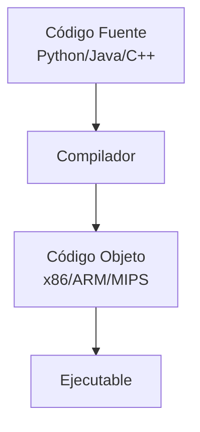
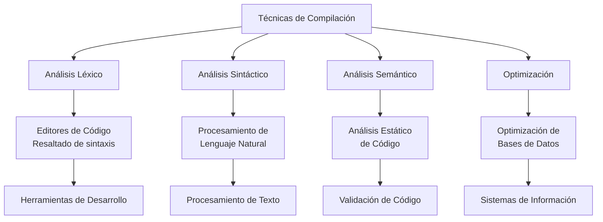

# Compiladores - Introducción a lo que es un compilador

## 1.2 Áreas de aplicación.

---

Los compiladores son herramientas fundamentales en la informática cuya utilidad se extiende más allá de la traducción de lenguajes de programación tradicionales. Su estudio y aplicación abarcan diversas áreas que impactan directamente en el desarrollo tecnológico actual.

### Definición de Compilador

Un compilador es un programa que traduce código escrito en un lenguaje fuente $L_s$ a un lenguaje destino $L_d$, preservando el significado semántico del programa original. Formalmente, podemos representar esta transformación como:

$$ C: L_s \rightarrow L_d $$

donde $\forall p \in L_s, C(p) = q \in L_d$ y $ \text{semántica}(p) = \text{semántica}(q) $.

### Áreas de Aplicación de los Compiladores

#### 1. Compilación Tradicional

La aplicación clásica de compiladores consiste en traducir lenguajes de alto nivel a código máquina:



**Ejemplo:**

```c
// Código fuente en C
#include <stdio.h>

int main() {
    int i, suma = 0;
    for(i = 1; i <= 10; i++) {
        suma += i;
    }
    printf("Suma: %d\n", suma);
    return 0;
}
```

El compilador traduce este código a instrucciones de máquina específicas.

#### 2. Compiladores Cruzados (Cross-Compilers)

Compiladores que generan código para una arquitectura diferente a la que están ejecutándose:

$$ Compilador\_{\text{anfitrión}} \rightarrow \text{Código}\_{objetivo} $$

**Aplicaciones:**

- Desarrollo de software embebido
- Programación de microcontroladores
- Desarrollo de sistemas operativos

#### 3. Compiladores para Lenguajes Específicos del Dominio (DSLs)

Creación de lenguajes especializados para áreas concretas:

```sql
-- Ejemplo de DSL: SQL
SELECT nombre, edad
FROM usuarios
WHERE edad > 18
ORDER BY nombre;
```

Este DSL se compila a operaciones de base de datos eficientes.

#### 4. Procesamiento de Lenguaje Natural (NLP)

Técnicas de compiladores aplicadas al análisis de lenguaje humano:

**Análisis sintáctico de oraciones:**

```
Oración: "El estudiante aprende compiladores"
Análisis:
   S[Nombre["El estudiante"] Verbo["aprende"] Objeto["compiladores"]]
```

#### 5. Herramientas de Análisis Estático

Aplicación de técnicas de compilación para analizar código sin ejecutarlo:

**Detección de patrones:**

```java
// Análisis de flujo de datos
public void process(String input) {
    if (input == null) {
        System.out.println("Input is null"); // Warning: posible NPE
    }
    int length = input.length(); // Análisis detecta posible NullPointerException
}
```

#### 6. Compiladores Just-In-Time (JIT)

Compilación dinámica durante la ejecución del programa:

$$ Tiempo\_{\text{ejecución}} = Tiempo\_{\text{interpretación}} + \frac{Tiempo\_{\text{compilación}}}{Frecuencia\_{\text{ejecución}}} $$

**Ventaja:** Combinación de portabilidad y rendimiento.

#### 7. Transcompilación (Source-to-Source)

Traducción entre lenguajes de programación de similar nivel de abstracción:

```typescript
// Código TypeScript
class Persona {
  constructor(
    public nombre: string,
    public edad: number,
  ) {}
}
```

Se transcompila a:

```javascript
// Código JavaScript resultante
class Persona {
  constructor(nombre, edad) {
    this.nombre = nombre;
    this.edad = edad;
  }
}
```

#### 8. Optimización de Consultas en Bases de Datos

Los motores de bases de datos utilizan técnicas de compilación para optimizar consultas:

```sql
SELECT * FROM orders
WHERE customer_id IN (
    SELECT id FROM customers
    WHERE country = 'Mexico'
)
```

Se optimiza a joins más eficientes mediante reescritura de consultas.

#### 9. Procesamiento de Shaders en Gráficos

Compilación de shaders para GPU en tiempo de ejecución:

```glsl
// Shader program
void main() {
    gl_FragColor = vec4(1.0, 0.0, 0.0, 1.0); // Color rojo
}
```

Compilado a instrucciones específicas de la GPU.

#### 10. Sistemas Expertos e Inteligencia Artificial

Compilación de reglas lógicas a sistemas eficientes de ejecución:

```prolog
% Regla en Prolog
padre(X, Y) :- hombre(X), hijo(Y, X).

% Hechos
hombre(juan).
hijo(maria, juan).
```

Compilado a estructuras eficientes de búsqueda y unificación.

### Fórmulas Relacionadas

#### Medida de Rendimiento de Optimizaciones

El speedup obtenido por una optimización se calcula como:

$$S = \frac{T_{\text{sin optimización}}}{T_{\text{con optimización}}}$$

#### Ley de Amdahl para Optimizaciones de Compilador

El speedup máximo alcanzable cuando solo parte del código es optimizado:

$$S_{\text{máximo}} = \frac{1}{(1 - P) + \frac{P}{S_{\text{parcial}}}}$$

Donde $P$ es la fracción del programa que se beneficia de la optimización.

### Ejercicios Propuestos

1. **Análisis de Transcompilación:**
   Proponga cómo transcompilaría el siguiente código Python a JavaScript:

   ```python
   def factorial(n):
       return 1 if n <= 1 else n * factorial(n-1)

   resultado = factorial(5)
   ```

2. **Optimización de Consultas:**
   Reescriba la siguiente consulta SQL de manera más eficiente:

   ```sql
   SELECT * FROM productos
   WHERE precio > 100
   AND id IN (
       SELECT producto_id FROM ventas
       WHERE fecha > '2023-01-01'
   )
   ```

3. **Detección de Errores:**
   Identifique los posibles errores que un análisis estático podría detectar:

   ```java
   public class Test {
       public void procesar(String str) {
           if (str.equals("hola")) {
               System.out.println("Saludo");
           }
           int length = str.length();
       }
   }
   ```

4. **Análisis de Rendimiento:**
   Si una optimización mejora el 30% de un programa en un factor de 2.5, ¿cuál es el speedup total máximo según la Ley de Amdahl?

### Diagrama de Aplicaciones de Técnicas de Compilación



### Referencias

#### Bibliografía Básica

1. Aho, A. V., Lam, M. S., Sethi, R., & Ullman, J. D. (2007). Compilers: Principles, Techniques, and Tools (2nd ed.). Pearson Education. (Capítulo 1: Introducción)
2. Cooper, K. D., & Torczon, L. (2004). Engineering a Compiler. Morgan Kaufmann. (Capítulo 1: Overview of Compilation)
3. Scott, M. L. (2009). Programming Language Pragmatics. Morgan Kaufmann. (Capítulo 1: Introduction)

#### Bibliografía Complementaria

1. Grune, D., Bal, H. E., Jacobs, C. J. H., & Langendoen, K. G. (2000). Modern Compiler Design. John Wiley & Sons. (Capítulo 1: Introduction)
2. Wilhelm, R., & Maurer, D. (1995). Compiler Design. Addison-Wesley. (Capítulo 1: Introduction to Compiler Design)

### Conclusión

Las técnicas de compilación encuentran aplicación en numerosos campos más allá de la compilación tradicional de lenguajes de programación. Desde el procesamiento de lenguaje natural hasta la optimización de bases de datos y sistemas expertos, los principios fundamentales de análisis léxico, sintáctico, semántico y optimización resultan esenciales en el desarrollo de sistemas software modernos. El estudio de compiladores proporciona una base sólida para comprender y desarrollar herramientas avanzadas de procesamiento de información.
