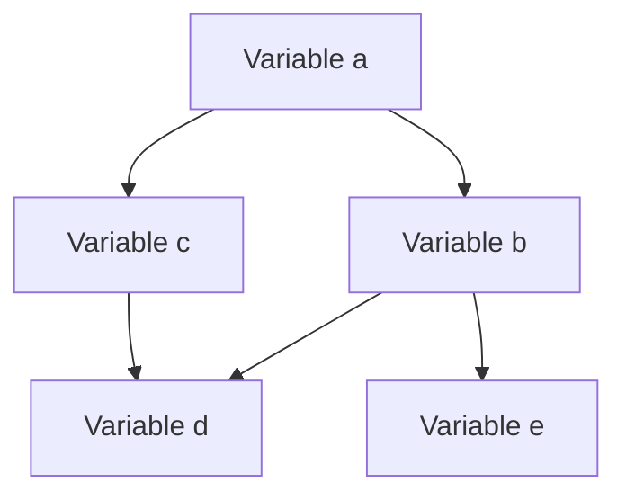

# Compiladores - Asignación de registros

## 12.1 Importancia.

---

La asignación de registros es una fase crítica en el proceso de compilación que determina cómo se utilizarán los registros del procesador durante la ejecución de un programa. Su importancia radica en que los registros son el medio más rápido para almacenar y manipular datos, pero son un recurso extremadamente limitado en cualquier arquitectura de procesador.

#### Definición

La **asignación de registros** es el proceso de mapear un número potencialmente ilimitado de variables temporales (o valores intermedios) a un número finito de registros de la máquina, minimizando las transferencias entre memoria y registros.

#### Función Principal

El objetivo principal es maximizar el uso de registros mientras se minimizan las operaciones de carga (load) y almacenamiento (store) entre la memoria y los registros. Matemáticamente, podemos expresar esto como:

$$\min \sum_{i=1}^{n} (c_{load} \cdot load_i + c_{store} \cdot store_i)$$

Donde:

- $n$ es el número de variables
- $c_{load}$ y $c_{store}$ son los costos de las operaciones de carga y almacenamiento
- $load_i$ y $store_i$ indican si se requieren estas operaciones para la variable $i$

### Por qué es Importante la Asignación de Registros

#### Limitación de Recursos

Los procesadores modernos típicamente tienen entre 16 y 32 registros de propósito general, mientras que los programas pueden utilizar cientos o miles de variables temporales.

#### Impacto en el Rendimiento

El acceso a registros es órdenes de magnitud más rápido que el acceso a memoria:

- Acceso a registro: 1 ciclo de reloj
- Acceso a memoria caché L1: 3-4 ciclos
- Acceso a memoria principal: 100-300 ciclos

#### Reducción de Overhead

Una buena asignación de registros reduce:

- Instrucciones de movimiento de datos (MOV)
- Operaciones de push/pop en la pila
- Tráfico de memoria

### Conceptos Clave

#### Grafo de Interferencia

Representación donde los nodos son variables y las aristas indican que dos variables no pueden ocupar el mismo registro simultáneamente.



#### Número de Colores (k)

El número mínimo de registros necesarios para un grafo de interferencia. Si k ≤ número de registros disponibles, el grafo es k-coloreable.

### Algoritmos de Asignación de Registros

#### Algoritmo de Coloreo de Grafos

Basado en el principio de que dos variables que están vivas al mismo tiempo no pueden compartir el mismo registro.

```python
def color_graph(graph, k):
    # Simplificar: encontrar nodo con grado < k
    stack = []
    while graph.has_nodes():
        node = find_node_with_degree_less_than_k(graph, k)
        if node is None:
            # Derramamiento necesario
            node = select_spill_candidate(graph)
        stack.push(node)
        graph.remove_node(node)

    # Asignar colores
    while stack.not_empty():
        node = stack.pop()
        graph.add_node(node)
        available_colors = set(range(k))
        for neighbor in node.neighbors:
            if neighbor.has_color():
                available_colors.remove(neighbor.color)
        if available_colors:
            node.color = available_colors.pop()
        else:
            # Requiere derramamiento
            spill(node)
```

#### Algoritmo Lineal Scan

Más eficiente para compiladores JIT (Just-In-Time):

```java
public void linearScanAllocation(List<Interval> intervals, int numRegisters) {
    intervals.sort(byStartPoint);
    ArrayList<Interval> active = new ArrayList<>();
    Map<Interval, Integer> allocation = new HashMap<>();

    for (Interval interval : intervals) {
        expireOldIntervals(interval, active);
        if (active.size() == numRegisters) {
            spillAtInterval(interval);
        } else {
            int reg = findFreeRegister();
            allocation.put(interval, reg);
            active.add(interval);
        }
    }
}
```

### Ejemplo Práctico

Consideremos el siguiente fragmento de código:

```c
// Código original
a = b + c;
d = a * e;
f = d + g;
```

Sin asignación de registros óptima, podríamos obtener:

```assembly
# Código subóptimo
LOAD R1, b
LOAD R2, c
ADD R3, R1, R2
STORE a, R3
LOAD R4, a
LOAD R5, e
MUL R6, R4, R5
STORE d, R6
LOAD R7, d
LOAD R8, g
ADD R9, R7, R8
STORE f, R9
```

Con asignación inteligente de registros:

```assembly
# Código optimizado
LOAD R1, b
LOAD R2, c
ADD R1, R1, R2    # a en R1
LOAD R2, e
MUL R1, R1, R2    # d en R1
LOAD R2, g
ADD R1, R1, R2    # f en R1
STORE f, R1
```

### Ejercicios Propuestos

1. Dado el siguiente grafo de interferencia con variables {a, b, c, d, e} y aristas:
   - a interfiere con b, c
   - b interfiere con a, c, d
   - c interfiere con a, b, d, e
   - d interfiere con b, c, e
   - e interfiere con c, d

   ¿Es 3-coloreable este grafo? Si no lo es, ¿qué variable debería derramarse?

2. Para el siguiente fragmento de código, construye el grafo de interferencia y asigna registros (suponiendo 4 registros disponibles):

   ```
   x = a + b
   y = x * c
   z = y + d
   w = z * e
   ```

3. Explica cómo afecta la arquitectura del conjunto de instrucciones (RISC vs CISC) a las estrategias de asignación de registros.

4. Implementa en pseudocódigo el algoritmo de coloreo de grafos para asignación de registros con derramamiento.

### Impacto en Diferentes Arquitecturas

#### Arquitecturas RISC

- Mayor dependencia de los registros
- Modos de direccionamiento limitados
- Asignación de registros más crítica

#### Arquitecturas CISC

- Más modos de direccionamiento
- Menor presión en la asignación de registros
- Still benefician de una buena asignación

### Técnicas Avanzadas

#### Asignación de Registros entre Procedimientos

Extiende el análisis más allá de los límites de procedimiento mediante:

- Convensión de llamadas a funciones
- Registros callee-saved vs caller-saved
- Análisis interprocedural

#### Asignación en Compiladores JIT

Técnicas como Linear Scan que sacrifican optimalidad por velocidad de compilación.

### Referencias

#### Bibliografía Básica

1. Cooper, K. D., & Torczon, L. (2004). _Engineering a Compiler_. Morgan Kaufmann. (Capítulo 13: Register Allocation)
2. Scott, M. L. (2009). _Programming Language Pragmatics_. Morgan Kaufmann. (Capítulo 17: Code Generation)
3. Aho, A. V., Lam, M. S., Sethi, R., & Ullman, J. D. (2007). _Compilers: Principles, Techniques, and Tools_ (2nd ed.). Pearson Education. (Capítulo 8: Code Generation)

#### Bibliografía Complementaria

1. Aho, A. V., & Ullman, J. D. (1972). _The Theory of Parsing, Translation and Compiling_ (Vol. 1). Prentice Hall.
2. Grune, D., Bal, H. E., Jacobs, C. J. H., & Langendoen, K. G. (2000). _Modern Compiler Design_. John Wiley & Sons.
3. Wilhelm, R., & Maurer, D. (1995). _Compiler Design_. Addison-Wesley.

### Conclusión

La asignación de registros es fundamental para generar código eficiente. Su importancia se deriva directamente de la disparidad entre el número limitado de registros físicos y el gran número de variables que manejan los programas modernos. Las técnicas de asignación de registros balancean la optimalidad del código generado con la eficiencia del proceso de compilación itself.
