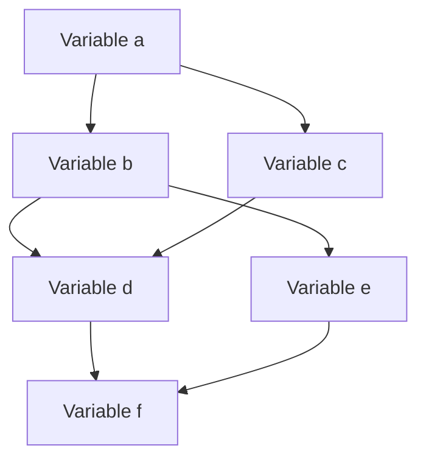

# Compiladores - Asignación de registros

## 12.2 Aspectos subyacentes.

---

La **asignación de registros** es el proceso mediante el cual un compilador decide qué valores residirán en registros en cada punto del programa. Los aspectos subyacentes se refieren a los conceptos teóricos, estructuras de datos y algoritmos que fundamentan este proceso.

#### Variables y Vidas (Liveness)

Una variable está **viva** en un punto del programa si su valor puede ser usado posteriormente. El análisis de vidas es fundamental para la asignación de registros.

Formalmente, una variable $v$ está viva en un punto $p$ si:

- Existe un camino desde $p$ hasta un uso de $v$
- En ese camino no hay redefinición de $v$

Las ecuaciones de liveness se definen como:

$$in[n] = use[n] \cup (out[n] \setminus def[n])$$

$$out[n] = \bigcup_{s \in succ[n]} in[s]$$

Donde:

- $in[n]$: Variables vivas al entrar al nodo $n$
- $out[n]$: Variables vivas al salir del nodo $n$
- $use[n]$: Variables usadas en $n$ antes de cualquier definición
- $def[n]$: Variables definidas en $n$

### Grafo de Interferencia

El **grafo de interferencia** es una estructura fundamental donde:

- Los nodos representan variables
- Las aristas representan interferencias (dos variables no pueden compartir registro)



Dos variables $a$ y $b$ **interfieren** si:

- Ambas están vivas al mismo tiempo
- No pueden ocupar el mismo registro

### Número de Cromático y k-colorabilidad

El problema de asignación de registros se reduce al problema de coloreo de grafos. El **número cromático** $\chi(G)$ es el mínimo número de colores (registros) needed para colorear el grafo.

Un grafo es **k-coloreable** si $\chi(G) \leq k$, donde $k$ es el número de registros disponibles.

### Algoritmo de Coloreo de Grafos

#### Algoritmo de Briggs

```python
def briggs_allocation(graph, k):
    stack = []
    # Fase de simplificación
    while graph.has_nodes():
        node = find_node_with_degree_less_than_k(graph, k)
        if node is None:
            # Necesitamos derramamiento (spilling)
            node = select_spill_candidate(graph)
        stack.append(node)
        graph.remove_node(node)

    # Fase de asignación
    while stack:
        node = stack.pop()
        graph.add_node(node)
        used_colors = set()
        for neighbor in node.neighbors:
            if hasattr(neighbor, 'color'):
                used_colors.add(neighbor.color)
        available_colors = set(range(k)) - used_colors
        if available_colors:
            node.color = available_colors.pop()
        else:
            spill(node)  # Derramamiento forzoso
```

### Costo de Derramamiento (Spilling)

Cuando no hay suficientes registros, algunas variables deben "derramarse" a memoria. El costo se calcula como:

$$Costo_{total} = \sum_{i=1}^{n} (frecuencia_i \times costo_{acceso})$$

Donde:

- $frecuencia_i$: Número de veces que se accede a la variable $i$
- $costo_{acceso}$: Diferencia entre acceso a memoria y registro

### Ejemplo de Análisis de Vidas

Consideremos el siguiente código:

```c
// Ejemplo de código
a = 1;
b = a + 2;
c = b * 3;
if c > 10:
    d = a + b;
else:
    d = b + c;
e = d + 5;
```

La tabla de liveness sería:

| Línea | Código     | Variables vivas |
| ----- | ---------- | --------------- |
| 1     | a = 1;     | {}              |
| 2     | b = a + 2; | {a}             |
| 3     | c = b * 3; | {a, b}          |
| 4     | if c > 10: | {a, b, c}       |
| 5     | d = a + b; | {a, b, c}       |
| 6     | d = b + c; | {a, b, c}       |
| 7     | e = d + 5; | {d}             |

### Ejercicios Propuestos

1. Para el siguiente fragmento de código, calcula las variables vivas en cada punto:

   ```c
   x = 5;
   y = x + 3;
   z = y * 2;
   if z > 10:
       w = x + y;
   else:
       w = y + z;
   result = w + 1;
   ```

2. Construye el grafo de interferencia para las variables del ejercicio anterior.

3. Dado el siguiente grafo de interferencia con 4 nodos (A, B, C, D) y las aristas:
   - A-B, A-C, A-D, B-C, C-D
     ¿Es 3-coloreable? Si no lo es, ¿qué variable debería derramarse?

4. Implementa el algoritmo de Briggs en pseudocódigo para un grafo de interferencia dado.

5. Calcula el costo de derramamiento para una variable que se accede 100 veces en un bucle, donde el acceso a registro toma 1 ciclo y el acceso a memoria toma 10 ciclos.

### Arquitectura de Registros y Convensiones de Llamada

Los aspectos subyacentes también incluyen consideraciones arquitectónicas:

#### Registros Caller-saved vs Callee-saved

- **Caller-saved**: El llamante debe preservarlos
- **Callee-saved**: El llamado debe preservarlos

La convención afecta la asignación ya que determina qué registros están disponibles en cada punto.

### Referencias

#### Bibliografía Básica

1. Cooper, K. D., & Torczon, L. (2004). _Engineering a Compiler_. Morgan Kaufmann. (Capítulo 13: Register Allocation)
2. Aho, A. V., Lam, M. S., Sethi, R., & Ullman, J. D. (2007). _Compilers: Principles, Techniques, and Tools_ (2nd ed.). Pearson Education. (Capítulo 8: Code Generation)

#### Bibliografía Complementaria

1. Aho, A. V., & Ullman, J. D. (1972). _The Theory of Parsing, Translation and Compiling_ (Vol. 1). Prentice Hall.
2. Grune, D., Bal, H. E., Jacobs, C. J. H., & Langendoen, K. G. (2000). _Modern Compiler Design_. John Wiley & Sons.

### Conclusión

Los aspectos subyacentes de la asignación de registros involucran teoría de grafos, análisis de flujo de datos y consideraciones arquitectónicas. Comprender estos fundamentos es crucial para implementar algoritmos eficientes de asignación de registros que minimicen las operaciones de acceso a memoria y maximicen el uso de los registros disponibles.
