# Compiladores - Asignación de registros

## 12.3 Asignación y alojamiento locales de registros.

---

### Definición y Alcance

La **asignación local de registros** se enfoca en la asignación de registros dentro de un único bloque básico, donde el flujo de control es lineal sin saltos intermedios. Este enfoque es más simple que la asignación global pero fundamental para el rendimiento de secciones críticas de código.

### Conceptos Fundamentales

#### Bloque Básico

Secuencia máxima de instrucciones con:

- Una única entrada (ningún salto hacia dentro excepto al inicio)
- Una única salida (ningún salto hacia fuera excepto al final)

#### Variables Vivas Locales

Una variable está viva en un punto si:

- Se define antes de ese punto
- Se usa después de ese punto en el mismo bloque

### Algoritmo de Asignación Local

#### Enfoque por Conteo de Referencias

Para cada variable en el bloque básico, calculamos:

$$Peso(v) = \sum_{i=1}^{n} (uso_i \times 10^{n-i}) + \sum_{j=1}^{m} (def_j \times 10^{m-j})$$

Donde:

- $uso_i$: 1 si la variable se usa en la instrucción $i$, 0 en otro caso
- $def_j$: 1 si la variable se define en la instrucción $j$, 0 en otro caso
- $n$: número total de instrucciones

### Algoritmo de Último Uso (Last Use)

```python
def local_register_allocation(basic_block, available_registers):
    # Paso 1: Analizar usos y definiciones
    usage_map = {}
    for i, instruction in enumerate(reversed(basic_block)):
        for operand in instruction.operands:
            if operand.is_variable():
                if operand not in usage_map:
                    usage_map[operand] = i  # Último uso

    # Paso 2: Asignar registros
    register_pool = set(available_registers)
    allocated = {}
    active_variables = set()

    for i, instruction in enumerate(basic_block):
        # Liberar registros de variables que ya no se usan
        for var in list(active_variables):
            if usage_map.get(var, -1) < i:
                register_pool.add(allocated[var])
                active_variables.remove(var)
                del allocated[var]

        # Asignar registros para nuevas variables
        for operand in instruction.operands:
            if operand.is_variable() and operand not in allocated:
                if register_pool:
                    reg = register_pool.pop()
                    allocated[operand] = reg
                    active_variables.add(operand)
                else:
                    # Necesita derramamiento (spilling)
                    spill_variable(operand)
```

### Ejemplo Práctico

Consideremos el siguiente bloque básico:

```
1: t1 = a + b
2: t2 = t1 * c
3: t3 = t2 + d
4: t4 = t3 * e
5: result = t4 + f
```

Análisis de último uso:

- a: último uso en línea 1
- b: último uso en línea 1
- c: último uso en línea 2
- d: último uso en línea 3
- e: último uso en línea 4
- f: último uso en línea 5
- t1: último uso en línea 2
- t2: último uso en línea 3
- t3: último uso en línea 4
- t4: último uso en línea 5

### Visualización del Uso de Registros

```mermaid
gantt
    title Asignación de Registros en Bloque Básico
    dateFormat X
    axisFormat %s

    section Registro R1
    a + b : 0, 1
    t1 : 1, 2
    t2 : 2, 3
    t3 : 3, 4
    t4 : 4, 5

    section Registro R2
    c : 1, 2
    d : 2, 3
    e : 3, 4
    f : 4, 5

    section Registro R3
    (libre) : 0, 5
```



### Técnica de Asignación por Intervalos

Para cada variable, definimos un intervalo de vida:

$$ Intervalo(v) = [primera\\_referencia, \text{última}\_referencia]$$

Dos variables pueden compartir registro si sus intervalos no se superponen:

$$Intervalo(v_1) \cap Intervalo(v_2) = \emptyset$$

### Algoritmo de Intervalos Solapados

```python
def interval_based_allocation(intervals, k_registers):
    # Ordenar intervalos por inicio
    intervals.sort(key=lambda x: x.start)

    active = []
    allocation = {}

    for interval in intervals:
        # Expirar intervalos que han terminado
        active = [i for i in active if i.end > interval.start]

        if len(active) >= k_registers:
            # Necesita derramamiento
            spill_candidate = select_spill_candidate(active, interval)
            spill(spill_candidate)
            active.remove(spill_candidate)

        # Asignar registro
        used_regs = {allocation[i.var] for i in active}
        available_reg = next(r for r in range(k_registers) if r not in used_regs)

        allocation[interval.var] = available_reg
        active.append(interval)

    return allocation
```

### Ejercicios Propuestos

1. Para el siguiente bloque básico, determina el último uso de cada variable y asigna registros (suponiendo 3 registros disponibles):

   ```
   x = a + b
   y = x * c
   z = y + d
   w = z * e
   result = w + f
   ```

2. Implementa el algoritmo de asignación por intervalos para el siguiente conjunto:
   - v1: [1, 5]
   - v2: [2, 4]
   - v3: [3, 6]
   - v4: [5, 7]
   - v5: [6, 8]
     Con k = 2 registros

3. Calcula el peso de cada variable según el algoritmo de conteo de referencias para:

   ```
   t1 = a + b
   t2 = t1 * c
   t3 = t2 + a
   result = t3 * b
   ```

4. Diseña un algoritmo que detecte variables que pueden ser eliminadas (dead store elimination) dentro de un bloque básico.

5. Explica cómo afectaría la arquitectura (registros de propósito general vs especializados) a la asignación local de registros.

### Consideraciones de Implementación

#### Registros de Propósito Específico

Algunas arquitecturas tienen registros especializados:

- Registros de punto flotante
- Registros de acumulación
- Registros de índice

La asignación debe considerar estos tipos especializados.

#### Costo de Movimiento entre Registros

El costo de mover datos entre diferentes tipos de registros puede modelarse como:

$$ Costo_{movimiento} = \begin{cases} 0 & \text{si mismo tipo} \\\ c_m & \text{entre tipos diferentes} \end{cases} $$

### Referencias

#### Bibliografía Básica
1. Cooper, K. D., & Torczon, L. (2004). *Engineering a Compiler*. Morgan Kaufmann. (Capítulo 13: Register Allocation)
2. Aho, A. V., Lam, M. S., Sethi, R., & Ullman, J. D. (2007). *Compilers: Principles, Techniques, and Tools* (2nd ed.). Pearson Education. (Capítulo 8: Code Generation)

#### Bibliografía Complementaria
1. Muchnick, S. S. (1997). *Advanced Compiler Design and Implementation*. Morgan Kaufmann.
2. Grune, D., Bal, H. E., Jacobs, C. J. H., & Langendoen, K. G. (2000). *Modern Compiler Design*. John Wiley & Sons.

### Conclusión

La asignación local de registros es fundamental para optimizar el rendimiento dentro de bloques básicos. Aunque más simple que la asignación global, requiere algoritmos eficientes para maximizar la utilización de registros y minimizar los accesos a memoria. Las técnicas basadas en último uso e intervalos solapados proporcionan enfoques efectivos para este problema, considerando las limitaciones específicas de la arquitectura objetivo.
