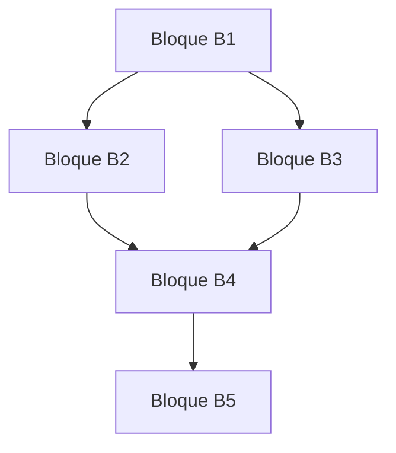
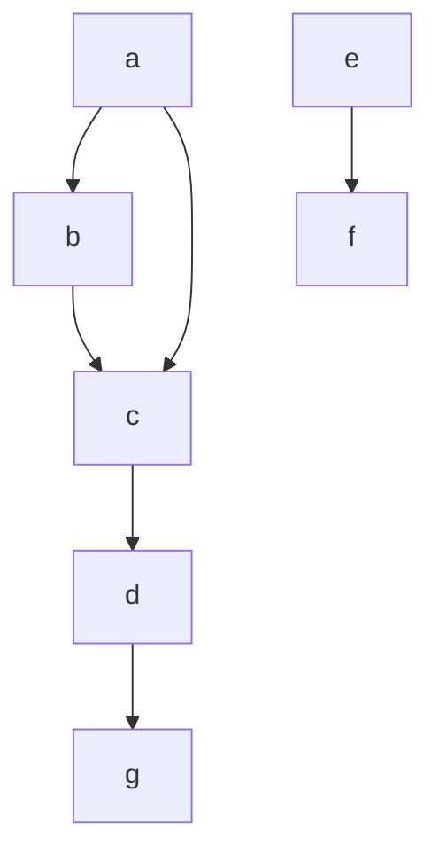

# Compiladores - Asignación de registros

## 12.4 Alojamiento y asignación cruzando fronteras de bloques básicos.

---

### Definición y Alcance

La **asignación global de registros** extiende la asignación más allá de los límites de bloques básicos individuales, considerando el flujo de control completo de una función o procedimiento. Este enfoque es esencial para optimizar el uso de registros a través de saltos, bucles y llamadas a funciones.

### Conceptos Fundamentales

#### Grafo de Flujo de Control (CFG)

Representación del programa donde:

- Nodos: bloques básicos
- Aristas: flujo de control entre bloques



#### Variables Globalmente Vivas

Una variable $v$ está globalmente viva en un punto $p$ si existe un camino desde $p$ hasta un uso de $v$ sin redefiniciones intermedias.

### Análisis de Vivas Global

Las ecuaciones para análisis de vivas global se definen como:

$$in[B] = use[B] \cup (out[B] \setminus def[B])$$

$$out[B] = \bigcup_{S \in succ[B]} in[S]$$

Donde:

- $in[B]$: Variables vivas al entrar al bloque B
- $out[B]$: Variables vivas al salir del bloque B
- $use[B]$: Variables usadas en B antes de cualquier definición
- $def[B]$: Variables definidas en B
- $succ[B]$: Bloques sucesores de B

### Grafo de Interferencia Global

Dos variables $v_1$ y $v_2$ **interfieren globalmente** si:

- Existe un punto en el programa donde ambas están vivas simultáneamente
- No pueden compartir el mismo registro

### Algoritmo de Coloreo de Grafos Global

```python
def global_register_allocation(cfg, k_registers):
    # Construir grafo de interferencia global
    interference_graph = build_global_interference_graph(cfg)

    # Aplicar algoritmo de coloreo
    allocation = {}
    stack = []

    # Fase de simplificación
    while interference_graph.nodes:
        node = find_simplifiable_node(interference_graph, k_registers)
        if node is None:
            node = select_spill_candidate(interference_graph)
        stack.append(node)
        interference_graph.remove_node(node)

    # Fase de selección
    while stack:
        node = stack.pop()
        interference_graph.add_node(node)

        used_colors = set()
        for neighbor in interference_graph.neighbors(node):
            if neighbor in allocation:
                used_colors.add(allocation[neighbor])

        available_colors = set(range(k_registers)) - used_colors
        if available_colors:
            allocation[node] = available_colors.pop()
        else:
            spill(node)

    return allocation
```

### Ejemplo de Análisis Global

Consideremos el siguiente código con múltiples bloques:

```c
// Bloque B1
a = 1;
b = 2;
if (a > b) {
    // Bloque B2
    c = a + b;
    d = c * 2;
} else {
    // Bloque B3
    c = a - b;
    d = c / 2;
}
// Bloque B4
result = d + a;
```

Análisis de vivas:

- $in[B1] = \emptyset$, $out[B1] = \{a, b\}$
- $in[B2] = \{a, b\}$, $out[B2] = \{a, c, d\}$
- $in[B3] = \{a, b\}$, $out[B3] = \{a, c, d\}$
- $in[B4] = \{a, d\}$, $out[B4] = \emptyset$

### Técnicas de Asignación Global

#### Algoritmo de Chaitin-Briggs

Extensión del algoritmo básico con:

- **Coalescencia**: Fusionar variables relacionadas por movimientos
- **Derramamiento conservador**: Selección inteligente de variables a derramar

#### Coalescencia de Variables

Dos variables $v_1$ y $v_2$ pueden coalescer si:

- Están conectadas por una instrucción de movimiento: $v_1 = v_2$
- No interfieren entre sí
- La coalescencia no aumenta el grado del grafo por encima de $k$

### Ejercicios Propuestos

1. Para el siguiente CFG, calcula los conjuntos $in$ y $out$ de cada bloque:

   ```
   B1: a = 1; b = 2; goto B2
   B2: if (a > b) goto B3 else goto B4
   B3: c = a + b; goto B5
   B4: c = a - b; goto B5
   B5: d = c * 2; result = d
   ```

2. Construye el grafo de interferencia global para las variables del ejercicio anterior.

3. Implementa el algoritmo de coalescencia para el siguiente grafo de interferencia:
   - Nodos: a, b, c, d
   - Aristas: a-b, a-c, b-c, c-d
   - Movimiento: a = b
     ¿Pueden coalescer a y b?

4. Diseña un algoritmo para detectar variables que pueden mantenerse en registros a través de múltiples bloques básicos.

5. Explica cómo manejarías las llamadas a funciones en la asignación global de registros.

### Consideraciones de Implementación

#### Convenciones de Llamada

- **Caller-saved**: Registros que el llamante debe preservar
- **Callee-saved**: Registros que el llamado debe preservar

#### Costo de Derramamiento Global

El costo de derramamiento considera la frecuencia de ejecución:

$$Costo_{spill}(v) = \sum_{b \in bloques} freq(b) \times (loads_b + stores_b)$$

Donde:

- $freq(b)$: Frecuencia de ejecución del bloque $b$
- $loads_b$: Número de cargas necesarias para $v$ en $b$
- $stores_b$: Número de almacenamientos necesarios para $v$ en $b$

### Visualización de Interferencias Globales



### Referencias

#### Bibliografía Básica

1. Cooper, K. D., & Torczon, L. (2004). _Engineering a Compiler_. Morgan Kaufmann. (Capítulo 13: Register Allocation)
2. Aho, A. V., Lam, M. S., Sethi, R., & Ullman, J. D. (2007). _Compilers: Principles, Techniques, and Tools_ (2nd ed.). Pearson Education. (Capítulo 8: Code Generation)

#### Bibliografía Complementaria

1. Muchnick, S. S. (1997). _Advanced Compiler Design and Implementation_. Morgan Kaufmann.
2. Appel, A. W. (1998). _Modern Compiler Implementation in Java_. Cambridge University Press.

### Conclusión

La asignación global de registros que cruza fronteras de bloques básicos es esencial para optimizaciones avanzadas. Requiere análisis complejos de flujo de datos y técnicas sofisticadas de coloreo de grafos. La coalescencia y el derramamiento inteligente son cruciales para maximizar la utilización de registros en programas con flujo de control complejo.
