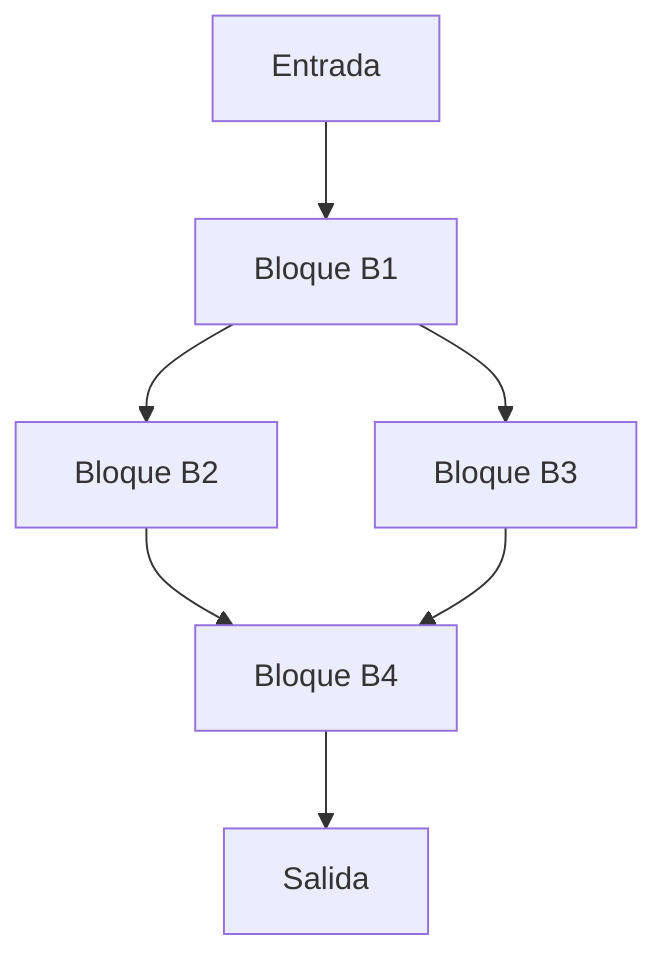

# Compiladores - Asignación de registros

## 12.5 Alojamiento y asignación globales.

---

### Definición y Alcance

La **asignación global de registros** es el proceso de asignar variables a registros a lo largo de todo un procedimiento o función, considerando el flujo de control completo. Este enfoque supera las limitaciones de la asignación local al optimizar el uso de registros a través de saltos, bucles y múltiples bloques básicos.

### Conceptos Fundamentales

#### Grafo de Flujo de Control (CFG)

Representación del programa donde los nodos son bloques básicos y las aristas representan el flujo de control.



#### Análisis de Vivas Global

Una variable está **globalmente viva** en un punto del programa si existe un camino desde ese punto hasta un uso de la variable sin redefiniciones intermedias.

Las ecuaciones de análisis de vivas se definen como:

$$in[B] = use[B] \cup (out[B] \setminus def[B])$$

$$out[B] = \bigcup_{S \in succ[B]} in[S]$$

Donde:

- $in[B]$: Variables vivas al entrar al bloque B
- $out[B]$: Variables vivas al salir del bloque B
- $use[B]$: Variables usadas en B antes de cualquier definición
- $def[B]$: Variables definidas en B
- $succ[B]$: Bloques sucesores de B

### Grafo de Interferencia Global

Dos variables $v_i$ y $v_j$ **interfieren** si existe al menos un punto del programa donde ambas están vivas simultáneamente. El grafo de interferencia $G = (V, E)$ donde:

- $V$: conjunto de variables
- $E$: conjunto de aristas donde $(v_i, v_j) \in E$ si $v_i$ y $v_j$ interfieren

### Algoritmo de Coloreo de Grafos

El problema se reduce a colorear el grafo de interferencia con $k$ colores (registros), donde $k$ es el número de registros disponibles.

#### Algoritmo de Chaitin-Briggs

```python
def global_register_allocation(interference_graph, k):
    stack = []
    simplified_nodes = []
    spilled_nodes = []

    # Fase de simplificación
    while interference_graph.nodes:
        # Encontrar nodo con grado < k
        node = find_node_with_degree_less_than_k(interference_graph, k)
        if node:
            stack.append(node)
            interference_graph.remove_node(node)
            simplified_nodes.append(node)
        else:
            # Seleccionar nodo para derramamiento
            node = select_spill_candidate(interference_graph)
            spilled_nodes.append(node)
            interference_graph.remove_node(node)

    # Fase de selección
    allocation = {}
    while stack:
        node = stack.pop()
        interference_graph.add_node(node)

        # Encontrar colores usados por vecinos
        used_colors = set()
        for neighbor in interference_graph.neighbors(node):
            if neighbor in allocation:
                used_colors.add(allocation[neighbor])

        # Asignar color disponible
        available_colors = set(range(k)) - used_colors
        if available_colors:
            allocation[node] = min(available_colors)
        else:
            spilled_nodes.append(node)

    return allocation, spilled_nodes
```

### Coalescencia

Técnica para fusionar variables relacionadas por movimientos:

```python
def coalesce(interference_graph, moves, k):
    for move in moves:
        u, v = move.src, move.dest
        if not interference_graph.has_edge(u, v):
            # Intentar fusionar u y v
            merged_node = merge_nodes(u, v)
            if can_coalesce(interference_graph, merged_node, k):
                interference_graph.coalesce_nodes(u, v)
                remove_move(move)
```

### Ejemplo Práctico

Consideremos el siguiente código:

```c
int main() {
    int a = 1;      // B1
    int b = 2;      // B1
    if (a > b) {    // B1
        int c = a + b;  // B2
        printf("%d", c); // B2
    } else {
        int d = a - b;  // B3
        printf("%d", d); // B3
    }
    return 0;       // B4
}
```

Análisis de vidas:

- $in[B1] = \emptyset$, $out[B1] = \{a, b\}$
- $in[B2] = \{a, b\}$, $out[B2] = \emptyset$
- $in[B3] = \{a, b\}$, $out[B3] = \emptyset$
- $in[B4] = \emptyset$, $out[B4] = \emptyset$

Grafo de interferencia: a-b (interfieren en B1, B2, B3)

### Ejercicios Propuestos

1. Para el siguiente CFG, calcula los conjuntos $in$ y $out$ de cada bloque:

   ```
   B1: a = 1; b = 2; c = 3
   B2: if (a > b) goto B3 else goto B4
   B3: d = a + c; goto B5
   B4: e = b + c; goto B5
   B5: f = d + e; result = f
   ```

2. Construye el grafo de interferencia para las variables del ejercicio anterior.

3. Implementa el algoritmo de coalescencia para el siguiente conjunto de movimientos:
   - Movimientos: t1 = t2, t3 = t4
   - Grafo de interferencia: t1-t2, t2-t3, t3-t4
   - k = 2 registros

4. Calcula el costo de derramamiento para una variable con:
   - Frecuencia de bloques: B1:10, B2:5, B3:8
   - Cargas necesarias: B1:1, B2:0, B3:1
   - Almacenamientos necesarios: B1:1, B2:1, B3:0
   - Costo de acceso a memoria: 10 ciclos

5. Diseña una estrategia para manejar registros callee-saved vs caller-saved en la asignación global.

### Técnicas Avanzadas

#### Asignación por Intervalos de Grafos

Para cada variable, definimos su intervalo de vida como $[first\_ref, last\_ref]$. Dos variables pueden compartir registro si sus intervalos no se solapan.

#### Algoritmo Linear Scan

Alternativa más rápida para compiladores JIT:

```python
def linear_scan_allocation(intervals, k):
    active = []
    allocation = {}

    for interval in sorted(intervals, key=lambda x: x.start):
        # Expirar intervalos terminados
        active = [i for i in active if i.end > interval.start]

        if len(active) == k:
            spill_at_interval(interval)
        else:
            reg = find_free_register(active, k)
            allocation[interval.var] = reg
            active.append(interval)

    return allocation
```

### Consideraciones de Implementación

#### Heurísticas para Selección de Derramamiento

$$SpillCost(v) = \frac{\sum_{b \in blocks} freq(b) \times (loads_b + stores_b)}{degree(v)}$$

Donde:

- $freq(b)$: Frecuencia de ejecución del bloque $b$
- $loads_b$, $stores_b$: Operaciones de memoria necesarias
- $degree(v)$: Grado del nodo en el grafo de interferencia

#### Registros de Arquitectura Específica

Algunas arquitecturas tienen restricciones especiales:

- Registros para parámetros
- Registros de retorno
- Registros preservados vs no preservados

### Referencias

#### Bibliografía Básica

1. Cooper, K. D., & Torczon, L. (2004). _Engineering a Compiler_. Morgan Kaufmann. (Capítulo 13)
2. Aho, A. V., Lam, M. S., Sethi, R., & Ullman, J. D. (2007). _Compilers: Principles, Techniques, and Tools_. Pearson Education. (Capítulo 8)

#### Bibliografía Complementaria

1. Muchnick, S. S. (1997). _Advanced Compiler Design and Implementation_. Morgan Kaufmann.
2. Appel, A. W. (1998). _Modern Compiler Implementation in ML_. Cambridge University Press.

### Conclusión

La asignación global de registros es un problema NP-completo que se aborda mediante técnicas heurísticas basadas en coloreo de grafos. La calidad de la asignación impacta directamente en el rendimiento del código generado, haciendo crucial el uso de técnicas avanzadas como coalescencia, derramamiento inteligente y consideraciones arquitectónicas específicas.
