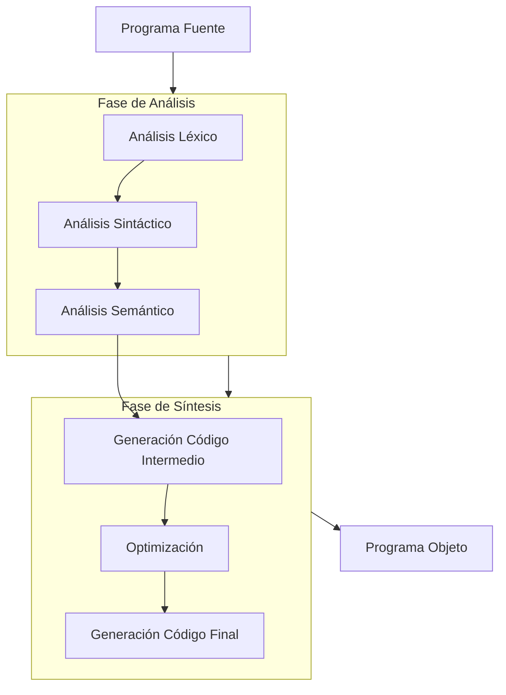
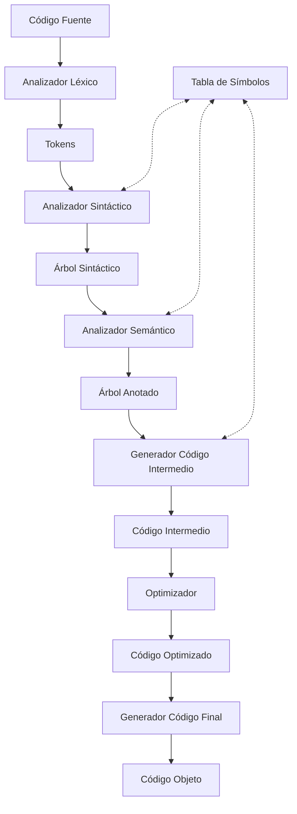

# Compiladores - Introducción a lo que es un compilador

## 1.3 Principios fundamentales de compiladores.

---

Los compiladores son programas complejos que transforman código fuente en código ejecutable, siguiendo principios bien establecidos. Estos principios fundamentales guían el diseño e implementación de compiladores eficientes y correctos.

### Definición Formal

Un compilador es un programa que realiza la traducción de un programa fuente $P_s$ escrito en un lenguaje $L_s$ a un programa destino $P_t$ en un lenguaje $L_t$, preservando su significado:

$$C: L_s \rightarrow L_t \quad \text{tal que} \quad \forall P_s \in L_s, \text{semántica}(P_s) = \text{semántica}(C(P_s))$$

### Arquitectura Básica de un Compilador



### Principios Fundamentales

#### 1. Separación entre Análisis y Síntesis

El diseño de compiladores se basa en la separación entre:

- **Análisis (Front-end)**: Comprende la estructura y significado del código fuente
- **Síntesis (Back-end)**: Genera el código objetivo equivalente

**Ventaja**: Permite reutilizar componentes para diferentes combinaciones lenguaje fuente/lenguaje destino.

#### 2. Fases de Compilación

##### 2.1 Análisis Léxico (Scanning)

Convierte el flujo de caracteres en tokens con significado.

**Ejemplo:**

```
Entrada: "if (x > 5) then"
Salida: [IF, LPAREN, ID("x"), GT, INT(5), RPAREN, THEN]
```

**Expresiones regulares para tokens comunes:**

- Identificador: `[a-zA-Z_][a-zA-Z0-9_]*`
- Entero: `[0-9]+`
- Operador: `\+|\-|\*|/|=|>|<|>=|<=|==`

##### 2.2 Análisis Sintáctico (Parsing)

Agrupa los tokens en una estructura jerárquica (árbol de sintaxis abstracta).

**Gramática para expresiones aritméticas:**

```
E → E + T | E - T | T
T → T * F | T / F | F
F → ( E ) | id | num
```

**Ejemplo de árbol sintáctico:**

```
      +
     / \
    *   3
   / \
  2   x
```

##### 2.3 Análisis Semántico

Verifica la corrección semántica del programa (tipos, declaraciones, etc.).

**Comprobaciones típicas:**

- Compatibilidad de tipos
- Variables declaradas antes de su uso
- Número correcto de argumentos en funciones

##### 2.4 Generación de Código Intermedio

Crea una representación intermedia independiente de la máquina destino.

**Código de tres direcciones:**

```
t1 = 2 * x
t2 = t1 + 3
```

##### 2.5 Optimización

Mejora el código intermedio preservando su significado.

**Técnicas comunes:**

- Eliminación de subexpresiones comunes
- Propagación de constantes
- Eliminación de código muerto

##### 2.6 Generación de Código

Produce el código objeto final para la arquitectura destino.

#### 3. Manejo de Tabla de Símbolos

La tabla de símbolos es una estructura de datos central que almacena información sobre identificadores:

| Nombre | Tipo  | Ámbito | Valor |
| ------ | ----- | ------ | ----- |
| x      | int   | global | -     |
| y      | float | func1  | 3.14  |

#### 4. Manejo de Errores

Principios para el manejo robusto de errores:

- Detección temprana y reporte claro
- Recuperación para continuar el análisis
- Modo de pánico para evitar cascadas de errores

### Fórmulas y Conceptos Matemáticos

#### Complejidad de Algoritmos de Análisis

- Análisis léxico: $O(n)$ donde $n$ es la longitud de la entrada
- Análisis sintáctico: $O(n^3)$ en el caso general, $O(n)$ para gramáticas LL/LR

#### Teoría de Autómatas y Lenguajes Formales

Los compiladores se basan en:

- Autómatas finitos para análisis léxico
- Autómatas de pila para análisis sintáctico
- Gramáticas formales para definir la sintaxis

### Ejemplos de Código

#### Ejemplo de Analizador Léxico Simple

```python
import re

tokens = [
    (r'[ \n\t]+', None),           # Espacios en blanco
    (r'#[^\n]*', None),            # Comentarios
    (r'\bif\b', 'IF'),
    (r'\bthen\b', 'THEN'),
    (r'\belse\b', 'ELSE'),
    (r'[a-zA-Z_][a-zA-Z0-9_]*', 'ID'),
    (r'[0-9]+', 'NUM'),
    (r'==', 'EQ'),
    (r'=', 'ASSIGN'),
]

def lex(characters):
    pos = 0
    tokens = []
    while pos < len(characters):
        match = None
        for token_expr in tokens:
            pattern, tag = token_expr
            regex = re.compile(pattern)
            match = regex.match(characters, pos)
            if match:
                text = match.group(0)
                if tag:
                    token = (text, tag)
                    tokens.append(token)
                break
        if not match:
            raise Exception('Carácter ilegal: %s' % characters[pos])
        else:
            pos = match.end(0)
    return tokens
```

#### Ejemplo de Gramática en BNF

```
<program> ::= <statement_list>
<statement_list> ::= <statement> | <statement> <statement_list>
<statement> ::= <assignment> | <if_statement>
<assignment> ::= <id> = <expression> ;
<if_statement> ::= if ( <condition> ) then <statement>
<condition> ::= <expression> <relop> <expression>
<expression> ::= <term> | <expression> <addop> <term>
<term> ::= <factor> | <term> <mulop> <factor>
<factor> ::= <id> | <num> | ( <expression> )
```

### Ejercicios Propuestos

1. **Análisis Léxico:**
   Dada la entrada: "x = 42 + y * 3;", identifique la secuencia de tokens resultante.

2. **Análisis Sintáctico:**
   Construya el árbol de sintaxis abstracta para la expresión: "a + b * c - d"

3. **Análisis Semántico:**
   Identifique los errores semánticos en el siguiente código:

   ```c
   int main() {
       int x = 5;
       float y = 3.14;
       int z = x + y;  // ¿Error?
       if (z) {
           int w = "hola";  // ¿Error?
       }
       return 0;
   }
   ```

4. **Optimización:**
   Optimice el siguiente fragmento de código de tres direcciones:

   ```
   t1 = 5 * 2
   t2 = x + t1
   t3 = 5 * 2
   t4 = y + t3
   t5 = t2 + t4
   ```

5. **Generación de Código:**
   Proponga código ensamblador para la expresión: "x = a + b * c"

### Diagrama de Flujo de Datos



### Referencias

#### Bibliografía Básica

1. Aho, A. V., Lam, M. S., Sethi, R., & Ullman, J. D. (2007). Compilers: Principles, Techniques, and Tools (2nd ed.). Pearson Education. (Capítulos 1-2)
2. Cooper, K. D., & Torczon, L. (2004). Engineering a Compiler. Morgan Kaufmann. (Capítulos 1-3)
3. Scott, M. L. (2009). Programming Language Pragmatics. Morgan Kaufmann. (Capítulo 2)

#### Bibliografía Complementaria

1. Grune, D., Bal, H. E., Jacobs, C. J. H., & Langendoen, K. G. (2000). Modern Compiler Design. John Wiley & Sons. (Capítulos 1-3)
2. Wilhelm, R., & Maurer, D. (1995). Compiler Design. Addison-Wesley. (Capítulos 1-2)

### Conclusión

Los principios fundamentales de los compiladores se basan en la separación clara entre análisis y síntesis, el uso de fases bien definidas con responsabilidades específicas, y la aplicación de teorías formales de lenguajes y autómatas. Comprender estos principios es esencial para diseñar compiladores eficientes, mantenibles y correctos. La estructura modular permite no solo la construcción de compiladores tradicionales, sino también el desarrollo de una variedad de herramientas de procesamiento de lenguaje.
