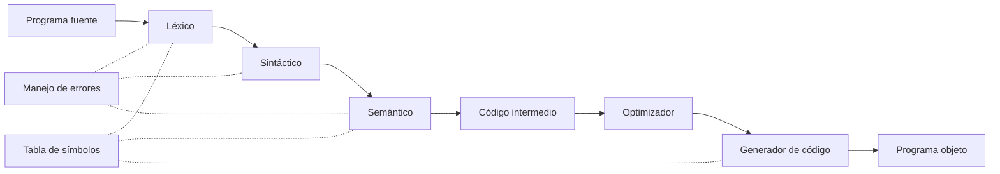

# Compiladores - Introducción a lo que es un compilador

## 1.3 Principios fundamentales de compiladores.

---

Detrás de la variedad de compiladores que existen hay unos pocos principios comunes: el compilador debe **preservar el significado** del programa, debe **mejorarlo** de forma perceptible, y su trabajo se organiza en **fases** que transforman el programa paso a paso entre representaciones cada vez más cercanas a la máquina, apoyadas en la teoría de lenguajes formales. Este tema presenta esos principios: la separación entre análisis y síntesis, cada fase con su entrada, su salida y los errores que detecta, la tabla de símbolos, el manejo de errores y los fundamentos formales con su complejidad, con un pequeño compilador completo en Python.

### Dos principios rectores

Cooper y Torczon resumen el oficio en dos reglas:

1. **El compilador debe preservar el significado del programa.** Cualquier transformación, por ingeniosa que sea, es inútil si cambia el resultado de algún programa válido.
2. **El compilador debe mejorar el programa de alguna forma perceptible**: más rápido, más pequeño, con menos consumo de energía o, al menos, ejecutable en una máquina en la que antes no lo era.

### Análisis y síntesis

El trabajo se divide en un **análisis**, que descompone el programa, verifica que sea válido y construye una representación de su significado, y una **síntesis**, que construye el programa objeto a partir de esa representación. Entre ambas está la **representación intermedia** (IR), independiente del lenguaje fuente y de la máquina, sobre la que trabaja el **optimizador**. Esta separación es la que permite reutilizar *front-ends* y *back-ends*.

### Las fases

| Fase | Entrada | Salida | Errores que detecta |
| ---- | ------- | ------ | ------------------- |
| Análisis léxico | caracteres | tokens | caracteres ilegales, cadenas o comentarios sin cerrar |
| Análisis sintáctico | tokens | árbol sintáctico | estructura incorrecta: falta un punto y coma, paréntesis sin cerrar |
| Análisis semántico | árbol | árbol anotado con tipos y símbolos | identificadores no declarados, tipos incompatibles, número de argumentos |
| Generación de código intermedio | árbol anotado | IR, como código de tres direcciones | ninguno, si las fases anteriores fueron correctas |
| Optimización | IR | IR equivalente y mejor | ninguno; puede emitir avisos |
| Generación de código | IR | código de máquina o ensamblador | límites de la máquina |

- El **analizador léxico** agrupa los caracteres en **lexemas** y los clasifica en **tokens**, pares de una clase y un valor, como `<ID, x>` o `<NUM, 42>`, y descarta los espacios y comentarios.
- El **analizador sintáctico** verifica que la secuencia de tokens pertenezca a la gramática del lenguaje y construye el **árbol sintáctico**, cuya forma refleja la precedencia y la asociatividad de los operadores.
- El **analizador semántico** verifica lo que la gramática no puede expresar: que cada identificador esté declarado, que los tipos sean compatibles, e inserta las conversiones implícitas.
- El **generador de código intermedio** produce una representación lineal y simple, como el **código de tres direcciones**, con a lo más un operador por instrucción: `t1 = b * c`.
- El **optimizador** aplica transformaciones que preservan el significado: plegado de constantes, eliminación de subexpresiones comunes, eliminación de código muerto, movimiento de código fuera de los ciclos.
- El **generador de código** elige las instrucciones de la máquina, asigna las variables a registros y ordena las instrucciones.

### La tabla de símbolos

La **tabla de símbolos** guarda, para cada identificador, su clase, variable, función o tipo; su tipo; su **ámbito**, y la información que necesitará la síntesis, como su dirección o su desplazamiento en el registro de activación. La consultan todas las fases, y se implementa con tablas de dispersión, una por ámbito, apiladas para reflejar el anidamiento, de modo que la búsqueda y la inserción cuesten en promedio $O(1).$

### Manejo de errores

Un compilador debe **detectar** todo programa inválido, **ubicar** el error con precisión, **explicarlo** con un mensaje útil y **recuperarse** para reportar otros errores en la misma compilación, sin generar cascadas de errores falsos. La recuperación más común en el análisis sintáctico es el **modo de pánico**: descartar tokens hasta uno de sincronización, como `;` o `}`.

### Fundamentos formales

| Fase | Formalismo | Reconocedor | Costo |
| ---- | ---------- | ----------- | ----- |
| Léxica | expresiones regulares, lenguajes regulares | autómata finito determinista | $O(n)$ |
| Sintáctica | gramáticas libres de contexto | autómata de pila | $O(n)$ para LL(1) y LR(1); $O(n^3)$ en general, con CYK o Earley |
| Semántica | gramáticas de atributos, sistemas de tipos | recorridos del árbol | normalmente $O(n),$ salvo inferencia de tipos |

Que la sintaxis de los lenguajes de programación se diseñe para que la reconozcan analizadores LL o LR, y no gramáticas arbitrarias, es lo que hace que el análisis sea lineal.



### Implementación en Python

El programa contiene un compilador completo, aunque pequeño, de un lenguaje con declaraciones, asignaciones, `if` y expresiones aritméticas: un analizador léxico con una sola expresión regular, un analizador sintáctico descendente recursivo que construye el árbol, un generador de código de tres direcciones, un optimizador local y un generador de ensamblador para una máquina sencilla. Con él resuelve los ejercicios 1, 2, 4 y 5, y usa `gcc` para el 3 y para comparar el ensamblador del 5. Al final muestra la falla del analizador léxico del material original.

```python
import re

# ---------- Análisis léxico: una expresión regular con un grupo por clase de token ----------
ESPEC = [("ESPACIO", r"[ \t\n]+"), ("COMENTARIO", r"//[^\n]*"), ("NUM", r"\d+(?:\.\d+)?"), ("ID", r"[A-Za-z_]\w*"),
         ("OP", r"==|!=|<=|>=|[-+*/<>=]"), ("PUNT", r"[(){};,]")]
RESERVADAS = {"if", "then", "else", "while", "int", "float", "return"}
PATRON = re.compile("|".join(f"(?P<{n}>{p})" for n, p in ESPEC))
def lexico(texto):
    tokens, pos, linea = [], 0, 1
    while pos < len(texto):
        m = PATRON.match(texto, pos)
        if not m: raise SyntaxError(f"línea {linea}: carácter ilegal {texto[pos]!r}")
        clase, lexema = m.lastgroup, m.group()
        if clase == "ID" and lexema in RESERVADAS: clase = lexema.upper()
        if clase not in ("ESPACIO", "COMENTARIO"): tokens.append((clase, lexema, linea))
        linea += lexema.count("\n"); pos = m.end()
    return tokens + [("FIN", "", linea)]

# ---------- Análisis sintáctico descendente recursivo; el árbol se representa con tuplas ----------
class Parser:
    def __init__(self, tokens): self.t, self.i = tokens, 0
    def ve(self): return self.t[self.i]
    def come(self, *esperado):
        clase, lexema, linea = self.t[self.i]
        if esperado and clase not in esperado and lexema not in esperado:
            raise SyntaxError(f"línea {linea}: se esperaba {' o '.join(esperado)} y se encontró {lexema or 'el fin'!r}")
        self.i += 1; return lexema
    def programa(self):
        sents = []
        while self.ve()[0] != "FIN": sents.append(self.sentencia())
        return ("programa", sents)
    def sentencia(self):
        clase, lexema, _ = self.ve()
        if clase in ("INT", "FLOAT"):
            tipo = self.come(); nombre = self.come("ID"); valor = None
            if self.ve()[1] == "=": self.come("="); valor = self.expresion()
            self.come(";"); return ("decl", tipo, nombre, valor)
        if clase == "IF":
            self.come("IF"); self.come("("); cond = self.expresion(); self.come(")")
            if self.ve()[0] == "THEN": self.come("THEN")
            entonces = self.sentencia(); sino = None
            if self.ve()[0] == "ELSE": self.come("ELSE"); sino = self.sentencia()
            return ("if", cond, entonces, sino)
        if clase == "RETURN": self.come("RETURN"); e = self.expresion(); self.come(";"); return ("return", e)
        if lexema == "{":
            self.come("{"); sents = []
            while self.ve()[1] != "}": sents.append(self.sentencia())
            self.come("}"); return ("bloque", sents)
        nombre = self.come("ID"); self.come("="); e = self.expresion(); self.come(";")
        return ("asigna", nombre, e)
    def expresion(self):                        # comparación < suma < producto < factor
        izq = self.suma()
        while self.ve()[1] in ("==", "!=", "<", ">", "<=", ">="): op = self.come(); izq = (op, izq, self.suma())
        return izq
    def suma(self):
        izq = self.producto()
        while self.ve()[1] in ("+", "-"): op = self.come(); izq = (op, izq, self.producto())   # asociatividad izquierda
        return izq
    def producto(self):
        izq = self.factor()
        while self.ve()[1] in ("*", "/"): op = self.come(); izq = (op, izq, self.factor())
        return izq
    def factor(self):
        clase, lexema, _ = self.ve()
        if clase == "NUM": self.come(); return ("num", float(lexema) if "." in lexema else int(lexema))
        if clase == "ID": self.come(); return ("var", lexema)
        self.come("("); e = self.expresion(); self.come(")"); return e
def arbol(n, s=""):                             # dibuja el árbol con sangría
    if n[0] == "num": return [f"{s}{n[1]}"]
    if n[0] == "var": return [f"{s}{n[1]}"]
    if n[0] in ("+", "-", "*", "/", "<", ">", "==", "!=", "<=", ">="):
        return [f"{s}{n[0]}"] + arbol(n[1], s + "  ") + arbol(n[2], s + "  ")
    if n[0] == "asigna": return [f"{s}= {n[1]}"] + arbol(n[2], s + "  ")
    return [f"{s}{n[0]}"]

# ---------- Código de tres direcciones ----------
class GeneradorTAC:
    def __init__(self): self.codigo, self.nt, self.ne = [], 0, 0
    def temp(self): self.nt += 1; return f"t{self.nt}"
    def etiqueta(self): self.ne += 1; return f"L{self.ne}"
    def expr(self, n):
        if n[0] == "num": return str(n[1])
        if n[0] == "var": return n[1]
        a, b = self.expr(n[1]), self.expr(n[2]); t = self.temp(); self.codigo.append(f"{t} = {a} {n[0]} {b}"); return t
    def sent(self, n):
        if n[0] == "programa" or n[0] == "bloque":
            for s in n[1]: self.sent(s)
        elif n[0] == "decl":
            if n[3] is not None: self.codigo.append(f"{n[2]} = {self.expr(n[3])}")
        elif n[0] == "asigna": self.codigo.append(f"{n[1]} = {self.expr(n[2])}")
        elif n[0] == "return": self.codigo.append(f"return {self.expr(n[1])}")
        elif n[0] == "if":
            c = n[1]; lf, lfin = self.etiqueta(), self.etiqueta()
            a, b = self.expr(c[1]), self.expr(c[2]); inverso = {"<": ">=", ">": "<=", "<=": ">", ">=": "<", "==": "!=", "!=": "=="}[c[0]]
            self.codigo.append(f"if {a} {inverso} {b} goto {lf if n[3] else lfin}")
            self.sent(n[2])
            if n[3]: self.codigo += [f"goto {lfin}", f"{lf}:"]; self.sent(n[3])
            self.codigo.append(f"{lfin}:")
        return self.codigo

# ---------- Optimización local: plegado, propagación de copias, subexpresiones comunes y código muerto ----------
def optimiza(codigo, vivas_al_final=None):
    valor, expr_disp, salida, pasos = {}, {}, [], []
    def v(x): return valor.get(x, x)
    for ins in codigo:
        m = re.fullmatch(r"(\w+) = (\S+) ([-+*/]) (\S+)", ins)
        if m:
            d, a, op, b = m.groups(); a, b = v(a), v(b)
            if re.fullmatch(r"-?\d+", a) and re.fullmatch(r"-?\d+", b):
                r = str(int(eval(f"{a}{op}{b}")) if op != "/" else int(a) // int(b)); valor[d] = r; pasos.append(f"plegado: {d} = {r}"); continue
            clave = (a, op, b) if op in "-/" else (min(a, b), op, max(a, b))
            if clave in expr_disp: valor[d] = expr_disp[clave]; pasos.append(f"subexpresión común: {d} = {expr_disp[clave]}"); continue
            expr_disp[clave] = d; salida.append(f"{d} = {a} {op} {b}"); continue
        m = re.fullmatch(r"(\w+) = (\S+)", ins)
        if m:
            d, a = m.groups(); a = v(a)
            if d.startswith("t"): valor[d] = a; pasos.append(f"copia: {d} = {a}"); continue
            for k in [k for k in expr_disp if d in k]: del expr_disp[k]          # d cambió: esas expresiones ya no valen
            salida.append(f"{d} = {a}"); continue
        salida.append(re.sub(r"\b(t\d+)\b", lambda k: v(k.group(1)), ins))
    usadas = {x for i in salida for x in re.findall(r"\b\w+\b", i.split("=", 1)[-1] if "=" in i and "goto" not in i else i)}
    final = [i for i in salida if not (re.match(r"t\d+ =", i) and i.split()[0] not in usadas)]
    return final, pasos

# ---------- Generación de código para una máquina de registros sencilla ----------
def genera_asm(codigo):
    asm, nombre = [], {"+": "add", "-": "sub", "*": "imul", "/": "idiv"}
    for ins in codigo:
        m = re.fullmatch(r"(\w+) = (\S+) ([-+*/]) (\S+)", ins)
        if m:
            d, a, op, b = m.groups(); asm += [f"mov eax, {a}", f"{nombre[op]} eax, {b}", f"mov {d}, eax"]; continue
        m = re.fullmatch(r"(\w+) = (\S+)", ins)
        if m: asm += [f"mov eax, {m.group(2)}", f"mov {m.group(1)}, eax"]; continue
        m = re.fullmatch(r"return (\S+)", ins)
        if m: asm += [f"mov eax, {m.group(1)}", "ret"]; continue
        m = re.fullmatch(r"if (\S+) (\S+) (\S+) goto (\w+)", ins)
        if m:
            salto = {"<": "jl", ">": "jg", "<=": "jle", ">=": "jge", "==": "je", "!=": "jne"}[m.group(2)]
            asm += [f"mov eax, {m.group(1)}", f"cmp eax, {m.group(3)}", f"{salto} {m.group(4)}"]; continue
        asm.append(ins.replace("goto", "jmp") if ins.startswith("goto") else ins)
    return asm

import os, subprocess, tempfile
# ---------- Ejercicio 1: tokens ----------
print("ejercicio 1:", " ".join(f"<{c},{l}>" if c in ("ID", "NUM", "OP") else f"<{l}>" for c, l, _ in lexico("x = 42 + y * 3;")[:-1]))
# ---------- Ejercicio 2: árbol de a + b * c - d ----------
p = Parser(lexico("a + b * c - d")); e = p.expresion()
print("ejercicio 2: árbol de a + b * c - d"); print("\n".join("   " + l for l in arbol(e)))
# ---------- Ejercicio 3: lo que dice gcc del programa ----------
C3 = """int main() {
    int x = 5;
    float y = 3.14;
    int z = x + y;
    if (z) {
        int w = "hola";
    }
    return 0;
}
"""
d = tempfile.mkdtemp(); open(os.path.join(d, "e3.c"), "w").write(C3)
r = subprocess.run(["gcc", "-c", "-Wall", "-Wconversion", "e3.c"], capture_output=True, text=True, cwd=d)
print("ejercicio 3: gcc -Wall -Wconversion:")
for l in r.stderr.splitlines():
    if ": warning:" in l or ": error:" in l: print("   " + l.split("e3.c:")[1])
# ---------- Ejercicio 4: optimización del código de tres direcciones ----------
TAC = ["t1 = 5 * 2", "t2 = x + t1", "t3 = 5 * 2", "t4 = y + t3", "t5 = t2 + t4"]
opt, pasos = optimiza(TAC + ["return t5"])
print("ejercicio 4:", "; ".join(pasos)); print("   resultado:", " | ".join(opt))
# ---------- Ejercicio 5: x = a + b * c ----------
tac = GeneradorTAC().sent(Parser(lexico("x = a + b * c;")).programa())
print("ejercicio 5: código de tres direcciones:", " | ".join(tac))
print("   ensamblador de la máquina sencilla:", " | ".join(genera_asm(tac)))
open(os.path.join(d, "e5.c"), "w").write("int a, b, c, x;\nvoid f(void) { x = a + b * c; }\n")
subprocess.run(["gcc", "-O2", "-S", "-masm=intel", "-fno-asynchronous-unwind-tables", "-fcf-protection=none", "e5.c"], cwd=d)
asm = [" ".join(l.split()) for l in open(os.path.join(d, "e5.s")) if l.startswith("\t") and not l.strip().startswith(".")]
print("   gcc -O2 -masm=intel:", " | ".join(asm))
# ---------- El analizador léxico del material original ----------
try:
    tokens = [(r'[ \n\t]+', None), (r'[a-zA-Z_][a-zA-Z0-9_]*', 'ID'), (r'[0-9]+', 'NUM'), (r'=', 'ASSIGN')]
    def lex(characters):
        import re as _re
        pos = 0; tokens = []                    # este "tokens" oculta la lista de patrones
        while pos < len(characters):
            match = None
            for pattern, tag in tokens:
                match = _re.compile(pattern).match(characters, pos)
                if match: break
            if not match: raise Exception('Carácter ilegal: %s' % characters[pos])
            pos = match.end(0)
        return tokens
    lex("x = 1")
except Exception as ex: print("analizador del material original con 'x = 1':", ex)
```

Salida, con gcc 13 en x86-64:

```text
ejercicio 1: <ID,x> <OP,=> <NUM,42> <OP,+> <ID,y> <OP,*> <NUM,3> <;>
ejercicio 2: árbol de a + b * c - d
   -
     +
       a
       *
         b
         c
     d
ejercicio 3: gcc -Wall -Wconversion:
   3:15: warning: conversion from ‘double’ to ‘float’ changes value from ‘3.1400000000000001e+0’ to ‘3.1400001e+0f’ [-Wfloat-conversion]
   4:15: warning: conversion from ‘int’ to ‘float’ may change value [-Wconversion]
   4:13: warning: conversion from ‘float’ to ‘int’ may change value [-Wfloat-conversion]
   6:17: warning: initialization of ‘int’ from ‘char *’ makes integer from pointer without a cast [-Wint-conversion]
   6:13: warning: unused variable ‘w’ [-Wunused-variable]
ejercicio 4: plegado: t1 = 10; plegado: t3 = 10
   resultado: t2 = x + 10 | t4 = y + 10 | t5 = t2 + t4 | return t5
ejercicio 5: código de tres direcciones: t1 = b * c | t2 = a + t1 | x = t2
   ensamblador de la máquina sencilla: mov eax, b | imul eax, c | mov t1, eax | mov eax, a | add eax, t1 | mov t2, eax | mov eax, t2 | mov x, eax
   gcc -O2 -masm=intel: mov eax, DWORD PTR b[rip] | imul eax, DWORD PTR c[rip] | add eax, DWORD PTR a[rip] | mov DWORD PTR x[rip], eax | ret
analizador del material original con 'x = 1': Carácter ilegal: x
```

### Ejercicios Propuestos

1. **Análisis léxico.** Identifica la secuencia de tokens de la entrada `x = 42 + y * 3;`.

2. **Análisis sintáctico.** Construye el árbol de sintaxis abstracta de la expresión `a + b * c - d`.

3. **Análisis semántico.** Identifica los errores semánticos del siguiente código:

    ```c
    int main() {
        int x = 5;
        float y = 3.14;
        int z = x + y;  // ¿Error?
        if (z) {
            int w = "hola";  // ¿Error?
        }
        return 0;
    }
    ```

4. **Optimización.** Optimiza el siguiente código de tres direcciones:

    ```text
    t1 = 5 * 2
    t2 = x + t1
    t3 = 5 * 2
    t4 = y + t3
    t5 = t2 + t4
    ```

5. **Generación de código.** Propón código ensamblador para la expresión `x = a + b * c`.

### Soluciones

**Ejercicio 1.** La secuencia es `<ID, x>`, `<OP, =>`, `<NUM, 42>`, `<OP, +>`, `<ID, y>`, `<OP, *>`, `<NUM, 3>` y `<;>`: ocho tokens. Los espacios no producen tokens, y los signos de puntuación no necesitan valor porque la clase ya los identifica. En la tabla de símbolos se registran `x` e `y`, y el valor 42 se guarda convertido a número.

**Ejercicio 2.** Por precedencia, `*` se agrupa antes que `+` y `-`, y por la asociatividad izquierda de `+` y `-`, la expresión es $(a + (b \cdot c)) - d:$ la raíz es `-`, con hijo izquierdo `+`, cuyos hijos son `a` y el producto `b * c`, y con hijo derecho `d`, como dibuja el programa. En esta expresión la asociatividad no cambia el valor, porque $(a + bc) - d = a + (bc - d),$ pero en general sí: $8 - 3 - 2$ vale 3 asociando a la izquierda y 7 a la derecha. La gramática con un no terminal por nivel de precedencia y recursión izquierda, implementada con ciclos, produce el árbol correcto.

**Ejercicio 3.** En C, ninguna de las dos líneas marcadas es un error en sentido estricto, y gcc 13 solo emite avisos:

- `int z = x + y`: `x` se convierte a `float`, la suma es `float` y se convierte implícitamente a `int`, truncando a 8; es válido pero pierde información, y gcc lo avisa solo con `-Wconversion`;
- `int w = "hola"`: inicializa un entero con un puntero a `char`, una violación de restricción del estándar; gcc 13 la acepta con un aviso, y gcc 14 la trata como **error** por omisión. En Java o C++ sí sería un error de tipos;
- `w` además nunca se usa, y `float y = 3.14` pierde precisión, porque 3.14 es una constante `double`.

`if (z)` es válido: en C cualquier valor escalar distinto de cero es verdadero. El ejercicio muestra que lo que es un error semántico depende de las reglas del **lenguaje**, no de una noción general de corrección.

**Ejercicio 4.** El optimizador pliega $5 \cdot 2 = 10$ en `t1` y en `t3`, que además eran una subexpresión común, y propaga el 10 a sus usos; `t1` y `t3` desaparecen. El resultado tiene tres instrucciones en lugar de cinco:

```text
t2 = x + 10
t4 = y + 10
t5 = t2 + t4
```

Algebraicamente sería $x + y + 20,$ dos instrucciones, pero esa reasociación solo es válida si la suma es asociativa, lo que se cumple con enteros en complemento a dos sin desbordamiento indefinido de por medio, y no con flotantes.

**Ejercicio 5.** El código de tres direcciones es `t1 = b * c`, `t2 = a + t1`, `x = t2`, y el generador sencillo lo traduce instrucción por instrucción, guardando cada temporal en memoria: 8 instrucciones. Un generador con asignación de registros mantiene el temporal en el registro, y gcc con `-O2` usa 5: carga `b`, lo multiplica por `c` directamente desde memoria, suma `a`, guarda en `x` y regresa:

```text
mov  eax, DWORD PTR b[rip]
imul eax, DWORD PTR c[rip]
add  eax, DWORD PTR a[rip]
mov  DWORD PTR x[rip], eax
```

La diferencia entre las dos versiones es justamente el trabajo de la selección de instrucciones y la asignación de registros, temas 11 y 13.

El analizador léxico de ejemplo del material original no funcionaba: dentro de la función, `tokens = []` reemplazaba a la lista de patrones del mismo nombre, el ciclo recorría una lista vacía y cualquier entrada producía "carácter ilegal" en su primer carácter, como muestra el programa. Además compilaba cada expresión regular en cada posición.

### Referencias

1. Cooper, K. D., and Torczon, L., _Engineering a Compiler_. 3a ed., Morgan Kaufmann, 2022. Capítulo 1.
2. Aho, A. V., Lam, M. S., Sethi, R., and Ullman, J. D., _Compilers: Principles, Techniques, and Tools_. 2a ed., Pearson, 2007. Capítulos 1 y 2.
3. Hopcroft, J. E., Motwani, R., and Ullman, J. D., _Introduction to Automata Theory, Languages, and Computation_. 3a ed., Pearson, 2006.
4. Wirth, N., _Compiler Construction_. Addison-Wesley, 1996.
5. ISO/IEC 9899:2018, _Programming languages — C_, sección 6.5.16.1.
