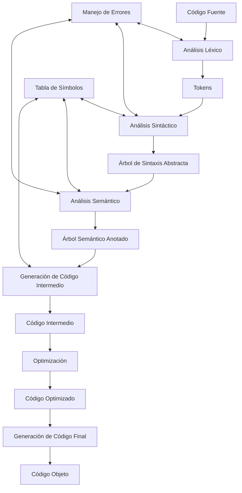
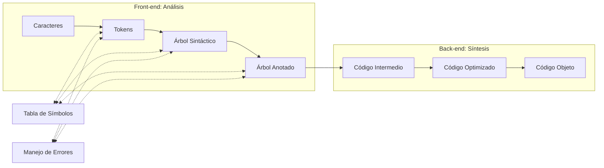

# Compiladores - Introducción a lo que es un compilador

## 1.4 Estructura de un compilador.

---

La estructura de un compilador se organiza en fases que transforman progresivamente el código fuente en código objeto. Cada fase tiene responsabilidades específicas y utiliza estructuras de datos bien definidas para realizar su tarea.

### Arquitectura General de un Compilador



### Fases de un Compilador

#### 1. Análisis Léxico (Scanner)

Convierte el flujo de caracteres en tokens con significado.

**Proceso:**

- Elimina espacios en blanco y comentarios
- Identifica tokens mediante expresiones regulares
- Construye la tabla de símbolos con identificadores

**Expresiones regulares comunes:**

- Identificador: `[a-zA-Z_][a-zA-Z0-9_]*`
- Número entero: `[0-9]+`
- Operador: `\+|\-|\*|/|==?|!=?|<=?|>=?`

**Ejemplo:**

```python
# Entrada: "position = initial + rate * 60"
# Tokens generados:
[ID("position"), OP("="), ID("initial"), OP("+"), ID("rate"), OP("*"), INT(60)]
```

#### 2. Análisis Sintáctico (Parser)

Agrupa los tokens en una estructura jerárquica (árbol de sintaxis).

**Gramática para expresiones:**

```
E → E + T | E - T | T
T → T * F | T / F | F
F → ( E ) | id | num
```

**Ejemplo de árbol sintáctico:**

```
      =
     / \
   pos   +
       /   \
     ini    *
          /   \
        rate   60
```

#### 3. Análisis Semántico

Verifica la corrección semántica del programa.

**Comprobaciones:**

- Compatibilidad de tipos
- Variables declaradas antes de su uso
- Coherencia en el uso de operadores

**Ejemplo de verificación de tipos:**

```java
int x = 5;
float y = 3.14;
float z = x + y;  // OK: conversión implícita de int a float
String s = x + y; // Error: incompatible types
```

#### 4. Generación de Código Intermedio

Crea una representación independiente de la máquina.

**Código de tres direcciones:**

```
t1 = rate * 60
t2 = initial + t1
position = t2
```

#### 5. Optimización de Código

Mejora el código preservando su significado.

**Técnicas comunes:**

- **Propagación de constantes**: `t1 = rate * 60` → `t1 = rate * 60`
- **Eliminación de subexpresiones comunes**
- **Optimización de bucles**

**Ejemplo de optimización:**

```cpp
// Antes de optimizar
t1 = 5 * 2;      // 10 puede calcularse en compilación
t2 = x + t1;

// Después de optimizar
t2 = x + 10;
```

#### 6. Generación de Código Final

Produce código objeto para la arquitectura destino.

**Ejemplo para x86:**

```assembly
; Para: position = initial + rate * 60
mov eax, [rate]    ; Carga rate en registro
imul eax, 60       ; Multiplica por 60
add eax, [initial] ; Suma initial
mov [position], eax; Almacena resultado
```

### Estructuras de Datos Principales

#### 1. Tabla de Símbolos

Almacena información sobre identificadores:

| Nombre   | Tipo  | Ámbito | Dirección | Valor |
| -------- | ----- | ------ | --------- | ----- |
| position | float | global | 0x1000    | -     |
| initial  | float | global | 0x1004    | 0.0   |
| rate     | float | global | 0x1008    | 0.0   |

#### 2. Árbol de Sintaxis Abstracta (AST)

Representación jerárquica del programa:

```python
class ASTNode:
    def __init__(self, type, children=None):
        self.type = type
        self.children = children or []

# Ejemplo: position = initial + rate * 60
ast = ASTNode('=',
    [ASTNode('id', ['position']),
     ASTNode('+',
        [ASTNode('id', ['initial']),
         ASTNode('*',
            [ASTNode('id', ['rate']),
             ASTNode('num', [60])])])])
```

#### 3. Código Intermedio

Representación de tres direcciones:

```python
# Lista de cuádruplos: (operador, operando1, operando2, resultado)
intermediate_code = [
    ('*', 'rate', 60, 't1'),
    ('+', 'initial', 't1', 't2'),
    ('=', 't2', None, 'position')
]
```

### Fórmulas y Conceptos Clave

#### Complejidad de las Fases

- Análisis léxico: $O(n)$ donde $n$ es la longitud de la entrada
- Análisis sintáctico: $O(n^3)$ en el caso general, $O(n)$ para gramáticas LL(1) y LR(1)
- Análisis semántico: $O(n)$ a $O(n^2)$ dependiendo de las comprobaciones

#### Tamaño de la Tabla de Símbolos

El tamaño esperado de la tabla de símbolos es proporcional al número de identificadores únicos:

$$S = O(m)$$

donde $m$ es el número de identificadores distintos en el programa.

### Ejercicios Propuestos

1. **Análisis Léxico:**
   Dada la entrada: `if (x > 0) then y = x * 2 + 1;`, genere la secuencia de tokens.

2. **Análisis Sintáctico:**
   Construya el árbol de sintaxis abstracta para la expresión: `a = b * c + d / e - f`

3. **Análisis Semántico:**
   Identifique los errores en el siguiente fragmento:

   ```c
   int main() {
       int x = 5;
       float y;
       z = x + y;  // ¿Error?
       if (x = 3) { // ¿Error?
           printf("x es 3");
       }
       return 0;
   }
   ```

4. **Generación de Código Intermedio:**
   Genere código de tres direcciones para:

   ```c
   if (x > y) {
       max = x;
   } else {
       max = y;
   }
   ```

5. **Optimización:**
   Optimice el siguiente código intermedio:
   ```
   t1 = 5 * 2
   t2 = x + t1
   t3 = 5 * 2
   t4 = y + t3
   t5 = t2 + t4
   ```

### Diagrama de Flujo de Información



### Referencias

#### Bibliografía Básica

1. Aho, A. V., Lam, M. S., Sethi, R., & Ullman, J. D. (2007). Compilers: Principles, Techniques, and Tools (2nd ed.). Pearson Education. (Capítulos 1-2)
2. Cooper, K. D., & Torczon, L. (2004). Engineering a Compiler. Morgan Kaufmann. (Capítulos 1-4)
3. Scott, M. L. (2009). Programming Language Pragmatics. Morgan Kaufmann. (Capítulos 1-2)

#### Bibliografía Complementaria

1. Grune, D., Bal, H. E., Jacobs, C. J. H., & Langendoen, K. G. (2000). Modern Compiler Design. John Wiley & Sons. (Capítulos 1-4)
2. Wilhelm, R., & Maurer, D. (1995). Compiler Design. Addison-Wesley. (Capítulos 1-3)

### Conclusión

La estructura de un compilador sigue un diseño modular organizado en fases que transforman progresivamente el código fuente en código objeto. Esta separación en front-end (análisis) y back-end (síntesis) permite la reutilización de componentes para diferentes combinaciones de lenguajes fuente y destino. Las estructuras de datos centrales, como la tabla de símbolos y los árboles sintácticos, facilitan el flujo de información entre las diferentes fases del proceso de compilación.
