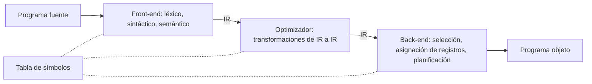

# Compiladores - Introducción a lo que es un compilador

## 1.4 Estructura de un compilador.

---

Un compilador real es un programa grande, GCC tiene millones de líneas, y su estructura determina qué tan fácil es mantenerlo, portarlo a una máquina nueva o agregarle un lenguaje. Este tema presenta la estructura de un compilador: el *front-end*, la representación intermedia y el *back-end*, las fases con sus entradas y salidas, las estructuras de datos que comparten, la tabla de símbolos, el árbol sintáctico y el código de tres direcciones con sus formas de almacenarlo, y la organización en pasadas, siguiendo la sentencia `position = initial + rate * 60` a través de todo el proceso.

### Tres partes



- El **front-end** depende del lenguaje fuente y no de la máquina: entiende el programa, detecta los errores y produce la IR.
- El **optimizador**, o *middle-end*, transforma la IR en otra equivalente y mejor; muchas de sus transformaciones no dependen ni del lenguaje ni de la máquina.
- El **back-end** depende de la máquina: elige las instrucciones, asigna los registros y ordena las instrucciones para aprovechar el procesador.

Con esta división, GCC y LLVM comparten un optimizador entre lenguajes como C, C++, Fortran, Rust o Swift, y un *back-end* por arquitectura.

### Las fases sobre un ejemplo

Para `position = initial + rate * 60`, con las tres variables declaradas `float`:

1. **Léxico:** `<ID, position> <=> <ID, initial> <+> <ID, rate> <*> <NUM, 60>`, y los tres identificadores en la tabla de símbolos.
2. **Sintáctico:** el árbol con `=` en la raíz, `position` a la izquierda y `+` a la derecha, cuyo hijo derecho es `*`, porque la multiplicación tiene mayor precedencia.
3. **Semántico:** como `rate` es `float` y 60 es `int`, se inserta la conversión `inttofloat(60)`, que el compilador puede hacer al compilar: 60.0.
4. **Código intermedio:** `t1 = rate * 60.0`, `t2 = initial + t1`, `position = t2`.
5. **Optimización:** se elimina la copia: `t1 = rate * 60.0`, `position = initial + t1`.
6. **Generación de código:** como los operandos son de punto flotante, en x86-64 se usan los registros `xmm` y las instrucciones escalares de SSE, `mulss` y `addss`, no las de enteros, como muestra el programa con gcc.

### Estructuras de datos

- **Tabla de símbolos:** para cada identificador, su nombre, clase, tipo, ámbito y ubicación: una dirección global, o un desplazamiento en el registro de activación de una función. El **valor** de una variable no está en la tabla, porque se conoce hasta ejecutar, salvo para las constantes.
- **Árbol de sintaxis abstracta** (AST): conserva la estructura del programa sin los detalles de la gramática, como los paréntesis o los signos de puntuación.
- **Código de tres direcciones:** instrucciones con a lo más un operador, `x = y op z`, saltos condicionales e incondicionales y etiquetas. Se almacena como **cuádruplos**, (operador, argumento 1, argumento 2, resultado); como **triples**, sin el campo de resultado, refiriéndose a los resultados por la posición de la instrucción, o como **triples indirectos**, con una lista de apuntadores que permite reordenar sin renumerar.
- **Grafo de flujo de control** y **DAG** de cada bloque básico, que los optimizadores usan para encontrar subexpresiones comunes.

### Pasadas

Una **pasada** es un recorrido completo de una representación del programa. Los primeros compiladores, con poca memoria, tenían muchas pasadas que escribían a disco; Pascal y C se diseñaron para poder compilarse en **una pasada**, declarando antes de usar. Hoy los compiladores leen todo el programa y hacen decenas de pasadas de optimización sobre la IR en memoria; LLVM las organiza con un administrador de pasadas configurable.

### Implementación en Python

El programa usa el mismo compilador pequeño del tema 1.3 para los ejercicios 1, 2 y 4, expresando además el código del ejercicio 4 como cuádruplos; construye el DAG del bloque del ejercicio 5 por numeración de valores, y usa gcc para el ejercicio 3 y para el ensamblador de la sentencia de ejemplo con variables `float`.

```python
import re

# ---------- Análisis léxico: una expresión regular con un grupo por clase de token ----------
ESPEC = [("ESPACIO", r"[ \t\n]+"), ("COMENTARIO", r"//[^\n]*"), ("NUM", r"\d+(?:\.\d+)?"), ("ID", r"[A-Za-z_]\w*"),
         ("OP", r"==|!=|<=|>=|[-+*/<>=]"), ("PUNT", r"[(){};,]")]
RESERVADAS = {"if", "then", "else", "while", "int", "float", "return"}
PATRON = re.compile("|".join(f"(?P<{n}>{p})" for n, p in ESPEC))
def lexico(texto):
    tokens, pos, linea = [], 0, 1
    while pos < len(texto):
        m = PATRON.match(texto, pos)
        if not m: raise SyntaxError(f"línea {linea}: carácter ilegal {texto[pos]!r}")
        clase, lexema = m.lastgroup, m.group()
        if clase == "ID" and lexema in RESERVADAS: clase = lexema.upper()
        if clase not in ("ESPACIO", "COMENTARIO"): tokens.append((clase, lexema, linea))
        linea += lexema.count("\n"); pos = m.end()
    return tokens + [("FIN", "", linea)]

# ---------- Análisis sintáctico descendente recursivo; el árbol se representa con tuplas ----------
class Parser:
    def __init__(self, tokens): self.t, self.i = tokens, 0
    def ve(self): return self.t[self.i]
    def come(self, *esperado):
        clase, lexema, linea = self.t[self.i]
        if esperado and clase not in esperado and lexema not in esperado:
            raise SyntaxError(f"línea {linea}: se esperaba {' o '.join(esperado)} y se encontró {lexema or 'el fin'!r}")
        self.i += 1; return lexema
    def programa(self):
        sents = []
        while self.ve()[0] != "FIN": sents.append(self.sentencia())
        return ("programa", sents)
    def sentencia(self):
        clase, lexema, _ = self.ve()
        if clase in ("INT", "FLOAT"):
            tipo = self.come(); nombre = self.come("ID"); valor = None
            if self.ve()[1] == "=": self.come("="); valor = self.expresion()
            self.come(";"); return ("decl", tipo, nombre, valor)
        if clase == "IF":
            self.come("IF"); self.come("("); cond = self.expresion(); self.come(")")
            if self.ve()[0] == "THEN": self.come("THEN")
            entonces = self.sentencia(); sino = None
            if self.ve()[0] == "ELSE": self.come("ELSE"); sino = self.sentencia()
            return ("if", cond, entonces, sino)
        if clase == "RETURN": self.come("RETURN"); e = self.expresion(); self.come(";"); return ("return", e)
        if lexema == "{":
            self.come("{"); sents = []
            while self.ve()[1] != "}": sents.append(self.sentencia())
            self.come("}"); return ("bloque", sents)
        nombre = self.come("ID"); self.come("="); e = self.expresion(); self.come(";")
        return ("asigna", nombre, e)
    def expresion(self):                        # comparación < suma < producto < factor
        izq = self.suma()
        while self.ve()[1] in ("==", "!=", "<", ">", "<=", ">="): op = self.come(); izq = (op, izq, self.suma())
        return izq
    def suma(self):
        izq = self.producto()
        while self.ve()[1] in ("+", "-"): op = self.come(); izq = (op, izq, self.producto())   # asociatividad izquierda
        return izq
    def producto(self):
        izq = self.factor()
        while self.ve()[1] in ("*", "/"): op = self.come(); izq = (op, izq, self.factor())
        return izq
    def factor(self):
        clase, lexema, _ = self.ve()
        if clase == "NUM": self.come(); return ("num", float(lexema) if "." in lexema else int(lexema))
        if clase == "ID": self.come(); return ("var", lexema)
        self.come("("); e = self.expresion(); self.come(")"); return e
def arbol(n, s=""):                             # dibuja el árbol con sangría
    if n[0] == "num": return [f"{s}{n[1]}"]
    if n[0] == "var": return [f"{s}{n[1]}"]
    if n[0] in ("+", "-", "*", "/", "<", ">", "==", "!=", "<=", ">="):
        return [f"{s}{n[0]}"] + arbol(n[1], s + "  ") + arbol(n[2], s + "  ")
    if n[0] == "asigna": return [f"{s}= {n[1]}"] + arbol(n[2], s + "  ")
    return [f"{s}{n[0]}"]

# ---------- Código de tres direcciones ----------
class GeneradorTAC:
    def __init__(self): self.codigo, self.nt, self.ne = [], 0, 0
    def temp(self): self.nt += 1; return f"t{self.nt}"
    def etiqueta(self): self.ne += 1; return f"L{self.ne}"
    def expr(self, n):
        if n[0] == "num": return str(n[1])
        if n[0] == "var": return n[1]
        a, b = self.expr(n[1]), self.expr(n[2]); t = self.temp(); self.codigo.append(f"{t} = {a} {n[0]} {b}"); return t
    def sent(self, n):
        if n[0] == "programa" or n[0] == "bloque":
            for s in n[1]: self.sent(s)
        elif n[0] == "decl":
            if n[3] is not None: self.codigo.append(f"{n[2]} = {self.expr(n[3])}")
        elif n[0] == "asigna": self.codigo.append(f"{n[1]} = {self.expr(n[2])}")
        elif n[0] == "return": self.codigo.append(f"return {self.expr(n[1])}")
        elif n[0] == "if":
            c = n[1]; lf, lfin = self.etiqueta(), self.etiqueta()
            a, b = self.expr(c[1]), self.expr(c[2]); inverso = {"<": ">=", ">": "<=", "<=": ">", ">=": "<", "==": "!=", "!=": "=="}[c[0]]
            self.codigo.append(f"if {a} {inverso} {b} goto {lf if n[3] else lfin}")
            self.sent(n[2])
            if n[3]: self.codigo += [f"goto {lfin}", f"{lf}:"]; self.sent(n[3])
            self.codigo.append(f"{lfin}:")
        return self.codigo

# ---------- Optimización local: plegado, propagación de copias, subexpresiones comunes y código muerto ----------
def optimiza(codigo, vivas_al_final=None):
    valor, expr_disp, salida, pasos = {}, {}, [], []
    def v(x): return valor.get(x, x)
    for ins in codigo:
        m = re.fullmatch(r"(\w+) = (\S+) ([-+*/]) (\S+)", ins)
        if m:
            d, a, op, b = m.groups(); a, b = v(a), v(b)
            if re.fullmatch(r"-?\d+", a) and re.fullmatch(r"-?\d+", b):
                r = str(int(eval(f"{a}{op}{b}")) if op != "/" else int(a) // int(b)); valor[d] = r; pasos.append(f"plegado: {d} = {r}"); continue
            clave = (a, op, b) if op in "-/" else (min(a, b), op, max(a, b))
            if clave in expr_disp: valor[d] = expr_disp[clave]; pasos.append(f"subexpresión común: {d} = {expr_disp[clave]}"); continue
            expr_disp[clave] = d; salida.append(f"{d} = {a} {op} {b}"); continue
        m = re.fullmatch(r"(\w+) = (\S+)", ins)
        if m:
            d, a = m.groups(); a = v(a)
            if d.startswith("t"): valor[d] = a; pasos.append(f"copia: {d} = {a}"); continue
            for k in [k for k in expr_disp if d in k]: del expr_disp[k]          # d cambió: esas expresiones ya no valen
            salida.append(f"{d} = {a}"); continue
        salida.append(re.sub(r"\b(t\d+)\b", lambda k: v(k.group(1)), ins))
    usadas = {x for i in salida for x in re.findall(r"\b\w+\b", i.split("=", 1)[-1] if "=" in i and "goto" not in i else i)}
    final = [i for i in salida if not (re.match(r"t\d+ =", i) and i.split()[0] not in usadas)]
    return final, pasos

# ---------- Generación de código para una máquina de registros sencilla ----------
def genera_asm(codigo):
    asm, nombre = [], {"+": "add", "-": "sub", "*": "imul", "/": "idiv"}
    for ins in codigo:
        m = re.fullmatch(r"(\w+) = (\S+) ([-+*/]) (\S+)", ins)
        if m:
            d, a, op, b = m.groups(); asm += [f"mov eax, {a}", f"{nombre[op]} eax, {b}", f"mov {d}, eax"]; continue
        m = re.fullmatch(r"(\w+) = (\S+)", ins)
        if m: asm += [f"mov eax, {m.group(2)}", f"mov {m.group(1)}, eax"]; continue
        m = re.fullmatch(r"return (\S+)", ins)
        if m: asm += [f"mov eax, {m.group(1)}", "ret"]; continue
        m = re.fullmatch(r"if (\S+) (\S+) (\S+) goto (\w+)", ins)
        if m:
            salto = {"<": "jl", ">": "jg", "<=": "jle", ">=": "jge", "==": "je", "!=": "jne"}[m.group(2)]
            asm += [f"mov eax, {m.group(1)}", f"cmp eax, {m.group(3)}", f"{salto} {m.group(4)}"]; continue
        asm.append(ins.replace("goto", "jmp") if ins.startswith("goto") else ins)
    return asm

import os, subprocess, tempfile
D = tempfile.mkdtemp()
def gcc(fuente, *opciones):
    open(os.path.join(D, "f.c"), "w").write(fuente)
    r = subprocess.run(["gcc", *opciones, "f.c"], capture_output=True, text=True, cwd=D, env={**os.environ, "LC_ALL": "C"})
    return r
def asm(fuente):
    gcc(fuente, "-O2", "-S", "-masm=intel", "-fno-asynchronous-unwind-tables", "-fcf-protection=none")
    return [" ".join(l.split()) for l in open(os.path.join(D, "f.s")) if l.startswith("\t") and not l.strip().startswith(".")]

# ---------- Ejercicio 1 ----------
print("ejercicio 1:", " ".join(f"<{c},{l}>" if c in ("ID", "NUM", "OP") else f"<{l}>" for c, l, _ in lexico("if (x > 0) then y = x * 2 + 1;")[:-1]))
# ---------- Ejercicio 2 ----------
s = Parser(lexico("a = b * c + d / e - f;")).sentencia()
print("ejercicio 2:"); print("\n".join("   " + l for l in arbol(s)))
# ---------- Ejercicio 3 ----------
C3 = 'int printf(const char *, ...);\nint main() {\n    int x = 5;\n    float y;\n    z = x + y;\n    if (x = 3) {\n        printf("x es 3");\n    }\n    return 0;\n}\n'
r = gcc(C3, "-c", "-Wall")
print("ejercicio 3: gcc -Wall:"); [print("   " + l.split("f.c:")[1]) for l in r.stderr.splitlines() if ": error:" in l or ": warning:" in l]
# ---------- Ejercicio 4 ----------
tac = GeneradorTAC().sent(Parser(lexico("if (x > y) { max = x; } else { max = y; }")).programa())
print("ejercicio 4:", " | ".join(tac))
cuad = []
for i in tac:                                   # el mismo código como cuádruplos (operador, arg1, arg2, resultado)
    m = re.fullmatch(r"if (\S+) (\S+) (\S+) goto (\w+)", i)
    if m: cuad.append((f"if{m.group(2)}", m.group(1), m.group(3), m.group(4)))
    elif i.startswith("goto"): cuad.append(("goto", "", "", i.split()[1]))
    elif i.endswith(":"): cuad.append(("label", "", "", i[:-1]))
    else: d, a = i.split(" = "); cuad.append(("=", a, "", d))
print("   cuádruplos:", cuad)
# ---------- Ejercicio 5: el bloque como DAG con numeración de valores ----------
TAC5 = ["t1 = 5 * 2", "t2 = x + t1", "t3 = 5 * 2", "t4 = y + t3", "t5 = t2 + t4"]
numero, nodos, nombre_de = {}, [], {}
def nodo(clave):                                # devuelve el número del nodo, creándolo solo si no existe
    if clave not in numero: nodos.append(clave); numero[clave] = len(nodos)
    return numero[clave]
for ins in TAC5:
    d, a, op, b = re.fullmatch(r"(\w+) = (\S+) (\S) (\S+)", ins).groups()
    va = nombre_de.get(a) or nodo(("hoja", a)); vb = nombre_de.get(b) or nodo(("hoja", b))
    nombre_de[d] = nodo((op, va, vb))
print(f"ejercicio 5: {len(TAC5)} instrucciones, {len(nodos)} nodos en el DAG; t1 y t3 son el mismo nodo: {nombre_de['t1'] == nombre_de['t3']}")
print("   nodos:", " ".join(f"n{k + 1}={n[1] if n[0] == 'hoja' else f'n{n[1]}{n[0]}n{n[2]}'}" for k, n in enumerate(nodos)))
opt, pasos = optimiza(TAC5 + ["return t5"]); print("   optimizado:", " | ".join(opt))
# ---------- La asignación del texto, con variables float ----------
print("position = initial + rate * 60 con float, gcc -O2:", " | ".join(asm("float position, initial, rate;\nvoid f(void) { position = initial + rate * 60; }\n")))
```

Salida, con gcc 13 en x86-64:

```text
ejercicio 1: <if> <(> <ID,x> <OP,>> <NUM,0> <)> <then> <ID,y> <OP,=> <ID,x> <OP,*> <NUM,2> <OP,+> <NUM,1> <;>
ejercicio 2:
   = a
     -
       +
         *
           b
           c
         /
           d
           e
       f
ejercicio 3: gcc -Wall:
   5:5: error: 'z' undeclared (first use in this function)
   6:9: warning: suggest parentheses around assignment used as truth value [-Wparentheses]
ejercicio 4: if x <= y goto L1 | max = x | goto L2 | L1: | max = y | L2:
   cuádruplos: [('if<=', 'x', 'y', 'L1'), ('=', 'x', '', 'max'), ('goto', '', '', 'L2'), ('label', '', '', 'L1'), ('=', 'y', '', 'max'), ('label', '', '', 'L2')]
ejercicio 5: 5 instrucciones, 8 nodos en el DAG; t1 y t3 son el mismo nodo: True
   nodos: n1=5 n2=2 n3=n1*n2 n4=x n5=n4+n3 n6=y n7=n6+n3 n8=n5+n7
   optimizado: t2 = x + 10 | t4 = y + 10 | t5 = t2 + t4 | return t5
position = initial + rate * 60 con float, gcc -O2: movss xmm0, DWORD PTR .LC0[rip] | mulss xmm0, DWORD PTR rate[rip] | addss xmm0, DWORD PTR initial[rip] | movss DWORD PTR position[rip], xmm0 | ret
```

### Ejercicios Propuestos

1. **Análisis léxico.** Genera la secuencia de tokens de `if (x > 0) then y = x * 2 + 1;`.

2. **Análisis sintáctico.** Construye el árbol de sintaxis abstracta de `a = b * c + d / e - f`.

3. **Análisis semántico.** Identifica los errores del siguiente fragmento:

    ```c
    int main() {
        int x = 5;
        float y;
        z = x + y;  // ¿Error?
        if (x = 3) { // ¿Error?
            printf("x es 3");
        }
        return 0;
    }
    ```

4. **Código intermedio.** Genera código de tres direcciones para:

    ```c
    if (x > y) {
        max = x;
    } else {
        max = y;
    }
    ```

5. **Optimización.** Optimiza el siguiente código intermedio:

    ```text
    t1 = 5 * 2
    t2 = x + t1
    t3 = 5 * 2
    t4 = y + t3
    t5 = t2 + t4
    ```

### Soluciones

**Ejercicio 1.** Son 15 tokens: `<if> <(> <ID, x> <OP, >> <NUM, 0> <)> <then> <ID, y> <OP, => <ID, x> <OP, *> <NUM, 2> <OP, +> <NUM, 1> <;>`. Las palabras `if` y `then` coinciden con el patrón de los identificadores, y el analizador las reconoce como **palabras reservadas** consultando una tabla después de reconocer el lexema; esa es la forma habitual de implementarlas, más simple que un patrón por palabra. `then` no existe en C, pero sí en Pascal o en el lenguaje del ejercicio.

**Ejercicio 2.** La asignación tiene la menor precedencia, así que es la raíz, con `a` como destino; el lado derecho es $((b \cdot c) + (d / e)) - f:$ los productos y divisiones se agrupan primero, y `+` y `-` se asocian a la izquierda, de modo que `-` queda arriba con `f` como hijo derecho, como dibuja el programa.

**Ejercicio 3.** `z = x + y` es un **error**: `z` no está declarada, y la búsqueda en la tabla de símbolos falla; gcc lo reporta como `'z' undeclared`. Además, `y` se usa sin haber recibido un valor, lo que no es un error del lenguaje sino un comportamiento indefinido que un análisis de flujo de datos puede avisar. `if (x = 3)` **no** es un error: es una asignación válida cuyo valor, 3, es verdadero, de modo que la condición siempre se cumple y además cambia `x`. Casi siempre es una confusión con `==`, y gcc con `-Wall` sugiere encerrarla en paréntesis si es intencional. La llamada a `printf` sin `#include <stdio.h>` sería otro aviso, por la declaración implícita, que el programa evita declarándola.

**Ejercicio 4.** El generador evalúa la condición e invierte la comparación para saltar a la rama del `else` cuando no se cumple:

```text
    if x <= y goto L1
    max = x
    goto L2
L1: max = y
L2:
```

Invertir la condición evita un salto: con la condición original se necesitaría `if x > y goto Lthen` seguido de un salto incondicional al `else`. Como cuádruplos, la primera instrucción es `(if<=, x, y, L1)` y la segunda `(=, x, , max)`, con los campos vacíos donde no hay operando. Con instrucciones de movimiento condicional, como `cmov` en x86, el compilador puede evitar los saltos por completo.

**Ejercicio 5.** El DAG del bloque tiene 8 nodos para 5 instrucciones, porque `t1` y `t3` calculan $5 \cdot 2$ sobre las mismas hojas y comparten el nodo: es la **numeración de valores**, que detecta las subexpresiones comunes construyendo cada nodo solo si no existe. Plegando la constante, el bloque queda en `t2 = x + 10`, `t4 = y + 10`, `t5 = t2 + t4`, igual que en el tema 1.3, pero aquí el razonamiento se hace sobre el grafo y no sobre el texto, que es como lo hacen los compiladores.

El material original daba como ejemplo de propagación de constantes `t1 = rate * 60` → `t1 = rate * 60`, sin ningún cambio; declaraba `float` las tres variables del ejemplo pero generaba código con `imul`, una multiplicación de enteros, y ponía una columna de valor en la tabla de símbolos, que en general no puede llenarse al compilar.

### Referencias

1. Aho, A. V., Lam, M. S., Sethi, R., and Ullman, J. D., _Compilers: Principles, Techniques, and Tools_. 2a ed., Pearson, 2007. Secciones 1.2, 6.1 y 6.2.
2. Cooper, K. D., and Torczon, L., _Engineering a Compiler_. 3a ed., Morgan Kaufmann, 2022. Capítulos 1 y 4.
3. Muchnick, S. S., _Advanced Compiler Design and Implementation_. Morgan Kaufmann, 1997.
4. Lattner, C., and Adve, V., LLVM: a compilation framework for lifelong program analysis and transformation. _CGO_, 2004.
5. Stallman, R. M., et al., _GNU Compiler Collection Internals_. Free Software Foundation.
