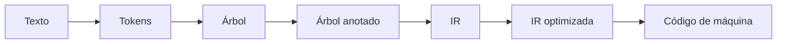

# Compiladores - Introducción a lo que es un compilador

## 1.5 Vista de alto nivel de la compilación.

---

Vista desde lejos, la compilación es una cadena de traducciones: cada fase recibe el programa en una representación y lo entrega en otra, más cercana a la máquina, sin cambiar su significado. Las representaciones son el **texto** del programa, la secuencia de **tokens**, el **árbol sintáctico**, el árbol **anotado** con tipos, la **representación intermedia** y el **código objeto**. Este tema recorre esa cadena de principio a fin con un ejemplo completo, presenta la separación de responsabilidades que permite la independencia de la máquina, el análisis semántico con la tabla de símbolos y el costo de cada fase, y verifica con un intérprete de código de tres direcciones que las transformaciones preservan el significado.

### Un ejemplo de principio a fin

Para el programa

```c
int main() {
    int x = 5;
    int y = x * 2 + 3;
    return y;
}
```

1. **Tokens:** `int`, `main`, `(`, `)`, `{`, `int`, `<ID, x>`, `=`, `<NUM, 5>`, `;`, y así sucesivamente.
2. **Árbol:** la declaración de `y` tiene como inicializador $(x \cdot 2) + 3.$
3. **Análisis semántico:** `x` e `y` se registran en la tabla de símbolos con tipo `int` en el ámbito de `main`; todas las operaciones son entre enteros y no hacen falta conversiones.
4. **Código de tres direcciones:** `x = 5`, `t1 = x * 2`, `t2 = t1 + 3`, `y = t2`, `return y`.
5. **Optimización:** propagando la constante de `x`, $t_1 = 10$ y $t_2 = 13;$ como `x` e `y` no se usan después, todo se reduce a `return 13`.
6. **Código objeto:** en x86-64, `mov eax, 13` y `ret`.

### Separación de responsabilidades

Cada fase tiene una sola tarea y una interfaz precisa con la siguiente: el analizador léxico no sabe de gramáticas, el sintáctico no sabe de tipos y el optimizador no sabe de la sintaxis del lenguaje fuente. Gracias a eso, cada fase puede construirse con la técnica que mejor le conviene, autómatas para la léxica, analizadores LL o LR para la sintáctica, y probarse por separado. Las fases no siempre se ejecutan una después de otra: el analizador léxico suele ser una subrutina que el sintáctico llama cada vez que necesita un token, y el análisis semántico y la generación de código intermedio pueden hacerse durante el análisis sintáctico, con **traducción dirigida por la sintaxis**.

### Independencia de la máquina

La representación intermedia es la frontera entre lo que depende del lenguaje y lo que depende de la máquina. Una buena IR es fácil de producir a partir del árbol, fácil de traducir a código de máquina y adecuada para optimizar. LLVM IR y el GIMPLE de GCC son representaciones de tres direcciones en **forma SSA**, en la que cada variable se asigna una sola vez (tema 5.4); el *bytecode* de Java y el CIL de .NET son representaciones de pila, pensadas además para distribuirse y verificarse.

### Análisis semántico y tabla de símbolos

El análisis semántico recorre el árbol con la tabla de símbolos: al encontrar una declaración la registra en el ámbito actual, y al encontrar un uso la busca del ámbito más interno al más externo. Si no la encuentra, es un identificador no declarado; si la encuentra, usa su tipo para verificar la operación y decidir qué conversiones insertar. Al abrir una función o un bloque se crea un ámbito nuevo, y al cerrarlo se descarta, lo que implementa las reglas de **alcance léxico**.

### Costo de cada fase

El análisis léxico es lineal en el número de caracteres; el sintáctico, lineal en el número de tokens con analizadores LL(1) y LR(1); el semántico, casi siempre lineal en el tamaño del árbol, con tablas de dispersión. La optimización y la generación de código son las fases más costosas: muchos problemas de optimización, como la asignación óptima de registros o la planificación óptima de instrucciones, son NP-difíciles, y los compiladores usan heurísticas, a menudo de costo cuadrático o mayor en el tamaño de una función, y limitan su alcance.



### Implementación en Python

El programa agrega al compilador pequeño de los temas anteriores un analizador semántico con una tabla de símbolos con ámbitos anidados y desplazamientos, y un intérprete de código de tres direcciones. Con ellos resuelve los ejercicios: detecta el uso antes de la declaración del ejercicio 1, genera y **ejecuta** el código del ejercicio 2, verifica con varios valores que la optimización del ejercicio 3 no cambia el resultado, construye la tabla de símbolos del ejercicio 4 y calcula los tiempos del ejercicio 5.

```python
import re

# ---------- Análisis léxico: una expresión regular con un grupo por clase de token ----------
ESPEC = [("ESPACIO", r"[ \t\n]+"), ("COMENTARIO", r"//[^\n]*"), ("NUM", r"\d+(?:\.\d+)?"), ("ID", r"[A-Za-z_]\w*"),
         ("OP", r"==|!=|<=|>=|[-+*/<>=]"), ("PUNT", r"[(){};,]")]
RESERVADAS = {"if", "then", "else", "while", "int", "float", "return"}
PATRON = re.compile("|".join(f"(?P<{n}>{p})" for n, p in ESPEC))
def lexico(texto):
    tokens, pos, linea = [], 0, 1
    while pos < len(texto):
        m = PATRON.match(texto, pos)
        if not m: raise SyntaxError(f"línea {linea}: carácter ilegal {texto[pos]!r}")
        clase, lexema = m.lastgroup, m.group()
        if clase == "ID" and lexema in RESERVADAS: clase = lexema.upper()
        if clase not in ("ESPACIO", "COMENTARIO"): tokens.append((clase, lexema, linea))
        linea += lexema.count("\n"); pos = m.end()
    return tokens + [("FIN", "", linea)]

# ---------- Análisis sintáctico descendente recursivo; el árbol se representa con tuplas ----------
class Parser:
    def __init__(self, tokens): self.t, self.i = tokens, 0
    def ve(self): return self.t[self.i]
    def come(self, *esperado):
        clase, lexema, linea = self.t[self.i]
        if esperado and clase not in esperado and lexema not in esperado:
            raise SyntaxError(f"línea {linea}: se esperaba {' o '.join(esperado)} y se encontró {lexema or 'el fin'!r}")
        self.i += 1; return lexema
    def programa(self):
        sents = []
        while self.ve()[0] != "FIN": sents.append(self.sentencia())
        return ("programa", sents)
    def sentencia(self):
        clase, lexema, _ = self.ve()
        if clase in ("INT", "FLOAT"):
            tipo = self.come(); nombre = self.come("ID"); valor = None
            if self.ve()[1] == "=": self.come("="); valor = self.expresion()
            self.come(";"); return ("decl", tipo, nombre, valor)
        if clase == "IF":
            self.come("IF"); self.come("("); cond = self.expresion(); self.come(")")
            if self.ve()[0] == "THEN": self.come("THEN")
            entonces = self.sentencia(); sino = None
            if self.ve()[0] == "ELSE": self.come("ELSE"); sino = self.sentencia()
            return ("if", cond, entonces, sino)
        if clase == "RETURN": self.come("RETURN"); e = self.expresion(); self.come(";"); return ("return", e)
        if lexema == "{":
            self.come("{"); sents = []
            while self.ve()[1] != "}": sents.append(self.sentencia())
            self.come("}"); return ("bloque", sents)
        nombre = self.come("ID"); self.come("="); e = self.expresion(); self.come(";")
        return ("asigna", nombre, e)
    def expresion(self):                        # comparación < suma < producto < factor
        izq = self.suma()
        while self.ve()[1] in ("==", "!=", "<", ">", "<=", ">="): op = self.come(); izq = (op, izq, self.suma())
        return izq
    def suma(self):
        izq = self.producto()
        while self.ve()[1] in ("+", "-"): op = self.come(); izq = (op, izq, self.producto())   # asociatividad izquierda
        return izq
    def producto(self):
        izq = self.factor()
        while self.ve()[1] in ("*", "/"): op = self.come(); izq = (op, izq, self.factor())
        return izq
    def factor(self):
        clase, lexema, _ = self.ve()
        if clase == "NUM": self.come(); return ("num", float(lexema) if "." in lexema else int(lexema))
        if clase == "ID": self.come(); return ("var", lexema)
        self.come("("); e = self.expresion(); self.come(")"); return e
def arbol(n, s=""):                             # dibuja el árbol con sangría
    if n[0] == "num": return [f"{s}{n[1]}"]
    if n[0] == "var": return [f"{s}{n[1]}"]
    if n[0] in ("+", "-", "*", "/", "<", ">", "==", "!=", "<=", ">="):
        return [f"{s}{n[0]}"] + arbol(n[1], s + "  ") + arbol(n[2], s + "  ")
    if n[0] == "asigna": return [f"{s}= {n[1]}"] + arbol(n[2], s + "  ")
    return [f"{s}{n[0]}"]

# ---------- Código de tres direcciones ----------
class GeneradorTAC:
    def __init__(self): self.codigo, self.nt, self.ne = [], 0, 0
    def temp(self): self.nt += 1; return f"t{self.nt}"
    def etiqueta(self): self.ne += 1; return f"L{self.ne}"
    def expr(self, n):
        if n[0] == "num": return str(n[1])
        if n[0] == "var": return n[1]
        a, b = self.expr(n[1]), self.expr(n[2]); t = self.temp(); self.codigo.append(f"{t} = {a} {n[0]} {b}"); return t
    def sent(self, n):
        if n[0] == "programa" or n[0] == "bloque":
            for s in n[1]: self.sent(s)
        elif n[0] == "decl":
            if n[3] is not None: self.codigo.append(f"{n[2]} = {self.expr(n[3])}")
        elif n[0] == "asigna": self.codigo.append(f"{n[1]} = {self.expr(n[2])}")
        elif n[0] == "return": self.codigo.append(f"return {self.expr(n[1])}")
        elif n[0] == "if":
            c = n[1]; lf, lfin = self.etiqueta(), self.etiqueta()
            a, b = self.expr(c[1]), self.expr(c[2]); inverso = {"<": ">=", ">": "<=", "<=": ">", ">=": "<", "==": "!=", "!=": "=="}[c[0]]
            self.codigo.append(f"if {a} {inverso} {b} goto {lf if n[3] else lfin}")
            self.sent(n[2])
            if n[3]: self.codigo += [f"goto {lfin}", f"{lf}:"]; self.sent(n[3])
            self.codigo.append(f"{lfin}:")
        return self.codigo

# ---------- Optimización local: plegado, propagación de copias, subexpresiones comunes y código muerto ----------
def optimiza(codigo, vivas_al_final=None):
    valor, expr_disp, salida, pasos = {}, {}, [], []
    def v(x): return valor.get(x, x)
    for ins in codigo:
        m = re.fullmatch(r"(\w+) = (\S+) ([-+*/]) (\S+)", ins)
        if m:
            d, a, op, b = m.groups(); a, b = v(a), v(b)
            if re.fullmatch(r"-?\d+", a) and re.fullmatch(r"-?\d+", b):
                r = str(int(eval(f"{a}{op}{b}")) if op != "/" else int(a) // int(b)); valor[d] = r; pasos.append(f"plegado: {d} = {r}"); continue
            clave = (a, op, b) if op in "-/" else (min(a, b), op, max(a, b))
            if clave in expr_disp: valor[d] = expr_disp[clave]; pasos.append(f"subexpresión común: {d} = {expr_disp[clave]}"); continue
            expr_disp[clave] = d; salida.append(f"{d} = {a} {op} {b}"); continue
        m = re.fullmatch(r"(\w+) = (\S+)", ins)
        if m:
            d, a = m.groups(); a = v(a)
            if d.startswith("t"): valor[d] = a; pasos.append(f"copia: {d} = {a}"); continue
            for k in [k for k in expr_disp if d in k]: del expr_disp[k]          # d cambió: esas expresiones ya no valen
            salida.append(f"{d} = {a}"); continue
        salida.append(re.sub(r"\b(t\d+)\b", lambda k: v(k.group(1)), ins))
    usadas = {x for i in salida for x in re.findall(r"\b\w+\b", i.split("=", 1)[-1] if "=" in i and "goto" not in i else i)}
    final = [i for i in salida if not (re.match(r"t\d+ =", i) and i.split()[0] not in usadas)]
    return final, pasos

# ---------- Generación de código para una máquina de registros sencilla ----------
def genera_asm(codigo):
    asm, nombre = [], {"+": "add", "-": "sub", "*": "imul", "/": "idiv"}
    for ins in codigo:
        m = re.fullmatch(r"(\w+) = (\S+) ([-+*/]) (\S+)", ins)
        if m:
            d, a, op, b = m.groups(); asm += [f"mov eax, {a}", f"{nombre[op]} eax, {b}", f"mov {d}, eax"]; continue
        m = re.fullmatch(r"(\w+) = (\S+)", ins)
        if m: asm += [f"mov eax, {m.group(2)}", f"mov {m.group(1)}, eax"]; continue
        m = re.fullmatch(r"return (\S+)", ins)
        if m: asm += [f"mov eax, {m.group(1)}", "ret"]; continue
        m = re.fullmatch(r"if (\S+) (\S+) (\S+) goto (\w+)", ins)
        if m:
            salto = {"<": "jl", ">": "jg", "<=": "jle", ">=": "jge", "==": "je", "!=": "jne"}[m.group(2)]
            asm += [f"mov eax, {m.group(1)}", f"cmp eax, {m.group(3)}", f"{salto} {m.group(4)}"]; continue
        asm.append(ins.replace("goto", "jmp") if ins.startswith("goto") else ins)
    return asm

# ---------- Una tabla de símbolos con ámbitos anidados y desplazamientos ----------
TAM = {"int": 4, "float": 4}
class TablaSimbolos:
    def __init__(self): self.ambitos, self.registro = [("global", {}, 0)], []
    def abre(self, nombre): self.ambitos.append((nombre, {}, 0))
    def cierra(self): self.ambitos.pop()
    def declara(self, nombre, tipo, clase="variable", linea=0):
        amb, tabla, desp = self.ambitos[-1]
        if nombre in tabla: return f"línea {linea}: '{nombre}' ya está declarado en el ámbito {amb}"
        tabla[nombre] = {"tipo": tipo, "clase": clase, "desp": desp}
        self.ambitos[-1] = (amb, tabla, desp + (TAM.get(tipo, 0) if clase != "función" else 0))
        self.registro.append((nombre, clase, tipo, amb, desp if clase != "función" else "-"))
    def busca(self, nombre):
        for amb, tabla, _ in reversed(self.ambitos):         # del ámbito más interno al global
            if nombre in tabla: return amb, tabla[nombre]
        return None

# ---------- Análisis semántico sobre el árbol ----------
def semantico(nodo, ts, errores, linea=[0]):
    tipo = nodo[0]
    if tipo in ("programa", "bloque"):
        if tipo == "bloque": ts.abre(f"bloque{len(ts.registro)}")
        for s in nodo[1]: semantico(s, ts, errores)
        if tipo == "bloque": ts.cierra()
    elif tipo == "decl":
        if nodo[3] is not None: tipo_expr(nodo[3], ts, errores)
        e = ts.declara(nodo[2], nodo[1]); e and errores.append(e)
    elif tipo == "asigna":
        if not ts.busca(nodo[1]): errores.append(f"error: '{nodo[1]}' no está declarado")
        tipo_expr(nodo[2], ts, errores)
    elif tipo == "if":
        if nodo[1][0] not in ("<", ">", "<=", ">=", "==", "!="): errores.append("aviso: la condición no es una comparación")
        tipo_expr(nodo[1], ts, errores); semantico(nodo[2], ts, errores)
        if nodo[3]: semantico(nodo[3], ts, errores)
    elif tipo == "return": tipo_expr(nodo[1], ts, errores)
def tipo_expr(n, ts, errores):
    if n[0] == "num": return "float" if isinstance(n[1], float) else "int"
    if n[0] == "var":
        s = ts.busca(n[1])
        if not s: errores.append(f"error: '{n[1]}' se usa sin estar declarado"); return "int"
        return s[1]["tipo"]
    a, b = tipo_expr(n[1], ts, errores), tipo_expr(n[2], ts, errores)
    return "float" if "float" in (a, b) else "int"

# ---------- Ejercicio 1 ----------
P1 = "int x = 5;\nint y = x + z;\nfloat z = 3.14;\nreturn 0;"
errores = []; semantico(Parser(lexico(P1)).programa(), TablaSimbolos(), errores)
print("ejercicio 1, error 1:", errores)
try: Parser(lexico("if (x = 5) { y = 1; }")).programa()
except SyntaxError as e: print("ejercicio 1, error 2 en nuestro lenguaje, donde = no es una expresión:", e)

# ---------- Ejercicio 2: generar el código y ejecutarlo ----------
tac = GeneradorTAC().sent(Parser(lexico("if (a > b) { max = a; } else { max = b; }")).programa())
print("ejercicio 2:", " | ".join(tac))
def ejecuta_tac(codigo, mem):
    etiquetas = {i[:-1]: k for k, i in enumerate(codigo) if i.endswith(":")}; pc = 0
    val = lambda x: mem[x] if x in mem else int(x)
    while pc < len(codigo):
        i = codigo[pc]; pc += 1
        if m := re.fullmatch(r"if (\S+) (\S+) (\S+) goto (\w+)", i):
            if eval(f"{val(m.group(1))} {m.group(2)} {val(m.group(3))}"): pc = etiquetas[m.group(4)]
        elif i.startswith("goto"): pc = etiquetas[i.split()[1]]
        elif m := re.fullmatch(r"(\w+) = (\S+) ([-+*/]) (\S+)", i): mem[m.group(1)] = eval(f"{val(m.group(2))} {m.group(3)} {val(m.group(4))}")
        elif m := re.fullmatch(r"(\w+) = (\S+)", i): mem[m.group(1)] = val(m.group(2))
    return mem
for a, b in ((7, 3), (2, 9), (4, 4)): print(f"   a = {a}, b = {b}: max = {ejecuta_tac(tac, {'a': a, 'b': b})['max']}")

# ---------- Ejercicio 3 ----------
opt, pasos = optimiza(["t1 = 5 * 2", "t2 = x + t1", "t3 = 5 * 2", "t4 = y + t3", "result = t2 + t4"])
print("ejercicio 3:", " | ".join(opt))
for x, y in ((1, 2), (-5, 8)):
    a = ejecuta_tac(["t1 = 5 * 2", "t2 = x + t1", "t3 = 5 * 2", "t4 = y + t3", "result = t2 + t4"], {"x": x, "y": y})["result"]
    print(f"   x = {x}, y = {y}: original {a}, optimizado {ejecuta_tac(opt, {'x': x, 'y': y})['result']}")

# ---------- Ejercicio 4: tabla de símbolos de un programa con una función ----------
ts = TablaSimbolos()
ts.declara("global", "int", linea=1)
ts.declara("suma", "int(int, int)", "función", linea=3)
ts.abre("suma")
ts.declara("a", "int", "parámetro"); ts.declara("b", "int", "parámetro"); ts.declara("resultado", "int", "local")
print("ejercicio 4: búsqueda de 'a' dentro de suma →", ts.busca("a"), "| de 'global' →", ts.busca("global")[0])
ts.cierra(); print("   fuera de suma, 'a' →", ts.busca("a"))
print("   nombre        clase      tipo            ámbito  desplazamiento")
for n, c, t, a, d in ts.registro: print(f"   {n:13} {c:10} {t:15} {a:7} {d}")

# ---------- Ejercicio 5 ----------
for tokens in (10_000, 100_000):
    print(f"ejercicio 5: {tokens:,} tokens: n = {tokens:.0e}, n³ = {tokens ** 3:.0e}; a 10⁹ operaciones por segundo, "
          f"{tokens / 1e9 * 1e3:.2f} ms frente a {tokens ** 3 / 1e9 / 3600:.1f} horas")
```

Salida:

```text
ejercicio 1, error 1: ["error: 'z' se usa sin estar declarado"]
ejercicio 1, error 2 en nuestro lenguaje, donde = no es una expresión: línea 1: se esperaba ) y se encontró '='
ejercicio 2: if a <= b goto L1 | max = a | goto L2 | L1: | max = b | L2:
   a = 7, b = 3: max = 7
   a = 2, b = 9: max = 9
   a = 4, b = 4: max = 4
ejercicio 3: t2 = x + 10 | t4 = y + 10 | result = t2 + t4
   x = 1, y = 2: original 23, optimizado 23
   x = -5, y = 8: original 23, optimizado 23
ejercicio 4: búsqueda de 'a' dentro de suma → ('suma', {'tipo': 'int', 'clase': 'parámetro', 'desp': 0}) | de 'global' → global
   fuera de suma, 'a' → None
   nombre        clase      tipo            ámbito  desplazamiento
   global        variable   int             global  0
   suma          función    int(int, int)   global  -
   a             parámetro  int             suma    0
   b             parámetro  int             suma    4
   resultado     local      int             suma    8
ejercicio 5: 10,000 tokens: n = 1e+04, n³ = 1e+12; a 10⁹ operaciones por segundo, 0.01 ms frente a 0.3 horas
ejercicio 5: 100,000 tokens: n = 1e+05, n³ = 1e+15; a 10⁹ operaciones por segundo, 0.10 ms frente a 277.8 horas
```

### Ejercicios Propuestos

1. **Fases.** Identifica qué fase del compilador detectaría cada error:

    ```c
    int main() {
        int x = 5;
        int y = x + z;      // Error 1
        float z = 3.14;
        if (x = 5) {        // Error 2
            printf("Hola");
        }
        return 0;
    }
    ```

2. **Código intermedio.** Genera código de tres direcciones para:

    ```c
    if (a > b) {
        max = a;
    } else {
        max = b;
    }
    ```

3. **Optimización.** Optimiza el siguiente código intermedio:

    ```text
    t1 = 5 * 2
    t2 = x + t1
    t3 = 5 * 2
    t4 = y + t3
    result = t2 + t4
    ```

4. **Tabla de símbolos.** Diseña la tabla de símbolos para:

    ```c
    int global = 10;

    int suma(int a, int b) {
        int resultado = a + b;
        return resultado;
    }
    ```

5. **Complejidad.** Si el análisis sintáctico tuviera complejidad $O(n^3)$ y el léxico $O(n),$ ¿qué tiempo dominaría para un programa de 1 000 líneas?

### Soluciones

**Ejercicio 1.** El error 1 lo detecta el **análisis semántico**: `z` se usa en la línea 3 y se declara en la línea 4, y en C un identificador solo es visible desde su declaración, así que la búsqueda en la tabla de símbolos falla; la declaración posterior no lo arregla. El error 2, `if (x = 5)`, no es un error en C: es una asignación cuyo valor, 5, siempre es verdadero; un compilador lo detecta como **aviso** en el análisis semántico, porque reconoce una asignación donde se espera una condición. En el lenguaje del programa, donde `=` es una sentencia y no una expresión, el mismo código es un error **sintáctico**: el analizador espera `)` y encuentra `=`. Python y Java toman esa decisión de diseño para evitar la confusión; Java la permite solo con condiciones booleanas.

**Ejercicio 2.** El código es `if a <= b goto L1`, `max = a`, `goto L2`, `L1: max = b`, `L2:`. El intérprete del programa lo ejecuta y da 7 para $a = 7,\ b = 3,$ 9 para $a = 2,\ b = 9$ y 4 en el empate, que va a la rama del `else`, como en el programa fuente: cuando $a = b$ ambas ramas dan el mismo resultado, pero en general el empate debe seguir la misma rama que el original, y la condición invertida de $a \gt b$ es $a \le b,$ no $a \lt b.$

**Ejercicio 3.** El resultado es `t2 = x + 10`, `t4 = y + 10`, `result = t2 + t4`: se pliegan las constantes, se elimina la subexpresión común `5 * 2` y desaparecen los temporales sin uso. El programa ejecuta el original y el optimizado con dos pares de valores y obtiene lo mismo, $x + y + 20.$ Probar con algunos valores no demuestra la equivalencia, pero es una práctica útil para encontrar errores en un optimizador; los compiladores se validan además con grandes conjuntos de pruebas y con generadores aleatorios de programas, como Csmith.

**Ejercicio 4.** La tabla tiene un ámbito global y uno por función:

| Nombre | Clase | Tipo | Ámbito | Desplazamiento |
| ------ | ----- | ---- | ------ | -------------- |
| `global` | variable | `int` | global | 0 en el segmento de datos |
| `suma` | función | `int(int, int)` | global | - |
| `a` | parámetro | `int` | `suma` | 0 |
| `b` | parámetro | `int` | `suma` | 4 |
| `resultado` | variable local | `int` | `suma` | 8 |

El tipo de la función incluye los de sus parámetros, para verificar cada llamada. Los desplazamientos de los parámetros y locales son relativos al registro de activación, y los fija el *back-end* según la convención de llamada: en x86-64, `a` y `b` llegan en los registros `edi` y `esi`, y solo ocupan la pila si hace falta guardarlos. Dentro de `suma`, una búsqueda de `a` la encuentra en el ámbito de la función y una de `global` sube al ámbito global; fuera de la función, `a` ya no existe.

**Ejercicio 5.** Mil líneas son del orden de $10^4$ tokens. Con $n = 10^4,$ un análisis lineal hace unas $10^4$ operaciones, unas centésimas de milisegundo a $10^9$ operaciones por segundo, y uno cúbico $10^{12},$ unos 17 minutos: dominaría el análisis sintáctico. Con $10^5$ tokens, el cúbico tardaría más de 11 días. Por eso los lenguajes de programación se diseñan con gramáticas que admiten analizadores LL o LR, lineales; los algoritmos cúbicos generales, como CYK o Earley, se reservan para gramáticas ambiguas, como las del lenguaje natural.

### Referencias

1. Cooper, K. D., and Torczon, L., _Engineering a Compiler_. 3a ed., Morgan Kaufmann, 2022. Capítulo 1.
2. Aho, A. V., Lam, M. S., Sethi, R., and Ullman, J. D., _Compilers: Principles, Techniques, and Tools_. 2a ed., Pearson, 2007. Capítulos 1, 2 y 6.
3. Appel, A. W., _Modern Compiler Implementation in Java_. 2a ed., Cambridge University Press, 2002. Capítulo 1.
4. Yang, X., Chen, Y., Eide, E., and Regehr, J., Finding and understanding bugs in C compilers. _PLDI_, 2011.
5. Earley, J., An efficient context-free parsing algorithm. _Communications of the ACM_ 13(2), 1970.
