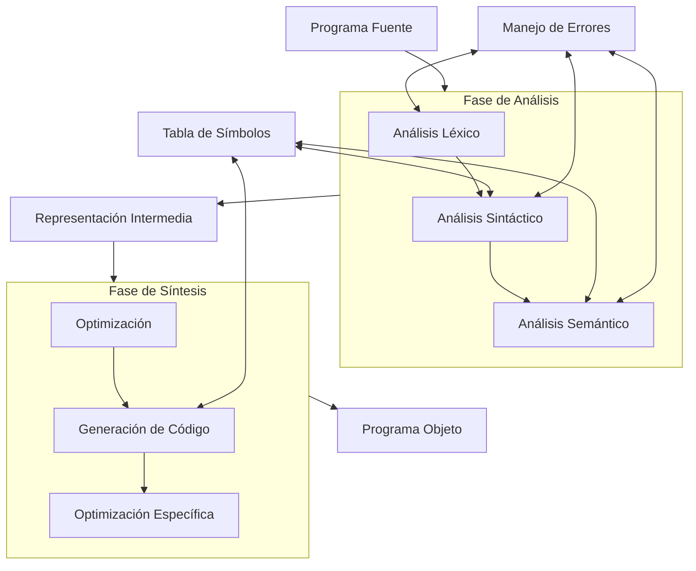
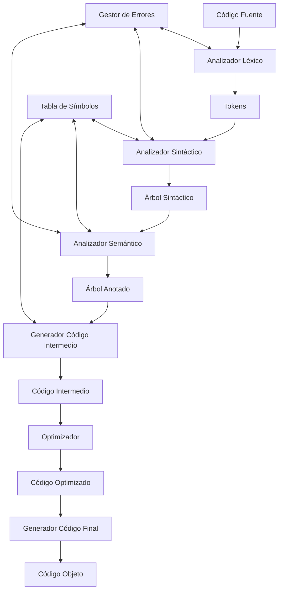

# Compiladores - Introducción a lo que es un compilador

## 1.5 Vista de alto nivel de la compilación.

---

La compilación es un proceso complejo que transforma código fuente en código ejecutable. Desde una perspectiva de alto nivel, este proceso puede entenderse como una serie de transformaciones bien definidas que preservan el significado del programa mientras lo adaptan para su ejecución eficiente en una plataforma específica.

### Definición Formal

Un compilador es un programa que implementa una función de traducción:

$$ C: P\_{fuente} \rightarrow P\_{objeto} $$

donde $ \text{semántica}(P\_{fuente}) = \text{semántica}(P\_{objeto}) $ y $ P\_{objeto} $ está expresado en un lenguaje adecuado para la ejecución en una máquina destino.

### Proceso de Compilación: Vista General



### Fases Principales del Proceso

#### 1. Front-end (Análisis)

##### Análisis Léxico

Convierte el flujo de caracteres en tokens significativos.

**Ejemplo:**

```
Entrada: "if (x > 5) then y = 1;"
Tokens: [IF, LPAREN, ID(x), GT, NUM(5), RPAREN, THEN, ID(y), ASSIGN, NUM(1), SEMICOLON]
```

##### Análisis Sintáctico

Agrupa tokens en estructuras jerárquicas (árbol de sintaxis).

**Gramática simplificada:**

```
statement → if-statement | assignment
if-statement → IF condition THEN statement
assignment → ID = expression ;
condition → expression relop expression
expression → term | expression addop term
term → factor | term mulop factor
factor → ID | NUM | ( expression )
```

##### Análisis Semántico

Verifica la corrección semántica del programa.

**Comprobaciones típicas:**

- Compatibilidad de tipos
- Declaración previa de variables
- Coherencia en uso de operadores

#### 2. Representación Intermedia

Forma intermedia entre el código fuente y el objeto. Ejemplo de código de tres direcciones:

```python
# Para: position = initial + rate * 60
t1 = rate * 60
t2 = initial + t1
position = t2
```

#### 3. Back-end (Síntesis)

##### Optimización

Mejora el código preservando su significado:

```python
# Antes de optimizar
t1 = rate * 60
t2 = initial + t1
position = t2

# Después de optimizar (si rate es constante)
t2 = initial + 300  # Si rate = 5
position = t2
```

##### Generación de Código

Produce código específico para la arquitectura destino:

```assembly
; Para x = y + z * 2
mov eax, [z]    ; Carga z en registro
imul eax, 2     ; Multiplica por 2
add eax, [y]    ; Suma y
mov [x], eax    ; Almacena resultado
```

### Modelo de Datos del Compilador

#### Tabla de Símbolos

Estructura que almacena información sobre identificadores:

| Nombre    | Tipo     | Ámbito | Dirección | Valor inicial |
| --------- | -------- | ------ | --------- | ------------- |
| counter   | int      | global | 0x1000    | 0             |
| rate      | float    | global | 0x1004    | 0.0           |
| calculate | function | global | 0x2000    | -             |

#### Flujo de Datos entre Componentes



### Conceptos Clave de Alto Nivel

#### Separación de Concerns

El diseño de compiladores separa:

- **Análisis**: Comprender el programa fuente
- **Síntesis**: Generar programa objeto eficiente

#### Independencia de Máquina

La representación intermedia permite:

- Reutilizar el front-end para diferentes arquitecturas
- Reutilizar el back-end para diferentes lenguajes fuente

#### Manejo de Errores

Estrategias comunes:

- **Modo de pánico**: Recuperación después de error
- **Corrección de errores**: Intentar corregir automáticamente
- **Reporte múltiple**: Mostrar todos los errores de una vez

### Fórmulas y Métricas

#### Complejidad del Proceso

- Tiempo de compilación: $T_c = O(n)$ a $O(n^3)$ según la fase
- Espacio requerido: $S_c = O(n)$ para la mayoría de las fases

#### Eficiencia de Optimización

El speedup obtenido por optimizaciones:

$$S = \frac{T_{\text{sin optimización}}}{T_{\text{con optimización}}}$$

#### Ley de Amdahl para Optimizaciones

El speedup máximo alcanzable:

$$S_{\text{máximo}} = \frac{1}{(1 - P) + \frac{P}{S_{\text{local}}}}$$

Donde $P$ es la fracción de código mejorada.

### Ejemplos de Transformaciones

#### Ejemplo Completo de Compilación

**Código Fuente (C-like):**

```c
int main() {
    int x = 5;
    int y = x * 2 + 3;
    return y;
}
```

**Código Intermedio:**

```
t1 = 5
x = t1
t2 = x * 2
t3 = t2 + 3
y = t3
return y
```

**Código Optimizado:**

```
x = 5
y = 13        // Optimización: cálculo en tiempo de compilación
return y
```

**Código Ensamblador (x86):**

```assembly
main:
    mov eax, 13
    ret
```

### Ejercicios Propuestos

1. **Análisis de Fases:**
   Para el siguiente código, identifique qué fase del compilador detectaría cada error:

   ```c
   int main() {
       int x = 5;
       int y = x + z;      // Error 1
       float z = 3.14;
       if (x = 5) {        // Error 2
           printf("Hola");
       }
       return 0;
   }
   ```

2. **Generación de Código Intermedio:**
   Genere código de tres direcciones para:

   ```c
   if (a > b) {
       max = a;
   } else {
       max = b;
   }
   ```

3. **Optimización:**
   Optimice el siguiente código intermedio:

   ```
   t1 = 5 * 2
   t2 = x + t1
   t3 = 5 * 2
   t4 = y + t3
   result = t2 + t4
   ```

4. **Diseño de Tabla de Símbolos:**
   Diseñe la tabla de símbolos para:

   ```c
   int global = 10;

   int suma(int a, int b) {
       int resultado = a + b;
       return resultado;
   }
   ```

5. **Análisis de Complejidad:**
   Si el análisis sintáctico tiene complejidad $O(n^3)$ y el análisis léxico $O(n)$, ¿cuál será el tiempo dominante para un programa de 1000 líneas?

### Referencias

#### Bibliografía Básica

1. Aho, A. V., Lam, M. S., Sethi, R., & Ullman, J. D. (2007). Compilers: Principles, Techniques, and Tools (2nd ed.). Pearson Education. (Capítulo 1)
2. Cooper, K. D., & Torczon, L. (2004). Engineering a Compiler. Morgan Kaufmann. (Capítulo 1)
3. Scott, M. L. (2009). Programming Language Pragmatics. Morgan Kaufmann. (Capítulo 1)

#### Bibliografía Complementaria

1. Grune, D., Bal, H. E., Jacobs, C. J. H., & Langendoen, K. G. (2000). Modern Compiler Design. John Wiley & Sons. (Capítulo 1)
2. Wilhelm, R., & Maurer, D. (1995). Compiler Design. Addison-Wesley. (Capítulo 1)

### Conclusión

La vista de alto nivel de la compilación revela un proceso estructurado y modular que transforma sistemáticamente el código fuente en código ejecutable. La separación entre front-end y back-end, el uso de representaciones intermedias y las técnicas de optimización son principios fundamentales que permiten a los compiladores generar código eficiente para diversas arquitecturas. Comprender esta perspectiva global es esencial para apreciar la complejidad y elegancia del diseño de compiladores.
