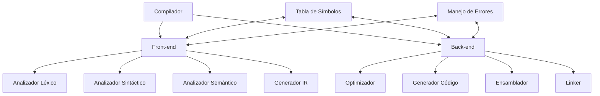

# Compiladores - Introducción a lo que es un compilador

## 1.6 Propiedades deseables en un compilador.

---

Un compilador efectivo debe poseer ciertas propiedades que garantizan su utilidad práctica en entornos de desarrollo reales. Estas propiedades se relacionan con la corrección, eficiencia, usabilidad y mantenibilidad del proceso de compilación.

### Propiedades Fundamentales

#### 1. Corrección

La propiedad más crítica: el compilador debe preservar el significado semántico del programa fuente.

**Definición formal:**
$$ ∀P ∈ L\_{fuente}, \text{semántica}(P) = \text{semántica}(C(P)) $$

Donde $ C(P) $ es el resultado de compilar el programa $P$.

#### 2. Eficiencia

El compilador debe generar código objeto eficiente y ser eficiente en su propio funcionamiento.

**Métricas de eficiencia:**

- Tiempo de compilación: $T_c = O(f(n))$
- Calidad del código generado: $T_e$ (tiempo de ejecución)
- Uso de memoria: $S_c$ (espacio durante compilación)

#### 3. Mensajes de Error Claros

Los mensajes deben ser informativos, precisos y ayudar en la depuración.

**Ejemplo comparativo:**

```javascript
// Mensaje pobre:
// "Error en línea 15"

// Mensaje útil:
// "Línea 15: Tipo incompatible en asignación.
//  Se esperaba 'int' pero se encontró 'string'"
```

#### 4. Portabilidad

Capacidad de compilar para diferentes arquitecturas y sistemas.

**Niveles de portabilidad:**

- Front-end portable para diferentes lenguajes
- Back-end portable para diferentes arquitecturas
- Compilador completo portable entre sistemas

#### 5. Capacidad de Depuración

Soporte para debugging mediante información simbólica.

**Información de depuración típica:**

- Tabla de símbolos con ubicaciones
- Mapeo línea fuente → código objeto
- Información de tipos y ámbitos

### Propiedades de Implementación

#### 6. Modularidad y Mantenibilidad

Diseño organizado en componentes bien definidos.



#### 7. Escalabilidad

Capacidad de manejar programas de diferentes tamaños y complejidad.

**Complejidad esperada:**

- Tiempo: $O(n)$ a $O(n^3)$ según la fase
- Espacio: $O(n)$ en la mayoría de casos

#### 8. Capacidad de Recuperación de Errores

Mecanismos robustos para manejar errores y continuar el análisis.

**Estrategias de recuperación:**

- Modo de pánico
- Corrección local
- Producciones de error en la gramática

#### 9. Soporte para Optimizaciones

Capacidad de aplicar transformaciones que mejoren el código.

**Tipos de optimizaciones:**

- Locales: dentro de bloques básicos
- Globales: través del flujo de control
- Entre procedimientos: múltiples funciones

### Propiedades de Usabilidad

#### 10. Tiempos de Compilación Razonables

Balance entre calidad del código y velocidad de compilación.

**Fórmula de tiempo total:**
$$ T\_{total} = T\_{\text{compilación}} + N \times T\_{\text{ejecución}} $$

Donde $N$ es el número de ejecuciones.

#### 11. Soporte para Estándares

Cumplimiento con especificaciones del lenguaje.

#### 12. Capacidades de Retroalimentación

Opciones para obtener información sobre el proceso de compilación.

**Ejemplo de salida informativa:**

```
Tiempos de compilación:
  Análisis léxico:   0.12s
  Análisis sintáctico: 0.25s
  Análisis semántico:  0.18s
  Generación de código: 0.35s
  Optimización:      0.42s
Total: 1.32s

Estadísticas:
  Líneas de código: 1,542
  Tokens: 8,417
  Variables: 243
  Funciones: 37
```

### Propiedades Avanzadas

#### 13. Incrementalidad

Capacidad de recompilar solo lo necesario después de cambios.

#### 14. Paralelización

Uso de múltiples núcleos para acelerar la compilación.

#### 15. Capacidades de Perfilado

Generación de código instrumentado para análisis de rendimiento.

#### 16. Soporte para Metaprogramación

Capacidades de reflexión y generación de código en tiempo de compilación.

### Ejercicios Propuestos

1. **Análisis de Mensajes de Error:**
   Mejore los siguientes mensajes de error:

   ```
   a) "Error en línea 23"
   b) "Variable no encontrada"
   c) "Tipos incompatibles"
   ```

2. **Diseño Modular:**
   Proponga una interfaz entre el analizador léxico y sintáctico que permita:
   - Solicitar tokens on-demand
   - Recuperarse de errores
   - Mantener información de ubicación

3. **Cálculo de Tiempos:**
   Un programa tarda 5 segundos en compilarse y 0.8 segundos en ejecutarse.
   Después de optimizaciones, tarda 8 segundos en compilarse pero 0.2 segundos
   en ejecutarse. ¿A partir de cuántas ejecuciones es rentable la optimización?

4. **Diseño de Tabla de Símbolos:**
   Diseñe una estructura de tabla de símbolos que soporte:
   - Ámbitos anidados
   - Sobrecarga de funciones
   - Información de tipos complejos
   - Múltiples espacios de nombres

5. **Estrategias de Recuperación:**
   Para el siguiente código con errores, proponga una estrategia de recuperación:
   ```python
   def calcular_promedio(numeros):
       total = 0
       for i in range(len(numeros)
           total += numeros[i]
       promedio = total / len(numeros
       return promedio
   ```

### Referencias

#### Bibliografía Básica

1. Aho, A. V., Lam, M. S., Sethi, R., & Ullman, J. D. (2007). Compilers: Principles, Techniques, and Tools (2nd ed.). Pearson Education. (Capítulo 1)
2. Cooper, K. D., & Torczon, L. (2004). Engineering a Compiler. Morgan Kaufmann. (Capítulo 1)
3. Scott, M. L. (2009). Programming Language Pragmatics. Morgan Kaufmann. (Capítulo 1)

#### Bibliografía Complementaria

1. Grune, D., Bal, H. E., Jacobs, C. J. H., & Langendoen, K. G. (2000). Modern Compiler Design. John Wiley & Sons. (Capítulo 1)
2. Wilhelm, R., & Maurer, D. (1995). Compiler Design. Addison-Wesley. (Capítulo 1)

### Conclusión

Las propiedades deseables en un compilador abarcan desde aspectos fundamentales como la corrección y eficiencia, hasta características avanzadas como incrementalidad y paralelización. Un compilador bien diseñado balancea estas propiedades para ofrecer una herramienta robusta, eficiente y útil para el desarrollo de software. La comprensión de estas propiedades es esencial tanto para usuarios de compiladores como para quienes participan en su diseño e implementación.
