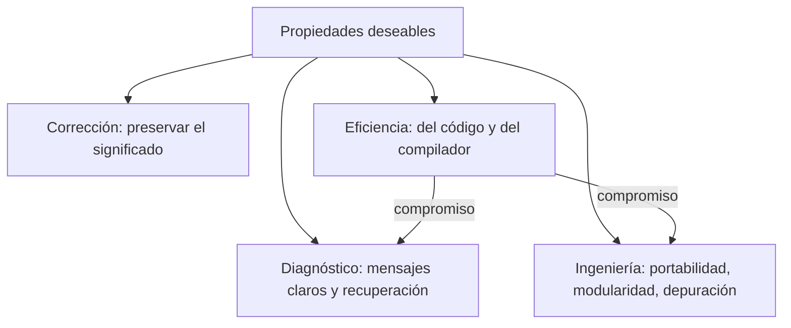

# Compiladores - Introducción a lo que es un compilador

## 1.6 Propiedades deseables en un compilador.

---

Un compilador no se juzga solo por la velocidad del código que produce. Debe ser, ante todo, **correcto**; debe generar código **eficiente** sin tardar demasiado en hacerlo; debe ayudar a las personas a encontrar sus errores con **mensajes claros** y **recuperarse** para reportar varios a la vez; debe ser **portable**, **mantenible** y apoyar la **depuración**. Estas propiedades compiten entre sí, y cada compilador elige un equilibrio: un compilador para desarrollo prioriza la velocidad de compilación y los mensajes, uno para producción la calidad del código. Este tema presenta las propiedades deseables, sus compromisos y cómo se implementan algunas de ellas.

### Corrección

La propiedad indispensable: para todo programa válido $P$ del lenguaje fuente y toda entrada, $C(P)$ debe comportarse como $P.$ Precisarla requiere una semántica formal del lenguaje, y para lenguajes como C con comportamiento indefinido, la obligación del compilador es solo para los programas que no lo tienen. Los compiladores se validan con grandes conjuntos de pruebas, con generadores aleatorios de programas que comparan varios compiladores, como Csmith, y, en casos críticos, con verificación formal: **CompCert**, un compilador de C demostrado correcto en el asistente de demostración Coq, en el que Csmith no encontró errores en el código generado.

### Eficiencia

Hay dos eficiencias: la del **código generado**, en tiempo, tamaño y energía, y la del **compilador**, en tiempo y memoria al compilar. El compromiso se expresa con niveles de optimización: `-O0` compila rápido y produce código fácil de depurar, `-O2` y `-O3` optimizan más, `-Os` reduce el tamaño. El tiempo total de $N$ ejecuciones es $T_c + N\,T_e,$ y una optimización que aumenta $T_c$ a $T_c'$ y reduce $T_e$ a $T_e'$ conviene si

$$N \gt \frac{T_c' - T_c}{T_e - T_e'}$$

### Mensajes de error

Un buen mensaje dice **dónde** está el error, con archivo, línea y columna; **qué** está mal, en términos del programa y no de la gramática, y, si puede, **cómo** corregirlo. Clang y Rust popularizaron los mensajes con la línea del código, una marca bajo la parte errónea y sugerencias como "¿quisiste decir...?", calculadas con una distancia de edición entre el nombre mal escrito y los declarados. El error debe reportarse donde se **detecta**, pero el mensaje debe apuntar, en lo posible, a donde se **cometió**: un paréntesis sin cerrar se detecta líneas después.

### Recuperación de errores

Tras un error, el compilador debe continuar para reportar los demás, sin producir una cascada de errores falsos:

- **modo de pánico:** descartar tokens hasta uno de **sincronización**, como `;` o `}`, y continuar; es simple y nunca entra en un ciclo;
- **corrección local:** insertar, borrar o reemplazar un token, como el `;` que falta;
- **producciones de error:** agregar a la gramática reglas para errores comunes;
- **corrección global:** buscar la menor cantidad de cambios que vuelve válido el programa; es demasiado costosa en general.

### Portabilidad, modularidad y depuración

La **portabilidad** se logra con la representación intermedia: un *front-end* por lenguaje y un *back-end* por máquina. La **modularidad**, con fases de interfaces precisas, que permite reemplazar una sin tocar las demás; el ensamblador y el enlazador son herramientas aparte que el compilador invoca. La **depuración** requiere que el compilador emita información que relacione el código de máquina con el fuente: líneas, variables y tipos, en formatos como DWARF, con `-g`; la optimización la dificulta, porque las variables desaparecen o cambian de lugar.

### Otras propiedades

- **Escalabilidad:** manejar programas de millones de líneas con algoritmos casi lineales.
- **Compilación incremental y en paralelo:** recompilar solo lo que cambió y usar varios núcleos, como hacen los sistemas de construcción y la compilación de Rust por unidades.
- **Conformidad con los estándares:** implementar el lenguaje como lo define su norma, como ISO C o ISO C++.
- **Información para el usuario:** estadísticas, informes de qué optimizaciones se aplicaron o no, como `-fopt-info` de GCC o `-Rpass` de Clang, y perfilado.



### Implementación en Python

El programa genera mensajes de error con ubicación, contexto, marca y sugerencia para el ejercicio 1; implementa la interfaz del analizador léxico del ejercicio 2, con tokens bajo demanda, consulta del siguiente token, sincronización y posiciones; calcula el punto de equilibrio del ejercicio 3; implementa la tabla de símbolos del ejercicio 4, y para el ejercicio 5 muestra el mensaje de CPython y la recuperación en modo de pánico en el compilador pequeño de los temas anteriores, que se incluye al inicio.

```python
import re

# ---------- Análisis léxico: una expresión regular con un grupo por clase de token ----------
ESPEC = [("ESPACIO", r"[ \t\n]+"), ("COMENTARIO", r"//[^\n]*"), ("NUM", r"\d+(?:\.\d+)?"), ("ID", r"[A-Za-z_]\w*"),
         ("OP", r"==|!=|<=|>=|[-+*/<>=]"), ("PUNT", r"[(){};,]")]
RESERVADAS = {"if", "then", "else", "while", "int", "float", "return"}
PATRON = re.compile("|".join(f"(?P<{n}>{p})" for n, p in ESPEC))
def lexico(texto):
    tokens, pos, linea = [], 0, 1
    while pos < len(texto):
        m = PATRON.match(texto, pos)
        if not m: raise SyntaxError(f"línea {linea}: carácter ilegal {texto[pos]!r}")
        clase, lexema = m.lastgroup, m.group()
        if clase == "ID" and lexema in RESERVADAS: clase = lexema.upper()
        if clase not in ("ESPACIO", "COMENTARIO"): tokens.append((clase, lexema, linea))
        linea += lexema.count("\n"); pos = m.end()
    return tokens + [("FIN", "", linea)]

# ---------- Análisis sintáctico descendente recursivo; el árbol se representa con tuplas ----------
class Parser:
    def __init__(self, tokens): self.t, self.i = tokens, 0
    def ve(self): return self.t[self.i]
    def come(self, *esperado):
        clase, lexema, linea = self.t[self.i]
        if esperado and clase not in esperado and lexema not in esperado:
            raise SyntaxError(f"línea {linea}: se esperaba {' o '.join(esperado)} y se encontró {lexema or 'el fin'!r}")
        self.i += 1; return lexema
    def programa(self):
        sents = []
        while self.ve()[0] != "FIN": sents.append(self.sentencia())
        return ("programa", sents)
    def sentencia(self):
        clase, lexema, _ = self.ve()
        if clase in ("INT", "FLOAT"):
            tipo = self.come(); nombre = self.come("ID"); valor = None
            if self.ve()[1] == "=": self.come("="); valor = self.expresion()
            self.come(";"); return ("decl", tipo, nombre, valor)
        if clase == "IF":
            self.come("IF"); self.come("("); cond = self.expresion(); self.come(")")
            if self.ve()[0] == "THEN": self.come("THEN")
            entonces = self.sentencia(); sino = None
            if self.ve()[0] == "ELSE": self.come("ELSE"); sino = self.sentencia()
            return ("if", cond, entonces, sino)
        if clase == "RETURN": self.come("RETURN"); e = self.expresion(); self.come(";"); return ("return", e)
        if lexema == "{":
            self.come("{"); sents = []
            while self.ve()[1] != "}": sents.append(self.sentencia())
            self.come("}"); return ("bloque", sents)
        nombre = self.come("ID"); self.come("="); e = self.expresion(); self.come(";")
        return ("asigna", nombre, e)
    def expresion(self):                        # comparación < suma < producto < factor
        izq = self.suma()
        while self.ve()[1] in ("==", "!=", "<", ">", "<=", ">="): op = self.come(); izq = (op, izq, self.suma())
        return izq
    def suma(self):
        izq = self.producto()
        while self.ve()[1] in ("+", "-"): op = self.come(); izq = (op, izq, self.producto())   # asociatividad izquierda
        return izq
    def producto(self):
        izq = self.factor()
        while self.ve()[1] in ("*", "/"): op = self.come(); izq = (op, izq, self.factor())
        return izq
    def factor(self):
        clase, lexema, _ = self.ve()
        if clase == "NUM": self.come(); return ("num", float(lexema) if "." in lexema else int(lexema))
        if clase == "ID": self.come(); return ("var", lexema)
        self.come("("); e = self.expresion(); self.come(")"); return e
def arbol(n, s=""):                             # dibuja el árbol con sangría
    if n[0] == "num": return [f"{s}{n[1]}"]
    if n[0] == "var": return [f"{s}{n[1]}"]
    if n[0] in ("+", "-", "*", "/", "<", ">", "==", "!=", "<=", ">="):
        return [f"{s}{n[0]}"] + arbol(n[1], s + "  ") + arbol(n[2], s + "  ")
    if n[0] == "asigna": return [f"{s}= {n[1]}"] + arbol(n[2], s + "  ")
    return [f"{s}{n[0]}"]

# ---------- Código de tres direcciones ----------
class GeneradorTAC:
    def __init__(self): self.codigo, self.nt, self.ne = [], 0, 0
    def temp(self): self.nt += 1; return f"t{self.nt}"
    def etiqueta(self): self.ne += 1; return f"L{self.ne}"
    def expr(self, n):
        if n[0] == "num": return str(n[1])
        if n[0] == "var": return n[1]
        a, b = self.expr(n[1]), self.expr(n[2]); t = self.temp(); self.codigo.append(f"{t} = {a} {n[0]} {b}"); return t
    def sent(self, n):
        if n[0] == "programa" or n[0] == "bloque":
            for s in n[1]: self.sent(s)
        elif n[0] == "decl":
            if n[3] is not None: self.codigo.append(f"{n[2]} = {self.expr(n[3])}")
        elif n[0] == "asigna": self.codigo.append(f"{n[1]} = {self.expr(n[2])}")
        elif n[0] == "return": self.codigo.append(f"return {self.expr(n[1])}")
        elif n[0] == "if":
            c = n[1]; lf, lfin = self.etiqueta(), self.etiqueta()
            a, b = self.expr(c[1]), self.expr(c[2]); inverso = {"<": ">=", ">": "<=", "<=": ">", ">=": "<", "==": "!=", "!=": "=="}[c[0]]
            self.codigo.append(f"if {a} {inverso} {b} goto {lf if n[3] else lfin}")
            self.sent(n[2])
            if n[3]: self.codigo += [f"goto {lfin}", f"{lf}:"]; self.sent(n[3])
            self.codigo.append(f"{lfin}:")
        return self.codigo

# ---------- Optimización local: plegado, propagación de copias, subexpresiones comunes y código muerto ----------
def optimiza(codigo, vivas_al_final=None):
    valor, expr_disp, salida, pasos = {}, {}, [], []
    def v(x): return valor.get(x, x)
    for ins in codigo:
        m = re.fullmatch(r"(\w+) = (\S+) ([-+*/]) (\S+)", ins)
        if m:
            d, a, op, b = m.groups(); a, b = v(a), v(b)
            if re.fullmatch(r"-?\d+", a) and re.fullmatch(r"-?\d+", b):
                r = str(int(eval(f"{a}{op}{b}")) if op != "/" else int(a) // int(b)); valor[d] = r; pasos.append(f"plegado: {d} = {r}"); continue
            clave = (a, op, b) if op in "-/" else (min(a, b), op, max(a, b))
            if clave in expr_disp: valor[d] = expr_disp[clave]; pasos.append(f"subexpresión común: {d} = {expr_disp[clave]}"); continue
            expr_disp[clave] = d; salida.append(f"{d} = {a} {op} {b}"); continue
        m = re.fullmatch(r"(\w+) = (\S+)", ins)
        if m:
            d, a = m.groups(); a = v(a)
            if d.startswith("t"): valor[d] = a; pasos.append(f"copia: {d} = {a}"); continue
            for k in [k for k in expr_disp if d in k]: del expr_disp[k]          # d cambió: esas expresiones ya no valen
            salida.append(f"{d} = {a}"); continue
        salida.append(re.sub(r"\b(t\d+)\b", lambda k: v(k.group(1)), ins))
    usadas = {x for i in salida for x in re.findall(r"\b\w+\b", i.split("=", 1)[-1] if "=" in i and "goto" not in i else i)}
    final = [i for i in salida if not (re.match(r"t\d+ =", i) and i.split()[0] not in usadas)]
    return final, pasos

# ---------- Generación de código para una máquina de registros sencilla ----------
def genera_asm(codigo):
    asm, nombre = [], {"+": "add", "-": "sub", "*": "imul", "/": "idiv"}
    for ins in codigo:
        m = re.fullmatch(r"(\w+) = (\S+) ([-+*/]) (\S+)", ins)
        if m:
            d, a, op, b = m.groups(); asm += [f"mov eax, {a}", f"{nombre[op]} eax, {b}", f"mov {d}, eax"]; continue
        m = re.fullmatch(r"(\w+) = (\S+)", ins)
        if m: asm += [f"mov eax, {m.group(2)}", f"mov {m.group(1)}, eax"]; continue
        m = re.fullmatch(r"return (\S+)", ins)
        if m: asm += [f"mov eax, {m.group(1)}", "ret"]; continue
        m = re.fullmatch(r"if (\S+) (\S+) (\S+) goto (\w+)", ins)
        if m:
            salto = {"<": "jl", ">": "jg", "<=": "jle", ">=": "jge", "==": "je", "!=": "jne"}[m.group(2)]
            asm += [f"mov eax, {m.group(1)}", f"cmp eax, {m.group(3)}", f"{salto} {m.group(4)}"]; continue
        asm.append(ins.replace("goto", "jmp") if ins.startswith("goto") else ins)
    return asm

import difflib, subprocess, sys

# ---------- Ejercicio 1: mensajes de error con ubicación, contexto y sugerencia ----------
def reporta(fuente, linea, col, mensaje, nota=None, largo=1):
    texto = fuente.splitlines()[linea - 1]
    salida = [f"prog.c:{linea}:{col}: error: {mensaje}", f"  {linea} | {texto}", "    | " + " " * (col - 1) + "^" + "~" * (largo - 1)]
    return salida + ([f"    = nota: {nota}"] if nota else [])
FUENTE = "int contador = 0;\nint total = 5;\nint main() {\n    contadr = total + 1;\n    int x = \"hola\";\n}"
declaradas = ["contador", "total", "main"]
sug = difflib.get_close_matches("contadr", declaradas, n=1)
print("ejercicio 1:")
for l in reporta(FUENTE, 4, 5, "'contadr' no está declarado", f"¿quisiste decir '{sug[0]}'? declarado en la línea 1", 7): print("   " + l)
for l in reporta(FUENTE, 5, 13, "no se puede inicializar 'x', de tipo int, con una cadena de tipo char *", "si querías el texto, declara 'x' como const char *", 6): print("   " + l)

# ---------- Ejercicio 2: interfaz entre el analizador léxico y el sintáctico ----------
class Lexico:
    """El analizador sintáctico pide los tokens uno a uno; cada token lleva su línea y columna."""
    def __init__(self, texto): self.texto, self.pos, self.linea, self.ini_linea, self._sig = texto, 0, 1, 0, None
    def _lee(self):
        while True:
            if self.pos >= len(self.texto): return ("FIN", "", self.linea, self.pos - self.ini_linea + 1)
            m = PATRON.match(self.texto, self.pos)
            if not m:
                c = self.texto[self.pos]; tok = ("ERROR", c, self.linea, self.pos - self.ini_linea + 1); self.pos += 1; return tok
            clase, lexema, col = m.lastgroup, m.group(), self.pos - self.ini_linea + 1
            for k, ch in enumerate(lexema):
                if ch == "\n": self.linea += 1; self.ini_linea = self.pos + k + 1
            self.pos = m.end()
            if clase not in ("ESPACIO", "COMENTARIO"):
                return ((lexema.upper() if lexema in RESERVADAS else clase) if clase == "ID" else clase, lexema, self.linea, col)
    def siguiente(self):                                   # consume un token, bajo demanda
        t = self._sig or self._lee(); self._sig = None; return t
    def mira(self):                                        # observa el siguiente sin consumirlo
        if self._sig is None: self._sig = self._lee()
        return self._sig
    def sincroniza(self, conjunto):                        # para la recuperación: descarta hasta un token del conjunto
        descartados = []
        while self.mira()[1] not in conjunto and self.mira()[0] != "FIN": descartados.append(self.siguiente()[1])
        return descartados
lx = Lexico("x = 3 @ 4;\ny = x;")
leidos = [lx.siguiente() for _ in range(3)]
print("ejercicio 2:", leidos, "| mira:", lx.mira(), "| sincroniza en ';' descarta:", lx.sincroniza({";"}), "| sigue:", lx.siguiente(), lx.siguiente())

# ---------- Ejercicio 3: rentabilidad de la optimización ----------
N = (8 - 5) / (0.8 - 0.2)
print(f"ejercicio 3: 5 + 0.8 N > 8 + 0.2 N cuando N > {N:g}; en N = 5 empatan en {5 + 0.8 * 5:g} s, y en N = 6: {5 + 0.8 * 6:.1f} s frente a {8 + 0.2 * 6:.1f} s")

# ---------- Ejercicio 4: tabla de símbolos con ámbitos, sobrecarga, tipos compuestos y espacios de nombres ----------
class Tabla:
    def __init__(self): self.espacios = {"": [{}]}       # espacio de nombres → pila de ámbitos
    def ambito(self, esp=""): self.espacios.setdefault(esp, [{}]).append({})
    def cierra(self, esp=""): self.espacios[esp].pop()
    def declara(self, nombre, tipo, esp=""):
        actual = self.espacios.setdefault(esp, [{}])[-1]
        if isinstance(tipo, tuple) and tipo[0] == "función":       # sobrecarga: varias firmas con un nombre
            firmas = actual.setdefault(nombre, [])
            if any(f[1] == tipo[1] for f in firmas): raise TypeError(f"{nombre}{tipo[1]} ya está definida")
            firmas.append(tipo)
        else:
            if nombre in actual: raise TypeError(f"'{nombre}' ya está declarado en este ámbito")
            actual[nombre] = tipo
    def busca(self, nombre, esp="", argumentos=None):
        if "::" in nombre: esp, nombre = nombre.split("::")
        for amb in reversed(self.espacios.get(esp, [])):
            if nombre in amb:
                e = amb[nombre]
                if argumentos is None: return e
                cand = [f for f in e if f[1] == tuple(argumentos)] or [f for f in e if len(f[1]) == len(argumentos) and
                        all(p == a or (p, a) == ("float", "int") for p, a in zip(f[1], argumentos))]   # con promoción int → float
                if len(cand) == 1: return cand[0]
                raise TypeError(f"llamada {'ambigua' if cand else 'sin función compatible'}: {nombre}{tuple(argumentos)}")
        raise NameError(f"'{nombre}' no está declarado")
t = Tabla()
t.declara("Punto", ("struct", {"x": "float", "y": "float"}))
t.declara("max", ("función", ("int", "int"), "int")); t.declara("max", ("función", ("float", "float"), "float"))
t.declara("log", ("función", ("float",), "float"), esp="mates")
t.declara("x", "int"); t.ambito(); t.declara("x", ("arreglo", 10, "Punto"))
print("ejercicio 4: x en el ámbito interno:", t.busca("x")); t.cierra(); print("   x tras cerrar el ámbito:", t.busca("x"))
for args in (("int", "int"), ("float", "float"), ("int", "float")): print(f"   max{args} →", t.busca("max", argumentos=args))
print("   mates::log(int) →", t.busca("mates::log", argumentos=("int",)), "| Punto →", t.busca("Punto"))
try: t.declara("max", ("función", ("int", "int"), "int"))
except TypeError as e: print("   redefinir max(int, int):", e)

# ---------- Ejercicio 5: recuperación de errores ----------
PY = "def calcular_promedio(numeros):\n    total = 0\n    for i in range(len(numeros)\n        total += numeros[i]\n    promedio = total / len(numeros\n    return promedio\n"
r = subprocess.run([sys.executable, "-c", "compile(open(0).read(), 'prog.py', 'exec')"], input=PY, capture_output=True, text=True)
print("ejercicio 5: CPython", sys.version.split()[0], "reporta solo el primer error:", r.stderr.strip().splitlines()[-1])
class ParserConRecuperacion(Parser):
    def programa(self):
        sents, errores = [], []
        while self.ve()[0] != "FIN":
            try: sents.append(self.sentencia())
            except SyntaxError as e:                       # modo de pánico: saltar hasta ';' y seguir
                errores.append(str(e))
                while self.ve()[1] != ";" and self.ve()[0] != "FIN": self.i += 1
                if self.ve()[1] == ";": self.i += 1
        return ("programa", sents), errores
C5 = "total = 0;\ni = (len + 1;\ntotal = total + x;\npromedio = total / (len;\nreturn promedio;"
arbol5, errores = ParserConRecuperacion(lexico(C5)).programa()
print(f"   con modo de pánico, el mismo tipo de errores en el lenguaje pequeño: {len(errores)} errores, {len(arbol5[1])} sentencias correctas")
for e in errores: print("     " + e)
```

Salida:

```text
ejercicio 1:
   prog.c:4:5: error: 'contadr' no está declarado
     4 |     contadr = total + 1;
       |     ^~~~~~~
       = nota: ¿quisiste decir 'contador'? declarado en la línea 1
   prog.c:5:13: error: no se puede inicializar 'x', de tipo int, con una cadena de tipo char *
     5 |     int x = "hola";
       |             ^~~~~~
       = nota: si querías el texto, declara 'x' como const char *
ejercicio 2: [('ID', 'x', 1, 1), ('OP', '=', 1, 3), ('NUM', '3', 1, 5)] | mira: ('ERROR', '@', 1, 7) | sincroniza en ';' descarta: ['@', '4'] | sigue: ('PUNT', ';', 1, 10) ('ID', 'y', 2, 1)
ejercicio 3: 5 + 0.8 N > 8 + 0.2 N cuando N > 5; en N = 5 empatan en 9 s, y en N = 6: 9.8 s frente a 9.2 s
ejercicio 4: x en el ámbito interno: ('arreglo', 10, 'Punto')
   x tras cerrar el ámbito: int
   max('int', 'int') → ('función', ('int', 'int'), 'int')
   max('float', 'float') → ('función', ('float', 'float'), 'float')
   max('int', 'float') → ('función', ('float', 'float'), 'float')
   mates::log(int) → ('función', ('float',), 'float') | Punto → ('struct', {'x': 'float', 'y': 'float'})
   redefinir max(int, int): max('int', 'int') ya está definida
ejercicio 5: CPython 3.13.17 reporta solo el primer error: SyntaxError: invalid syntax. Perhaps you forgot a comma?
   con modo de pánico, el mismo tipo de errores en el lenguaje pequeño: 2 errores, 3 sentencias correctas
     línea 2: se esperaba ) y se encontró ';'
     línea 4: se esperaba ) y se encontró ';'
```

### Ejercicios Propuestos

1. **Mensajes de error.** Mejora los mensajes: a) "Error en línea 23"; b) "Variable no encontrada"; c) "Tipos incompatibles".

2. **Diseño modular.** Propón una interfaz entre el analizador léxico y el sintáctico que permita pedir los tokens bajo demanda, recuperarse de errores y conservar la ubicación.

3. **Tiempos.** Un programa tarda 5 segundos en compilarse y 0.8 en ejecutarse. Con optimizaciones, tarda 8 segundos en compilarse y 0.2 en ejecutarse. ¿A partir de cuántas ejecuciones conviene optimizar?

4. **Tabla de símbolos.** Diseña una tabla de símbolos que admita ámbitos anidados, sobrecarga de funciones, tipos compuestos y varios espacios de nombres.

5. **Recuperación.** Propón una estrategia de recuperación para el siguiente código con errores:

    ```python
    def calcular_promedio(numeros):
        total = 0
        for i in range(len(numeros)
            total += numeros[i]
        promedio = total / len(numeros
        return promedio
    ```

### Soluciones

**Ejercicio 1.** Los tres mensajes carecen de ubicación precisa, de los objetos involucrados y de una sugerencia. Versiones mejores, como las que genera el programa:

- a) `prog.c:23:9: error: se esperaba ';' después de la expresión`, con la línea y una marca en la columna;
- b) `prog.c:4:5: error: 'contadr' no está declarado`, con la nota `¿quisiste decir 'contador'? declarado en la línea 1`, calculada buscando el nombre declarado más parecido;
- c) `prog.c:5:13: error: no se puede inicializar 'x', de tipo int, con una cadena de tipo char *`, que dice qué tipo se esperaba, cuál se encontró y en qué operación, con la nota de cómo corregirlo.

El mensaje debe usar los términos del programador, no los de la gramática: "falta un paréntesis de cierre para el que se abrió en la línea 3" es mejor que "token inesperado NEWLINE".

**Ejercicio 2.** La interfaz del programa tiene tres operaciones: `siguiente()`, que reconoce y entrega el próximo token solo cuando el analizador sintáctico lo pide, de modo que nunca se guarda toda la secuencia; `mira()`, que lo consulta sin consumirlo, la anticipación de un token que necesitan los analizadores LL(1) y LR(1), y `sincroniza(conjunto)`, que descarta tokens hasta uno del conjunto y devuelve los descartados, para la recuperación en modo de pánico. Cada token es una tupla con su clase, su lexema, su línea y su columna, y un carácter ilegal se entrega como token `ERROR` en lugar de detener el análisis, para que el analizador sintáctico decida cómo recuperarse. En el ejemplo, tras `x = 3`, el analizador ve el `@` ilegal, se sincroniza descartando `@` y `4`, y continúa en `;` y `y`.

**Ejercicio 3.** Optimizar conviene cuando $5 + 0.8\,N \gt 8 + 0.2\,N,$ es decir, $N \gt 3/0.6 = 5:$ con 5 ejecuciones ambas opciones cuestan 9 s, y a partir de la sexta la optimizada gana, 9.2 s frente a 9.8 s. La respuesta es 6 ejecuciones. En la práctica se compila sin optimizar mientras se desarrolla y con optimización para producción, donde el programa se ejecuta miles o millones de veces.

**Ejercicio 4.** La tabla del programa organiza los símbolos en un diccionario de **espacios de nombres**, cada uno con una **pila de ámbitos**; abrir un bloque apila un ámbito y cerrarlo lo desapila, y la búsqueda recorre la pila del más interno al más externo, de modo que `x` declarada en un bloque oculta a la global solo dentro de él. Los **tipos compuestos** se guardan como estructuras de datos, por ejemplo `("arreglo", 10, "Punto")` o `("struct", {"x": "float", "y": "float"})`, que el verificador de tipos recorre. La **sobrecarga** se implementa guardando, para cada nombre de función, la lista de sus **firmas**: declarar una firma repetida es un error, y una llamada se resuelve buscando primero una firma exacta y después una que coincida con las promociones permitidas; si hay varias, la llamada es ambigua. Así, `max(int, int)` elige la versión entera, y `max(int, float)` la de flotantes, promoviendo el primer argumento. Un nombre calificado, como `mates::log`, busca directamente en su espacio de nombres. Las reglas reales de C++ para resolver la sobrecarga son mucho más elaboradas, con rangos de conversión.

**Ejercicio 5.** El código tiene dos paréntesis sin cerrar, en las líneas 3 y 5, y en ambos casos el error se **detecta** en la línea siguiente, donde aparece algo que no puede continuar la expresión. CPython 3.13 se detiene en el primero, con un mensaje que no es el ideal, "invalid syntax. Perhaps you forgot a comma?", porque al no cerrarse el paréntesis interpreta la línea siguiente como otro argumento de `range`. Una buena estrategia combina dos técnicas: **corrección local**, que al encontrar el fin de una línea lógica, el `:` de un `for` o una sentencia nueva con un paréntesis abierto, inserta el `)` faltante y lo reporta como "falta ')' para el '(' de la línea 3"; y el **modo de pánico** a nivel de sentencia, que sincroniza en el siguiente salto de línea con la misma sangría. Así se reportan los dos errores en una compilación. El programa muestra la segunda técnica en el compilador pequeño: con dos paréntesis sin cerrar, reporta los dos errores y conserva las 3 sentencias correctas.

El material original escribía la definición de corrección con `L\_{fuente}`, que muestra la barra invertida; incluía al enlazador como parte del *back-end* del compilador, cuando es una herramienta aparte, y escribía "través" por "a través".

### Referencias

1. Cooper, K. D., and Torczon, L., _Engineering a Compiler_. 3a ed., Morgan Kaufmann, 2022. Capítulo 1.
2. Aho, A. V., Lam, M. S., Sethi, R., and Ullman, J. D., _Compilers: Principles, Techniques, and Tools_. 2a ed., Pearson, 2007. Sección 4.1.
3. Leroy, X., Formal verification of a realistic compiler. _Communications of the ACM_ 52(7), 2009.
4. Yang, X., Chen, Y., Eide, E., and Regehr, J., Finding and understanding bugs in C compilers. _PLDI_, 2011.
5. Lattner, C., Expressive diagnostics. Clang documentation, 2010.
6. Grune, D., van Reeuwijk, K., Bal, H. E., Jacobs, C. J. H., and Langendoen, K., _Modern Compiler Design_. 2a ed., Springer, 2012.
