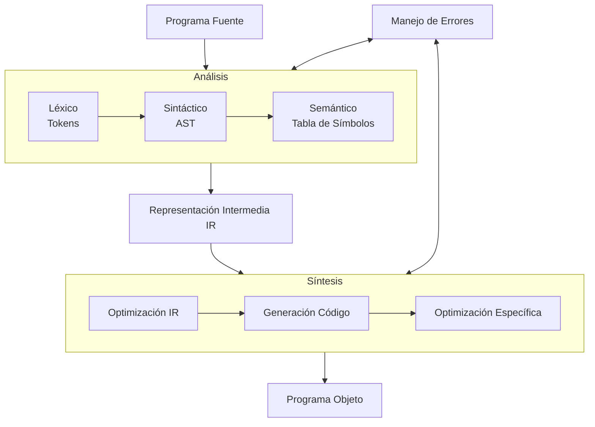
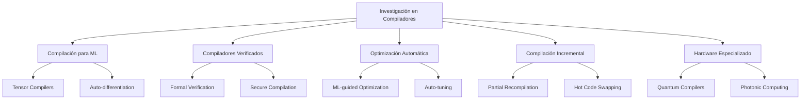

# Compiladores - Introducción a lo que es un compilador

## 1.7 Resumen y perspectiva.

---

El estudio de compiladores representa una de las áreas más fundamentales y fascinantes de la ciencia de la computación. Esta guía sintetiza los conceptos clave y explora las perspectivas futuras en el desarrollo de compiladores.

### Resumen Conceptual

#### Definición Integral

Un compilador es un programa que implementa la transformación:

$$C: P_{fuente} \rightarrow P_{objeto}$$

donde $ \text{semántica}(P\_{fuente}) = \text{semántica}(P\_{objeto}) $ y $ P\_{objeto} $ está optimizado para ejecución eficiente en una máquina específica.

#### Arquitectura Global



### Evolución Histórica y Perspectiva

#### Generaciones de Compiladores

| Generación | Período | Características Principales                      |
| ---------- | ------- | ------------------------------------------------ |
| 1ª         | 1950s   | Ensambladores, traducción directa                |
| 2ª         | 1960s   | Compiladores de un paso, optimización básica     |
| 3ª         | 1970s   | Compiladores multi-paso, optimización intermedia |
| 4ª         | 1980s   | Compiladores optimizadores, RISC                 |
| 5ª         | 1990s   | Compiladores para OOP, JIT                       |
| 6ª         | 2000s   | Compiladores paralelos, polyhedral               |
| 7ª         | 2010s   | Compiladores para GPUs, ML                       |
| 8ª         | 2020s   | Compiladores para quantum, AI-assisted           |

#### Tendencias Actuales y Futuras

##### 1. Compiladores para Hardware Especializado

```cpp
// Ejemplo: Compilación para aceleradores específicos
#pragma acc parallel loop
for (int i = 0; i < n; i++) {
    result[i] = input[i] * weights[i];
}
```

##### 2. Compiladores Asistidos por IA

Uso de machine learning para:

- Optimización automática de código
- Predicción de mejores transformaciones
- Generación automática de heurísticas

##### 3. Compiladores Incrementales

Compilación parcial después de cambios:

$$\Delta C: \Delta P_{fuente} \rightarrow \Delta P_{objeto}$$

##### 4. Compiladores para Computación Cuántica

```qsharp
// Q#: Lenguaje para computación cuántica
operation QuantumHello() : Result {
    using (qubit = Qubit()) {
        H(qubit);
        return M(qubit);
    }
}
```

### Conceptos Fundamentales Revisados

#### Principios de Diseño

1. **Separación de Concerns**
   - Front-end independiente del lenguaje
   - Back-end independiente de la arquitectura

2. **Fases de Transformación**
   - Análisis → IR → Síntesis
   - Múltiples niveles de IR

3. **Manejo de Errores**
   - Detección temprana
   - Recuperación elegante
   - Mensajes informativos

#### Estructuras de Datos Clave

**Tabla de Símbolos:**

```python
class SymbolTable:
    def __init__(self):
        self.scopes = [{}]  # Pila de ámbitos
        self.type_info = {}  # Información de tipos

    def add_symbol(self, name, type, scope, address):
        # Implementación simplificada
        current_scope = self.scopes[-1]
        current_scope[name] = {
            'type': type,
            'scope': scope,
            'address': address
        }
```

**Árbol de Sintaxis Abstracta (AST):**

```python
class ASTNode:
    def __init__(self, node_type, children=None, value=None):
        self.node_type = node_type
        self.children = children or []
        self.value = value
        self.data_type = None  # Para análisis semántico
```

### Fórmulas y Métricas Importantes

#### Medidas de Calidad

**Speedup por optimización:**

$$ S = \frac{T\_{\text{sin optimización}}}{T\_{\text{con optimización}}} $$

**Ley de Amdahl aplicada a optimizaciones:**

$$S_{max} = \frac{1}{(1 - P) + \frac{P}{S_{local}}}$$

**Complejidad de fases:**

- Análisis léxico: $O(n)$
- Análisis sintáctico: $O(n)$ a $O(n^3)$
- Análisis semántico: $O(n)$
- Optimización: $O(n)$ a $O(n^2)$

### Ejercicios de Síntesis

1. **Análisis Integral:**
   Para el siguiente código, trace el proceso completo de compilación:

   ```c
   #include <stdio.h>

   int main() {
       int suma = 0;
       for (int i = 1; i <= 10; i++) {
           suma += i;
       }
       printf("Suma: %d\n", suma);
       return 0;
   }
   ```

2. **Diseño de IR:**
   Proponga una representación intermedia para:

   ```python
   def factorial(n):
       if n <= 1:
           return 1
       else:
           return n * factorial(n-1)
   ```

3. **Optimización Multi-nivel:**
   Optimice el siguiente código en diferentes niveles:

   ```c
   int calcular(int* array, int size) {
       int total = 0;
       for (int i = 0; i < size; i++) {
           total += array[i] * 2;
       }
       return total;
   }
   ```

4. **Análisis de Tendencias:**
   Investigue y compare tres compiladores modernos (GCC, Clang, Roslyn)
   en términos de:
   - Arquitectura modular
   - Técnicas de optimización
   - Soporte para nuevos estándares

5. **Diseño Futuro:**
   Proponga características para un compilador del año 2030 considerando:
   - Hardware heterogéneo
   - Programación automática asistida por IA
   - Requisitos de seguridad

### Perspectivas Futuras

#### Retos Emergentes

1. **Compilación para Hardware Heterogéneo**
   - CPUs multi-núcleo
   - GPUs y aceleradores
   - Procesadores especializados

2. **Seguridad y Verificación**
   - Compiladores verificados formalmente
   - Generación de código seguro
   - Detección de vulnerabilidades

3. **Sostenibilidad Computacional**
   - Optimización para bajo consumo energético
   - Compilación green computing

4. **Programación Automática**
   - Compiladores que comprenden intención
   - Generación de código desde especificaciones

#### Áreas de Investigación Activa



### Referencias Críticas

#### Bibliografía Básica

1. Aho, A. V., Lam, M. S., Sethi, R., & Ullman, J. D. (2007). Compilers: Principles, Techniques, and Tools (2nd ed.). Pearson Education.
2. Cooper, K. D., & Torczon, L. (2004). Engineering a Compiler. Morgan Kaufmann.
3. Scott, M. L. (2009). Programming Language Pragmatics. Morgan Kaufmann.

#### Bibliografía Complementaria

1. Appel, A. W. (1998). Modern Compiler Implementation in ML. Cambridge University Press.
2. Muchnick, S. S. (1997). Advanced Compiler Design and Implementation. Morgan Kaufmann.
3. Nielson, F., Nielson, H. R., & Hankin, C. (1999). Principles of Program Analysis. Springer.

#### Recursos para Profundizar

1. **LLVM Project**: Compiler infrastructure moderno
2. **GCC**: GNU Compiler Collection
3. **Research Papers**: PLDI, POPL, CGO conferences

### Conclusión Final

El estudio de compiladores ha evolucionado desde la traducción básica de código hasta convertirse en un campo multidisciplinario que integra teoría de lenguajes, arquitectura de computadoras, inteligencia artificial y matemáticas avanzadas. Los compiladores modernos son sistemas complejos que no solo traducen código, sino que optimizan, verifican y adaptan programas para ejecución eficiente en hardware diverso.

La perspectiva futura sugiere que los compiladores jugarán un papel aún más crucial en la abstracción de la complejidad del hardware heterogéneo y en la habilitación de nuevos paradigmas de programación. El dominio de los principios de compilación proporciona una base sólida para cualquier profesional en ciencias de la computación, ofreciendo perspectivas valiosas tanto para el desarrollo de software como para el diseño de hardware.

El recorrido por el diseño de compiladores refleja la evolución más amplia de la informática en sí misma: desde la simple traducción hasta la adaptación inteligente, desde arquitecturas únicas hasta sistemas heterogéneos, y desde la optimización manual hasta la transformación guiada por IA.
