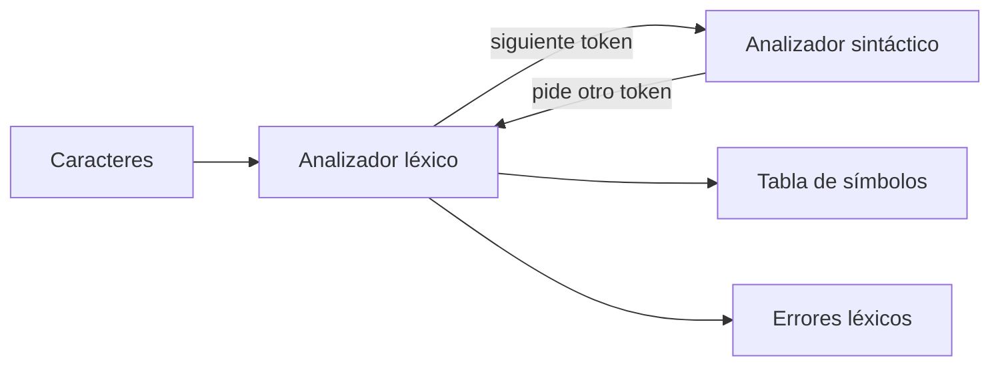

# Compiladores - Análisis léxico

## 2.1 En qué consiste.

---

El **análisis léxico** es la primera fase del compilador: lee el programa como una secuencia de caracteres y la agrupa en unidades con significado, los **tokens**, como identificadores, números, operadores y palabras reservadas, descartando los espacios y los comentarios. Simplifica enormemente el trabajo del analizador sintáctico, que ya no tiene que razonar sobre caracteres sueltos, y es la parte del compilador que más datos procesa, así que debe ser muy eficiente. Este tema presenta qué es un token, qué hace el analizador léxico, cómo se describen los tokens con expresiones regulares y cómo se detectan los errores léxicos, con un analizador completo en Python.

### Lexemas, patrones y tokens

- Un **lexema** es una secuencia concreta de caracteres del programa, como `contador` o `25`.
- Un **patrón** describe el conjunto de lexemas de una clase, normalmente con una expresión regular: los identificadores son `[A-Za-z_][A-Za-z0-9_]*`.
- Un **token** es el par formado por la **clase** y un **atributo**: `<ID, contador>`, `<ENTERO, 25>`. Para las clases con un solo lexema, como `=` o `while`, el atributo sobra. Se acompaña de la **posición**, línea y columna, para los mensajes de error.

Formalmente, el analizador es una función $L: \Sigma^* \to T^*$ de las cadenas sobre el alfabeto de entrada $\Sigma$ a las secuencias de tokens, que además puede fallar si la entrada contiene una secuencia que no es el prefijo de ningún token.

| Lexema | Token | Atributo |
| ------ | ----- | -------- |
| `suma` | `ID` | el nombre, o una referencia a su entrada en la tabla de símbolos |
| `=` | `ASIGNACION` | ninguno |
| `25` | `ENTERO` | el valor 25 |
| `+` | `ARITMETICO` | la operación |
| `while` | `WHILE` | ninguno |

### Funciones del analizador léxico

1. **Agrupar los caracteres** en lexemas y clasificarlos, aplicando la regla del **lexema más largo**: `<=` es un token y no `<` seguido de `=`, y `contador` un identificador y no `con` seguido de `tador`. Si dos patrones reconocen el mismo lexema más largo, gana el de **mayor prioridad**, normalmente el primero de la especificación: así `while` es palabra reservada y no identificador.
2. **Descartar** espacios, tabuladores, saltos de línea y comentarios, salvo en lenguajes donde la sangría tiene significado, como Python, en los que el analizador genera tokens `INDENT` y `DEDENT`.
3. **Convertir los atributos**: el lexema `25` se convierte en el entero 25, y las secuencias de escape de las cadenas, como `\n`, en sus caracteres.
4. **Llevar las posiciones** para los mensajes de error.
5. **Reportar los errores léxicos**: caracteres que no pertenecen al lenguaje, cadenas o comentarios sin cerrar, números mal formados.

El analizador léxico suele ser una subrutina que el sintáctico llama cada vez que necesita un token.



### Por qué separar el análisis léxico

- **Simplicidad:** la gramática del analizador sintáctico se escribe sobre tokens, sin ocuparse de espacios, comentarios ni de cómo se escribe un número.
- **Eficiencia:** el análisis léxico se implementa con autómatas finitos, lineales y muy rápidos, y técnicas como la lectura con buffer se concentran en un solo lugar.
- **Portabilidad:** las particularidades del juego de caracteres quedan aisladas.

### Implementación en Python

El programa implementa un analizador con una sola expresión regular formada por la alternativa de los patrones de cada clase, con un grupo con nombre por clase. Las expresiones de Python prueban las alternativas **en orden** y aceptan la primera que coincide, sin buscar la más larga, así que el orden de los patrones implementa las dos reglas: `DECIMAL` va antes que `ENTERO` para que `3.14` no se parta, y `==` antes que `=`. Lleva la línea y la columna, reporta cada carácter ilegal **y continúa**, y reconoce las palabras reservadas consultando un conjunto después de reconocer un identificador. Resuelve los cuatro ejercicios, con casos de prueba para las expresiones del ejercicio 2.

```python
import re

# ---------- Un analizador léxico con posiciones y reporte de errores ----------
RESERVADAS = {"if", "else", "while"}
ESPEC = [("DECIMAL", r"\d+\.\d*|\.\d+"),            # antes que ENTERO: 3.14 no debe partirse en 3 y .14
         ("ENTERO", r"\d+"),
         ("ID", r"[A-Za-z_]\w*"),
         ("CADENA", r'"(?:[^"\\\n]|\\.)*"'),
         ("COMENTARIO", r"//[^\n]*"),
         ("COMPARACION", r"==|!=|<=|>=|<|>"),        # antes que ASIGNACION: == no es = seguido de =
         ("ASIGNACION", r"="),
         ("ARITMETICO", r"[-+*/]"),                  # el guion al inicio: dentro de [] un - entre dos caracteres es un rango
         ("PAREN", r"[()]"),
         ("ESPACIO", r"[ \t]+"), ("SALTO", r"\n"), ("ERROR", r".")]
PATRON = re.compile("|".join(f"(?P<{n}>{p})" for n, p in ESPEC))
def lexico(texto):
    tokens, errores, linea, inicio = [], [], 1, 0
    for m in PATRON.finditer(texto):
        clase, lexema, col = m.lastgroup, m.group(), m.start() - inicio + 1
        if clase == "SALTO": linea += 1; inicio = m.end(); continue
        if clase in ("ESPACIO", "COMENTARIO"): continue
        if clase == "ERROR": errores.append(f"línea {linea}, columna {col}: carácter ilegal {lexema!r}"); continue
        if clase == "ID" and lexema in RESERVADAS: clase = lexema.upper()
        valor = int(lexema) if clase == "ENTERO" else float(lexema) if clase == "DECIMAL" else lexema
        tokens.append((clase, valor, linea, col))
    return tokens, errores

# ---------- Ejercicio 1 ----------
t, e = lexico("resultado = (valor1 + valor2) * factor - 10")
print(f"ejercicio 1: {len(t)} tokens")
for tok in t: print("   ", tok)

# ---------- Ejercicio 2: expresiones regulares probadas con casos ----------
PRUEBAS = {
    "decimal": (r"\d+\.\d*|\.\d+", ["3.14", "0.5", ".75", "5."], ["5", ".", "3.1.4", "1e5"]),
    "cadena": (r'"(?:[^"\\\n]|\\.)*"', ['"hola"', '""', r'"di \"sí\""', r'"a\nb"'], ['"sin cerrar', "'simples'", '"a"b"']),
    "comentario": (r"//[^\n]*", ["// nota", "//", "// a // b"], ["/ no", "/* bloque */"]),
}
for nombre, (er, buenas, malas) in PRUEBAS.items():
    ok = all(re.fullmatch(er, s) for s in buenas) and not any(re.fullmatch(er, s) for s in malas)
    print(f"ejercicio 2: {nombre:10} {er:24} acepta {buenas}, rechaza {malas}: {ok}")

# ---------- Ejercicio 3 ----------
t, e = lexico("precio = 25$ + 10@valor")
print("ejercicio 3:", e); print("   tokens válidos:", [x[1] for x in t])

# ---------- Ejercicio 4 ----------
t, e = lexico('if (x >= 3.5) total = total + .25 // ajuste\nelse while (n != 0) n = n - 1')
print("ejercicio 4:", [(c, v) for c, v, _, _ in t], "errores:", e)

# ---------- El patrón de operadores del material original ----------
print("[+*-/] acepta la coma y el punto:", bool(re.fullmatch(r"[+*-/]", ",")), bool(re.fullmatch(r"[+*-/]", ".")),
      "| [-+*/]:", bool(re.fullmatch(r"[-+*/]", ",")), bool(re.fullmatch(r"[-+*/]", ".")))
```

Salida:

```text
ejercicio 1: 11 tokens
    ('ID', 'resultado', 1, 1)
    ('ASIGNACION', '=', 1, 11)
    ('PAREN', '(', 1, 13)
    ('ID', 'valor1', 1, 14)
    ('ARITMETICO', '+', 1, 21)
    ('ID', 'valor2', 1, 23)
    ('PAREN', ')', 1, 29)
    ('ARITMETICO', '*', 1, 31)
    ('ID', 'factor', 1, 33)
    ('ARITMETICO', '-', 1, 40)
    ('ENTERO', 10, 1, 42)
ejercicio 2: decimal    \d+\.\d*|\.\d+           acepta ['3.14', '0.5', '.75', '5.'], rechaza ['5', '.', '3.1.4', '1e5']: True
ejercicio 2: cadena     "(?:[^"\\\n]|\\.)*"      acepta ['"hola"', '""', '"di \\"sí\\""', '"a\\nb"'], rechaza ['"sin cerrar', "'simples'", '"a"b"']: True
ejercicio 2: comentario //[^\n]*                 acepta ['// nota', '//', '// a // b'], rechaza ['/ no', '/* bloque */']: True
ejercicio 3: ["línea 1, columna 12: carácter ilegal '$'", "línea 1, columna 18: carácter ilegal '@'"]
   tokens válidos: ['precio', '=', 25, '+', 10, 'valor']
ejercicio 4: [('IF', 'if'), ('PAREN', '('), ('ID', 'x'), ('COMPARACION', '>='), ('DECIMAL', 3.5), ('PAREN', ')'), ('ID', 'total'), ('ASIGNACION', '='), ('ID', 'total'), ('ARITMETICO', '+'), ('DECIMAL', 0.25), ('ELSE', 'else'), ('WHILE', 'while'), ('PAREN', '('), ('ID', 'n'), ('COMPARACION', '!='), ('ENTERO', 0), ('PAREN', ')'), ('ID', 'n'), ('ASIGNACION', '='), ('ID', 'n'), ('ARITMETICO', '-'), ('ENTERO', 1)] errores: []
[+*-/] acepta la coma y el punto: True True | [-+*/]: False False
```

### Ejercicios Propuestos

1. **Identificación de tokens.** Identifica todos los tokens de:

    ```python
    resultado = (valor1 + valor2) * factor - 10
    ```

2. **Expresiones regulares.** Crea expresiones regulares para números decimales, como 3.14, 0.5 y .75; cadenas de texto entre comillas dobles, y comentarios de una línea, como `// comentario`.

3. **Errores.** Identifica los errores léxicos en `precio = 25$ + 10@valor`.

4. **Implementación.** Extiende el analizador para reconocer números decimales, las palabras reservadas `if`, `else` y `while`, y los operadores de comparación `==`, `!=`, `<` y `>`.

### Soluciones

**Ejercicio 1.** Son 11 tokens: `<ID, resultado>`, `<=>`, `<(>`, `<ID, valor1>`, `<+>`, `<ID, valor2>`, `<)>`, `<*>`, `<ID, factor>`, `<->` y `<ENTERO, 10>`, cada uno con su columna. `valor1` es un solo identificador y no `valor` seguido de 1, por la regla del lexema más largo, porque el patrón de los identificadores admite dígitos después del primer carácter.

**Ejercicio 2.** Las expresiones, verificadas con casos que deben aceptarse y que deben rechazarse, son:

- **decimales:** `\d+\.\d*|\.\d+`, que acepta 3.14, 0.5, .75 y también 5., como C, y rechaza 5, que es un entero, un punto solo y 3.1.4; si se quiere exigir dígitos a ambos lados, `\d+\.\d+`;
- **cadenas:** `"(?:[^"\\\n]|\\.)*"`, una comilla, cualquier cantidad de caracteres que no sean comilla, barra invertida ni salto de línea, o de secuencias de escape formadas por una barra y cualquier carácter, y la comilla de cierre. Así `"di \"sí\""` es una sola cadena, y una cadena sin cerrar no coincide;
- **comentarios de una línea:** `//[^\n]*`, dos barras y todo hasta el fin de la línea, que no incluye el salto.

La expresión de las cadenas muestra por qué no basta `".*"`: con `"a" + "b"`, la cerradura llegaría hasta la última comilla y tomaría todo como una cadena.

**Ejercicio 3.** Hay dos errores: el carácter `$` en la columna 12 y `@` en la columna 18, que no pertenecen a ningún token. El analizador los reporta con su posición y **continúa**, de modo que entrega los tokens válidos `precio`, `=`, `25`, `+`, `10` y `valor` y el analizador sintáctico puede seguir buscando otros errores. En otros lenguajes, `$` sería válido, por ejemplo en los identificadores de Java y JavaScript, y `@` en las anotaciones de Java o los decoradores de Python: lo que es un error léxico depende del lenguaje.

**Ejercicio 4.** Las extensiones están en la especificación del programa: el patrón `DECIMAL` antes que `ENTERO`; el patrón `COMPARACION` con las alternativas de dos caracteres antes que las de uno, y antes que la asignación, y la consulta de las palabras reservadas después de reconocer un identificador. La entrada de prueba produce `IF`, `ELSE` y `WHILE` como palabras reservadas, `>=` y `!=` como comparaciones, y 3.5 y .25 como decimales, sin errores. Un `!` aislado sería un error, porque en este lenguaje no es un operador.

El analizador del material original tenía dos fallas. El patrón de los operadores, `[+*-/]`, contiene el **rango** de `*` a `/` en el código ASCII, que incluye `+`, `,`, `-`, `.` y `/`, de modo que aceptaba la coma y el punto como operadores; el guion debe ir al principio o al final, `[-+*/]`. Y el patrón final `MISMATCH`, que coincidía con cualquier carácter, se descartaba en silencio, de modo que el error de carácter inesperado nunca se reportaba.

### Referencias

1. Aho, A. V., Lam, M. S., Sethi, R., and Ullman, J. D., _Compilers: Principles, Techniques, and Tools_. 2a ed., Pearson, 2007. Capítulo 3.
2. Cooper, K. D., and Torczon, L., _Engineering a Compiler_. 3a ed., Morgan Kaufmann, 2022. Capítulo 2.
3. Appel, A. W., _Modern Compiler Implementation in Java_. 2a ed., Cambridge University Press, 2002. Capítulo 2.
4. Python Software Foundation, _re — Regular expression operations_, documentación de Python 3.13.
