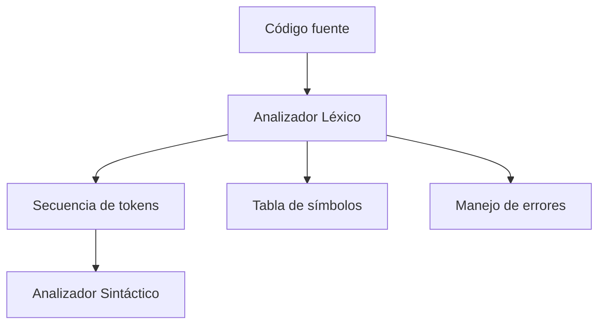

# Compiladores - Análisis léxico

## 2.1 En qué consiste.

---

El análisis léxico es la primera fase del proceso de compilación. Su función principal es leer el código fuente del programa y convertirlo en una secuencia de componentes léxicos (tokens) que serán utilizados por la siguiente fase: el análisis sintáctico.

Según Aho, Lam, Sethi y Ullman (2007), el analizador léxico "lee los caracteres de entrada del programa fuente y agrupa los caracteres en secuencias que tienen un significado colectivo, llamados tokens".

### Definición formal

El análisis léxico consiste en la transformación de una secuencia de caracteres de entrada en una secuencia de tokens que representan los elementos significativos del lenguaje de programación.

Matemáticamente, podemos representar esta transformación como:

$$ L: Σ^* → T^* $$

Donde:

- $Σ$ es el alfabeto de caracteres de entrada
- $T$ es el conjunto de tokens definidos para el lenguaje
- $L$ es la función de análisis léxico

### Funciones del analizador léxico

1. **Eliminación de espacios en blanco y comentarios**: Ignora caracteres que no contribuyen al significado del programa.

2. **Identificación de tokens**: Reconoce patrones léxicos como identificadores, palabras reservadas, operadores, constantes, etc.

3. **Detección de errores léxicos**: Identifica secuencias de caracteres que no forman ningún token válido.

4. **Interacción con la tabla de símbolos**: Al encontrar identificadores, los añade a la tabla de símbolos o actualiza su información.

5. **Numeración de líneas**: Lleva el control del número de línea para reportar errores.

### Componentes léxicos (Tokens)

Un token es una unidad léxica que tiene:

- **Tipo**: Categoría léxica (ej: identificador, número, operador)
- **Atributos**: Información adicional (ej: valor numérico, nombre del identificador)
- **Posición**: Línea y columna donde aparece

#### Ejemplo de tokens:

| Lexema     | Tipo de token | Atributos            |
| ---------- | ------------- | -------------------- |
| `suma`     | IDENTIFICADOR | Puntero a "suma"     |
| `=`        | ASIGNACION    | ---                  |
| `25`       | ENTERO        | Valor = 25           |
| `+`        | OPERADOR      | Operación suma       |
| `contador` | IDENTIFICADOR | Puntero a "contador" |

### Expresiones regulares en análisis léxico

Las expresiones regulares son la base matemática para definir los patrones de tokens:

- Identificador: `[a-zA-Z_][a-zA-Z0-9_]*`
- Entero: `[0-9]+`
- Operador de asignación: `=`
- Operador aritmético: `[+*-/]`

### Diagrama del proceso de análisis léxico



### Ejemplo práctico

**Código fuente:**

```python
x = 25 + y * 3
```

**Secuencia de tokens generada:**

```
<ID, "x", línea 1>
<ASIGNACION, "=", línea 1>
<ENTERO, 25, línea 1>
<OPERADOR, "+", línea 1>
<ID, "y", línea 1>
<OPERADOR, "*", línea 1>
<ENTERO, 3, línea 1>
```

### Implementación básica de un analizador léxico

```python
import re

class Lexer:
    def __init__(self, source_code):
        self.source_code = source_code
        self.position = 0
        self.line = 1
        self.tokens = []

        # Patrones de tokens
        self.token_specs = [
            ('NUMBER',   r'\d+'),
            ('IDENT',    r'[a-zA-Z_]\w*'),
            ('OPERATOR', r'[+\-*/=]'),
            ('SKIP',     r'[ \t]+'),
            ('NEWLINE',  r'\n'),
            ('MISMATCH', r'.')
        ]

        # Compilar expresiones regulares
        self.regex_patterns = []
        for name, pattern in self.token_specs:
            self.regex_patterns.append((name, re.compile(pattern)))

    def tokenize(self):
        while self.position < len(self.source_code):
            matched = False
            for token_name, pattern in self.regex_patterns:
                match = pattern.match(self.source_code, self.position)
                if match:
                    text = match.group()
                    if token_name == 'SKIP':
                        pass  # Ignorar espacios
                    elif token_name == 'NEWLINE':
                        self.line += 1
                    elif token_name != 'MISMATCH':
                        self.tokens.append((token_name, text, self.line))
                    self.position = match.end()
                    matched = True
                    break

            if not matched:
                # Carácter no reconocido
                raise Exception(f'Carácter inesperado: {self.source_code[self.position]} en línea {self.line}')

        return self.tokens

# Uso del lexer
code = "x = 25 + y * 3"
lexer = Lexer(code)
tokens = lexer.tokenize()
for token in tokens:
    print(token)
```

### Ejercicios propuestos

1. **Identificación de tokens**: Dado el siguiente código, identifica todos los tokens:

   ```python
   resultado = (valor1 + valor2) * factor - 10
   ```

2. **Diseño de expresiones regulares**: Crea expresiones regulares para:
   - Números decimales (ej: 3.14, 0.5, .75)
   - Cadenas de texto entre comillas dobles
   - Comentarios de una línea (// comentario)

3. **Detección de errores**: Identifica los errores léxicos en:

   ```python
   precio = 25$ + 10@valor
   ```

4. **Implementación**: Extiende el lexer anterior para reconocer:
   - Números decimales
   - Palabras reservadas (if, else, while)
   - Operadores de comparación (==, !=, <, >)

### Errores comunes en análisis léxico

1. **Símbolos no reconocidos**: Caracteres que no pertenecen al alfabeto del lenguaje.
2. **Secuencias ilegales**: Combinaciones de caracteres que no forman tokens válidos.
3. **Comentarios no cerrados**: Comentarios de bloque que no terminan correctamente.

### Referencias

1. Aho, A. V., Lam, M. S., Sethi, R., & Ullman, J. D. (2007). Compilers: Principles, Techniques, and Tools (2nd ed.). Pearson Education. (Capítulo 3: Lexical Analysis)

2. Cooper, K. D., & Torczon, L. (2004). Engineering a Compiler. Morgan Kaufmann. (Capítulo 2: Scanning)

3. Scott, M. L. (2009). Programming Language Pragmatics. Morgan Kaufmann. (Sección 2.2: Scanning)

4. Grune, D., Bal, H. E., Jacobs, C. J. H., & Langendoen, K. G. (2000). Modern Compiler Design. John Wiley & Sons. (Capítulo 2: Lexical Analysis)

### Conclusión

El análisis léxico es la fase inicial de cualquier compilador o intérprete, responsable de transformar el flujo de caracteres de entrada en tokens significativos. Su correcta implementación es crucial para el funcionamiento de las fases posteriores del proceso de compilación y para proporcionar mensajes de error precisos a los programadores.
