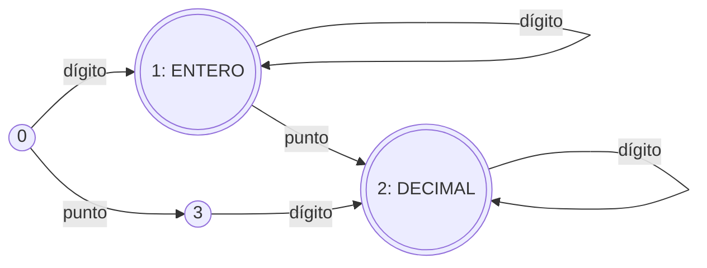

# Compiladores - Análisis léxico

## 2.2 Reconocimiento de palabras.

---

Reconocer una palabra es decidir si un prefijo de la entrada pertenece al lenguaje de algún token y, de ser así, de cuál. El modelo que lo hace eficiente es el **autómata finito determinista**: lee cada carácter una sola vez, cambia de estado según una tabla y, al no poder avanzar, sabe qué token reconoció. Este tema presenta los autómatas como reconocedores de palabras, la regla del lexema más largo con su retroceso, el diseño de autómatas para números, cadenas, operadores y comentarios, y su implementación guiada por tabla.

### Definición

Un **autómata finito determinista** es una 5-tupla $M = (Q, \Sigma, \delta, q_0, F),$ donde $Q$ es un conjunto finito de estados, $\Sigma$ el alfabeto, $\delta: Q \times \Sigma \to Q$ la función de transición, que puede ser parcial, $q_0$ el estado inicial y $F \subseteq Q$ el conjunto de estados de aceptación. La función se extiende a cadenas con $\hat\delta(q, \varepsilon) = q$ y $\hat\delta(q, wa) = \delta(\hat\delta(q, w), a),$ y el lenguaje del autómata es $L(M) = \{w \in \Sigma^* : \hat\delta(q_0, w) \in F\}.$

Para el análisis léxico, cada estado de aceptación se etiqueta con el token que reconoce, de modo que el reconocimiento es una función que, dada la entrada $x$ y una posición $i,$ devuelve el token y la longitud del **prefijo aceptado más largo** de $x_i x_{i+1} \ldots,$ o un fallo $\bot$ si ningún prefijo no vacío es aceptado.

Cada carácter se procesa con una consulta a la tabla, así que reconocer un lexema de longitud $n$ cuesta $O(n)$ más lo que se lee de más para decidir dónde termina.

### La regla del lexema más largo y el retroceso

El autómata no se detiene al llegar a un estado de aceptación: sigue mientras haya transición, porque un lexema más largo podría ser válido, como `<=` después de `<`. Por eso debe **recordar el último estado de aceptación** y su posición. Cuando ya no puede avanzar, regresa a esa posición y entrega ese token, y los caracteres leídos de más se vuelven a leer como inicio del siguiente lexema.

El retroceso puede ser de más de un carácter. En un lenguaje con el operador de rango `..` y decimales de la forma $d^+ . d^+,$ la entrada `1..5` lleva al autómata de `1` a `1.`, que no es un estado de aceptación, y al ver el segundo punto se detiene; el último estado de aceptación fue el entero `1`, así que retrocede un carácter, entrega `1` y empieza de nuevo en `..`.



### Implementación con tabla de transiciones

Para que la tabla sea pequeña, los caracteres se agrupan en **clases**, como dígito o letra, que se comportan igual en todas las transiciones; los analizadores generados por herramientas como flex calculan automáticamente esas clases de equivalencia. El reconocedor es entonces un ciclo de tres líneas, idéntico para todos los tokens:

1. $q \leftarrow q_0,$ y el último aceptado es ninguno;
2. mientras exista $\delta(q, \text{clase}(x_j)),$ avanzar y, si el nuevo estado acepta, recordar el token y $j;$
3. devolver el último aceptado, o un error si no lo hubo.

Las **palabras reservadas** suelen reconocerse como identificadores y buscarse después en una tabla, porque incorporarlas al autómata multiplica sus estados; la búsqueda cuesta $O(1)$ con una tabla de dispersión.

### Implementación en Python

El programa implementa un reconocedor guiado por tabla con retroceso al último estado de aceptación, y con él resuelve los ejercicios: el autómata de los decimales del ejercicio 1, con la traza de estados, y el ejemplo del operador de rango; el reconocedor de cadenas con secuencias de escape del ejercicio 2; la tabla de los operadores de comparación del ejercicio 3; la eliminación de comentarios del ejercicio 4, y, para el ejercicio 5, un constructor que convierte patrones como `[a-z]+` o `[0-9]{3}` en un autómata y lo compara con el módulo `re` de Python.

```python
# ---------- Un reconocedor guiado por tabla, con el lexema más largo y retroceso ----------
def clase(c):
    if c.isdigit(): return "d"
    if c.isalpha() or c == "_": return "l"
    return c                                        # los demás caracteres son su propia clase

class AFD:
    def __init__(self, delta, inicial, finales):
        self.delta, self.inicial, self.finales = delta, inicial, finales   # finales: estado -> token
    def reconoce(self, texto, i, traza=None):
        """Avanza mientras haya transición y recuerda el último estado de aceptación (retroceso)."""
        q, j, ultimo = self.inicial, i, None
        if q in self.finales: ultimo = (self.finales[q], i)
        while j < len(texto) and (q, clase(texto[j])) in self.delta:
            q = self.delta[(q, clase(texto[j]))]; j += 1
            if traza is not None: traza.append(f"{texto[j-1]!r}->{q}")
            if q in self.finales: ultimo = (self.finales[q], j)
        return ultimo                               # (token, fin) del lexema más largo aceptado, o None

def escanea(afd, texto, ignora=" \t\n"):
    i, salida = 0, []
    while i < len(texto):
        if texto[i] in ignora: i += 1; continue
        r = afd.reconoce(texto, i)
        if r is None: salida.append(("ERROR", texto[i])); i += 1; continue
        tok, fin = r; salida.append((tok, texto[i:fin])); i = fin
    return salida

# ---------- Ejercicio 1: decimales 3.14, 0.5, .75 ----------
# 0 -d-> 1 (entero) -.-> 2 (decimal) -d-> 2;  0 -.-> 3 -d-> 2
NUM = AFD({(0, "d"): 1, (1, "d"): 1, (1, "."): 2, (2, "d"): 2, (0, "."): 3, (3, "d"): 2},
          0, {1: "ENTERO", 2: "DECIMAL"})
for s in ["3.14", "0.5", ".75", "42", "5."]:
    t = []; r = NUM.reconoce(s, 0, t); print(f"ejercicio 1: {s:5} {' '.join(t):28} -> {r}")
print("   '.' solo:", NUM.reconoce(".", 0), "| '3.1.4':", escanea(NUM, "3.1.4"))

# Retroceso: con DECIMAL = d+.d+ y el operador de rango '..', la entrada 1..5 no debe leerse como '1.' y '.5'
RANGO = AFD({(0, "d"): 1, (1, "d"): 1, (1, "."): 2, (2, "d"): 3, (3, "d"): 3, (0, "."): 4, (4, "."): 5},
            0, {1: "ENTERO", 3: "DECIMAL", 5: "RANGO"})
print("retroceso: 1..5 ->", escanea(RANGO, "1..5"), "| 1.5 ->", escanea(RANGO, "1.5"))

# ---------- Ejercicio 2: cadenas con secuencias de escape ----------
ESCAPES = {"n": "\n", "t": "\t", '"': '"', "\\": "\\"}
def cadena(texto, i):
    """texto[i] es la comilla de apertura; devuelve (valor, fin) o lanza un error con la columna."""
    j, valor = i + 1, []
    while j < len(texto):
        c = texto[j]
        if c == '"': return "".join(valor), j + 1
        if c == "\n": break
        if c == "\\":
            if j + 1 >= len(texto) or texto[j + 1] not in ESCAPES:
                raise ValueError(f"columna {j+1}: secuencia de escape inválida {texto[j:j+2]!r}")
            valor.append(ESCAPES[texto[j + 1]]); j += 2; continue
        valor.append(c); j += 1
    raise ValueError(f"columna {i+1}: cadena sin cerrar")
for s in [r'"hola"', r'"di \"sí\""', r'"a\nb\tc"', r'"ruta\\dir"', r'"sin cerrar', r'"mal \q"']:
    try: v, fin = cadena(s, 0); print(f"ejercicio 2: {s:14} -> valor {v!r}, {len(v)} caracteres")
    except ValueError as e: print(f"ejercicio 2: {s:14} -> error, {e}")

# ---------- Ejercicio 3: tabla de transiciones de los operadores de comparación ----------
COMP = AFD({(0, "="): 1, (1, "="): 2, (0, "!"): 3, (3, "="): 4, (0, "<"): 5, (5, "="): 6, (0, ">"): 7, (7, "="): 8},
           0, {1: "ASIGNA", 2: "IGUAL", 4: "DISTINTO", 5: "MENOR", 6: "MENOR_IGUAL", 7: "MAYOR", 8: "MAYOR_IGUAL"})
simbolos = ["=", "!", "<", ">"]
print("ejercicio 3: estado |", " | ".join(simbolos), "| acepta")
for q in range(9):
    fila = [str(COMP.delta.get((q, s), "-")) for s in simbolos]
    print(f"   {q:>12} | {' | '.join(fila)} | {COMP.finales.get(q, '-')}")
print("   '<= != == > = !' ->", escanea(COMP, "<= != == > = !"))

# ---------- Ejercicio 4: comentarios // y /* */ ----------
def sin_comentarios(texto):
    i, salida, linea, errores = 0, [], 1, []
    while i < len(texto):
        if texto.startswith("//", i):
            fin = texto.find("\n", i); i = len(texto) if fin < 0 else fin
        elif texto.startswith("/*", i):
            fin = texto.find("*/", i + 2)
            if fin < 0: errores.append(f"línea {linea}: comentario sin cerrar"); break
            linea += texto.count("\n", i, fin); salida.append("\n" * texto.count("\n", i, fin)); i = fin + 2
        else:
            if texto[i] == "\n": linea += 1
            salida.append(texto[i]); i += 1
    return "".join(salida), errores
prog = "x = 1; // uno\n/* varias\n   líneas */ y = 2;\nz = x / y; /* fin"
limpio, err = sin_comentarios(prog)
print("ejercicio 4:", repr(limpio), err)
print("   /* a /* b */ c */ ->", repr(sin_comentarios("/* a /* b */ c */")[0]), "(no se anidan: queda ' c */')")

# ---------- Ejercicio 5: autómata para patrones simples [a-z]+, [0-9]{3} ----------
import re as _re
def atomos(patron):
    """Una secuencia de clases [..] o caracteres, cada una con *, +, ?, {n} o {n,m}."""
    res, i = [], 0
    while i < len(patron):
        if patron[i] == "[":
            j = patron.index("]", i); cuerpo = patron[i+1:j]; conj = set()
            k = 0
            while k < len(cuerpo):
                if k + 2 < len(cuerpo) and cuerpo[k+1] == "-":
                    conj |= {chr(c) for c in range(ord(cuerpo[k]), ord(cuerpo[k+2]) + 1)}; k += 3
                else: conj.add(cuerpo[k]); k += 1
            i = j + 1
        else: conj = {patron[i]}; i += 1
        lo, hi = 1, 1
        if i < len(patron) and patron[i] in "*+?":
            lo, hi = {"*": (0, None), "+": (1, None), "?": (0, 1)}[patron[i]]; i += 1
        elif i < len(patron) and patron[i] == "{":
            j = patron.index("}", i); partes = patron[i+1:j].split(",")
            lo = int(partes[0]); hi = lo if len(partes) == 1 else (int(partes[1]) if partes[1] else None); i = j + 1
        res.append((frozenset(conj), lo, hi))
    return res
def construye(patron):
    """Expande las repeticiones en una cadena de estados de un AFN y lo determiniza por subconjuntos."""
    trans, eps, n = [], [], 1                   # el estado 0 es el inicial
    actual = 0
    for conj, lo, hi in atomos(patron):
        for _ in range(lo): trans.append((actual, conj, n)); actual = n; n += 1
        if hi is None: trans.append((actual, conj, actual))
        else:
            salida = []
            for _ in range(hi - lo): salida.append(actual); trans.append((actual, conj, n)); actual = n; n += 1
            for s in salida: eps.append((s, actual))
    final = actual
    def cierre(S):
        S = set(S); cambio = True
        while cambio:
            cambio = False
            for a, b in eps:
                if a in S and b not in S: S.add(b); cambio = True
        return frozenset(S)
    alfabeto = sorted(set().union(*(c for _, c, _ in trans)))
    inicio = cierre({0}); estados, pendientes, delta = {inicio: 0}, [inicio], {}
    while pendientes:
        S = pendientes.pop(0)
        for c in alfabeto:
            T = cierre({b for a, conj, b in trans if a in S and c in conj})
            if not T: continue
            if T not in estados: estados[T] = len(estados); pendientes.append(T)
            delta[(estados[S], c)] = estados[T]
    finales = {i for S, i in estados.items() if final in S}
    return delta, finales, len(estados)
def acepta(dfa, s):
    delta, finales, _ = dfa; q = 0
    for c in s:
        if (q, c) not in delta: return False
        q = delta[(q, c)]
    return q in finales
for patron, pruebas in [("[a-z]+", ["abc", "x", "", "aB"]), ("[0-9]{3}", ["123", "12", "1234", "abc"]),
                        ("[a-z][a-z0-9]{0,2}", ["a", "ab1", "a123", "1a"]), ("-?[0-9]+", ["-42", "7", "-", "4-2"])]:
    dfa = construye(patron)
    ok = all(acepta(dfa, s) == bool(_re.fullmatch(patron, s)) for s in pruebas)
    print(f"ejercicio 5: {patron:20} {dfa[2]} estados, finales {sorted(dfa[1])}:",
          {s: acepta(dfa, s) for s in pruebas}, "coincide con re:", ok)
```

Salida:

```text
ejercicio 1: 3.14  '3'->1 '.'->2 '1'->2 '4'->2  -> ('DECIMAL', 4)
ejercicio 1: 0.5   '0'->1 '.'->2 '5'->2         -> ('DECIMAL', 3)
ejercicio 1: .75   '.'->3 '7'->2 '5'->2         -> ('DECIMAL', 3)
ejercicio 1: 42    '4'->1 '2'->1                -> ('ENTERO', 2)
ejercicio 1: 5.    '5'->1 '.'->2                -> ('DECIMAL', 2)
   '.' solo: None | '3.1.4': [('DECIMAL', '3.1'), ('DECIMAL', '.4')]
retroceso: 1..5 -> [('ENTERO', '1'), ('RANGO', '..'), ('ENTERO', '5')] | 1.5 -> [('DECIMAL', '1.5')]
ejercicio 2: "hola"         -> valor 'hola', 4 caracteres
ejercicio 2: "di \"sí\""    -> valor 'di "sí"', 7 caracteres
ejercicio 2: "a\nb\tc"      -> valor 'a\nb\tc', 5 caracteres
ejercicio 2: "ruta\\dir"    -> valor 'ruta\\dir', 8 caracteres
ejercicio 2: "sin cerrar    -> error, columna 1: cadena sin cerrar
ejercicio 2: "mal \q"       -> error, columna 6: secuencia de escape inválida '\\q'
ejercicio 3: estado | = | ! | < | > | acepta
              0 | 1 | 3 | 5 | 7 | -
              1 | 2 | - | - | - | ASIGNA
              2 | - | - | - | - | IGUAL
              3 | 4 | - | - | - | -
              4 | - | - | - | - | DISTINTO
              5 | 6 | - | - | - | MENOR
              6 | - | - | - | - | MENOR_IGUAL
              7 | 8 | - | - | - | MAYOR
              8 | - | - | - | - | MAYOR_IGUAL
   '<= != == > = !' -> [('MENOR_IGUAL', '<='), ('DISTINTO', '!='), ('IGUAL', '=='), ('MAYOR', '>'), ('ASIGNA', '='), ('ERROR', '!')]
ejercicio 4: 'x = 1; \n\n y = 2;\nz = x / y; ' ['línea 4: comentario sin cerrar']
   /* a /* b */ c */ -> ' c */' (no se anidan: queda ' c */')
ejercicio 5: [a-z]+               2 estados, finales [1]: {'abc': True, 'x': True, '': False, 'aB': False} coincide con re: True
ejercicio 5: [0-9]{3}             4 estados, finales [3]: {'123': True, '12': False, '1234': False, 'abc': False} coincide con re: True
ejercicio 5: [a-z][a-z0-9]{0,2}   4 estados, finales [1, 2, 3]: {'a': True, 'ab1': True, 'a123': False, '1a': False} coincide con re: True
ejercicio 5: -?[0-9]+             3 estados, finales [2]: {'-42': True, '7': True, '-': False, '4-2': False} coincide con re: True
```

### Ejercicios Propuestos

1. **Números decimales.** Extiende el analizador para reconocer números como 3.14, 0.5 y .75.

2. **Cadenas entre comillas.** Implementa el reconocimiento de cadenas entre comillas dobles, con las secuencias de escape `\"` y `\n`.

3. **Tabla de transiciones.** Diseña una tabla de transiciones para los operadores de comparación `==`, `!=`, `<`, `>`, `<=` y `>=`.

4. **Comentarios.** Implementa el reconocimiento y descarte de comentarios de una línea, `//`, y de varias líneas, `/* */`.

5. **Patrones simples.** Crea un autómata que reconozca patrones como `[a-z]+` y `[0-9]{3}`.

### Soluciones

**Ejercicio 1.** El autómata tiene cuatro estados: el inicial 0; el 1, al que se llega con dígitos y que acepta un `ENTERO`; el 2, al que se llega con un punto después de dígitos o con dígitos después del punto, y que acepta un `DECIMAL`, y el 3, el de un punto inicial, que no acepta, porque un punto solo no es un número. La traza de `3.14` recorre 1, 2, 2, 2 y acepta un decimal de 4 caracteres, y la de `.75` recorre 3, 2, 2. Como el estado 2 no tiene transición con el punto, `3.1.4` se divide en `3.1` y `.4`; un lenguaje real lo reportaría como número mal formado, comprobando que el siguiente carácter no sea un punto ni un dígito. El autómata acepta `5.` como en C; para exigir dígitos después del punto, el punto debe llevar a un estado que no acepte, como en el ejemplo del rango.

**Ejercicio 2.** Después de la comilla de apertura, el reconocedor acumula caracteres hasta la comilla de cierre; una barra invertida exige un carácter de la tabla de escapes, que se traduce, de modo que el **valor** del token ya no contiene la barra: `"di \"sí\""` tiene 7 caracteres. Hay dos errores léxicos: la cadena **sin cerrar**, que se detecta al llegar al fin de línea o de archivo y se reporta en la posición de la comilla de apertura, donde está el error, y la **secuencia de escape inválida**, como `\q`, que se reporta en su columna. Como autómata, son tres estados: fuera de la cadena, dentro, y después de una barra.

**Ejercicio 3.** La tabla del programa tiene 9 estados. Los estados 1, 5 y 7, a los que se llega con `=`, `<` y `>`, ya aceptan, pero tienen una transición con `=` hacia 2, 6 y 8: la regla del lexema más largo elige `<=` en lugar de `<` seguido de `=`. El estado 3, al que se llega con `!`, no acepta, porque en este lenguaje `!` solo no es un operador, y la entrada `!` aislada produce un error. Basta un carácter de anticipación para decidir cada caso.

**Ejercicio 4.** Un comentario de línea se descarta hasta el salto de línea, sin incluirlo, para que la cuenta de líneas siga correcta; uno de bloque se descarta hasta el primer `*/`, conservando los saltos de línea que contiene. Un `/*` sin cerrar es un error que se reporta al llegar al fin del archivo, con la línea donde se abrió. En C, los comentarios **no se anidan**: en `/* a /* b */ c */` el comentario termina en el primer `*/`, y ` c */` queda como código, lo que provoca un error sintáctico. Lenguajes como Rust y Swift sí los anidan, lo que exige contar la profundidad y ya no es un lenguaje regular.

**Ejercicio 5.** El constructor descompone el patrón en una secuencia de átomos, una clase o un carácter, cada uno con una repetición: `+` es un estado con un ciclo, `{n}` se expande en $n$ estados encadenados, y `{n,m}` en $m$ estados con transiciones vacías que permiten salir desde el estado número $n.$ El autómata resultante es no determinista y se determiniza con la construcción de subconjuntos, que se estudia en el tema 2.4. `[a-z]+` produce un AFD de 2 estados y `[0-9]{3}` uno de 4, que cuenta los dígitos; en las pruebas, sus respuestas coinciden con las de `re.fullmatch`. Un patrón con `{n,m}` y $m$ grande crece linealmente con $m,$ y por eso los motores de expresiones regulares limitan estas repeticiones.

El material original definía el reconocimiento como $R: C^* \to T \cup \{\varepsilon\},$ usando $\varepsilon$ para el fallo, cuando $\varepsilon$ denota la cadena vacía. Su pseudocódigo del reconocimiento retrocedía un solo carácter y aceptaba solo si el estado final era de aceptación, sin recordar el último estado de aceptación, de modo que fallaba en casos como `1..5`; llamaba a la regla del lexema más largo "algoritmo de máximo esfuerzo", y su analizador solo reconocía `==` como operador de dos caracteres: `<=`, `>=` y `!=` se partían en dos tokens, y un `!` aislado se aceptaba como operador.

### Referencias

1. Aho, A. V., Lam, M. S., Sethi, R., and Ullman, J. D., _Compilers: Principles, Techniques, and Tools_. 2a ed., Pearson, 2007. Secciones 3.4 y 3.6.
2. Cooper, K. D., and Torczon, L., _Engineering a Compiler_. 3a ed., Morgan Kaufmann, 2022. Capítulo 2.
3. Hopcroft, J. E., Motwani, R., and Ullman, J. D., _Introduction to Automata Theory, Languages, and Computation_. 3a ed., Pearson, 2006. Capítulo 2.
4. Scott, M. L., _Programming Language Pragmatics_. 4a ed., Morgan Kaufmann, 2016. Sección 2.2.
