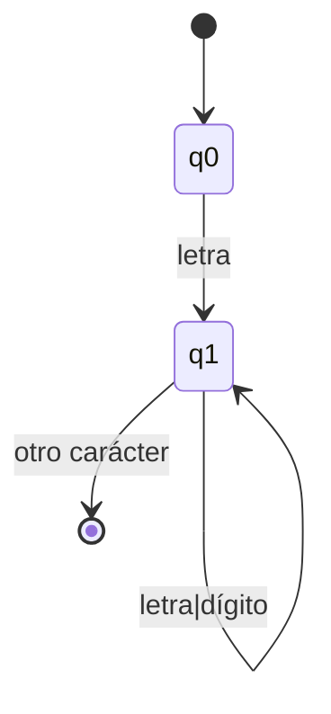

# Compiladores - Análisis léxico

## 2.2 Reconocimiento de palabras.

---

El reconocimiento de palabras es una función fundamental del análisis léxico que consiste en identificar los componentes básicos (tokens) de un lenguaje de programación a partir de una secuencia de caracteres de entrada. Este proceso utiliza patrones definidos para clasificar lexemas en categorías léxicas específicas.

### Definición formal

El reconocimiento de palabras puede modelarse como un proceso de matching de patrones donde:

$$ R: C^* \rightarrow T \cup \{\epsilon\} $$

Donde:

- $C$ es el conjunto de caracteres de entrada
- $T$ es el conjunto de tokens reconocibles
- $R$ es la función de reconocimiento
- $\epsilon$ representa la no coincidencia (fallo en el reconocimiento)

### Autómatas finitos en el reconocimiento de palabras

El reconocimiento de patrones léxicos se implementa típicamente mediante autómatas finitos (AF). Un autómata finito determinista (AFD) se define como una 5-tupla:

$$ M = (Q, \Sigma, \delta, q_0, F) $$

Donde:

- $Q$ es un conjunto finito de estados
- $\Sigma$ es el alfabeto de entrada
- $\delta: Q \times \Sigma \rightarrow Q$ es la función de transición
- $q_0 \in Q$ es el estado inicial
- $F \subseteq Q$ es el conjunto de estados de aceptación

### Diagrama de un autómata para reconocimiento de identificadores



### Algoritmo de reconocimiento mediante AFD

El algoritmo básico para reconocer tokens usando un AFD es:

```
Estado actual = estado inicial
Mientras haya caracteres de entrada:
    Leer próximo carácter c
    Estado actual = δ(estado actual, c)
    Si estado actual es indefinido:
        Retroceder el puntero de entrada
        Salir del bucle
Si estado actual ∈ F:
    return TOKEN_RECONOCIDO
Else:
    return ERROR
```

### Implementación de reconocimiento de tokens

```python
class TokenType:
    IDENTIFIER = "IDENTIFIER"
    INTEGER = "INTEGER"
    OPERATOR = "OPERATOR"
    KEYWORD = "KEYWORD"
    EOF = "EOF"

class Token:
    def __init__(self, type, value, line, column):
        self.type = type
        self.value = value
        self.line = line
        self.column = column

    def __str__(self):
        return f"Token({self.type}, {self.value}, line={self.line}, col={self.column})"

class Lexer:
    def __init__(self, text):
        self.text = text
        self.pos = 0
        self.line = 1
        self.column = 1
        self.current_char = self.text[0] if self.text else None
        self.keywords = {'if', 'else', 'while', 'for', 'return'}

    def advance(self):
        if self.current_char == '\n':
            self.line += 1
            self.column = 0

        self.pos += 1
        self.column += 1

        if self.pos >= len(self.text):
            self.current_char = None
        else:
            self.current_char = self.text[self.pos]

    def skip_whitespace(self):
        while self.current_char is not None and self.current_char.isspace():
            self.advance()

    def recognize_integer(self):
        result = ''
        start_column = self.column

        while self.current_char is not None and self.current_char.isdigit():
            result += self.current_char
            self.advance()

        return Token(TokenType.INTEGER, int(result), self.line, start_column)

    def recognize_identifier(self):
        result = ''
        start_column = self.column

        while (self.current_char is not None and
               (self.current_char.isalnum() or self.current_char == '_')):
            result += self.current_char
            self.advance()

        # Verificar si es palabra reservada
        token_type = TokenType.KEYWORD if result in self.keywords else TokenType.IDENTIFIER

        return Token(token_type, result, self.line, start_column)

    def recognize_operator(self):
        start_column = self.column
        op = self.current_char
        self.advance()

        # Verificar operadores de dos caracteres
        if op == '=' and self.current_char == '=':
            op += self.current_char
            self.advance()
            return Token(TokenType.OPERATOR, op, self.line, start_column)

        return Token(TokenType.OPERATOR, op, self.line, start_column)

    def get_next_token(self):
        while self.current_char is not None:
            if self.current_char.isspace():
                self.skip_whitespace()
                continue

            if self.current_char.isdigit():
                return self.recognize_integer()

            if self.current_char.isalpha() or self.current_char == '_':
                return self.recognize_identifier()

            if self.current_char in '=+-*/<>!':
                return self.recognize_operator()

            # Carácter no reconocido
            raise Exception(f"Carácter no reconocido: '{self.current_char}' at line {self.line}, column {self.column}")

        return Token(TokenType.EOF, None, self.line, self.column)

# Ejemplo de uso
code = "x = 25 + counter * 3"
lexer = Lexer(code)

try:
    token = lexer.get_next_token()
    while token.type != TokenType.EOF:
        print(token)
        token = lexer.get_next_token()
    print(token)  # EOF
except Exception as e:
    print(f"Error: {e}")
```

### Técnicas de reconocimiento

#### 1. Reconocimiento por tabla de transiciones

Para implementar un AFD, se puede usar una tabla de transiciones:

```python
# Ejemplo de tabla de transiciones para identificadores
transition_table = {
    0: {'letter': 1, 'digit': -1, '_': 1, 'other': -1},
    1: {'letter': 1, 'digit': 1, '_': 1, 'other': 2},
    2: {}  # Estado de aceptación
}
```

#### 2. Algoritmo de máximo esfuerzo (maximal munch)

Este principio establece que el analizador léxico debe seleccionar el token más largo posible que coincida con un patrón:

```
Mientras haya caracteres disponibles:
    Intentar reconocer un token con el siguiente carácter
    Si se reconoce un token:
        Guardar el token y su posición
        Avanzar al siguiente carácter después del token
    Si no se reconoce:
        Reportar error
```

### Ejemplos de reconocimiento

**Ejemplo 1:** Reconocimiento de identificadores

```
Entrada: "counter_1"
Proceso:
  'c' → letra → estado 1
  'o' → letra → estado 1
  'u' → letra → estado 1
  'n' → letra → estado 1
  't' → letra → estado 1
  'e' → letra → estado 1
  'r' → letra → estado 1
  '_' → guión bajo → estado 1
  '1' → dígito → estado 1
  Fin de entrada → aceptar como IDENTIFICADOR
```

**Ejemplo 2:** Distinción entre operadores de asignación y comparación

```
Entrada: "a == b"
Proceso:
  'a' → IDENTIFICADOR
  ' ' → espacio → ignorar
  '=' → operador, ver siguiente carácter
  '=' → segundo '=', formar OPERADOR_COMPARACION "=="
  ' ' → espacio → ignorar
  'b' → IDENTIFICADOR
```

### Ejercicios propuestos

1. **Implementar reconocimiento de números decimales**: Extiende el lexer para reconocer números como "3.14", "0.5" y ".75".

2. **Reconocimiento de cadenas entre comillas**: Implementa el reconocimiento de cadenas de texto entre comillas dobles, manejando caracteres de escape como `\"` y `\n`.

3. **Tabla de transiciones para operadores**: Diseña una tabla de transiciones para reconocer operadores de comparación (==, !=, <, >, <=, >=).

4. **Manejo de comentarios**: Implementa el reconocimiento y descarte de comentarios de una línea (//) y de múltiples líneas (/* */).

5. **Analizador para expresiones regulares**: Crea un autómata que reconozca patrones de expresiones regulares simples como `[a-z]+`, `[0-9]{3}`, etc.

### Consideraciones de diseño

1. **Palabras reservadas vs identificadores**: Las palabras reservadas pueden reconocerse:
   - Como casos especiales en el autómata de identificadores
   - Mediante una tabla de búsqueda después de reconocer un identificador

2. **Lookahead**: A veces es necesario mirar el siguiente carácter para decidir:
   - Ejemplo: '=' vs '==', '/' vs '/*' (inicio de comentario)

3. **Gestión de errores**: Estrategias para manejar caracteres no reconocidos:
   - Recuperación mediante salto hasta el siguiente token válido
   - Modo pánico hasta encontrar un delimitador conocido

### Referencias

1. Aho, A. V., Lam, M. S., Sethi, R., & Ullman, J. D. (2007). Compilers: Principles, Techniques, and Tools (2nd ed.). Pearson Education. (Capítulo 3: Sección 3.5 - The Lexical-Analyzer Generator Lex)

2. Cooper, K. D., & Torczon, L. (2004). Engineering a Compiler. Morgan Kaufmann. (Capítulo 2: Sección 2.3 - Regular Expressions)

3. Scott, M. L. (2009). Programming Language Pragmatics. Morgan Kaufmann. (Sección 2.2.2: Finite Automata)

4. Grune, D., Bal, H. E., Jacobs, C. J. H., & Langendoen, K. G. (2000). Modern Compiler Design. John Wiley & Sons. (Capítulo 2: Sección 2.2 - From Regular Expressions to Scanners)
