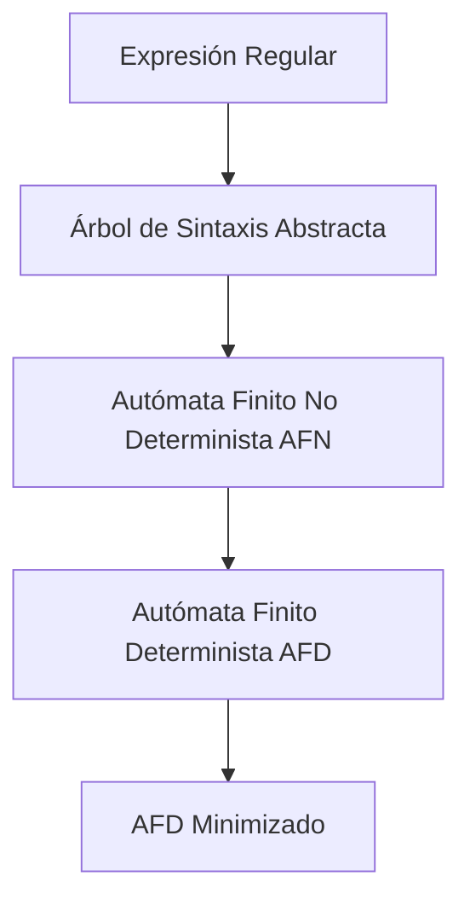

# Compiladores - Análisis léxico

## 2.3 Expresiones regulares.

---

Las expresiones regulares son una herramienta fundamental en el análisis léxico para definir los patrones que representan los tokens de un lenguaje de programación. Proporcionan una notación concisa y poderosa para describir los componentes léxicos que el analizador debe reconocer.

### Definición formal

Una expresión regular es una secuencia de caracteres que define un patrón de búsqueda. Formalmente, podemos definir las expresiones regulares recursivamente:

#### Base:

1. $ε$ es una expresión regular que denota el lenguaje vacío $\{ε\}$
2. Si $a ∈ Σ$, entonces $a$ es una expresión regular que denota $\{a\}$

#### Paso recursivo:

Sean $r$ y $s$ expresiones regulares que denotan los lenguajes $L(r)$ y $L(s)$ respectivamente:\

3. $ (r)|(s) $ es una expresión regular que denota $L(r) ∪ L(s)$
4. $ (r)(s) $ es una expresión regular que denota $L(r)L(s)$
5. $ (r) ^ * $ es una expresión regular que denota $(L(r)) ^ *$
6. $ (r) $ es una expresión regular que denota $L(r)$

### Operadores básicos de expresiones regulares

| Operador | Significado                   | Ejemplo                                                        |
| -------- | ----------------------------- | -------------------------------------------------------------- |
| `        | `                             | Alternancia (OR)                                               | `a  | b` coincide con "a" o "b" |
| `·`      | Concatenación                 | `ab` coincide con "a" seguido de "b"                           |
| `*`      | Cerradura de Kleene (0 o más) | `a*` coincide con "", "a", "aa", ...                           |
| `+`      | Una o más repeticiones        | `a+` coincide con "a", "aa", ...                               |
| `?`      | Cero o una ocurrencia         | `a?` coincide con "" o "a"                                     |
| `[ ]`    | Clase de caracteres           | `[abc]` coincide con "a", "b" o "c"                            |
| `[^ ]`   | Exclusión de caracteres       | `[^abc]` coincide con cualquier carácter excepto "a", "b", "c" |
| `{n}`    | Exactamente n repeticiones    | `a{3}` coincide con "aaa"                                      |
| `{n,}`   | Al menos n repeticiones       | `a{2,}` coincide con "aa", "aaa", ...                          |
| `{n,m}`  | Entre n y m repeticiones      | `a{2,4}` coincide con "aa", "aaa", "aaaa"                      |

### Expresiones regulares para elementos de programación

#### Identificadores:

$$ [a-zA-Z\_][a-zA-Z0-9\_]* $$

#### Números enteros:

$$ [0-9]+ $$

#### Números decimales:

$$ [0-9]*.[0-9]+|[0-9]+.? $$

#### Operadores:

$$ +|-|*|/|=|>|<|>=|<=|==|!= $$

#### Cadenas de texto:

$$\text{\textquotedblleft} \lparen \lbrace \text{\textasciicircum} " \backprime \rbrace \| . \rparen * " $$

#### Comentarios de una línea:

$$ //[\text{\textasciicircum} \backprime n]* $$

### Conversión de ER a Autómatas Finitos



#### Algoritmo de Thompson para construcción de AFN

Para una expresión regular $r$, construimos un AFN $N(r)$ con:

- Un estado inicial $q_0$
- Un estado de aceptación $q_f$
- Transiciones según la estructura de $r$

### Implementación de reconocimiento con expresiones regulares

```python
import re

class RegexLexer:
    def __init__(self):
        # Definición de tokens mediante expresiones regulares
        self.token_specs = [
            ('NUMBER',    r'\d+(\.\d*)?'),     # Enteros o decimales
            ('IDENTIFIER', r'[a-zA-Z_]\w*'),    # Identificadores
            ('OPERATOR',  r'[+\-*/=<>!]=?|==|!=|<=|>='),  # Operadores
            ('STRING',    r'\"([^\"\\]|\\.)*\"'),  # Cadenas
            ('COMMENT',   r'//[^\n]*'),         # Comentarios
            ('WHITESPACE', r'[ \t\n]+'),        # Espacios en blanco
            ('MISMATCH',  r'.'),                # Cualquier otro carácter
        ]

        # Compilar las expresiones regulares
        self.regex_patterns = []
        for token_type, pattern in self.token_specs:
            self.regex_patterns.append((token_type, re.compile(pattern)))

    def tokenize(self, code):
        tokens = []
        line_num = 1
        line_start = 0
        pos = 0

        while pos < len(code):
            # Encontrar la coincidencia más larga
            matches = []
            for token_type, pattern in self.regex_patterns:
                match = pattern.match(code, pos)
                if match:
                    matches.append((token_type, match))

            if not matches:
                raise SyntaxError(f'Carácter inesperado: {code[pos]} en línea {line_num}')

            # Seleccionar la coincidencia más larga (principio de máxima munch)
            matches.sort(key=lambda x: x[1].end() - x[1].start(), reverse=True)
            token_type, match = matches[0]

            # Calcular posición en la línea
            line_num += code.count('\n', pos, match.start())
            line_start = code.rfind('\n', 0, match.start()) + 1 if '\n' in code[:match.start()] else 0
            column = match.start() - line_start + 1

            # Obtener el texto coincidente
            text = match.group()

            # Ignorar espacios y comentarios
            if token_type not in ['WHITESPACE', 'COMMENT']:
                tokens.append({
                    'type': token_type,
                    'value': text,
                    'line': line_num,
                    'column': column
                })

            # Actualizar posición
            pos = match.end()

        return tokens

# Ejemplo de uso
lexer = RegexLexer()
code = '''
x = 25 + 3.14  // Esto es un comentario
resultado = "cadena\\ncon escape"
if x > 10 then print("mayor")
'''

tokens = lexer.tokenize(code)
for token in tokens:
    print(f"{token['type']:12} {token['value']:15} línea {token['line']}, col {token['column']}")
```

### Propiedades algebraicas de las expresiones regulares

Las expresiones regulares obedecen a varias leyes algebraicas:

#### Leyes de asociatividad:

$$ (r|s)|t = r|(s|t) $$
$$ (rs)t = r(st) $$

#### Leyes de conmutatividad:

$$ r|s = s|r $$

#### Leyes de distributividad:

$$ r(s|t) = rs|rt $$
$$ (s|t)r = sr|tr $$

#### Leyes de identidad:

$$ r | \varnothing = r $$
$$ r ε = ε r = r $$
$$ r \varnothing = \varnothing r = \varnothing $$

#### Leyes de idempotencia:

$$ r|r = r $$

#### Leyes de cerradura de Kleene:

$$ \varnothing * = ε $$
$$ ε* = ε $$
$$ r* = r** $$
$$ r* = (r|ε)* $$

### Ejemplos de expresiones regulares complejas

#### Dirección de email:

$$ \left\lbrack a-zA-Z0-9.\_\%+- \right\rbrack+@[a-zA-Z0-9.-]+.[a-zA-Z] \set{2,} $$

#### Dirección IPv4:

$ (25[0-5]|2[0-4][0-9]|[01]?[0-9][0-9]?).(25[0-5]|2[0-4][0-9]|[01]?[0-9][0-9]?).(25[0-5]|2[0-4][0-9]|[01]?[0-9][0-9]?).(25[0-5]|2[0-4][0-9]|[01]?[0-9][0-9]?) $

#### Números en notación científica:

$$ [+ \backprime -]? ( d +(. d *)?|. d +)([eE][+ \backprime -]? d +)? $$

### Ejercicios propuestos

1. **Convertir ER a AFN**: Convierte la expresión regular `(a|b)*abb` a un autómata finito no determinista usando el algoritmo de Thompson.

2. **Diseñar ER para tokens**: Crea expresiones regulares para reconocer:
   - Números hexadecimales (ej: 0x1A3F)
   - Números en punto flotante con notación científica
   - Comentarios multilínea (/* ... */)
   - Palabras reservadas de un lenguaje simple

3. **Minimizar AFD**: Dado el siguiente AFD para la expresión regular `a(b|c)*`, minimízalo usando el algoritmo de partición.

4. **Implementar ER anidadas**: Extiende el lexer para manejar expresiones regulares con:
   - Grupos de captura
   - Referencias anteriores
   - Aserciones (lookahead/lookbehind)

5. **Analizar complejidad**: Calcula la complejidad temporal del algoritmo de coincidencia de expresiones regulares en el peor caso.

### Optimización de expresiones regulares

#### Técnicas de optimización:

1. **Factorización común**: `abc|abd` → `ab(c|d)`
2. **Eliminación de redundancias**: `a|a` → `a`
3. **Simplificación de caracteres**: `[a-a]` → `a`
4. **Optimización de cerraduras**: `a*a*` → `a*`

#### Ejemplo de optimización:

$$ ( a | ε ) b * | ( a | c ) d ^ *   \rightarrow a ( b ^ * | d ^ * ) | ε b ^ * | c d ^ *  $$

### Referencias

1. Aho, A. V., Lam, M. S., Sethi, R., & Ullman, J. D. (2007). Compilers: Principles, Techniques, and Tools (2nd ed.). Pearson Education. (Capítulo 3: Sección 3.3 - Specification of Tokens)

2. Cooper, K. D., & Torczon, L. (2004). Engineering a Compiler. Morgan Kaufmann. (Capítulo 2: Sección 2.3 - Regular Expressions)

3. Scott, M. L. (2009). Programming Language Pragmatics. Morgan Kaufmann. (Sección 2.1: Regular Expressions)

4. Grune, D., Bal, H. E., Jacobs, C. J. H., & Langendoen, K. G. (2000). Modern Compiler Design. John Wiley & Sons. (Capítulo 2: Sección 2.1 - Regular Expressions)

5. Hopcroft, J. E., Motwani, R., & Ullman, J. D. (2006). Introduction to Automata Theory, Languages, and Computation (3rd ed.). Pearson Education. (Capítulo 3: Regular Expressions and Languages)

### Conclusión

Las expresiones regulares son una herramienta esencial en el análisis léxico que permite definir de manera concisa y precisa los patrones que representan los tokens de un lenguaje. Su comprensión y dominio son fundamentales para implementar analizadores léxicos eficientes y correctos. La conversión de expresiones regulares a autómatas finitos y las técnicas de optimización asociadas son aspectos clave en el diseño de compiladores.
