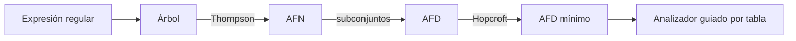
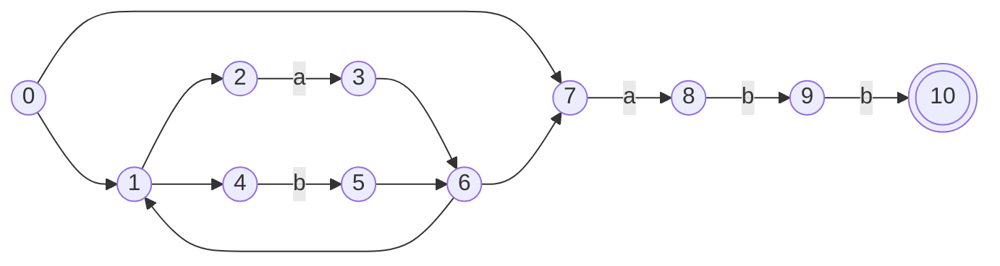

# Compiladores - Análisis léxico

## 2.3 Expresiones regulares.

---

Las **expresiones regulares** son la notación con que se especifican los tokens: describen con pocos símbolos conjuntos infinitos de cadenas, como todos los identificadores o todos los números reales, y, lo más importante para el compilador, cada expresión puede convertirse automáticamente en un autómata finito que la reconoce en tiempo lineal. Este tema presenta su definición formal, las extensiones de notación que usan las herramientas, las leyes algebraicas, la relación con los autómatas y los límites de lo que pueden describir, con un motor completo en Python que construye los autómatas a partir de las expresiones.

### Definición formal

Sea $\Sigma$ un alfabeto. Las expresiones regulares sobre $\Sigma$ y los lenguajes que denotan se definen por inducción:

- **Base:** $\varnothing$ denota el lenguaje vacío, $L(\varnothing) = \varnothing;$ $\varepsilon$ denota el lenguaje formado solo por la cadena vacía, $L(\varepsilon) = \{\varepsilon\},$ y cada símbolo $a \in \Sigma$ denota $L(a) = \{a\}.$
- **Inducción:** si $r$ y $s$ son expresiones regulares, también lo son la **unión** $r \mid s,$ con $L(r \mid s) = L(r) \cup L(s);$ la **concatenación** $rs,$ con $L(rs) = \{xy : x \in L(r),\ y \in L(s)\};$ la **cerradura de Kleene** $r^*,$ con $L(r^*) = \bigcup_{i \ge 0} L(r)^i,$ y $(r),$ con $L((r)) = L(r).$

La precedencia, de mayor a menor, es cerradura, concatenación y unión, y las tres asocian por la izquierda, de modo que $a \mid bc^*$ significa $a \mid (b(c^*)).$ Un lenguaje es **regular** si alguna expresión regular lo denota.

### Extensiones de notación

Las herramientas agregan operadores que no aumentan el poder de la notación, porque cada uno se reescribe con los tres básicos:

| Notación | Significado | Equivale a |
| -------- | ----------- | ---------- |
| `r+` | una o más repeticiones | $rr^*$ |
| `r?` | cero o una | $r \mid \varepsilon$ |
| `[abc]` | clase de caracteres | $a \mid b \mid c$ |
| `[a-z]` | rango | $a \mid b \mid \cdots \mid z$ |
| `[^abc]` | clase complementaria | la unión de los demás símbolos de $\Sigma$ |
| `.` | cualquier carácter salvo el salto de línea | una clase |
| `r{n}`, `r{n,m}` | exactamente $n,$ o de $n$ a $m$ repeticiones | $r$ repetida, con $m - n$ copias opcionales |
| `\.`, `\*` | el carácter literal | el símbolo |

Para especificar un lenguaje se usan **definiciones regulares**, que dan nombre a expresiones y las reutilizan, sin recursión:

```text
dígito  -> [0-9]
dígitos -> dígito+
real    -> (dígitos \. dígito* | \. dígitos) ([eE] [+-]? dígitos)?
```

### Leyes algebraicas

Dos expresiones son **equivalentes**, $r = s,$ si denotan el mismo lenguaje. Algunas leyes:

- la unión es asociativa, conmutativa e idempotente, con neutro $\varnothing;$
- la concatenación es asociativa, con neutro $\varepsilon$ y $\varnothing$ como absorbente, $r\varnothing = \varnothing r = \varnothing;$
- la concatenación distribuye sobre la unión: $r(s \mid t) = rs \mid rt$ y $(s \mid t)r = sr \mid tr;$
- para la cerradura, $\varnothing^* = \varepsilon,$ $\varepsilon^* = \varepsilon,$ $(r^*)^* = r^*,$ $r^* = \varepsilon \mid rr^*,$ $(r \mid s)^* = (r^*s^*)^*$ y $(rs)^*r = r(sr)^*.$

La concatenación **no** es conmutativa, y la cerradura no distribuye sobre la unión: $(a \mid b)^* \ne a^* \mid b^*,$ porque $ab$ pertenece al primero y no al segundo. La equivalencia es decidible: se construyen los autómatas mínimos de ambas expresiones y se comparan, o se recorre su producto buscando una cadena que uno acepte y el otro no; así lo comprueba el programa.

### Expresiones regulares y autómatas

El **teorema de Kleene** establece que los lenguajes denotados por expresiones regulares son exactamente los que reconocen los autómatas finitos. La dirección que interesa al compilador, de la expresión al autómata, la da la **construcción de Thompson**, que se estudia en detalle en el tema 2.4: produce un autómata no determinista con a lo más $2m$ estados para una expresión de $m$ símbolos y operadores, que después se determiniza y se minimiza.



El AFN de Thompson para $(a \mid b)^*abb$ tiene 11 estados; las aristas sin etiqueta son transiciones $\varepsilon:$



### Más allá de los lenguajes regulares

Las expresiones de Perl, Python o Java incluyen construcciones que no son regulares en el sentido formal. Las **referencias anteriores**, como `\1`, exigen repetir el texto que capturó un grupo: `(a+)b\1` denota $\{a^n b a^n : n \ge 1\},$ que no es regular, porque un autómata de $k$ estados no puede recordar más de $k$ valores de $n.$ Las **aserciones** de anticipación y de retroceso, como `(?=...)` y `(?<=...)`, comprueban un contexto sin consumirlo. Para implementar esas construcciones, los motores usan **retroceso**, que en el peor caso es exponencial; los motores basados en autómatas, como RE2 de Google o el de Rust, garantizan tiempo lineal renunciando a las referencias anteriores. Los analizadores léxicos usan solo expresiones regulares en sentido estricto, y la anticipación de flex, `r/s`, es una forma restringida de aserción.

### Implementación en Python

El programa implementa un motor de expresiones regulares completo, que se reutiliza en los temas 2.4 y 2.5: un analizador de expresiones con unión, concatenación, cerradura, `+`, `?`, clases, rangos, complemento y escapes; la construcción de Thompson; la construcción de subconjuntos con **clases de equivalencia de caracteres**; la minimización de Hopcroft, verificada con el algoritmo de Moore; un analizador guiado por tabla con la regla del lexema más largo y prioridad entre tokens, y la decisión de equivalencia de dos expresiones. Con él resuelve los ejercicios y compara sus resultados con el módulo `re`.

```python
# ===== Núcleo de autómatas: expresión regular -> AFN de Thompson -> AFD -> AFD mínimo -> analizador =====
UNIVERSO = frozenset(chr(c) for c in range(32, 127)) | {"\n", "\t"}

def parsea(er):
    """Analizador descendente de expresiones regulares. Árbol: ('sim', conj) ('eps',) ('alt', a, b)
    ('cat', a, b) ('star', a) ('plus', a) ('opt', a). Admite clases [a-z], [^...], el punto, \\ y ε."""
    pos = 0
    def mira(): return er[pos] if pos < len(er) else None
    def toma():
        nonlocal pos; pos += 1; return er[pos - 1]
    def alternativa():
        n = concatenacion()
        while mira() == "|": toma(); n = ("alt", n, concatenacion())
        return n
    def concatenacion():
        n = None
        while mira() is not None and mira() not in "|)":
            r = repeticion(); n = r if n is None else ("cat", n, r)
        return n if n is not None else ("eps",)
    def repeticion():
        n = atomo()
        while mira() is not None and mira() in "*+?":
            n = ({"*": "star", "+": "plus", "?": "opt"}[toma()], n)
        return n
    def escape(c): return {"n": "\n", "t": "\t"}.get(c, c)
    def atomo():
        c = toma()
        if c == "(":
            n = alternativa()
            if toma() != ")": raise SyntaxError("falta ')'")
            return n
        if c == "ε": return ("eps",)
        if c == ".": return ("sim", UNIVERSO - {"\n"})
        if c == "\\": return ("sim", frozenset(escape(toma())))
        if c == "[":
            negada = mira() == "^"
            if negada: toma()
            conj, primero = set(), True
            while mira() != "]" or primero:
                a = toma(); primero = False
                if a == "\\": a = escape(toma())
                if mira() == "-" and pos + 1 < len(er) and er[pos + 1] != "]":
                    toma(); b = toma()
                    if b == "\\": b = escape(toma())
                    conj |= {chr(x) for x in range(ord(a), ord(b) + 1)}
                else: conj.add(a)
            toma()
            return ("sim", frozenset(UNIVERSO - conj if negada else conj))
        if c in "*+?|)": raise SyntaxError(f"'{c}' inesperado en la posición {pos}")
        return ("sim", frozenset(c))
    arbol = alternativa()
    if pos != len(er): raise SyntaxError(f"'{er[pos]}' inesperado en la posición {pos}")
    return arbol

class AFN:
    """Construcción de Thompson. Concatenar funde el estado final de r con el inicial de s, como en Aho y otros."""
    def __init__(self): self.trans = []            # trans[q] = lista de (conjunto de caracteres o None para ε, destino)
    def nuevo(self): self.trans.append([]); return len(self.trans) - 1
    def arista(self, a, etiqueta, b): self.trans[a].append((etiqueta, b))
    def construye(self, n, s):
        """Construye el fragmento de n que empieza en el estado s; devuelve su estado final."""
        t = n[0]
        if t == "sim": f = self.nuevo(); self.arista(s, n[1], f); return f
        if t == "eps": f = self.nuevo(); self.arista(s, None, f); return f
        if t == "cat": return self.construye(n[2], self.construye(n[1], s))
        if t == "alt":
            i1 = self.nuevo(); e1 = self.construye(n[1], i1)
            i2 = self.nuevo(); e2 = self.construye(n[2], i2)
            f = self.nuevo()
            for i, e in ((i1, e1), (i2, e2)): self.arista(s, None, i); self.arista(e, None, f)
            return f
        i = self.nuevo(); self.arista(s, None, i); e = self.construye(n[1], i); f = self.nuevo()
        if t in ("star", "plus"): self.arista(e, None, i)    # repetir
        if t in ("star", "opt"): self.arista(s, None, f)     # saltarse r
        self.arista(e, None, f)
        return f
    def cierre(self, S):
        pila, C = list(S), set(S)
        while pila:
            q = pila.pop()
            for etq, d in self.trans[q]:
                if etq is None and d not in C: C.add(d); pila.append(d)
        return frozenset(C)
    def mueve(self, S, c): return {d for q in S for etq, d in self.trans[q] if etq is not None and c in etq}

def thompson(espec):
    """espec: lista de (token, expresión) en orden de prioridad. Devuelve el AFN, su inicial y {final: índice}."""
    m = AFN(); q0 = m.nuevo(); finales = {}
    if len(espec) == 1:
        finales[m.construye(parsea(espec[0][1]), q0)] = 0
    else:
        for k, (_, er) in enumerate(espec):
            s = m.nuevo(); m.arista(q0, None, s); finales[m.construye(parsea(er), s)] = k
    return m, q0, finales

def clases(m):
    """Clases de equivalencia de caracteres: dos caracteres son equivalentes si están en las mismas etiquetas."""
    etiquetas = sorted({etq for t in m.trans for etq, _ in t if etq is not None}, key=sorted)
    firma = {}
    for c in sorted(UNIVERSO):
        f = tuple(c in e for e in etiquetas)
        if any(f): firma.setdefault(f, []).append(c)
    return [frozenset(v) for v in sorted(firma.values())]

class AFD:
    def __init__(self, delta, inicial, acepta, clases, tokens):
        self.delta, self.inicial, self.acepta, self.clases, self.tokens = delta, inicial, acepta, clases, tokens
        self.de = {c: k for k, conj in enumerate(clases) for c in conj}
    @property
    def n(self): return 1 + max([self.inicial] + [q for q, _ in self.delta] + list(self.delta.values()))
    def paso(self, q, c):
        k = self.de.get(c)
        return None if k is None else self.delta.get((q, k))
    def acepta_cadena(self, w):
        q = self.inicial
        for c in w:
            q = self.paso(q, c)
            if q is None: return False
        return q in self.acepta
    def tabla(self, nombres=None):
        nombre = nombres or (lambda c: "".join(sorted(c)) if len(c) <= 3 else f"{min(c)}..{max(c)}")
        filas = [["estado"] + [nombre(c) for c in self.clases] + ["acepta"]]
        for q in range(self.n):
            filas.append([("->" if q == self.inicial else "") + str(q)]
                         + [str(self.delta.get((q, k), "-")) for k in range(len(self.clases))]
                         + [self.tokens[self.acepta[q]] if q in self.acepta else "-"])
        anchos = [max(len(f[i]) for f in filas) for i in range(len(filas[0]))]
        return "\n".join("   " + " | ".join(x.rjust(a) for x, a in zip(f, anchos)) for f in filas)

def subconjuntos(m, q0, finales, tokens, traza=None):
    """Construcción de subconjuntos. Un estado acepta el token de mayor prioridad (menor índice) entre sus finales."""
    cl = clases(m); ini = m.cierre({q0}); num = {ini: 0}; pendientes = [ini]; delta = {}; acepta = {}
    while pendientes:
        S = pendientes.pop(0)
        ks = [finales[q] for q in S if q in finales]
        if ks: acepta[num[S]] = min(ks)
        for k, conj in enumerate(cl):
            T = m.cierre(m.mueve(S, next(iter(conj))))
            if not T: continue
            if T not in num: num[T] = len(num); pendientes.append(T)
            delta[(num[S], k)] = num[T]
    if traza is not None: traza.update({v: sorted(k) for k, v in num.items()})
    return AFD(delta, 0, acepta, cl, tokens)

def minimiza(d):
    """Algoritmo de Hopcroft sobre el AFD completado con un estado muerto. La partición inicial separa
    los estados por el token que aceptan, no solo aceptación contra rechazo."""
    n, K = d.n, len(d.clases); muerto = n
    def sig(q, k): return muerto if q == muerto else d.delta.get((q, k), muerto)
    grupos = {}
    for q in range(n + 1): grupos.setdefault(d.acepta.get(q, -1), set()).add(q)
    P = [frozenset(g) for _, g in sorted(grupos.items())]
    inversa = {}
    for q in range(n + 1):
        for k in range(K): inversa.setdefault((sig(q, k), k), set()).add(q)
    bloques = {i: set(g) for i, g in enumerate(P)}            # identificador -> estados
    de = {q: i for i, g in bloques.items() for q in g}
    W = set(bloques)                                          # bloques pendientes de usar como divisores
    while W:
        A = bloques[W.pop()].copy()
        for k in range(K):
            X = set().union(*(inversa.get((q, k), set()) for q in A))   # los que entran a A con k
            tocados = {}
            for q in X: tocados.setdefault(de[q], set()).add(q)
            for b, i in tocados.items():
                if len(i) == len(bloques[b]): continue                # Y contenido en X: no se divide
                nuevo = max(bloques) + 1
                bloques[b] -= i; bloques[nuevo] = i
                for q in i: de[q] = nuevo
                if b in W: W.add(nuevo)
                else: W.add(nuevo if len(i) <= len(bloques[b]) else b)
    P = [frozenset(g) for g in bloques.values()]
    grupo_muerto = next(g for g in P if muerto in g)
    vivos = sorted((g for g in P if g != grupo_muerto), key=min)
    vivos.sort(key=lambda g: (d.inicial not in g, min(g)))          # el inicial primero
    num = {q: i for i, g in enumerate(vivos) for q in g}
    delta = {(num[q], k): num[t] for (q, k), t in d.delta.items() if q in num and t in num}
    acepta = {num[q]: t for q, t in d.acepta.items() if q in num}
    return AFD(delta, num[d.inicial], acepta, d.clases, d.tokens)

def moore(d):
    """Refinamiento de particiones de Moore, más simple y O(k n^2): sirve para verificar a Hopcroft."""
    estados = list(range(d.n)); bloque = {q: d.acepta.get(q, -1) for q in estados}
    while True:
        firma = {q: (bloque[q],) + tuple(bloque.get(d.delta.get((q, k)), None) for k in range(len(d.clases))) for q in estados}
        ids = {f: i for i, f in enumerate(sorted(set(firma.values()), key=repr))}
        nuevo = {q: ids[firma[q]] for q in estados}
        if len(set(nuevo.values())) == len(set(bloque.values())): return len(set(nuevo.values()))
        bloque = nuevo

def compila(espec, minimo=True):
    m, q0, fin = thompson(espec)
    d = subconjuntos(m, q0, fin, [t for t, _ in espec])
    return minimiza(d) if minimo else d

def analiza(d, texto, ignora=()):
    """Analizador guiado por la tabla, con la regla del lexema más largo y retroceso al último estado de aceptación."""
    i, linea, col, salida = 0, 1, 1, []
    while i < len(texto):
        q, j, ultimo = d.inicial, i, None
        while j < len(texto):
            q = d.paso(q, texto[j])
            if q is None: break
            j += 1
            if q in d.acepta: ultimo = (d.acepta[q], j)
        if ultimo is None:
            salida.append(("ERROR", texto[i], linea, col)); fin = i + 1
        else:
            k, fin = ultimo
            if d.tokens[k] not in ignora: salida.append((d.tokens[k], texto[i:fin], linea, col))
        for c in texto[i:fin]:
            linea, col = (linea + 1, 1) if c == "\n" else (linea, col + 1)
        i = fin
    return salida

def equivalentes(er1, er2, alfabeto):
    """Recorre el producto de los dos AFD por anchura; devuelve (True, None) o (False, contraejemplo más corto)."""
    d1, d2 = compila([("T", er1)]), compila([("T", er2)])
    ini = (d1.inicial, d2.inicial); vistos = {ini: ""}; cola = [ini]
    while cola:
        p = cola.pop(0); w = vistos[p]
        if (p[0] in d1.acepta) != (p[1] in d2.acepta): return False, w
        for c in alfabeto:
            s = (None if p[0] is None else d1.paso(p[0], c), None if p[1] is None else d2.paso(p[1], c))
            if s not in vistos: vistos[s] = w + c; cola.append(s)
    return True, None

import re

# ---------- Ejercicio 1: AFN de Thompson para (a|b)*abb ----------
m, q0, fin = thompson([("T", "(a|b)*abb")])
print(f"ejercicio 1: AFN de Thompson con {len(m.trans)} estados, inicial {q0}, final {list(fin)}")
for q, t in enumerate(m.trans):
    if t: print(f"   {q:2}: " + ", ".join(f"{'ε' if e is None else ''.join(sorted(e))}->{d}" for e, d in t))
def simula(m, q0, finales, w):
    S = m.cierre({q0}); pasos = [sorted(S)]
    for c in w: S = m.cierre(m.mueve(S, c)); pasos.append(sorted(S))
    return any(q in finales for q in S), pasos
for w in ["aabb", "abab"]:
    ok, pasos = simula(m, q0, fin, w)
    print(f"   simulación de {w}: {ok}; conjunto final {pasos[-1]}")
traza = {}
d = subconjuntos(m, q0, fin, ["T"], traza)
print("   AFD por subconjuntos:", {q: s for q, s in sorted(traza.items())})
print(d.tabla()); md = minimiza(d); print(f"   mínimo: {md.n} estados"); print(md.tabla())

# ---------- Ejercicio 2: expresiones para tokens, en un solo analizador ----------
ESPEC = [("IF", "if"), ("ELSE", "else"), ("WHILE", "while"), ("RETURN", "return"),   # antes que ID: prioridad
         ("HEX", "0[xX][0-9a-fA-F]+"),
         ("REAL", "([0-9]+\\.[0-9]*|\\.[0-9]+)([eE][+-]?[0-9]+)?|[0-9]+[eE][+-]?[0-9]+"),
         ("ENTERO", "[0-9]+"),
         ("ID", "[a-zA-Z_][a-zA-Z0-9_]*"),
         ("COMENTARIO", "/\\*([^*]|\\*+[^*/])*\\*+/"),
         ("OP", "[-+*/=<>]"), ("PUNT", "[(){};]"), ("ESPACIO", "[ \\t\\n]+")]
import random
random.seed(7)
for nombre, er in ESPEC[4:9]:
    d1 = compila([(nombre, er)])
    pruebas = ["".join(random.choice("0xXaF19.eE+-/*_ ") for _ in range(random.randint(0, 8))) for _ in range(4000)]
    pruebas += ["0x1A3F", "0X", "6.02e23", "1e-9", ".5E+3", "3.", "/* a ** b */", "/* sin */ */", "/**/", "x_1"]
    ok = all(d1.acepta_cadena(w) == bool(re.fullmatch(er, w)) for w in pruebas)
    print(f"ejercicio 2: {nombre:10} AFD mínimo de {d1.n} estados, coincide con re en {len(pruebas)} cadenas: {ok}")
lex = compila(ESPEC)
prog = "while (x < 0x1F) { /* paso\n ** doble */ x = x * 6.02e23 + .5; }\nreturn ifx;"
print(f"   analizador combinado: AFD mínimo de {lex.n} estados y {len(lex.clases)} clases de caracteres")
for t in analiza(lex, prog, ignora=("ESPACIO",)): print("   ", t)

# ---------- Ejercicio 3: minimización del AFD de a(b|c)* ----------
m, q0, fin = thompson([("T", "a(b|c)*")]); traza = {}
d = subconjuntos(m, q0, fin, ["T"], traza)
print("ejercicio 3: AFD por subconjuntos:", {q: s for q, s in sorted(traza.items())}); print(d.tabla())
md = minimiza(d); print(f"   mínimo con Hopcroft: {md.n} estados; Moore: {moore(d)}"); print(md.tabla())

# ---------- Ejercicio 4: grupos, referencias anteriores y aserciones (módulo re) ----------
g = re.fullmatch(r"(?P<entera>\d+)(?:\.(?P<frac>\d*))?(?:[eE](?P<exp>[+-]?\d+))?", "6.02e23")
print("ejercicio 4: grupos de 6.02e23:", g.groupdict())
print("   palabra repetida:", re.findall(r"\b(\w+) \1\b", "si si es es lo que dije dije"))
anban = re.compile(r"(a+)b\1")
print("   (a+)b\\1, el lenguaje a^n b a^n:", {w: bool(anban.fullmatch(w)) for w in ["aba", "aaabaaa", "aabaaa"]})
print("   adelante \\d+(?=px):", re.findall(r"\d+(?=px)", "10px 20em 30px"),
      "| detrás (?<=\\$)\\d+:", re.findall(r"(?<=\$)\d+", "$15 y 20 y $7"),
      "| if(?!\\w):", [bool(re.match(r"if(?!\w)", s)) for s in ["if (", "ifx"]])

# ---------- Ejercicio 5: complejidad, retroceso contra simulación del AFN ----------
def retroceso(n_arbol, w):
    """Coincidencia con retroceso sobre el árbol, como los motores de Perl o Python; cuenta las llamadas."""
    cuenta = 0
    def m(n, i, k):
        nonlocal cuenta; cuenta += 1; t = n[0]
        if t == "sim": return i < len(w) and w[i] in n[1] and k(i + 1)
        if t == "eps": return k(i)
        if t == "cat": return m(n[1], i, lambda j: m(n[2], j, k))
        if t == "alt": return m(n[1], i, k) or m(n[2], i, k)
        if t == "star": return m(n[1], i, lambda j: j > i and m(n, j, k)) or k(i)
    ok = m(n_arbol, 0, lambda j: j == len(w))
    return ok, cuenta
arbol = parsea("(a|a)*b"); m, q0, fin = thompson([("T", "(a|a)*b")])
print("ejercicio 5: (a|a)*b sobre a^n, que no coincide")
for n in [4, 8, 12, 16]:
    w = "a" * n; ok, llamadas = retroceso(arbol, w)
    S = m.cierre({q0}); trabajo = len(S)
    for c in w: S = m.cierre(m.mueve(S, c)); trabajo += len(S)
    print(f"   n={n:2}: retroceso {llamadas:>9} llamadas | simulación del AFN {trabajo:4} estados visitados | {ok}")

# ---------- La "optimización" del material original y algunas leyes ----------
for a, b in [("(a|ε)b*|(a|c)d*", "a(b*|d*)|εb*|cd*"), ("(a|ε)b*|(a|c)d*", "a?b*|(a|c)d*"),
             ("(a|b)*", "(a*b*)*"), ("a**", "a*"), ("(ab)*a", "a(ba)*"), ("(a|b)*", "a*|b*")]:
    print(f"   {a:18} = {b:18}:", equivalentes(a, b, "abcd"))
```

Salida:

```text
ejercicio 1: AFN de Thompson con 11 estados, inicial 0, final [10]
    0: ε->1, ε->7
    1: ε->2, ε->4
    2: a->3
    3: ε->6
    4: b->5
    5: ε->6
    6: ε->1, ε->7
    7: a->8
    8: b->9
    9: b->10
   simulación de aabb: True; conjunto final [1, 2, 4, 5, 6, 7, 10]
   simulación de abab: False; conjunto final [1, 2, 4, 5, 6, 7, 9]
   AFD por subconjuntos: {0: [0, 1, 2, 4, 7], 1: [1, 2, 3, 4, 6, 7, 8], 2: [1, 2, 4, 5, 6, 7], 3: [1, 2, 4, 5, 6, 7, 9], 4: [1, 2, 4, 5, 6, 7, 10]}
   estado | a | b | acepta
      ->0 | 1 | 2 |      -
        1 | 1 | 3 |      -
        2 | 1 | 2 |      -
        3 | 1 | 4 |      -
        4 | 1 | 2 |      T
   mínimo: 4 estados
   estado | a | b | acepta
      ->0 | 1 | 0 |      -
        1 | 1 | 2 |      -
        2 | 1 | 3 |      -
        3 | 1 | 0 |      T
ejercicio 2: HEX        AFD mínimo de 4 estados, coincide con re en 4010 cadenas: True
ejercicio 2: REAL       AFD mínimo de 7 estados, coincide con re en 4010 cadenas: True
ejercicio 2: ENTERO     AFD mínimo de 2 estados, coincide con re en 4010 cadenas: True
ejercicio 2: ID         AFD mínimo de 2 estados, coincide con re en 4010 cadenas: True
ejercicio 2: COMENTARIO AFD mínimo de 5 estados, coincide con re en 4010 cadenas: True
   analizador combinado: AFD mínimo de 35 estados y 25 clases de caracteres
    ('WHILE', 'while', 1, 1)
    ('PUNT', '(', 1, 7)
    ('ID', 'x', 1, 8)
    ('OP', '<', 1, 10)
    ('HEX', '0x1F', 1, 12)
    ('PUNT', ')', 1, 16)
    ('PUNT', '{', 1, 18)
    ('COMENTARIO', '/* paso\n ** doble */', 1, 20)
    ('ID', 'x', 2, 14)
    ('OP', '=', 2, 16)
    ('ID', 'x', 2, 18)
    ('OP', '*', 2, 20)
    ('REAL', '6.02e23', 2, 22)
    ('OP', '+', 2, 30)
    ('REAL', '.5', 2, 32)
    ('PUNT', ';', 2, 34)
    ('PUNT', '}', 2, 36)
    ('RETURN', 'return', 3, 1)
    ('ID', 'ifx', 3, 8)
    ('PUNT', ';', 3, 11)
ejercicio 3: AFD por subconjuntos: {0: [0], 1: [1, 2, 3, 5, 8], 2: [2, 3, 4, 5, 7, 8], 3: [2, 3, 5, 6, 7, 8]}
   estado | a | b | c | acepta
      ->0 | 1 | - | - |      -
        1 | - | 2 | 3 |      T
        2 | - | 2 | 3 |      T
        3 | - | 2 | 3 |      T
   mínimo con Hopcroft: 2 estados; Moore: 2
   estado | a | b | c | acepta
      ->0 | 1 | - | - |      -
        1 | - | 1 | 1 |      T
ejercicio 4: grupos de 6.02e23: {'entera': '6', 'frac': '02', 'exp': '23'}
   palabra repetida: ['si', 'es', 'dije']
   (a+)b\1, el lenguaje a^n b a^n: {'aba': True, 'aaabaaa': True, 'aabaaa': False}
   adelante \d+(?=px): ['10', '30'] | detrás (?<=\$)\d+: ['15', '7'] | if(?!\w): [True, False]
ejercicio 5: (a|a)*b sobre a^n, que no coincide
   n= 4: retroceso       156 llamadas | simulación del AFN   33 estados visitados | False
   n= 8: retroceso      2556 llamadas | simulación del AFN   61 estados visitados | False
   n=12: retroceso     40956 llamadas | simulación del AFN   89 estados visitados | False
   n=16: retroceso    655356 llamadas | simulación del AFN  117 estados visitados | False
   (a|ε)b*|(a|c)d*    = a(b*|d*)|εb*|cd*  : (True, None)
   (a|ε)b*|(a|c)d*    = a?b*|(a|c)d*      : (True, None)
   (a|b)*             = (a*b*)*           : (True, None)
   a**                = a*                : (True, None)
   (ab)*a             = a(ba)*            : (True, None)
   (a|b)*             = a*|b*             : (False, 'ab')
```

### Ejercicios Propuestos

1. **De expresión regular a AFN.** Convierte la expresión regular `(a|b)*abb` a un autómata finito no determinista usando el algoritmo de Thompson.

2. **Expresiones para tokens.** Crea expresiones regulares para reconocer:
    - números hexadecimales, como 0x1A3F;
    - números de punto flotante con notación científica;
    - comentarios de varias líneas, `/* ... */`;
    - las palabras reservadas de un lenguaje simple.

3. **Minimización.** Minimiza el AFD de la expresión regular `a(b|c)*` usando el algoritmo de partición.

4. **Extensiones.** Extiende el analizador para manejar expresiones con grupos de captura, referencias anteriores y aserciones de anticipación y de retroceso.

5. **Complejidad.** Calcula la complejidad temporal en el peor caso del algoritmo de coincidencia de expresiones regulares.

### Soluciones

**Ejercicio 1.** La construcción, con la numeración del programa:

- $(a \mid b)$ usa los estados 1 a 6: el 1 bifurca con $\varepsilon$ hacia 2 y 4, que leen $a$ y $b$ hacia 3 y 5, y ambos llegan al 6;
- la cerradura agrega el 0 y el 7, con $\varepsilon$ de 0 a 1, de 0 a 7 para la cadena vacía, de 6 a 1 para repetir y de 6 a 7 para salir;
- la concatenación con $abb$ funde el estado final de cada parte con el inicial de la siguiente, y agrega 8, 9 y 10, el final.

El resultado tiene 11 estados, como en el libro de Aho y otros. La simulación del AFN lleva el **conjunto** de estados activos: para `aabb` termina en un conjunto que contiene al 10 y acepta, y para `abab` contiene al 9 pero no al 10. La construcción de subconjuntos da un AFD de 5 estados, de los que 0 y 2 son equivalentes, porque ambos significan que la cadena leída no termina en un prefijo de $abb;$ el AFD mínimo tiene 4 estados, que recuerdan cuánto de $abb$ se ha visto al final.

**Ejercicio 2.** Las expresiones, con la notación de flex:

- **hexadecimales:** `0[xX][0-9a-fA-F]+`;
- **reales:** `([0-9]+\.[0-9]*|\.[0-9]+)([eE][+-]?[0-9]+)?|[0-9]+[eE][+-]?[0-9]+`, que acepta 3.14, 3., .5, 6.02e23 y también 1e-9, sin punto, pero no un entero solo, que es otro token;
- **comentarios:** `/\*([^*]|\*+[^*/])*\*+/`. La versión ingenua `/\*.*\*/` es incorrecta por dos razones: el punto no cruza los saltos de línea y, con el lexema más largo, `/* a */ x = 1; /* b */` sería un solo comentario. La expresión correcta dice que dentro del comentario hay caracteres que no son `*` o grupos de asteriscos no seguidos de `/`, y que termina con uno o más asteriscos y la barra;
- **palabras reservadas:** `if`, `else`, `while`, `return`, listadas **antes** del identificador. Como `if` coincide con ambos patrones con la misma longitud, gana el de mayor prioridad; pero `ifx` es identificador, porque el patrón de los identificadores reconoce un lexema más largo.

El programa compila cada expresión a su AFD mínimo, comprueba que coincide con `re` en más de 4 000 cadenas, y combina las 12 especificaciones en un solo analizador de 35 estados, cuyos estados de aceptación conocen su token. Las clases de equivalencia reducen el alfabeto de 97 caracteres a 25 columnas, porque, por ejemplo, las letras que no aparecen en las palabras reservadas ni en los hexadecimales, como `g`, `k`, `m` o `z`, se comportan igual en todas las transiciones.

**Ejercicio 3.** La construcción de subconjuntos produce 4 estados: el inicial, y uno después de leer `a`, otro después de `b` y otro después de `c`, los tres de aceptación. El algoritmo de partición parte de $\{0\}$ y $\{1, 2, 3\};$ los tres estados de aceptación van al mismo grupo con cada símbolo, $b$ y $c$ al grupo de aceptación y $a$ a ninguno, así que la partición no se refina. El AFD mínimo tiene 2 estados, el inicial, que con `a` va al de aceptación, y este, que tiene un ciclo con `b` y `c`.

**Ejercicio 4.** El programa usa el módulo `re` de Python, que implementa estas extensiones con retroceso, porque el motor de autómatas no puede implementarlas todas:

- los **grupos con nombre** extraen las partes de 6.02e23, la entera, la fraccionaria y el exponente, que un analizador léxico puede usar para calcular el valor;
- la **referencia anterior** de `\b(\w+) \1\b` encuentra palabras repetidas, y `(a+)b\1` reconoce $a^n b a^n,$ que no es regular: por el lema del bombeo, para un AFD de $k$ estados, la cadena $a^k b a^k$ tendría un ciclo en sus primeras $a,$ y repetirlo daría una cadena aceptada con más $a$ a la izquierda que a la derecha;
- la **anticipación** `\d+(?=px)` toma los números seguidos de `px` sin consumir la unidad, y su versión negativa, `if(?!\w)`, reconoce `if` solo si no sigue un carácter de identificador, otra forma de resolver el conflicto con los identificadores;
- el **retroceso** `(?<=\$)\d+` toma los números precedidos por `$`.

Las aserciones sobre lenguajes regulares no aumentan el poder, y pueden compilarse a autómatas, pero las referencias anteriores sí, y hacen que la coincidencia sea NP-completa en general.

**Ejercicio 5.** Para una expresión de tamaño $m$ y un texto de longitud $n:$

| Método | Preparación | Coincidencia |
| ------ | ----------- | ------------ |
| simulación del AFN de Thompson | $O(m)$ | $O(mn),$ cada carácter actualiza a lo más $O(m)$ estados |
| AFD por subconjuntos | $O(2^m)$ en el peor caso | $O(n),$ una consulta por carácter |
| retroceso, como Perl, Python o Java | $O(m)$ | $O(2^n)$ en el peor caso |

El programa lo muestra con `(a|a)*b` sobre $a^n,$ que no coincide: el retroceso prueba las dos alternativas en cada posición antes de fallar, $10 \cdot 2^n - 4$ llamadas, más de 655 000 con $n = 16,$ mientras la simulación del AFN visita $7n + 5$ estados. Ese comportamiento, llamado ReDoS cuando lo provoca una entrada maliciosa, ha tumbado servicios reales. Los analizadores léxicos usan AFD, cuya preparación se hace una sola vez al generar el analizador, y analizan en tiempo lineal; la regla del lexema más largo puede obligar a releer caracteres, y en casos patológicos el análisis completo es cuadrático, lo que se evita con la técnica de Reps.

En el material original, el caso base decía que $\varepsilon$ denota el lenguaje vacío y lo escribía como $\{\varepsilon\},$ cuando el lenguaje vacío es $\varnothing,$ que faltaba como caso base; la tabla de operadores tenía la barra vertical sin escapar, lo que rompía sus columnas; las expresiones de los decimales, los operadores y el correo usaban `.`, `+` y `*` sin escapar, de modo que `[0-9]*.[0-9]+` acepta `3x5`, y las de las cadenas y los comentarios estaban escritas con comandos de LaTeX que no se leían. El ejemplo de optimización transformaba $(a \mid \varepsilon)b^* \mid (a \mid c)d^*$ en una expresión equivalente, como verifica el programa, pero más larga; una simplificación real es $a?b^* \mid (a \mid c)d^*.$ El analizador asignaba la línea 1 a todos los tokens, porque contaba los saltos de línea entre la posición actual y el inicio de la coincidencia, que son la misma, reconocía `if` como identificador y entregaba los paréntesis como tokens `MISMATCH` en lugar de reportar un error.

### Referencias

1. Aho, A. V., Lam, M. S., Sethi, R., and Ullman, J. D., _Compilers: Principles, Techniques, and Tools_. 2a ed., Pearson, 2007. Secciones 3.3 y 3.7.
2. Hopcroft, J. E., Motwani, R., and Ullman, J. D., _Introduction to Automata Theory, Languages, and Computation_. 3a ed., Pearson, 2006. Capítulos 3 y 4.
3. Thompson, K., Regular expression search algorithm. _Communications of the ACM_ 11(6), 1968.
4. Cox, R., Regular expression matching can be simple and fast. 2007, swtch.com/~rsc/regexp.
5. Reps, T., "Maximal-munch" tokenization in linear time. _ACM TOPLAS_ 20(2), 1998.
6. Friedl, J. E. F., _Mastering Regular Expressions_. 3a ed., O'Reilly, 2006.
