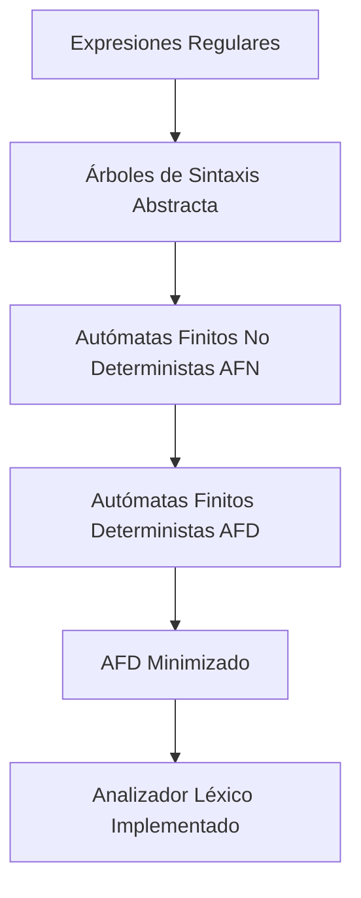
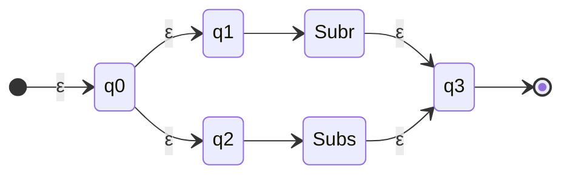
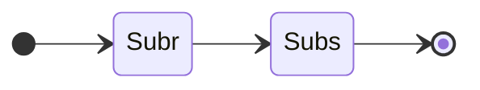
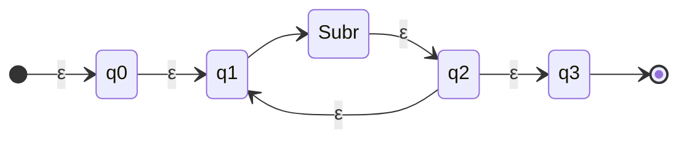

# Compiladores - Análisis léxico

## 2.4 Construcción del analizador léxico a partir de expresiones regulares.

---

La construcción de un analizador léxico a partir de expresiones regulares es un proceso sistemático que transforma especificaciones textuales de tokens en un autómata finito capaz de reconocerlos eficientemente. Este proceso es fundamental en la implementación de compiladores y sigue algoritmos bien establecidos.

### Proceso general de construcción



### Algoritmo de Thompson: De ER a AFN

El algoritmo de Thompson construye un AFN a partir de una expresión regular mediante construcción recursiva.

#### Base:

- Para $ε$:

  ```mermaid
  stateDiagram-v2
      direction LR
      q0 --> q1: ε
  ```

- Para $a ∈ Σ$:
  ```mermaid
  stateDiagram-v2
      direction LR
      q0 --> q1: a
  ```

#### Paso recursivo:

##### Para r|s:



##### Para rs:



##### Para r*:



### Implementación del algoritmo de Thompson

```python
class State:
    def __init__(self, is_end=False):
        self.transitions = {}
        self.is_end = is_end
        self.epsilon_transitions = []

class NFA:
    def __init__(self, start, end):
        self.start = start
        self.end = end
        end.is_end = True

def thompson_construction(regex):
    stack = []

    for char in regex:
        if char == '|':
            # Alternancia: r|s
            nfa2 = stack.pop()
            nfa1 = stack.pop()

            start = State()
            end = State()

            start.epsilon_transitions.extend([nfa1.start, nfa2.start])
            nfa1.end.epsilon_transitions.append(end)
            nfa2.end.epsilon_transitions.append(end)
            nfa1.end.is_end = False
            nfa2.end.is_end = False

            stack.append(NFA(start, end))

        elif char == '.':
            # Concatenación: rs
            nfa2 = stack.pop()
            nfa1 = stack.pop()

            nfa1.end.epsilon_transitions.append(nfa2.start)
            nfa1.end.is_end = False

            stack.append(NFA(nfa1.start, nfa2.end))

        elif char == '*':
            # Cerradura de Kleene: r*
            nfa = stack.pop()

            start = State()
            end = State()

            start.epsilon_transitions.extend([nfa.start, end])
            nfa.end.epsilon_transitions.extend([nfa.start, end])
            nfa.end.is_end = False

            stack.append(NFA(start, end))

        else:
            # Carácter simple
            start = State()
            end = State()
            start.transitions[char] = end
            stack.append(NFA(start, end))

    return stack.pop()

# Ejemplo: Construir AFN para (a|b)*abb
regex_postfix = "ab|*a.b.b."  # Notación polaca inversa para (a|b)*abb
nfa = thompson_construction(regex_postfix)
```

### Conversión de AFN a AFD: Algoritmo de subconjuntos

El algoritmo de subconjuntos convierte un AFN en un AFD mediante la construcción de subconjuntos.

#### Algoritmo:

```
AFD = {}
Por procesar = {ε-clausura(AFN.inicio)}
Mientras Por procesar no esté vacío:
    S = sacar un conjunto de Por procesar
    Para cada símbolo a en Σ:
        S' = ε-clausura(mover(S, a))
        Si S' no está en AFD:
            Añadir S' a Por procesar
        AFD[S][a] = S'
```

#### Implementación:

```python
def epsilon_closure(states):
    closure = set(states)
    stack = list(states)

    while stack:
        state = stack.pop()
        for next_state in state.epsilon_transitions:
            if next_state not in closure:
                closure.add(next_state)
                stack.append(next_state)

    return closure

def move(states, char):
    result = set()
    for state in states:
        if char in state.transitions:
            result.add(state.transitions[char])
    return result

def nfa_to_dfa(nfa):
    dfa = {}
    alphabet = set()  # Símbolos de entrada

    # Recolectar alfabeto (excluyendo ε)
    def collect_alphabet(state, visited):
        if state in visited:
            return
        visited.add(state)
        for char in state.transitions:
            if char != 'ε':
                alphabet.add(char)
        for next_state in state.epsilon_transitions:
            collect_alphabet(next_state, visited)

    collect_alphabet(nfa.start, set())

    start_set = frozenset(epsilon_closure([nfa.start]))
    unprocessed = [start_set]
    dfa_states = {start_set: 0}
    dfa_transitions = {}
    dfa_accept_states = set()

    state_counter = 1

    while unprocessed:
        current_set = unprocessed.pop()

        for char in alphabet:
            moved = move(current_set, char)
            if not moved:
                continue

            new_set = frozenset(epsilon_closure(moved))

            if new_set not in dfa_states:
                dfa_states[new_set] = state_counter
                unprocessed.append(new_set)
                state_counter += 1

            # Verificar si es estado de aceptación
            if any(state.is_end for state in new_set):
                dfa_accept_states.add(dfa_states[new_set])

            # Guardar transición
            if dfa_states[current_set] not in dfa_transitions:
                dfa_transitions[dfa_states[current_set]] = {}
            dfa_transitions[dfa_states[current_set]][char] = dfa_states[new_set]

    return dfa_transitions, dfa_accept_states, dfa_states[start_set]

# Convertir el AFN anterior a AFD
dfa_transitions, dfa_accept_states, start_state = nfa_to_dfa(nfa)
```

### Minimización de AFD: Algoritmo de partición

El algoritmo de partición minimiza un AFD agrupando estados equivalentes.

```python
def minimize_dfa(transitions, accept_states, states):
    # Partición inicial: estados de aceptación vs no aceptación
    partition = [set(accept_states), set(states) - set(accept_states)]

    changed = True
    while changed:
        changed = False
        new_partition = []

        for group in partition:
            if len(group) <= 1:
                new_partition.append(group)
                continue

            # Dividir el grupo según transiciones
            subgroups = {}
            for state in group:
                signature = tuple()
                for char in sorted(alphabet):
                    next_state = transitions.get(state, {}).get(char, None)
                    # Encontrar a qué grupo pertenece next_state
                    group_index = None
                    for i, g in enumerate(partition):
                        if next_state in g:
                            group_index = i
                            break
                    signature += (group_index,)

                if signature not in subgroups:
                    subgroups[signature] = set()
                subgroups[signature].add(state)

            if len(subgroups) > 1:
                changed = True
                new_partition.extend(subgroups.values())
            else:
                new_partition.append(group)

        partition = new_partition

    # Crear AFD minimizado
    minimized_transitions = {}
    state_mapping = {}

    for i, group in enumerate(partition):
        representative = next(iter(group))
        state_mapping[representative] = i

        if representative in accept_states:
            minimized_accept_states.add(i)

    for group in partition:
        representative = next(iter(group))
        minimized_transitions[state_mapping[representative]] = {}

        for char in alphabet:
            if representative in transitions and char in transitions[representative]:
                next_state = transitions[representative][char]
                minimized_transitions[state_mapping[representative]][char] = state_mapping[next_state]

    return minimized_transitions, minimized_accept_states, state_mapping[start_state]

# Minimizar el AFD
minimized_dfa, minimized_accept, minimized_start = minimize_dfa(
    dfa_transitions, dfa_accept_states, set(dfa_transitions.keys())
)
```

### Implementación final del analizador léxico

```python
class Lexer:
    def __init__(self, dfa_transitions, accept_states, start_state, token_types):
        self.transitions = dfa_transitions
        self.accept_states = accept_states
        self.current_state = start_state
        self.start_state = start_state
        self.token_types = token_types  # Mapeo de estados a tipos de token
        self.buffer = ""
        self.position = 0

    def reset(self):
        self.current_state = self.start_state
        self.buffer = ""

    def get_next_token(self, input_string):
        self.reset()
        start_position = self.position
        last_accept_position = -1
        last_accept_state = None

        while self.position < len(input_string):
            char = input_string[self.position]

            if self.current_state in self.transitions and char in self.transitions[self.current_state]:
                self.current_state = self.transitions[self.current_state][char]
                self.buffer += char

                if self.current_state in self.accept_states:
                    last_accept_position = self.position
                    last_accept_state = self.current_state

                self.position += 1
            else:
                break

        if last_accept_position != -1:
            # Token reconocido
            token_value = input_string[start_position:last_accept_position + 1]
            token_type = self.token_types.get(last_accept_state, "UNKNOWN")
            self.position = last_accept_position + 1
            return (token_type, token_value, start_position)
        else:
            # Error léxico
            raise SyntaxError(f"Error léxico en posición {start_position}: '{input_string[start_position]}'")

    def tokenize(self, input_string):
        tokens = []
        self.position = 0

        while self.position < len(input_string):
            if input_string[self.position].isspace():
                self.position += 1
                continue

            token = self.get_next_token(input_string)
            tokens.append(token)

        return tokens

# Configurar el lexer para nuestros tokens
token_types = {
    1: "IDENTIFIER",    # Estado para identificadores
    2: "NUMBER",        # Estado para números
    3: "OPERATOR",      # Estado para operadores
    # ... más mapeos de estados a tipos de token
}

lexer = Lexer(minimized_dfa, minimized_accept, minimized_start, token_types)
code = "x = 25 + y * 3"
tokens = lexer.tokenize(code)
for token in tokens:
    print(token)
```

### Ejercicios propuestos

1. **Implementar el algoritmo de Thompson completo**: Extiende la implementación para manejar los operadores `+` (una o más) y `?` (opcional).

2. **Construir AFD para expresiones regulares complejas**:
   - Implementa la construcción para la ER: `(a|b)*a(a|b)(a|b)`
   - Visualiza los AFN y AFD resultantes

3. **Analizar complejidad**: Calcula la complejidad temporal y espacial del algoritmo de subconjuntos.

4. **Implementar minimización de AFD**: Completa la implementación del algoritmo de partición con todas las optimizaciones.

5. **Generar código de escaneo**: Desarrolla un generador que produzca código C o Python a partir de un AFD minimizado.

6. **Manejar conflictos de tokens**: Implementa un mecanismo para resolver conflicts cuando múltiples tokens pueden coincidir con la misma cadena.

### Consideraciones de optimización

1. **Tablas de transiciones comprimidas**: Usar representaciones eficientes para tablas sparse.
2. **Simulación directa de AFN**: Para algunos casos, puede ser más eficiente simular el AFN que convertirlo a AFD.
3. **Algoritmo de Hopcroft**: Implementa este algoritmo más eficiente para minimización de AFD.

### Referencias

1. Aho, A. V., Lam, M. S., Sethi, R., & Ullman, J. D. (2007). Compilers: Principles, Techniques, and Tools (2nd ed.). Pearson Education. (Capítulo 3: Sección 3.6 - Finite Automata)

2. Cooper, K. D., & Torczon, L. (2004). Engineering a Compiler. Morgan Kaufmann. (Capítulo 2: Sección 2.4 - From Regular Expression to Scanner)

3. Scott, M. L. (2009). Programming Language Pragmatics. Morgan Kaufmann. (Sección 2.2.2: Finite Automata)

4. Hopcroft, J. E., Motwani, R., & Ullman, J. D. (2006). Introduction to Automata Theory, Languages, and Computation (3rd ed.). Pearson Education. (Capítulo 3: Regular Expressions and Languages)

5. Grune, D., Bal, H. E., Jacobs, C. J. H., & Langendoen, K. G. (2000). Modern Compiler Design. John Wiley & Sons. (Capítulo 2: Sección 2.2 - From Regular Expressions to Scanners)

### Conclusión

La construcción de analizadores léxicos a partir de expresiones regulares es un proceso bien definido que involucra la conversión de ER a AFN, luego a AFD, y finalmente la minimización del AFD. Este enfoque sistemático permite crear analizadores eficientes y correctos que forman la base de cualquier compilador moderno. La implementación práctica requiere cuidadosas consideraciones de eficiencia y manejo de casos especiales.
