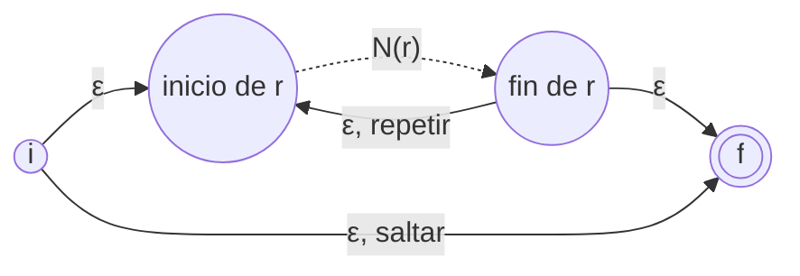
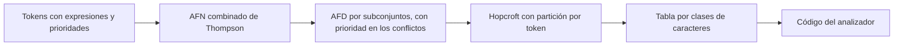

# Compiladores - Análisis léxico

## 2.4 Construcción del analizador léxico a partir de expresiones regulares.

---

Un generador de analizadores léxicos, como lex o flex, recibe la lista de tokens con sus expresiones regulares y produce un programa que los reconoce. Lo hace con tres algoritmos clásicos: la **construcción de Thompson**, que convierte cada expresión en un autómata no determinista; la **construcción de subconjuntos**, que lo convierte en uno determinista, y la **minimización**, que reduce sus estados al mínimo. Este tema presenta los tres, con sus demostraciones y su complejidad, la forma de combinar varios tokens con prioridades y la generación del código del analizador, usando el motor de autómatas del tema 2.3.

### Construcción de Thompson

Para cada expresión $r$ se construye un AFN $N(r)$ con un solo estado inicial, sin transiciones de entrada, y un solo estado final, sin transiciones de salida. Las reglas son:

- **Casos base:** para $\varepsilon$ y para cada $a,$ dos estados unidos por una transición $\varepsilon$ o $a;$
- **Unión:** para $r \mid s,$ un estado inicial nuevo con transiciones $\varepsilon$ a los iniciales de $N(r)$ y $N(s),$ y un final nuevo al que llegan con $\varepsilon$ sus dos finales;
- **Concatenación:** para $rs,$ el final de $N(r)$ se funde con el inicial de $N(s);$
- **Cerradura:** para $r^*,$ un inicial y un final nuevos; $\varepsilon$ del inicial al de $N(r)$ y al final nuevo, y del final de $N(r)$ al inicial de $N(r),$ para repetir, y al final nuevo;
- **Una o más, y opcional:** $r^+$ y $r?$ se construyen como la cerradura, sin la transición que se salta $N(r)$ en el caso de $r^+,$ y sin la que repite en el caso de $r?.$



**Proposición.** $N(r)$ reconoce $L(r)$ y tiene a lo más $2|r|$ estados, donde $|r|$ es el número de símbolos y operadores de $r;$ cada estado tiene a lo más dos transiciones de salida.

*Demostración.* Por inducción sobre $r.$ Los casos base son inmediatos. En la unión, un camino del inicial al final pasa exactamente por uno de los dos autómatas, así que reconoce $L(r) \cup L(s);$ en la concatenación, todo camino recorre $N(r)$ y después $N(s);$ en la cerradura, un camino que da $k$ vueltas por $N(r)$ reconoce una cadena de $L(r)^k,$ y el salto da $\varepsilon.$ Que el inicial no tenga entradas ni el final salidas garantiza que las construcciones no creen caminos indeseados. Cada operador y cada símbolo agrega a lo más dos estados, y fundir en la concatenación no agrega ninguno. $\blacksquare$

### Construcción de subconjuntos

Un estado del AFD representa el **conjunto** de estados en que podría estar el AFN. Con la **cerradura** $\varepsilon\text{-cierre}(T),$ los estados alcanzables desde $T$ por transiciones $\varepsilon,$ y $\text{mueve}(T, a),$ los alcanzables con una transición $a:$

1. el estado inicial es $\varepsilon\text{-cierre}(\{q_0\});$
2. para cada estado $T$ sin procesar y cada símbolo $a,$ $U = \varepsilon\text{-cierre}(\text{mueve}(T, a));$ si $U$ es nuevo, se agrega, y se registra $\delta_D(T, a) = U;$
3. un estado del AFD acepta si contiene un estado final del AFN.

Por inducción sobre la longitud de $w,$ el estado al que llega el AFD con $w$ es exactamente el conjunto de estados a los que llega el AFN, así que ambos aceptan el mismo lenguaje. El AFD puede tener hasta $2^{|Q|}$ estados, y la cota se alcanza: para $(a \mid b)^*a(a \mid b)^{n-1},$ el autómata debe recordar los últimos $n$ símbolos, y todo AFD que lo reconozca tiene al menos $2^n$ estados, porque dos cadenas de longitud $n$ distintas difieren en alguna posición $i,$ y agregar $i - 1$ símbolos hace que una se acepte y la otra no.

### Minimización

Dos estados son **equivalentes** si, para toda cadena $w,$ ambos llegan a aceptación o ambos no. El AFD mínimo, único salvo el nombre de los estados por el teorema de Myhill y Nerode, se obtiene fundiendo los estados equivalentes. Los algoritmos refinan una partición:

- **Moore:** parte de la partición inicial y la refina dividiendo cada bloque según a qué bloques van sus estados con cada símbolo, hasta que no cambia; cuesta $O(|\Sigma| n^2).$
- **Hopcroft:** usa cada bloque como **divisor**: los estados que con un símbolo entran al divisor se separan de los que no; al dividir un bloque que no está pendiente, basta agregar la mitad **menor** como divisor nuevo, porque la mayor se puede deducir. Como cada estado pertenece a lo más a $\log_2 n$ mitades menores, cuesta $O(|\Sigma| n \log n).$

Para un analizador léxico, la partición inicial no es aceptación contra rechazo: los estados de aceptación se separan **por el token que aceptan**, porque un estado que acepta `IF` y uno que acepta `ID` no son intercambiables aunque acepten el mismo lenguaje.

### Varios tokens y conflictos

Para la especificación $(t_1, r_1), \ldots, (t_k, r_k),$ se construye un AFN con un estado inicial nuevo unido por $\varepsilon$ a los $N(r_i),$ y cada final recuerda su token. Un estado del AFD puede contener finales de varios tokens: es un **conflicto**, y se resuelve a favor del token listado primero, como en lex. El analizador combina las dos reglas: el **lexema más largo** decide dónde termina el token, y la **prioridad** decide cuál es cuando varios reconocen el mismo lexema. Un token que no gana en ningún estado nunca se reconoce, y flex lo advierte con el aviso "rule cannot be matched".

Para que la tabla quede pequeña, los caracteres se agrupan en **clases de equivalencia**, los que aparecen en las mismas etiquetas del AFN, y la tabla tiene una columna por clase en lugar de una por carácter.



### Implementación en Python

El programa usa el motor de autómatas del tema 2.3, que se incluye completo al inicio: Thompson con `+` y `?` directos para el ejercicio 1; los autómatas de $(a \mid b)^*a(a \mid b)(a \mid b)$ para el ejercicio 2; el crecimiento exponencial de los subconjuntos para el 3; Hopcroft, comparado con Moore y con `re` en 300 expresiones aleatorias, y el efecto de la partición inicial, para el 4; un generador de código C a partir del AFD mínimo, que compila el resultado con gcc y lo compara con el analizador en Python, para el 5, y la detección de conflictos y de reglas que nunca ganan, para el 6.

```python
# ===== Núcleo de autómatas: expresión regular -> AFN de Thompson -> AFD -> AFD mínimo -> analizador =====
UNIVERSO = frozenset(chr(c) for c in range(32, 127)) | {"\n", "\t"}

def parsea(er):
    """Analizador descendente de expresiones regulares. Árbol: ('sim', conj) ('eps',) ('alt', a, b)
    ('cat', a, b) ('star', a) ('plus', a) ('opt', a). Admite clases [a-z], [^...], el punto, \\ y ε."""
    pos = 0
    def mira(): return er[pos] if pos < len(er) else None
    def toma():
        nonlocal pos; pos += 1; return er[pos - 1]
    def alternativa():
        n = concatenacion()
        while mira() == "|": toma(); n = ("alt", n, concatenacion())
        return n
    def concatenacion():
        n = None
        while mira() is not None and mira() not in "|)":
            r = repeticion(); n = r if n is None else ("cat", n, r)
        return n if n is not None else ("eps",)
    def repeticion():
        n = atomo()
        while mira() is not None and mira() in "*+?":
            n = ({"*": "star", "+": "plus", "?": "opt"}[toma()], n)
        return n
    def escape(c): return {"n": "\n", "t": "\t"}.get(c, c)
    def atomo():
        c = toma()
        if c == "(":
            n = alternativa()
            if toma() != ")": raise SyntaxError("falta ')'")
            return n
        if c == "ε": return ("eps",)
        if c == ".": return ("sim", UNIVERSO - {"\n"})
        if c == "\\": return ("sim", frozenset(escape(toma())))
        if c == "[":
            negada = mira() == "^"
            if negada: toma()
            conj, primero = set(), True
            while mira() != "]" or primero:
                a = toma(); primero = False
                if a == "\\": a = escape(toma())
                if mira() == "-" and pos + 1 < len(er) and er[pos + 1] != "]":
                    toma(); b = toma()
                    if b == "\\": b = escape(toma())
                    conj |= {chr(x) for x in range(ord(a), ord(b) + 1)}
                else: conj.add(a)
            toma()
            return ("sim", frozenset(UNIVERSO - conj if negada else conj))
        if c in "*+?|)": raise SyntaxError(f"'{c}' inesperado en la posición {pos}")
        return ("sim", frozenset(c))
    arbol = alternativa()
    if pos != len(er): raise SyntaxError(f"'{er[pos]}' inesperado en la posición {pos}")
    return arbol

class AFN:
    """Construcción de Thompson. Concatenar funde el estado final de r con el inicial de s, como en Aho y otros."""
    def __init__(self): self.trans = []            # trans[q] = lista de (conjunto de caracteres o None para ε, destino)
    def nuevo(self): self.trans.append([]); return len(self.trans) - 1
    def arista(self, a, etiqueta, b): self.trans[a].append((etiqueta, b))
    def construye(self, n, s):
        """Construye el fragmento de n que empieza en el estado s; devuelve su estado final."""
        t = n[0]
        if t == "sim": f = self.nuevo(); self.arista(s, n[1], f); return f
        if t == "eps": f = self.nuevo(); self.arista(s, None, f); return f
        if t == "cat": return self.construye(n[2], self.construye(n[1], s))
        if t == "alt":
            i1 = self.nuevo(); e1 = self.construye(n[1], i1)
            i2 = self.nuevo(); e2 = self.construye(n[2], i2)
            f = self.nuevo()
            for i, e in ((i1, e1), (i2, e2)): self.arista(s, None, i); self.arista(e, None, f)
            return f
        i = self.nuevo(); self.arista(s, None, i); e = self.construye(n[1], i); f = self.nuevo()
        if t in ("star", "plus"): self.arista(e, None, i)    # repetir
        if t in ("star", "opt"): self.arista(s, None, f)     # saltarse r
        self.arista(e, None, f)
        return f
    def cierre(self, S):
        pila, C = list(S), set(S)
        while pila:
            q = pila.pop()
            for etq, d in self.trans[q]:
                if etq is None and d not in C: C.add(d); pila.append(d)
        return frozenset(C)
    def mueve(self, S, c): return {d for q in S for etq, d in self.trans[q] if etq is not None and c in etq}

def thompson(espec):
    """espec: lista de (token, expresión) en orden de prioridad. Devuelve el AFN, su inicial y {final: índice}."""
    m = AFN(); q0 = m.nuevo(); finales = {}
    if len(espec) == 1:
        finales[m.construye(parsea(espec[0][1]), q0)] = 0
    else:
        for k, (_, er) in enumerate(espec):
            s = m.nuevo(); m.arista(q0, None, s); finales[m.construye(parsea(er), s)] = k
    return m, q0, finales

def clases(m):
    """Clases de equivalencia de caracteres: dos caracteres son equivalentes si están en las mismas etiquetas."""
    etiquetas = sorted({etq for t in m.trans for etq, _ in t if etq is not None}, key=sorted)
    firma = {}
    for c in sorted(UNIVERSO):
        f = tuple(c in e for e in etiquetas)
        if any(f): firma.setdefault(f, []).append(c)
    return [frozenset(v) for v in sorted(firma.values())]

class AFD:
    def __init__(self, delta, inicial, acepta, clases, tokens):
        self.delta, self.inicial, self.acepta, self.clases, self.tokens = delta, inicial, acepta, clases, tokens
        self.de = {c: k for k, conj in enumerate(clases) for c in conj}
    @property
    def n(self): return 1 + max([self.inicial] + [q for q, _ in self.delta] + list(self.delta.values()))
    def paso(self, q, c):
        k = self.de.get(c)
        return None if k is None else self.delta.get((q, k))
    def acepta_cadena(self, w):
        q = self.inicial
        for c in w:
            q = self.paso(q, c)
            if q is None: return False
        return q in self.acepta
    def tabla(self, nombres=None):
        nombre = nombres or (lambda c: "".join(sorted(c)) if len(c) <= 3 else f"{min(c)}..{max(c)}")
        filas = [["estado"] + [nombre(c) for c in self.clases] + ["acepta"]]
        for q in range(self.n):
            filas.append([("->" if q == self.inicial else "") + str(q)]
                         + [str(self.delta.get((q, k), "-")) for k in range(len(self.clases))]
                         + [self.tokens[self.acepta[q]] if q in self.acepta else "-"])
        anchos = [max(len(f[i]) for f in filas) for i in range(len(filas[0]))]
        return "\n".join("   " + " | ".join(x.rjust(a) for x, a in zip(f, anchos)) for f in filas)

def subconjuntos(m, q0, finales, tokens, traza=None):
    """Construcción de subconjuntos. Un estado acepta el token de mayor prioridad (menor índice) entre sus finales."""
    cl = clases(m); ini = m.cierre({q0}); num = {ini: 0}; pendientes = [ini]; delta = {}; acepta = {}
    while pendientes:
        S = pendientes.pop(0)
        ks = [finales[q] for q in S if q in finales]
        if ks: acepta[num[S]] = min(ks)
        for k, conj in enumerate(cl):
            T = m.cierre(m.mueve(S, next(iter(conj))))
            if not T: continue
            if T not in num: num[T] = len(num); pendientes.append(T)
            delta[(num[S], k)] = num[T]
    if traza is not None: traza.update({v: sorted(k) for k, v in num.items()})
    return AFD(delta, 0, acepta, cl, tokens)

def minimiza(d):
    """Algoritmo de Hopcroft sobre el AFD completado con un estado muerto. La partición inicial separa
    los estados por el token que aceptan, no solo aceptación contra rechazo."""
    n, K = d.n, len(d.clases); muerto = n
    def sig(q, k): return muerto if q == muerto else d.delta.get((q, k), muerto)
    grupos = {}
    for q in range(n + 1): grupos.setdefault(d.acepta.get(q, -1), set()).add(q)
    P = [frozenset(g) for _, g in sorted(grupos.items())]
    inversa = {}
    for q in range(n + 1):
        for k in range(K): inversa.setdefault((sig(q, k), k), set()).add(q)
    bloques = {i: set(g) for i, g in enumerate(P)}            # identificador -> estados
    de = {q: i for i, g in bloques.items() for q in g}
    W = set(bloques)                                          # bloques pendientes de usar como divisores
    while W:
        A = bloques[W.pop()].copy()
        for k in range(K):
            X = set().union(*(inversa.get((q, k), set()) for q in A))   # los que entran a A con k
            tocados = {}
            for q in X: tocados.setdefault(de[q], set()).add(q)
            for b, i in tocados.items():
                if len(i) == len(bloques[b]): continue                # Y contenido en X: no se divide
                nuevo = max(bloques) + 1
                bloques[b] -= i; bloques[nuevo] = i
                for q in i: de[q] = nuevo
                if b in W: W.add(nuevo)
                else: W.add(nuevo if len(i) <= len(bloques[b]) else b)
    P = [frozenset(g) for g in bloques.values()]
    grupo_muerto = next(g for g in P if muerto in g)
    vivos = sorted((g for g in P if g != grupo_muerto), key=min)
    vivos.sort(key=lambda g: (d.inicial not in g, min(g)))          # el inicial primero
    num = {q: i for i, g in enumerate(vivos) for q in g}
    delta = {(num[q], k): num[t] for (q, k), t in d.delta.items() if q in num and t in num}
    acepta = {num[q]: t for q, t in d.acepta.items() if q in num}
    return AFD(delta, num[d.inicial], acepta, d.clases, d.tokens)

def moore(d):
    """Refinamiento de particiones de Moore, más simple y O(k n^2): sirve para verificar a Hopcroft."""
    estados = list(range(d.n)); bloque = {q: d.acepta.get(q, -1) for q in estados}
    while True:
        firma = {q: (bloque[q],) + tuple(bloque.get(d.delta.get((q, k)), None) for k in range(len(d.clases))) for q in estados}
        ids = {f: i for i, f in enumerate(sorted(set(firma.values()), key=repr))}
        nuevo = {q: ids[firma[q]] for q in estados}
        if len(set(nuevo.values())) == len(set(bloque.values())): return len(set(nuevo.values()))
        bloque = nuevo

def compila(espec, minimo=True):
    m, q0, fin = thompson(espec)
    d = subconjuntos(m, q0, fin, [t for t, _ in espec])
    return minimiza(d) if minimo else d

def analiza(d, texto, ignora=()):
    """Analizador guiado por la tabla, con la regla del lexema más largo y retroceso al último estado de aceptación."""
    i, linea, col, salida = 0, 1, 1, []
    while i < len(texto):
        q, j, ultimo = d.inicial, i, None
        while j < len(texto):
            q = d.paso(q, texto[j])
            if q is None: break
            j += 1
            if q in d.acepta: ultimo = (d.acepta[q], j)
        if ultimo is None:
            salida.append(("ERROR", texto[i], linea, col)); fin = i + 1
        else:
            k, fin = ultimo
            if d.tokens[k] not in ignora: salida.append((d.tokens[k], texto[i:fin], linea, col))
        for c in texto[i:fin]:
            linea, col = (linea + 1, 1) if c == "\n" else (linea, col + 1)
        i = fin
    return salida

def equivalentes(er1, er2, alfabeto):
    """Recorre el producto de los dos AFD por anchura; devuelve (True, None) o (False, contraejemplo más corto)."""
    d1, d2 = compila([("T", er1)]), compila([("T", er2)])
    ini = (d1.inicial, d2.inicial); vistos = {ini: ""}; cola = [ini]
    while cola:
        p = cola.pop(0); w = vistos[p]
        if (p[0] in d1.acepta) != (p[1] in d2.acepta): return False, w
        for c in alfabeto:
            s = (None if p[0] is None else d1.paso(p[0], c), None if p[1] is None else d2.paso(p[1], c))
            if s not in vistos: vistos[s] = w + c; cola.append(s)
    return True, None

import random, re, subprocess, tempfile, os

# ---------- Ejercicio 1: Thompson con + y ? ----------
print("ejercicio 1: estados del AFN de Thompson")
for er, reescrita in [("a+", "aa*"), ("a?", "(a|ε)"), ("(ab)+c?", "ab(ab)*(c|ε)"), ("[0-9]+(\\.[0-9]+)?", "[0-9][0-9]*(\\.[0-9][0-9]*|ε)")]:
    n1, n2 = len(thompson([("T", er)])[0].trans), len(thompson([("T", reescrita)])[0].trans)
    print(f"   {er:20} {n1:2} estados | reescrita {reescrita:30} {n2:2} | equivalentes: {equivalentes(er, reescrita, 'abc0123.')[0]}")
m, q0, fin = thompson([("T", "a+")])
print("   AFN de a+:", {q: [("ε" if e is None else "".join(e), d) for e, d in t] for q, t in enumerate(m.trans)})

# ---------- Ejercicio 2: AFN y AFD de (a|b)*a(a|b)(a|b) ----------
ER = "(a|b)*a(a|b)(a|b)"
m, q0, fin = thompson([("T", ER)]); d = subconjuntos(m, q0, fin, ["T"]); md = minimiza(d)
print(f"ejercicio 2: AFN {len(m.trans)} estados, AFD {d.n}, mínimo {md.n}"); print(md.tabla())
print("   el estado mínimo recuerda los últimos 3 símbolos:", {w: md.acepta_cadena(w) for w in ["abb", "aab", "bbabb", "babab", "ab"]})

# ---------- Ejercicio 3: complejidad de los subconjuntos ----------
print("ejercicio 3: (a|b)*a(a|b){n-1}")
for n in range(1, 9):
    er = "(a|b)*a" + "(a|b)" * (n - 1)
    m, q0, fin = thompson([("T", er)]); d = subconjuntos(m, q0, fin, ["T"])
    print(f"   n={n}: AFN {len(m.trans):3} estados | AFD por subconjuntos {d.n:4} | mínimo {minimiza(d).n:4} = 2^{n}")

# ---------- Ejercicio 4: minimización, Hopcroft contra Moore y la partición inicial ----------
random.seed(3)
def aleatoria(p):
    if p == 0: return random.choice("abc")
    op = random.choice("|.*+?")
    if op == "|": return f"({aleatoria(p-1)}|{aleatoria(p-1)})"
    if op == ".": return aleatoria(p - 1) + aleatoria(p - 1)
    return f"({aleatoria(p-1)}){op}"
iguales = ok_re = 0
for _ in range(300):
    er = aleatoria(3); d = compila([("T", er)], minimo=False); md = minimiza(d)
    iguales += md.n == moore(d)
    ok_re += all(md.acepta_cadena(w) == bool(re.fullmatch(er, w))
                 for w in ("".join(random.choice("abc") for _ in range(random.randint(0, 6))) for _ in range(60)))
print(f"ejercicio 4: 300 expresiones aleatorias: Hopcroft y Moore dan el mismo tamaño en {iguales}, coinciden con re en {ok_re}")
E = [("IF", "if"), ("ID", "[a-z]+")]
d = compila(E, minimo=False); md = minimiza(d)
ingenua = minimiza(AFD(d.delta, d.inicial, {q: 0 for q in d.acepta}, d.clases, ["ACEPTA"]))
print(f"   IF e ID: AFD {d.n} estados; mínimo separando tokens {md.n}; mínimo con aceptación contra rechazo {ingenua.n}")
print("   con tokens:", [t[0] for t in analiza(md, "if")], "| ingenuo: 'if' e 'ix' llegan al mismo estado:",
      ingenua.paso(ingenua.paso(0, "i"), "f") == ingenua.paso(ingenua.paso(0, "i"), "x"))

# ---------- Ejercicio 5: generador de código C a partir del AFD mínimo ----------
def genera_c(d):
    def rangos(conj):
        cs = sorted(ord(c) for c in conj); res = []
        for c in cs:
            if res and res[-1][1] == c - 1: res[-1][1] = c
            else: res.append([c, c])
        return " || ".join(f"c == {a}" if a == b else f"(c >= {a} && c <= {b})" for a, b in res)
    L = ["#include <stdio.h>", "#include <string.h>",
         "static const char *TOKEN[] = {" + ", ".join(f'"{t}"' for t in d.tokens) + "};",
         "/* devuelve el token del lexema más largo que empieza en s[i] y su fin en *fin, o -1 */",
         "static int siguiente(const char *s, int i, int *fin) {",
         "    int q = %d, ultimo = -1;" % d.inicial,
         "    for (int j = i; s[j]; j++) {", "        int c = (unsigned char)s[j], p = -1;", "        switch (q) {"]
    for q in range(d.n):
        L.append(f"        case {q}:")
        for k, conj in enumerate(d.clases):
            if (q, k) in d.delta: L.append(f"            if ({rangos(conj)}) p = {d.delta[(q, k)]};")
        L.append("            break;")
    L += ["        }", "        if (p < 0) break;", "        q = p;", "        switch (q) {"]
    for q, t in sorted(d.acepta.items()): L.append(f"        case {q}: ultimo = {t}; *fin = j + 1; break;")
    L += ["        }", "    }", "    return ultimo;", "}",
          "int main(void) {", "    char s[4096]; size_t n = fread(s, 1, sizeof s - 1, stdin); s[n] = 0;",
          "    for (int i = 0, fin; s[i]; ) {",
          "        int t = siguiente(s, i, &fin);",
          "        if (t < 0) { printf(\"ERROR %c\\n\", s[i]); i++; continue; }",
          "        if (strcmp(TOKEN[t], \"ESPACIO\")) printf(\"%s %.*s\\n\", TOKEN[t], fin - i, s + i);",
          "        i = fin;", "    }", "    return 0;", "}"]
    return "\n".join(L)
ESPEC = [("IF", "if"), ("WHILE", "while"), ("ID", "[a-zA-Z_][a-zA-Z0-9_]*"), ("NUM", "[0-9]+(\\.[0-9]+)?"),
         ("OP", "==|=|<=|<|\\+|-"), ("PUNT", "[(){};]"), ("ESPACIO", "[ \\t\\n]+")]
lex = compila(ESPEC); fuente = genera_c(lex)
entrada = "while (x <= 10) { if (x == y) x = x + 1.5; } $"
with tempfile.TemporaryDirectory() as tmp:
    open(os.path.join(tmp, "lex.c"), "w").write(fuente)
    avisos = subprocess.run(["gcc", "-O2", "-Wall", "-Wextra", "-o", os.path.join(tmp, "lex"), os.path.join(tmp, "lex.c")],
                            check=True, capture_output=True, text=True).stderr
    salida_c = subprocess.run([os.path.join(tmp, "lex")], input=entrada, capture_output=True, text=True).stdout.split("\n")[:-1]
salida_py = [f"{t} {v}" for t, v, _, _ in analiza(lex, entrada, ignora=("ESPACIO",))]
print(f"ejercicio 5: AFD mínimo de {lex.n} estados -> {len(fuente.splitlines())} líneas de C; avisos de gcc -Wall -Wextra: {len(avisos.splitlines())}")
print("   ", " | ".join(salida_c)); print("    igual al analizador en Python:", salida_c == salida_py)

# ---------- Ejercicio 6: conflictos entre tokens ----------
def conflictos(espec):
    m, q0, fin = thompson(espec); traza = {}
    d = subconjuntos(m, q0, fin, [t for t, _ in espec], traza)
    choques = sorted({tuple(sorted({espec[fin[q]][0] for q in S if q in fin})) for S in traza.values()
                      if len({fin[q] for q in S if q in fin}) > 1})
    inalcanzables = [t for k, (t, _) in enumerate(espec) if k not in d.acepta.values()]
    return choques, inalcanzables
for espec in [[("IF", "if"), ("ID", "[a-z]+")], [("ID", "[a-z]+"), ("IF", "if")],
              [("ASIGNA", "="), ("IGUAL", "=="), ("NUM", "[0-9]+"), ("REAL", "[0-9]+(\\.[0-9]*)?")]]:
    c, inal = conflictos(espec)
    print("ejercicio 6:", [t for t, _ in espec], "conflictos resueltos por prioridad:", c, "| reglas que nunca ganan:", inal)
```

Salida, con gcc 13:

```text
ejercicio 1: estados del AFN de Thompson
   a+                    4 estados | reescrita aa*                             5 | equivalentes: True
   a?                    4 estados | reescrita (a|ε)                           6 | equivalentes: True
   (ab)+c?               8 estados | reescrita ab(ab)*(c|ε)                   12 | equivalentes: True
   [0-9]+(\.[0-9]+)?    10 estados | reescrita [0-9][0-9]*(\.[0-9][0-9]*|ε)   14 | equivalentes: True
   AFN de a+: {0: [('ε', 1)], 1: [('a', 2)], 2: [('ε', 1), ('ε', 3)], 3: []}
ejercicio 2: AFN 19 estados, AFD 9, mínimo 8
   estado | a | b | acepta
      ->0 | 1 | 0 |      -
        1 | 2 | 3 |      -
        2 | 4 | 5 |      -
        3 | 6 | 7 |      -
        4 | 4 | 5 |      T
        5 | 6 | 7 |      T
        6 | 2 | 3 |      T
        7 | 1 | 0 |      T
   el estado mínimo recuerda los últimos 3 símbolos: {'abb': True, 'aab': True, 'bbabb': True, 'babab': False, 'ab': False}
ejercicio 3: (a|b)*a(a|b){n-1}
   n=1: AFN   9 estados | AFD por subconjuntos    3 | mínimo    2 = 2^1
   n=2: AFN  14 estados | AFD por subconjuntos    5 | mínimo    4 = 2^2
   n=3: AFN  19 estados | AFD por subconjuntos    9 | mínimo    8 = 2^3
   n=4: AFN  24 estados | AFD por subconjuntos   17 | mínimo   16 = 2^4
   n=5: AFN  29 estados | AFD por subconjuntos   33 | mínimo   32 = 2^5
   n=6: AFN  34 estados | AFD por subconjuntos   65 | mínimo   64 = 2^6
   n=7: AFN  39 estados | AFD por subconjuntos  129 | mínimo  128 = 2^7
   n=8: AFN  44 estados | AFD por subconjuntos  257 | mínimo  256 = 2^8
ejercicio 4: 300 expresiones aleatorias: Hopcroft y Moore dan el mismo tamaño en 300, coinciden con re en 300
   IF e ID: AFD 4 estados; mínimo separando tokens 4; mínimo con aceptación contra rechazo 2
   con tokens: ['IF'] | ingenuo: 'if' e 'ix' llegan al mismo estado: True
ejercicio 5: AFD mínimo de 16 estados -> 157 líneas de C; avisos de gcc -Wall -Wextra: 0
    WHILE while | PUNT ( | ID x | OP <= | NUM 10 | PUNT ) | PUNT { | IF if | PUNT ( | ID x | OP == | ID y | PUNT ) | ID x | OP = | ID x | OP + | NUM 1.5 | PUNT ; | PUNT } | ERROR $
    igual al analizador en Python: True
ejercicio 6: ['IF', 'ID'] conflictos resueltos por prioridad: [('ID', 'IF')] | reglas que nunca ganan: []
ejercicio 6: ['ID', 'IF'] conflictos resueltos por prioridad: [('ID', 'IF')] | reglas que nunca ganan: ['IF']
ejercicio 6: ['ASIGNA', 'IGUAL', 'NUM', 'REAL'] conflictos resueltos por prioridad: [('NUM', 'REAL')] | reglas que nunca ganan: []
```

### Ejercicios Propuestos

1. **Thompson completo.** Extiende la construcción para manejar los operadores `+`, una o más, y `?`, opcional.

2. **Expresiones complejas.** Construye el AFN y el AFD de la expresión `(a|b)*a(a|b)(a|b)`.

3. **Complejidad.** Calcula la complejidad temporal y espacial del algoritmo de subconjuntos.

4. **Minimización.** Implementa completo el algoritmo de partición, con sus optimizaciones.

5. **Generación de código.** Desarrolla un generador que produzca código C o Python a partir de un AFD minimizado.

6. **Conflictos entre tokens.** Implementa un mecanismo para resolver los conflictos cuando varios tokens pueden coincidir con la misma cadena.

### Soluciones

**Ejercicio 1.** El programa implementa `+` y `?` como reglas propias, con un inicial y un final nuevos: $r^+$ tiene la transición de repetición y no la de salto, y $r?$ la de salto y no la de repetición. Reescribirlos como $rr^*$ y $r \mid \varepsilon$ también es correcto, pero más costoso: $rr^*$ **copia** el autómata de $r,$ lo que con expresiones anidadas puede multiplicar el tamaño, y en los ejemplos las reglas directas ahorran de 1 a 4 estados, con autómatas equivalentes según la prueba de equivalencia del tema 2.3. El AFN de `a+` tiene 4 estados: $0 \to 1$ con $\varepsilon,$ $1 \to 2$ con $a,$ y de 2 una transición $\varepsilon$ de regreso a 1 y otra al final, 3.

**Ejercicio 2.** El AFN tiene 19 estados: 8 de $(a \mid b)^*,$ 1 de la $a$ y 5 de cada $(a \mid b),$ porque la concatenación funde estados. El AFD por subconjuntos tiene 9 y el mínimo 8, que corresponden a los $2^3$ posibles valores de los últimos tres símbolos leídos, con el estado inicial equivalente a haber leído `bbb`; aceptan los cuatro en que el antepenúltimo es $a,$ los estados 4 a 7 de la tabla. Leer un símbolo desplaza la ventana: desde el estado que representa $xyz,$ el símbolo $c$ lleva al que representa $yzc.$

**Ejercicio 3.** Si el AFN tiene $n$ estados y el alfabeto $k$ símbolos, el AFD tiene a lo más $2^n$ estados, y para cada uno se calcula, con cada símbolo, un movimiento y una cerradura, en $O(n^2)$ con una representación por conjuntos, o en $O(n)$ con el AFN de Thompson, que tiene a lo más dos transiciones por estado. El tiempo es $O(2^n k n)$ y el espacio de la tabla $O(2^n k).$ La cota es alcanzable: con $(a \mid b)^*a(a \mid b)^{n-1},$ el AFN crece linealmente, $5n + 4$ estados, y el AFD mínimo tiene exactamente $2^n,$ como muestra el programa hasta $n = 8.$ En la práctica, para los tokens de un lenguaje de programación, el AFD tiene un tamaño parecido al del AFN, y cuando no es así, se puede simular el AFN directamente o construir el AFD de forma perezosa, solo con los estados que la entrada visita, como hacen RE2 y grep.

**Ejercicio 4.** El programa implementa Hopcroft con el AFD completado con un estado muerto, para que la función de transición sea total; una tabla inversa, que para cada estado y símbolo da los estados que llegan a él, y la regla de la mitad menor. En 300 expresiones aleatorias da el mismo número de estados que el algoritmo de Moore, y el AFD mínimo coincide con `re`. Para `IF` e `ID`, el mínimo con la partición por token tiene 4 estados, y con la partición ingenua de aceptación contra rechazo solo 2, porque `if` e `ix` llegan al mismo estado: el analizador ya no sabría distinguir la palabra reservada. Otras optimizaciones son eliminar antes los estados inalcanzables y comprimir la tabla resultante, por ejemplo con las clases de caracteres o con el esquema de filas desplazadas que usa flex.

**Ejercicio 5.** El generador produce una función `siguiente` con un `switch` sobre el estado, en el que cada transición es una condición sobre rangos de caracteres, calculados a partir de las clases, y un segundo `switch` que registra el último estado de aceptación: el **código dirigido** que producen re2c y Ragel, en lugar de una tabla que se interpreta, como flex. Para los 7 tokens de la especificación, el AFD mínimo de 16 estados produce 157 líneas de C, que gcc compila sin avisos con `-Wall -Wextra`; con la misma entrada, el programa en C y el analizador en Python producen los mismos 21 tokens, incluido el error del `$`. El código dirigido evita los accesos a memoria de la tabla y suele ser más rápido, pero crece más con autómatas grandes.

**Ejercicio 6.** El programa detecta los conflictos inspeccionando los estados del AFD que contienen finales de varios tokens. Con `IF` antes de `ID`, el estado al que lleva `if` contiene los dos, y gana `IF`; con el orden contrario, el conflicto es el mismo pero gana `ID`, y `IF` **nunca** se reconoce, lo que el programa reporta como en flex. En la tercera especificación, `ASIGNA` e `IGUAL` no chocan, porque sus lexemas son distintos y los separa el lexema más largo, mientras que `NUM` y `REAL` reconocen los mismos enteros y la prioridad decide que `42` sea `NUM`. Otras políticas posibles son reportar el conflicto como error, como hacen algunos generadores, o resolverlo después, con la tabla de palabras reservadas.

En el material original, la conversión de subconjuntos solo marcaba como de aceptación a los estados a los que se llegaba con una transición, de modo que no detectaba que el estado inicial acepta, como en `a*`; la minimización usaba las variables `minimized_accept_states`, `alphabet` y `start_state` sin definirlas, de modo que fallaba al ejecutarse, y partía de aceptación contra rechazo, lo que funde los estados de tokens distintos; el analizador final asociaba los tokens a los números de estado 1, 2 y 3 sin relación con el autómata construido. Usaba `.` como operador de concatenación en la notación posfija, lo que impide escribir un punto literal, y decía "conflicts" por "conflictos".

### Referencias

1. Aho, A. V., Lam, M. S., Sethi, R., and Ullman, J. D., _Compilers: Principles, Techniques, and Tools_. 2a ed., Pearson, 2007. Secciones 3.7 a 3.9.
2. Thompson, K., Regular expression search algorithm. _Communications of the ACM_ 11(6), 1968.
3. Hopcroft, J. E., An $n \log n$ algorithm for minimizing states in a finite automaton. En _Theory of Machines and Computations_, Academic Press, 1971.
4. Cooper, K. D., and Torczon, L., _Engineering a Compiler_. 3a ed., Morgan Kaufmann, 2022. Capítulo 2.
5. Bumbulis, P., and Cowan, D. D., RE2C: a more versatile scanner generator. _ACM LOPLAS_ 2(1-4), 1993.
6. Paxson, V., et al., _Flex, version 2.6_. Manual.
