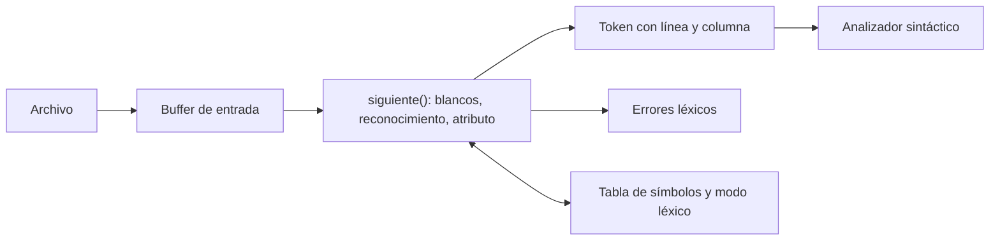

# Compiladores - Análisis léxico

## 2.5 Implementación de analizadores léxicos.

---

Un analizador léxico puede escribirse **a mano**, con un ciclo y una decisión por el primer carácter de cada token; **generarse** con una herramienta como flex, re2c o ANTLR a partir de la especificación, o construirse como un **intérprete de tablas** producidas por el algoritmo del tema 2.4. Los compiladores de producción usan las tres: GCC, Clang, el compilador de Go y el de Rust tienen analizadores escritos a mano, por velocidad y para dar mejores mensajes de error, mientras que muchos lenguajes de dominio específico usan generadores. Este tema presenta las tres formas de implementación, la lectura con buffer, el manejo de errores, los tokens que dependen del contexto, las pruebas y el rendimiento.

### Las tres formas de implementación

- **Escrito a mano:** un procedimiento por clase de token, elegido por el primer carácter, con un carácter de anticipación, a veces dos. Es el más flexible: maneja fácilmente los comentarios anidados, la sangría de Python o los números en varias bases, y produce mensajes precisos. El costo es que la especificación queda dispersa en el código y hay que probarlo con cuidado.
- **Generado:** la especificación es una lista de expresiones regulares con acciones, y el generador produce el autómata. Es correcto por construcción y fácil de modificar, pero los casos que no son regulares, como los comentarios anidados, requieren código en las acciones o **condiciones de inicio**.
- **Guiado por tablas:** un ciclo genérico que consulta la tabla del AFD, como el que producen lex y flex. El **código dirigido**, como el de re2c, compila la tabla a instrucciones `switch` y saltos, y suele ser más rápido.

Las tres comparten la estructura de la función `siguiente()` del analizador: saltar los blancos y los comentarios, recordar la posición de inicio, reconocer el lexema más largo, convertir el atributo y entregar el token con su posición.



### Lectura con buffer

Leer el archivo carácter por carácter con una llamada al sistema por carácter es muy lento. Con un **buffer**, se lee un bloque de $N$ bytes y se recorre en memoria; el problema es que cada avance debe preguntar si se acabó el buffer, una prueba extra por carácter, y que un lexema puede cruzar el fin del bloque. La solución clásica es el **doble buffer con centinelas**: dos mitades de $N$ bytes, cada una terminada en un carácter que no puede aparecer en el programa, el **centinela**. El analizador ya examina cada carácter para decidir la transición, así que el centinela se detecta en la misma prueba, y solo al encontrarlo se decide si hay que recargar la otra mitad o si se acabó el archivo. Mientras un lexema mida menos de $N,$ siempre está completo en las dos mitades. Hoy muchos compiladores leen el archivo completo en memoria, o lo mapean con `mmap`, y lo terminan con un byte nulo que funciona como centinela, como hace Clang.

### Errores léxicos

Los errores que detecta el analizador son los caracteres ilegales, las cadenas, los caracteres y los comentarios sin cerrar, las secuencias de escape inválidas y los números mal formados, como `0x` sin dígitos, `0b102` o `12abc`. El mensaje debe dar la posición donde **empieza** el lexema erróneo: para un comentario sin cerrar, la línea donde se abrió, y no el fin del archivo, donde se detecta. Para recuperarse, el analizador descarta el carácter o el lexema erróneo y continúa, o entrega un token `ERROR` para que el analizador sintáctico decida.

### Tokens que dependen del contexto

Hay lenguajes en que la clase de un lexema depende del contexto:

- **modos léxicos:** dentro de una cadena, de un comentario o de una plantilla, las reglas son otras; flex las implementa con **condiciones de inicio**, y las plantillas de JavaScript, `` `Hola ${nombre}` ``, requieren una **pila** de modos, porque una expresión dentro de la plantilla puede contener otra plantilla;
- **el *lexer hack* de C:** en `T * x;`, `T` es un nombre de tipo si un `typedef` lo declaró, y la sentencia es una declaración; si no, es una multiplicación. El analizador léxico consulta la tabla de símbolos del analizador sintáctico para entregar `NOMBRE_TIPO` o `ID`;
- **palabras reservadas contextuales:** `match` y `case` en Python 3.10, `async` en C# o `override` en C++ son identificadores salvo en ciertas posiciones, y la decisión la toma el analizador sintáctico, que recibe un `ID`;
- **la sangría de Python**, que el analizador convierte en tokens `INDENT` y `DEDENT` con una pila de niveles, como se hace en el tema 2.6.

### Implementación en Python

El programa resuelve los seis ejercicios: un analizador escrito a mano con hexadecimales, binarios, caracteres y comentarios anidados, con errores precisos; un generador que produce, a partir de una especificación, un módulo de Python con las tablas del AFD mínimo, usando el motor de autómatas del tema 2.3, que se incluye al inicio; tres estrategias de lectura, contando lecturas y pruebas; los modos léxicos, el *lexer hack* y una palabra reservada contextual; una batería de 12 pruebas unitarias, y la medición del rendimiento contando los pasos del autómata.

```python
# ===== Núcleo de autómatas: expresión regular -> AFN de Thompson -> AFD -> AFD mínimo -> analizador =====
UNIVERSO = frozenset(chr(c) for c in range(32, 127)) | {"\n", "\t"}

def parsea(er):
    """Analizador descendente de expresiones regulares. Árbol: ('sim', conj) ('eps',) ('alt', a, b)
    ('cat', a, b) ('star', a) ('plus', a) ('opt', a). Admite clases [a-z], [^...], el punto, \\ y ε."""
    pos = 0
    def mira(): return er[pos] if pos < len(er) else None
    def toma():
        nonlocal pos; pos += 1; return er[pos - 1]
    def alternativa():
        n = concatenacion()
        while mira() == "|": toma(); n = ("alt", n, concatenacion())
        return n
    def concatenacion():
        n = None
        while mira() is not None and mira() not in "|)":
            r = repeticion(); n = r if n is None else ("cat", n, r)
        return n if n is not None else ("eps",)
    def repeticion():
        n = atomo()
        while mira() is not None and mira() in "*+?":
            n = ({"*": "star", "+": "plus", "?": "opt"}[toma()], n)
        return n
    def escape(c): return {"n": "\n", "t": "\t"}.get(c, c)
    def atomo():
        c = toma()
        if c == "(":
            n = alternativa()
            if toma() != ")": raise SyntaxError("falta ')'")
            return n
        if c == "ε": return ("eps",)
        if c == ".": return ("sim", UNIVERSO - {"\n"})
        if c == "\\": return ("sim", frozenset(escape(toma())))
        if c == "[":
            negada = mira() == "^"
            if negada: toma()
            conj, primero = set(), True
            while mira() != "]" or primero:
                a = toma(); primero = False
                if a == "\\": a = escape(toma())
                if mira() == "-" and pos + 1 < len(er) and er[pos + 1] != "]":
                    toma(); b = toma()
                    if b == "\\": b = escape(toma())
                    conj |= {chr(x) for x in range(ord(a), ord(b) + 1)}
                else: conj.add(a)
            toma()
            return ("sim", frozenset(UNIVERSO - conj if negada else conj))
        if c in "*+?|)": raise SyntaxError(f"'{c}' inesperado en la posición {pos}")
        return ("sim", frozenset(c))
    arbol = alternativa()
    if pos != len(er): raise SyntaxError(f"'{er[pos]}' inesperado en la posición {pos}")
    return arbol

class AFN:
    """Construcción de Thompson. Concatenar funde el estado final de r con el inicial de s, como en Aho y otros."""
    def __init__(self): self.trans = []            # trans[q] = lista de (conjunto de caracteres o None para ε, destino)
    def nuevo(self): self.trans.append([]); return len(self.trans) - 1
    def arista(self, a, etiqueta, b): self.trans[a].append((etiqueta, b))
    def construye(self, n, s):
        """Construye el fragmento de n que empieza en el estado s; devuelve su estado final."""
        t = n[0]
        if t == "sim": f = self.nuevo(); self.arista(s, n[1], f); return f
        if t == "eps": f = self.nuevo(); self.arista(s, None, f); return f
        if t == "cat": return self.construye(n[2], self.construye(n[1], s))
        if t == "alt":
            i1 = self.nuevo(); e1 = self.construye(n[1], i1)
            i2 = self.nuevo(); e2 = self.construye(n[2], i2)
            f = self.nuevo()
            for i, e in ((i1, e1), (i2, e2)): self.arista(s, None, i); self.arista(e, None, f)
            return f
        i = self.nuevo(); self.arista(s, None, i); e = self.construye(n[1], i); f = self.nuevo()
        if t in ("star", "plus"): self.arista(e, None, i)    # repetir
        if t in ("star", "opt"): self.arista(s, None, f)     # saltarse r
        self.arista(e, None, f)
        return f
    def cierre(self, S):
        pila, C = list(S), set(S)
        while pila:
            q = pila.pop()
            for etq, d in self.trans[q]:
                if etq is None and d not in C: C.add(d); pila.append(d)
        return frozenset(C)
    def mueve(self, S, c): return {d for q in S for etq, d in self.trans[q] if etq is not None and c in etq}

def thompson(espec):
    """espec: lista de (token, expresión) en orden de prioridad. Devuelve el AFN, su inicial y {final: índice}."""
    m = AFN(); q0 = m.nuevo(); finales = {}
    if len(espec) == 1:
        finales[m.construye(parsea(espec[0][1]), q0)] = 0
    else:
        for k, (_, er) in enumerate(espec):
            s = m.nuevo(); m.arista(q0, None, s); finales[m.construye(parsea(er), s)] = k
    return m, q0, finales

def clases(m):
    """Clases de equivalencia de caracteres: dos caracteres son equivalentes si están en las mismas etiquetas."""
    etiquetas = sorted({etq for t in m.trans for etq, _ in t if etq is not None}, key=sorted)
    firma = {}
    for c in sorted(UNIVERSO):
        f = tuple(c in e for e in etiquetas)
        if any(f): firma.setdefault(f, []).append(c)
    return [frozenset(v) for v in sorted(firma.values())]

class AFD:
    def __init__(self, delta, inicial, acepta, clases, tokens):
        self.delta, self.inicial, self.acepta, self.clases, self.tokens = delta, inicial, acepta, clases, tokens
        self.de = {c: k for k, conj in enumerate(clases) for c in conj}
    @property
    def n(self): return 1 + max([self.inicial] + [q for q, _ in self.delta] + list(self.delta.values()))
    def paso(self, q, c):
        k = self.de.get(c)
        return None if k is None else self.delta.get((q, k))
    def acepta_cadena(self, w):
        q = self.inicial
        for c in w:
            q = self.paso(q, c)
            if q is None: return False
        return q in self.acepta
    def tabla(self, nombres=None):
        nombre = nombres or (lambda c: "".join(sorted(c)) if len(c) <= 3 else f"{min(c)}..{max(c)}")
        filas = [["estado"] + [nombre(c) for c in self.clases] + ["acepta"]]
        for q in range(self.n):
            filas.append([("->" if q == self.inicial else "") + str(q)]
                         + [str(self.delta.get((q, k), "-")) for k in range(len(self.clases))]
                         + [self.tokens[self.acepta[q]] if q in self.acepta else "-"])
        anchos = [max(len(f[i]) for f in filas) for i in range(len(filas[0]))]
        return "\n".join("   " + " | ".join(x.rjust(a) for x, a in zip(f, anchos)) for f in filas)

def subconjuntos(m, q0, finales, tokens, traza=None):
    """Construcción de subconjuntos. Un estado acepta el token de mayor prioridad (menor índice) entre sus finales."""
    cl = clases(m); ini = m.cierre({q0}); num = {ini: 0}; pendientes = [ini]; delta = {}; acepta = {}
    while pendientes:
        S = pendientes.pop(0)
        ks = [finales[q] for q in S if q in finales]
        if ks: acepta[num[S]] = min(ks)
        for k, conj in enumerate(cl):
            T = m.cierre(m.mueve(S, next(iter(conj))))
            if not T: continue
            if T not in num: num[T] = len(num); pendientes.append(T)
            delta[(num[S], k)] = num[T]
    if traza is not None: traza.update({v: sorted(k) for k, v in num.items()})
    return AFD(delta, 0, acepta, cl, tokens)

def minimiza(d):
    """Algoritmo de Hopcroft sobre el AFD completado con un estado muerto. La partición inicial separa
    los estados por el token que aceptan, no solo aceptación contra rechazo."""
    n, K = d.n, len(d.clases); muerto = n
    def sig(q, k): return muerto if q == muerto else d.delta.get((q, k), muerto)
    grupos = {}
    for q in range(n + 1): grupos.setdefault(d.acepta.get(q, -1), set()).add(q)
    P = [frozenset(g) for _, g in sorted(grupos.items())]
    inversa = {}
    for q in range(n + 1):
        for k in range(K): inversa.setdefault((sig(q, k), k), set()).add(q)
    bloques = {i: set(g) for i, g in enumerate(P)}            # identificador -> estados
    de = {q: i for i, g in bloques.items() for q in g}
    W = set(bloques)                                          # bloques pendientes de usar como divisores
    while W:
        A = bloques[W.pop()].copy()
        for k in range(K):
            X = set().union(*(inversa.get((q, k), set()) for q in A))   # los que entran a A con k
            tocados = {}
            for q in X: tocados.setdefault(de[q], set()).add(q)
            for b, i in tocados.items():
                if len(i) == len(bloques[b]): continue                # Y contenido en X: no se divide
                nuevo = max(bloques) + 1
                bloques[b] -= i; bloques[nuevo] = i
                for q in i: de[q] = nuevo
                if b in W: W.add(nuevo)
                else: W.add(nuevo if len(i) <= len(bloques[b]) else b)
    P = [frozenset(g) for g in bloques.values()]
    grupo_muerto = next(g for g in P if muerto in g)
    vivos = sorted((g for g in P if g != grupo_muerto), key=min)
    vivos.sort(key=lambda g: (d.inicial not in g, min(g)))          # el inicial primero
    num = {q: i for i, g in enumerate(vivos) for q in g}
    delta = {(num[q], k): num[t] for (q, k), t in d.delta.items() if q in num and t in num}
    acepta = {num[q]: t for q, t in d.acepta.items() if q in num}
    return AFD(delta, num[d.inicial], acepta, d.clases, d.tokens)

def moore(d):
    """Refinamiento de particiones de Moore, más simple y O(k n^2): sirve para verificar a Hopcroft."""
    estados = list(range(d.n)); bloque = {q: d.acepta.get(q, -1) for q in estados}
    while True:
        firma = {q: (bloque[q],) + tuple(bloque.get(d.delta.get((q, k)), None) for k in range(len(d.clases))) for q in estados}
        ids = {f: i for i, f in enumerate(sorted(set(firma.values()), key=repr))}
        nuevo = {q: ids[firma[q]] for q in estados}
        if len(set(nuevo.values())) == len(set(bloque.values())): return len(set(nuevo.values()))
        bloque = nuevo

def compila(espec, minimo=True):
    m, q0, fin = thompson(espec)
    d = subconjuntos(m, q0, fin, [t for t, _ in espec])
    return minimiza(d) if minimo else d

def analiza(d, texto, ignora=()):
    """Analizador guiado por la tabla, con la regla del lexema más largo y retroceso al último estado de aceptación."""
    i, linea, col, salida = 0, 1, 1, []
    while i < len(texto):
        q, j, ultimo = d.inicial, i, None
        while j < len(texto):
            q = d.paso(q, texto[j])
            if q is None: break
            j += 1
            if q in d.acepta: ultimo = (d.acepta[q], j)
        if ultimo is None:
            salida.append(("ERROR", texto[i], linea, col)); fin = i + 1
        else:
            k, fin = ultimo
            if d.tokens[k] not in ignora: salida.append((d.tokens[k], texto[i:fin], linea, col))
        for c in texto[i:fin]:
            linea, col = (linea + 1, 1) if c == "\n" else (linea, col + 1)
        i = fin
    return salida

def equivalentes(er1, er2, alfabeto):
    """Recorre el producto de los dos AFD por anchura; devuelve (True, None) o (False, contraejemplo más corto)."""
    d1, d2 = compila([("T", er1)]), compila([("T", er2)])
    ini = (d1.inicial, d2.inicial); vistos = {ini: ""}; cola = [ini]
    while cola:
        p = cola.pop(0); w = vistos[p]
        if (p[0] in d1.acepta) != (p[1] in d2.acepta): return False, w
        for c in alfabeto:
            s = (None if p[0] is None else d1.paso(p[0], c), None if p[1] is None else d2.paso(p[1], c))
            if s not in vistos: vistos[s] = w + c; cola.append(s)
    return True, None

import io, unittest

# ---------- Ejercicio 1: analizador escrito a mano con hexadecimales, binarios, caracteres y comentarios anidados ----------
class ErrorLexico(Exception): pass
class Lexico:
    RESERVADAS = {"if", "else", "while", "return", "int", "char"}
    ESCAPES = {"n": "\n", "t": "\t", "0": "\0", "\\": "\\", "'": "'", '"': '"'}
    OPS = ["==", "!=", "<=", ">=", "&&", "||", "=", "<", ">", "+", "-", "*", "/", "!", "(", ")", "{", "}", ";", ","]
    def __init__(self, texto): self.t, self.i, self.linea, self.col = texto, 0, 1, 1
    def c(self, k=0): return self.t[self.i + k] if self.i + k < len(self.t) else ""
    def avanza(self, n=1):
        for _ in range(n):
            if self.c() == "\n": self.linea, self.col = self.linea + 1, 1
            else: self.col += 1
            self.i += 1
    def error(self, msg, linea, col): raise ErrorLexico(f"{linea}:{col}: {msg}")
    def blancos(self):
        while True:
            if self.c() in (" ", "\t", "\n") and self.c(): self.avanza()
            elif self.c() == "/" and self.c(1) == "/":
                while self.c() and self.c() != "\n": self.avanza()
            elif self.c() == "/" and self.c(1) == "*":            # comentarios anidados: se cuenta la profundidad
                l, k, prof = self.linea, self.col, 0
                while True:
                    if not self.c(): self.error("comentario sin cerrar", l, k)
                    if self.c() == "/" and self.c(1) == "*": prof += 1; self.avanza(2)
                    elif self.c() == "*" and self.c(1) == "/":
                        prof -= 1; self.avanza(2)
                        if prof == 0: break
                    else: self.avanza()
            else: return
    def numero(self, l, k):
        ini = self.i
        if self.c() == "0" and self.c(1) in "xXbB" and self.c(1):
            base, digitos = (16, "0123456789abcdefABCDEF") if self.c(1) in "xX" else (2, "01")
            self.avanza(2); d = self.i
            while self.c() and self.c() in digitos: self.avanza()
            if self.i == d: self.error(f"faltan dígitos en {self.t[ini:self.i]!r}", l, k)
            if self.c().isalnum(): self.error(f"dígito inválido {self.c()!r} en base {base}", self.linea, self.col)
            return ("ENTERO", int(self.t[d:self.i], base))
        while self.c().isdigit(): self.avanza()
        real = False
        if self.c() == "." and self.c(1).isdigit():
            real = True; self.avanza()
            while self.c().isdigit(): self.avanza()
        if self.c() in ("e", "E") and (self.c(1).isdigit() or self.c(1) in "+-" and self.c(2).isdigit()):
            real = True; self.avanza(2)
            while self.c().isdigit(): self.avanza()
        if self.c().isalpha() or self.c() == "_": self.error(f"número mal formado {self.t[ini:self.i + 1]!r}", l, k)
        lex = self.t[ini:self.i]
        return ("REAL", float(lex)) if real else ("ENTERO", int(lex))
    def caracter(self, l, k):
        self.avanza()
        if self.c() == "\\":
            if self.c(1) not in self.ESCAPES or not self.c(1): self.error(f"escape inválido {self.t[self.i:self.i+2]!r}", l, k)
            v = self.ESCAPES[self.c(1)]; self.avanza(2)
        elif self.c() in ("'", "\n", ""): self.error("carácter vacío o sin cerrar", l, k)
        else: v = self.c(); self.avanza()
        if self.c() != "'": self.error("se esperaba ' para cerrar el carácter", l, k)
        self.avanza(); return ("CARACTER", v)
    def siguiente(self):
        self.blancos(); l, k = self.linea, self.col; c = self.c()
        if not c: return ("FIN", None, l, k)
        if c.isdigit(): tok = self.numero(l, k)
        elif c.isalpha() or c == "_":
            ini = self.i
            while self.c().isalnum() or self.c() == "_": self.avanza()
            lex = self.t[ini:self.i]; tok = (lex.upper(), lex) if lex in self.RESERVADAS else ("ID", lex)
        elif c == "'": tok = self.caracter(l, k)
        else:
            op = next((o for o in self.OPS if self.t.startswith(o, self.i)), None)   # los de dos caracteres van primero
            if op is None: self.error(f"carácter ilegal {c!r}", l, k)
            self.avanza(len(op)); tok = ("OP", op)
        return tok + (l, k)
def tokens(texto):
    lx, res = Lexico(texto), []
    while (t := lx.siguiente())[0] != "FIN": res.append(t[:2])
    return res
print("ejercicio 1:", tokens("x = 0x1A3F + 0b1010; /* uno /* dos */ sigue */ c = '\\n'; d = 'a'; r = 6.02e23"))
for malo in ["0x", "0b102", "12abc", "''", "'\\q'", "/* /* */ abierto", "2e"]:
    try: print(f"   {malo!r:20} ->", tokens(malo))
    except ErrorLexico as e: print(f"   {malo!r:20} -> error {e}")

# ---------- Ejercicio 2: generador de analizadores: de la especificación a un módulo de Python con tablas ----------
def genera_modulo(espec):
    d = compila(espec)
    clase = {c: k for k, conj in enumerate(d.clases) for c in sorted(conj)}
    return "\n".join([
        "# Generado automáticamente: no editar",
        f"TOKENS = {d.tokens!r}",
        f"CLASE = {clase!r}",
        f"DELTA = {dict(sorted(d.delta.items()))!r}",
        f"ACEPTA = {dict(sorted(d.acepta.items()))!r}",
        f"INICIAL = {d.inicial}",
        "def analiza(s, ignora=('ESPACIO',)):",
        "    i, res = 0, []",
        "    while i < len(s):",
        "        q, j, ultimo = INICIAL, i, None",
        "        while j < len(s) and (q, CLASE.get(s[j], -1)) in DELTA:",
        "            q = DELTA[(q, CLASE[s[j]])]; j += 1",
        "            if q in ACEPTA: ultimo = (ACEPTA[q], j)",
        "        if ultimo is None: res.append(('ERROR', s[i])); i += 1; continue",
        "        if TOKENS[ultimo[0]] not in ignora: res.append((TOKENS[ultimo[0]], s[i:ultimo[1]]))",
        "        i = ultimo[1]",
        "    return res"])
ESPEC = [("WHILE", "while"), ("ID", "[a-zA-Z_][a-zA-Z0-9_]*"), ("HEX", "0[xX][0-9a-fA-F]+"), ("NUM", "[0-9]+"),
         ("OP", "[-+*/<>=]|<=|>=|=="), ("PUNT", "[(){};]"), ("ESPACIO", "[ \\t\\n]+")]
fuente = genera_modulo(ESPEC); modulo = {}
exec(compile(fuente, "lexico_generado.py", "exec"), modulo)
print(f"ejercicio 2: módulo generado de {len(fuente.splitlines())} líneas, {len(modulo['DELTA'])} transiciones,",
      f"{len(set(modulo['CLASE'].values()))} clases")
print("   ", modulo["analiza"]("while (n >= 0x10) n = n - 1;"))

# ---------- Ejercicio 3: estrategias de buffering, contando lecturas y comparaciones ----------
class Fuente(io.BytesIO):
    def __init__(self, datos): super().__init__(datos); self.lecturas = 0
    def read(self, n=-1): self.lecturas += 1; return super().read(n)
def caracter_a_caracter(f):
    n = 0
    while f.read(1): n += 1
    return n, 0
def un_buffer(f, N):
    n = comparaciones = 0
    while True:
        b = f.read(N)
        if not b: return n, comparaciones
        i = 0
        while True:
            comparaciones += 1                    # una prueba extra por carácter: ¿se acabó el buffer?
            if i == len(b): break
            n += 1; i += 1
def doble_buffer(f, N):
    """Dos mitades de N bytes con un centinela 0 al final de cada una (Aho y otros, sección 3.2)."""
    mitades = [f.read(N) + b"\0", b""]; actual, i, n, comparaciones = 0, 0, 0, 0
    while True:
        c = mitades[actual][i]; i += 1
        if c == 0:                                # el analizador ya examina c; solo el centinela cuesta una prueba más
            comparaciones += 1
            if i < len(mitades[actual]): return n, comparaciones          # centinela dentro de la mitad: fin del archivo
            otra = 1 - actual; mitades[otra] = f.read(N) + b"\0"; actual, i = otra, 0
            if len(mitades[actual]) == 1: return n, comparaciones
            continue
        n += 1
datos = b"x = y + 42;\n" * 1000
for nombre, fun in [("carácter a carácter", caracter_a_caracter), ("un buffer de 4096", lambda f: un_buffer(f, 4096)),
                    ("doble buffer de 4096", lambda f: doble_buffer(f, 4096))]:
    f = Fuente(datos); n, comp = fun(f)
    print(f"ejercicio 3: {nombre:22} {n} caracteres, {f.lecturas:5} lecturas, {comp:5} pruebas extra de fin de buffer")

# ---------- Ejercicio 4: tokens que dependen del contexto ----------
def plantillas(s):
    """Modos del analizador, como las condiciones de inicio de flex: dentro de `...` el texto es literal hasta ${."""
    modos, res, i, buf = ["CODIGO"], [], 0, ""
    while i < len(s):
        m = modos[-1]
        if m == "PLANTILLA":
            if s[i] == "`": res.append(("TEXTO", buf)) if buf else None; buf = ""; res.append(("FIN_PLANTILLA", "`")); modos.pop(); i += 1
            elif s.startswith("${", i): res.append(("TEXTO", buf)) if buf else None; buf = ""; res.append(("ABRE_EXPR", "${")); modos.append("CODIGO"); i += 2
            else: buf += s[i]; i += 1
        else:
            c = s[i]
            if c == "`": res.append(("INICIO_PLANTILLA", "`")); modos.append("PLANTILLA"); i += 1
            elif c == "}" and len(modos) > 1: res.append(("CIERRA_EXPR", "}")); modos.pop(); i += 1
            elif c.isalnum():
                j = i
                while j < len(s) and s[j].isalnum(): j += 1
                res.append(("ID", s[i:j])); i = j
            elif c == " ": i += 1
            else: res.append(("OP", c)); i += 1
    return res
print("ejercicio 4: plantillas:", plantillas("`Hola ${nombre + `!${n}`}, adiós`"))
def lexer_hack(texto, tipos):
    """En C, 'T * x;' es una declaración si T es un nombre de tipo: el analizador léxico consulta la tabla de símbolos."""
    return [("NOMBRE_TIPO" if t == "ID" and v in tipos else t, v) for t, v in tokens(texto)]
print("   con typedef int T:", lexer_hack("T * x;", {"T"}), "| sin él:", lexer_hack("T * x;", set()))
for l in ["match (x) {", "match = 3;"]:
    t = tokens(l); es_sentencia = t[0][1] == "match" and t[-1] == ("OP", "{")
    print(f"   {l!r:14}: 'match' es", "palabra reservada" if es_sentencia else "identificador")

# ---------- Ejercicio 5: pruebas unitarias ----------
class PruebasLexico(unittest.TestCase):
    def test_hexadecimal(self): self.assertEqual(tokens("0x1A3F"), [("ENTERO", 6719)])
    def test_binario(self): self.assertEqual(tokens("0b1010"), [("ENTERO", 10)])
    def test_reales(self): self.assertEqual(tokens("3.5 1e3 2.5E-2"), [("REAL", 3.5), ("REAL", 1000.0), ("REAL", 0.025)])
    def test_punto_suelto(self): self.assertRaises(ErrorLexico, tokens, "3.x")
    def test_caracteres(self): self.assertEqual(tokens("'a' '\\n' '\\''"), [("CARACTER", "a"), ("CARACTER", "\n"), ("CARACTER", "'")])
    def test_reservadas(self): self.assertEqual(tokens("if ifx"), [("IF", "if"), ("ID", "ifx")])
    def test_lexema_mas_largo(self): self.assertEqual(tokens("a<=b"), [("ID", "a"), ("OP", "<="), ("ID", "b")])
    def test_comentario_anidado(self): self.assertEqual(tokens("/* a /* b */ c */ x"), [("ID", "x")])
    def test_comentario_sin_cerrar(self): self.assertRaises(ErrorLexico, tokens, "/* a /* b */")
    def test_posicion(self):
        lx = Lexico("a\n  b"); lx.siguiente(); self.assertEqual(lx.siguiente()[2:], (2, 3))
    def test_errores(self):
        for malo in ["0x", "0b2", "9z", "''", "@"]:
            with self.subTest(malo=malo): self.assertRaises(ErrorLexico, tokens, malo)
    def test_contra_el_generado(self):
        """Prueba diferencial: el analizador a mano y el generado deben coincidir en las clases comunes."""
        s = "while (n >= 0x10) n = n - 1;"
        mano = [v for _, v in tokens(s)]; generado = [v for _, v in modulo["analiza"](s)]
        self.assertEqual([str(v) for v in mano[:4]], generado[:4])
r = unittest.TestResult(); unittest.TestLoader().loadTestsFromTestCase(PruebasLexico).run(r)
print(f"ejercicio 5: {r.testsRun} pruebas, {len(r.failures)} fallas, {len(r.errors)} errores")
for prueba, traza in r.failures + r.errors: print("   falla:", prueba.id().split(".")[-1], traza.strip().splitlines()[-1])

# ---------- Ejercicio 6: rendimiento, contando pasos del autómata ----------
def pasos(d, s):
    """Transiciones ejecutadas, incluidas las de los caracteres que se releen por el retroceso."""
    i = total = 0
    while i < len(s):
        q, j, ultimo = d.inicial, i, None
        while j < len(s) and (q := d.paso(q, s[j])) is not None:
            j += 1; total += 1
            if q in d.acepta: ultimo = j
        i = ultimo if ultimo else i + 1
    return total
lex = compila(ESPEC)
for n in [100, 1000, 10000]:
    s = ("cuenta = cuenta + 0x1F; " * n)[: 24 * n]
    print(f"ejercicio 6: {len(s):6} caracteres, {pasos(lex, s):6} pasos, {pasos(lex, s) / len(s):.2f} por carácter")
patologico = compila([("A", "a"), ("AB", "a*b")])
for n in [10, 100, 1000]:
    print(f"   tokens a y a*b sobre a^{n}: {pasos(patologico, 'a' * n):7} pasos = n(n+1)/2 = {n * (n + 1) // 2}")
```

Salida:

```text
ejercicio 1: [('ID', 'x'), ('OP', '='), ('ENTERO', 6719), ('OP', '+'), ('ENTERO', 10), ('OP', ';'), ('ID', 'c'), ('OP', '='), ('CARACTER', '\n'), ('OP', ';'), ('ID', 'd'), ('OP', '='), ('CARACTER', 'a'), ('OP', ';'), ('ID', 'r'), ('OP', '='), ('REAL', 6.02e+23)]
   '0x'                 -> error 1:1: faltan dígitos en '0x'
   '0b102'              -> error 1:5: dígito inválido '2' en base 2
   '12abc'              -> error 1:1: número mal formado '12a'
   "''"                 -> error 1:1: carácter vacío o sin cerrar
   "'\\q'"              -> error 1:1: escape inválido '\\q'
   '/* /* */ abierto'   -> error 1:1: comentario sin cerrar
   '2e'                 -> error 1:1: número mal formado '2e'
ejercicio 2: módulo generado de 17 líneas, 91 transiciones, 16 clases
    [('WHILE', 'while'), ('PUNT', '('), ('ID', 'n'), ('OP', '>='), ('HEX', '0x10'), ('PUNT', ')'), ('ID', 'n'), ('OP', '='), ('ID', 'n'), ('OP', '-'), ('NUM', '1'), ('PUNT', ';')]
ejercicio 3: carácter a carácter    12000 caracteres, 12001 lecturas,     0 pruebas extra de fin de buffer
ejercicio 3: un buffer de 4096      12000 caracteres,     4 lecturas, 12003 pruebas extra de fin de buffer
ejercicio 3: doble buffer de 4096   12000 caracteres,     4 lecturas,     3 pruebas extra de fin de buffer
ejercicio 4: plantillas: [('INICIO_PLANTILLA', '`'), ('TEXTO', 'Hola '), ('ABRE_EXPR', '${'), ('ID', 'nombre'), ('OP', '+'), ('INICIO_PLANTILLA', '`'), ('TEXTO', '!'), ('ABRE_EXPR', '${'), ('ID', 'n'), ('CIERRA_EXPR', '}'), ('FIN_PLANTILLA', '`'), ('CIERRA_EXPR', '}'), ('TEXTO', ', adiós'), ('FIN_PLANTILLA', '`')]
   con typedef int T: [('NOMBRE_TIPO', 'T'), ('OP', '*'), ('ID', 'x'), ('OP', ';')] | sin él: [('ID', 'T'), ('OP', '*'), ('ID', 'x'), ('OP', ';')]
   'match (x) {' : 'match' es palabra reservada
   'match = 3;'  : 'match' es identificador
ejercicio 5: 12 pruebas, 0 fallas, 0 errores
ejercicio 6:   2400 caracteres,   2400 pasos, 1.00 por carácter
ejercicio 6:  24000 caracteres,  24000 pasos, 1.00 por carácter
ejercicio 6: 240000 caracteres, 240000 pasos, 1.00 por carácter
   tokens a y a*b sobre a^10:      55 pasos = n(n+1)/2 = 55
   tokens a y a*b sobre a^100:    5050 pasos = n(n+1)/2 = 5050
   tokens a y a*b sobre a^1000:  500500 pasos = n(n+1)/2 = 500500
```

### Ejercicios Propuestos

1. **Extensión.** Añade soporte para:
    - números hexadecimales, como 0x1A3F;
    - números binarios, como 0b1010;
    - caracteres individuales, como `'a'` y `'\n'`;
    - comentarios anidados, `/* ... */`.

2. **Generador.** Crea un programa que genere el código de un analizador léxico a partir de una especificación de tokens.

3. **Buffering.** Implementa y compara diferentes estrategias de lectura con buffer.

4. **Contexto.** Implementa un mecanismo para manejar tokens que dependen del contexto, como las palabras reservadas que cambian según el lenguaje o la posición.

5. **Pruebas unitarias.** Desarrolla un conjunto completo de pruebas para verificar el funcionamiento del analizador léxico.

6. **Rendimiento.** Mide el tiempo de análisis para diferentes tamaños de código fuente e identifica los cuellos de botella.

### Soluciones

**Ejercicio 1.** El procedimiento de los números mira dos caracteres: `0` seguido de `x` o `b` elige la base, exige al menos un dígito y rechaza un carácter alfanumérico que siga, de modo que `0b102` es un error en el `2`, y no el binario `0b10` seguido del entero 2. Los reales exigen un dígito después del punto y del exponente, así que `2e` es un número mal formado, y no un real. Los caracteres admiten un carácter o una secuencia de escape entre comillas simples, y reportan el carácter vacío y el escape inválido. Los comentarios anidados no son un lenguaje regular, porque hay que equilibrar las aperturas con los cierres; el analizador cuenta la **profundidad**, que sube con cada `/*` y baja con cada `*/`, y el comentario termina al volver a 0. Un comentario sin cerrar se reporta en la línea y la columna donde se abrió.

**Ejercicio 2.** El generador compila la especificación con Thompson, subconjuntos y Hopcroft, y escribe un módulo con cuatro tablas, los nombres de los tokens, la clase de cada carácter, las transiciones y los estados de aceptación, más la función genérica `analiza`, que implementa el lexema más largo con retroceso. El módulo de 17 líneas, con 91 transiciones sobre 16 clases de caracteres, se carga con `exec` y analiza la entrada de prueba. Es el esquema de lex: la parte que depende de la especificación son datos, y el ciclo es el mismo para todos los analizadores. Un generador real agrega las **acciones**, código que se ejecuta al reconocer cada token, y comprime las tablas. El tema 2.4 genera la otra variante, el código dirigido en C.

**Ejercicio 3.** Con 12 000 caracteres:

| Estrategia | Lecturas del archivo | Pruebas extra de fin |
| ---------- | -------------------- | -------------------- |
| carácter a carácter | 12 001 | 0 |
| un buffer de 4 096 bytes | 4 | 12 003 |
| doble buffer con centinelas | 4 | 3 |

Leer carácter por carácter hace una llamada al sistema por carácter, miles de veces más cara que un acceso a memoria. Un buffer reduce las lecturas a 4, pero agrega una prueba de fin por carácter; los centinelas la eliminan, porque solo el carácter centinela requiere una prueba adicional, una vez por mitad. El tiempo real depende de la máquina, del sistema operativo y del intérprete, y en Python domina el costo del propio intérprete; en C, la diferencia entre las dos últimas es pequeña pero medible en el ciclo más ejecutado del compilador.

**Ejercicio 4.** El programa implementa tres mecanismos. Las **plantillas** usan una pila de modos: en el modo de plantilla, todo es texto hasta `` ` `` o `${`; `${` apila el modo de código, y `}` lo desapila, de modo que la plantilla anidada de la entrada se analiza correctamente, algo que un autómata finito solo no puede hacer. El ***lexer hack*** recibe el conjunto de nombres de tipo declarados y cambia la clase de `T` según esté o no. La **palabra reservada contextual** `match` se reconoce como identificador, y se decide después, mirando los tokens siguientes: es palabra reservada al inicio de una sentencia `match (x) {`, e identificador en `match = 3;`. Para palabras reservadas que cambian **según el lenguaje**, como los dialectos de SQL o las versiones de un lenguaje, el analizador recibe el conjunto de reservadas como parámetro, como `RESERVADAS` en la clase del ejercicio 1.

**Ejercicio 5.** La batería tiene 12 pruebas, que pasan todas: casos positivos de cada clase, como hexadecimales, binarios, reales y caracteres; casos de las reglas, como el lexema más largo en `a<=b` y la prioridad de las palabras reservadas en `if ifx`; casos de error, con subpruebas para cinco entradas inválidas; las **posiciones**, que son las que más fallan en la práctica, y una **prueba diferencial**, que compara el analizador escrito a mano con el generado sobre la misma entrada. Otras técnicas útiles son las pruebas de **ida y vuelta**, que imprimen los tokens y vuelven a analizarlos, y la generación aleatoria de entradas, *fuzzing*, para encontrar entradas que hagan fallar o ciclar al analizador.

**Ejercicio 6.** En lugar de tiempos, que varían de una ejecución a otra, el programa cuenta las **transiciones** del autómata, que determinan el trabajo: el análisis de un programa típico hace exactamente un paso por carácter, de modo que el tiempo crece linealmente con el tamaño, 2 400, 24 000 y 240 000 pasos. El retroceso puede romper esa linealidad: con los tokens `a` y `a*b`, sobre $a^n$ el autómata recorre toda la entrada buscando una `b` desde cada posición y retrocede, y hace $n(n+1)/2$ pasos, 500 500 para $n = 1000;$ el algoritmo de Reps lo evita recordando las posiciones desde las que ya se sabe que no hay aceptación. Los cuellos de botella habituales, que se encuentran con un perfilador, son la lectura de la entrada, la creación de objetos por token y la búsqueda de las palabras reservadas; las soluciones son leer el archivo completo, entregar los tokens como índices en el texto en lugar de copias, y usar una tabla de dispersión perfecta, como la que genera gperf, para las reservadas.

En el material original, el analizador guiado por tablas tenía la tabla vacía, de modo que fallaba con cualquier entrada, y no recordaba el último estado de aceptación; el comentario de varias líneas sin cerrar se aceptaba en silencio; el número `2e` se reconocía como real, y `main` se trataba como palabra reservada, cuando en C es un identificador. La clase con buffer redefinía `advance` sin actualizar el carácter actual, de modo que el analizador no avanzaba.

### Referencias

1. Aho, A. V., Lam, M. S., Sethi, R., and Ullman, J. D., _Compilers: Principles, Techniques, and Tools_. 2a ed., Pearson, 2007. Secciones 3.2, 3.4 y 3.5.
2. Cooper, K. D., and Torczon, L., _Engineering a Compiler_. 3a ed., Morgan Kaufmann, 2022. Sección 2.5.
3. Appel, A. W., _Modern Compiler Implementation in C_. Cambridge University Press, 1998. Capítulo 2.
4. Reps, T., "Maximal-munch" tokenization in linear time. _ACM TOPLAS_ 20(2), 1998.
5. Schmidt, D. C., GPERF: a perfect hash function generator. _C++ Report_, 1990.
6. The Clang Team, _Clang internals: the Lexer and Preprocessor library_.
