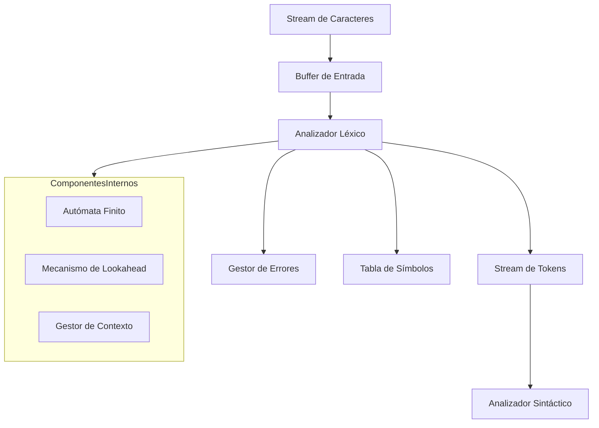

# Compiladores - Análisis léxico

## 2.5 Implementación de analizadores léxicos.

---

La implementación de analizadores léxicos es el proceso de convertir las especificaciones teóricas de tokens en un programa funcional que pueda reconocerlos eficientemente en el código fuente. Existen múltiples enfoques para implementar analizadores léxicos, cada uno con sus ventajas y desventajas.

### Enfoques de implementación

#### 1. Implementación manual (hand-coded)

#### 2. Generadores automáticos (Lex, Flex)

#### 3. Implementación basada en tablas

### Arquitectura general de un analizador léxico



### Implementación manual de un analizador léxico

```python
class TokenType:
    IDENTIFIER = "IDENTIFIER"
    INTEGER = "INTEGER"
    FLOAT = "FLOAT"
    OPERATOR = "OPERATOR"
    KEYWORD = "KEYWORD"
    STRING = "STRING"
    EOF = "EOF"
    DELIMITER = "DELIMITER"

class Token:
    def __init__(self, type, value, line, column):
        self.type = type
        self.value = value
        self.line = line
        self.column = column

    def __str__(self):
        return f"Token({self.type}, '{self.value}', line={self.line}, col={self.column})"

class Lexer:
    def __init__(self, source_code):
        self.source_code = source_code
        self.position = 0
        self.line = 1
        self.column = 1
        self.current_char = self.source_code[0] if self.source_code else None

        # Palabras reservadas
        self.keywords = {
            'if', 'else', 'while', 'for', 'return',
            'int', 'float', 'void', 'main'
        }

    def advance(self):
        """Avanza al siguiente carácter en el código fuente"""
        if self.current_char == '\n':
            self.line += 1
            self.column = 0

        self.position += 1
        self.column += 1

        if self.position >= len(self.source_code):
            self.current_char = None
        else:
            self.current_char = self.source_code[self.position]

    def peek(self, lookahead=1):
        """Mira caracteres adelante sin consumirlos"""
        if self.position + lookahead >= len(self.source_code):
            return None
        return self.source_code[self.position + lookahead]

    def skip_whitespace(self):
        """Omite espacios en blanco y comentarios"""
        while self.current_char is not None:
            if self.current_char.isspace():
                self.advance()
            elif self.current_char == '/' and self.peek() == '/':
                self.skip_single_line_comment()
            elif self.current_char == '/' and self.peek() == '*':
                self.skip_multi_line_comment()
            else:
                break

    def skip_single_line_comment(self):
        """Omite comentarios de una línea"""
        while self.current_char is not None and self.current_char != '\n':
            self.advance()
        if self.current_char == '\n':
            self.advance()

    def skip_multi_line_comment(self):
        """Omite comentarios de múltiples líneas"""
        self.advance()  # Consume '/'
        self.advance()  # Consume '*'

        while self.current_char is not None:
            if self.current_char == '*' and self.peek() == '/':
                self.advance()  # Consume '*'
                self.advance()  # Consume '/'
                break
            self.advance()

    def read_number(self):
        """Lee números enteros o flotantes"""
        result = ''
        start_column = self.column
        is_float = False

        while self.current_char is not None and self.current_char.isdigit():
            result += self.current_char
            self.advance()

        if self.current_char == '.':
            is_float = True
            result += self.current_char
            self.advance()

            while self.current_char is not None and self.current_char.isdigit():
                result += self.current_char
                self.advance()

        # Notación científica
        if self.current_char in ['e', 'E']:
            is_float = True
            result += self.current_char
            self.advance()

            if self.current_char in ['+', '-']:
                result += self.current_char
                self.advance()

            while self.current_char is not None and self.current_char.isdigit():
                result += self.current_char
                self.advance()

        token_type = TokenType.FLOAT if is_float else TokenType.INTEGER
        return Token(token_type, result, self.line, start_column)

    def read_identifier(self):
        """Lee identificadores y palabras reservadas"""
        result = ''
        start_column = self.column

        while (self.current_char is not None and
               (self.current_char.isalnum() or self.current_char == '_')):
            result += self.current_char
            self.advance()

        token_type = TokenType.KEYWORD if result in self.keywords else TokenType.IDENTIFIER
        return Token(token_type, result, self.line, start_column)

    def read_string(self):
        """Lee cadenas entre comillas"""
        start_column = self.column
        delimiter = self.current_char
        self.advance()  # Consume la comilla inicial

        result = ''
        while self.current_char is not None and self.current_char != delimiter:
            if self.current_char == '\\':
                self.advance()  # Consume la barra invertida
                if self.current_char is not None:
                    # Manejar secuencias de escape
                    escape_map = {'n': '\n', 't': '\t', 'r': '\r', '"': '"', '\\': '\\'}
                    result += escape_map.get(self.current_char, self.current_char)
                    self.advance()
            else:
                result += self.current_char
                self.advance()

        if self.current_char == delimiter:
            self.advance()  # Consume la comilla final
        else:
            raise Exception(f"Cadena sin terminar en línea {self.line}")

        return Token(TokenType.STRING, result, self.line, start_column)

    def read_operator(self):
        """Lee operadores (pueden ser de múltiples caracteres)"""
        start_column = self.column
        current_op = self.current_char

        # Operadores de dos caracteres
        two_char_ops = {
            '=': ['=', '=='], '!': ['=', '!='], '<': ['=', '<='],
            '>': ['=', '>='], '&': ['&', '&&'], '|': ['|', '||']
        }

        if current_op in two_char_ops and self.peek() == two_char_ops[current_op][0]:
            op = current_op + two_char_ops[current_op][0]
            self.advance()  # Consume el primer carácter
            self.advance()  # Consume el segundo carácter
            return Token(TokenType.OPERATOR, op, self.line, start_column)
        else:
            # Operador de un carácter
            op = current_op
            self.advance()
            return Token(TokenType.OPERATOR, op, self.line, start_column)

    def get_next_token(self):
        """Obtiene el siguiente token del código fuente"""
        self.skip_whitespace()

        if self.current_char is None:
            return Token(TokenType.EOF, None, self.line, self.column)

        start_column = self.column

        # Identificar el tipo de token basado en el primer carácter
        if self.current_char.isdigit():
            return self.read_number()

        if self.current_char.isalpha() or self.current_char == '_':
            return self.read_identifier()

        if self.current_char in ['"', "'"]:
            return self.read_string()

        if self.current_char in '=!<>&|+-*/%':
            return self.read_operator()

        if self.current_char in '(){}[];,.:':
            # Delimitadores
            char = self.current_char
            self.advance()
            return Token(TokenType.DELIMITER, char, self.line, start_column)

        # Carácter no reconocido
        raise Exception(f"Carácter no reconocido: '{self.current_char}' en línea {self.line}, columna {self.column}")

# Ejemplo de uso
def main():
    code = """
    // Este es un comentario
    int main() {
        float x = 3.14;
        string message = "Hola\\nMundo";
        if (x > 2.5) {
            return 1;
        }
        return 0;
    }
    """

    lexer = Lexer(code)

    try:
        while True:
            token = lexer.get_next_token()
            print(token)
            if token.type == TokenType.EOF:
                break
    except Exception as e:
        print(f"Error: {e}")

if __name__ == "__main__":
    main()
```

### Implementación basada en tablas (Table-Driven Lexer)

```python
class TableDrivenLexer:
    def __init__(self):
        # Tabla de transiciones para un AFD simplificado
        self.transition_table = self.build_transition_table()
        self.accepting_states = {
            2: TokenType.IDENTIFIER,
            4: TokenType.INTEGER,
            6: TokenType.FLOAT,
            8: TokenType.OPERATOR,
            10: TokenType.STRING,
            12: TokenType.DELIMITER
        }

        self.keywords = {'if', 'else', 'while', 'for', 'return', 'int', 'float', 'void'}

    def build_transition_table(self):
        """Construye la tabla de transiciones para el AFD"""
        # Estado 0: estado inicial
        # Estado 1-11: estados intermedios
        # Estado 2,4,6,8,10,12: estados de aceptación

        table = {}
        # Definir transiciones para cada estado y carácter
        # (Implementación simplificada para demostración)
        return table

    def tokenize(self, source_code):
        """Implementación basada en tabla de transiciones"""
        tokens = []
        position = 0
        line = 1
        column = 1
        n = len(source_code)

        while position < n:
            current_state = 0
            start_position = position
            start_line = line
            start_column = column
            lexeme = ''

            while position < n:
                char = source_code[position]
                next_state = self.transition_table.get((current_state, char), -1)

                if next_state == -1:
                    break

                current_state = next_state
                lexeme += char

                if char == '\n':
                    line += 1
                    column = 1
                else:
                    column += 1

                position += 1

            if current_state in self.accepting_states:
                token_type = self.accepting_states[current_state]

                # Verificar si es palabra reservada
                if token_type == TokenType.IDENTIFIER and lexeme in self.keywords:
                    token_type = TokenType.KEYWORD

                tokens.append(Token(token_type, lexeme, start_line, start_column))
            else:
                raise Exception(f"Error léxico en línea {start_line}, columna {start_column}")

        tokens.append(Token(TokenType.EOF, None, line, column))
        return tokens
```

### Técnicas de optimización

#### 1. Buffering de entrada

```python
class BufferedLexer(Lexer):
    def __init__(self, source_code, buffer_size=1024):
        super().__init__(source_code)
        self.buffer_size = buffer_size
        self.buffer = []
        self.buffer_index = 0
        self.load_buffer()

    def load_buffer(self):
        """Carga un buffer de caracteres desde la fuente"""
        start = self.position
        end = min(self.position + self.buffer_size, len(self.source_code))
        self.buffer = list(self.source_code[start:end])
        self.buffer_index = 0

    def advance(self):
        if self.buffer_index >= len(self.buffer) - 1:
            self.load_buffer()
        else:
            self.buffer_index += 1

        # Actualizar posición, línea y columna
        # (Implementación similar a la clase base)
```

#### 2. Lookahead y backtracking limitado

```python
def match_pattern(self, pattern):
    """Intenta hacer match con un patrón específico"""
    saved_position = self.position
    saved_line = self.line
    saved_column = self.column
    saved_char = self.current_char

    for expected_char in pattern:
        if self.current_char != expected_char:
            # Restaurar estado
            self.position = saved_position
            self.line = saved_line
            self.column = saved_column
            self.current_char = saved_char
            return False
        self.advance()

    return True
```

### Manejo de errores léxicos

```python
class ErrorHandler:
    @staticmethod
    def report_lexical_error(line, column, char, message="Carácter no válido"):
        print(f"Error léxico en línea {line}, columna {column}: {message} '{char}'")

    @staticmethod
    def recover_from_error(lexer):
        """Estrategia de recuperación: saltar hasta el siguiente token válido"""
        while (lexer.current_char is not None and
               not lexer.current_char.isspace() and
               not (lexer.current_char.isalnum() or lexer.current_char in '(){}[];,"')):
            lexer.advance()
```

### Ejercicios propuestos

1. **Extender el analizador léxico**: Añade soporte para:
   - Números hexadecimales (0x1A3F)
   - Números binarios (0b1010)
   - Caracteres individuales ('a', '\n')
   - Comentarios anidados /* ... */

2. **Implementar generador de analizadores léxicos**: Crea un programa que genere código de analizador léxico a partir de una especificación de tokens.

3. **Optimizar el rendimiento**: Implementa y compara diferentes estrategias de buffering.

4. **Manejo de contextos sensibles**: Implementa un mecanismo para manejar tokens que dependen del contexto (ej. palabras reservadas en diferentes lenguajes).

5. **Pruebas unitarias**: Desarrolla un conjunto completo de pruebas para verificar el correcto funcionamiento del analizador léxico.

6. **Análisis de rendimiento**: Mide el tiempo de análisis para diferentes tamaños de código fuente y identifica cuellos de botella.

### Buenas prácticas en la implementación

1. **Separación de concerns**: Mantener el analizador léxico independiente del sintáctico.
2. **Manejo adecuado de errores**: Proporcionar mensajes de error informativos.
3. **Eficiencia**: Minimizar las operaciones de I/O y el uso de memoria.
4. **Mantenibilidad**: Código claro y bien documentado.
5. **Flexibilidad**: Facilidad para añadir nuevos tokens o modificar existentes.

### Referencias

1. Aho, A. V., Lam, M. S., Sethi, R., & Ullman, J. D. (2007). Compilers: Principles, Techniques, and Tools (2nd ed.). Pearson Education. (Capítulo 3: Sección 3.8 - Lexical-Analyzer Generator Lex)

2. Cooper, K. D., & Torczon, L. (2004). Engineering a Compiler. Morgan Kaufmann. (Capítulo 2: Sección 2.5 - Implementing a Scanner)

3. Scott, M. L. (2009). Programming Language Pragmatics. Morgan Kaufmann. (Sección 2.2.3: Scanner Implementation)

4. Grune, D., Bal, H. E., Jacobs, C. J. H., & Langendoen, K. G. (2000). Modern Compiler Design. John Wiley & Sons. (Capítulo 2: Sección 2.3 - Implementation of a Scanner)

5. Appel, A. W. (1998). Modern Compiler Implementation in C. Cambridge University Press. (Capítulo 2: Lexical Analysis)

### Conclusión

La implementación de analizadores léxicos es un proceso crítico en la construcción de compiladores. Ya sea mediante implementación manual o usando generadores automáticos, es esencial comprender los principios subyacentes de autómatas finitos, gestión eficiente de buffers y estrategias robustas de manejo de errores. Un analizador léxico bien implementado proporciona una base sólida para las fases posteriores de análisis sintáctico y semántico.
