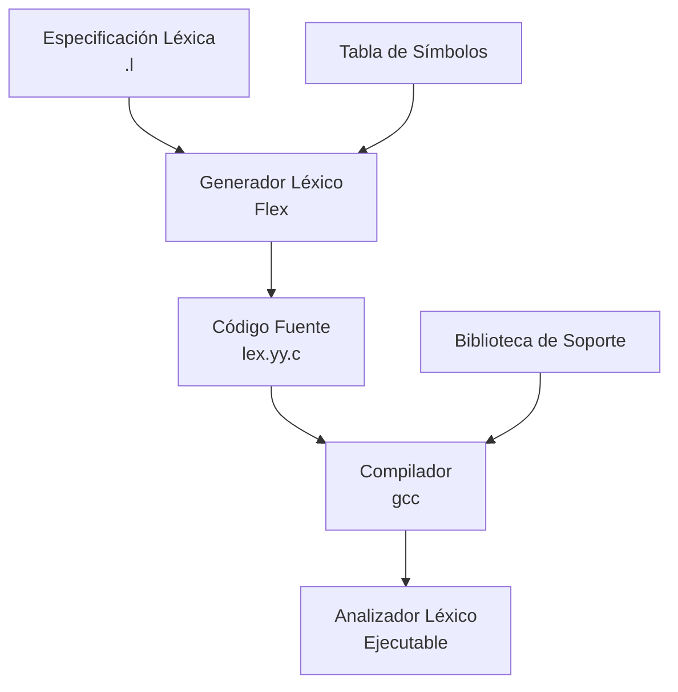
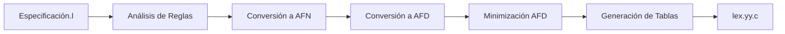
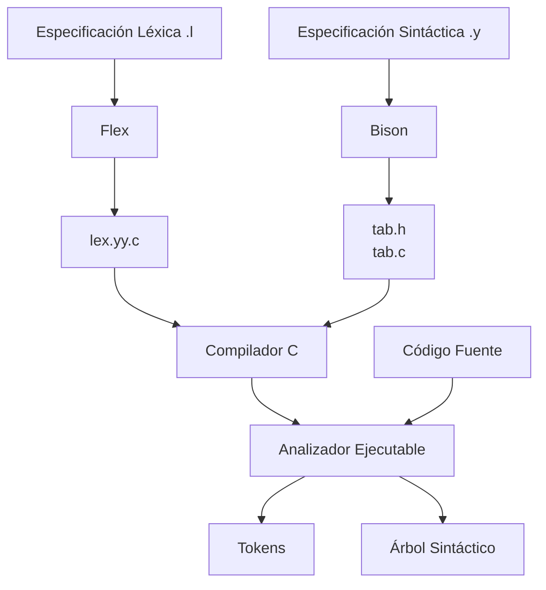

# Compiladores - Análisis léxico

## 2.6 Herramientas automáticas para la construcción de analizadores léxicos.

---

Las herramientas automáticas para la construcción de analizadores léxicos permiten generar implementaciones eficientes a partir de especificaciones declarativas de tokens. Estas herramientas siguen el principio "Divide y vencerás" al separar la especificación de la implementación.

### Conceptos Fundamentales

#### Generadores Léxicos

Un generador léxico es una herramienta que toma como entrada:

- Un conjunto de **expresiones regulares** que definen los tokens
- **Acciones semánticas** (código) a ejecutar cuando se reconoce cada token

Y produce como salida:

- Un **analizador léxico implementado** en un lenguaje de programación específico

El proceso puede representarse como:

$$ G_{lex} = (R, A) \rightarrow L $$

Donde:

- $R$ = Conjunto de reglas léxicas (expresiones regulares)
- $A$ = Conjunto de acciones semánticas
- $L$ = Analizador léxico implementado

### Arquitectura de un Generador Léxico



### Flex: Fast Lexical Analyzer Generator

#### Estructura de un archivo Flex

```
%{
// Sección de declaraciones C
#include <stdio.h>
%}

// Sección de definiciones
DIGITO    [0-9]
LETRA     [a-zA-Z]
%%

// Sección de reglas
{DIGITO}+    { printf("Entero: %s\n", yytext); }
{LETRA}+     { printf("Identificador: %s\n", yytext); }
"//".*       ; // Ignorar comentarios
[ \t\n]+     ; // Ignorar espacios en blanco
.            { printf("Carácter no reconocido: %s\n", yytext); }

%%

// Sección de código C
int main() {
    yylex();
    return 0;
}
```

#### Funcionamiento Interno de Flex



### Ejemplo Completo con Flex y Bison

#### Especificación Léxica (lexer.l)

```lex
%{
#include <stdio.h>
#include "parser.tab.h"  // Archivo generado por bison
%}

DIGITO    [0-9]
LETRA     [a-zA-Z_]
IDENT     {LETRA}({LETRA}|{DIGITO})*
ENTERO    {DIGITO}+
REAL      {DIGITO}+"."{DIGITO}*
OPERADOR  [+\\-*/]
COMENTARIO "//".*

%%

{ENTERO}       { yylval.ival = atoi(yytext); return ENTERO; }
{REAL}         { yylval.fval = atof(yytext); return REAL; }
{IDENT}        { yylval.sval = strdup(yytext); return IDENTIFICADOR; }
{OPERADOR}     { yylval.cval = yytext[0]; return OPERADOR; }
"=="           { return IGUAL; }
"!="           { return DIFERENTE; }
"<"            { return MENOR; }
">"            { return MAYOR; }
"<="           { return MENOR_IGUAL; }
">="           { return MAYOR_IGUAL; }
"("            { return PAREN_IZQ; }
")"            { return PAREN_DER; }
"{"            { return LLAVE_IZQ; }
"}"            { return LLAVE_DER; }
";"            { return PUNTO_COMA; }
"="            { return ASIGNACION; }
{COMENTARIO}   ; // Ignorar comentarios
[ \t\n]+       ; // Ignorar espacios en blanco
.              { printf("Error léxico: carácter no válido '%s'\\n", yytext); }

%%

int yywrap() {
    return 1;
}
```

#### Especificación Sintáctica (parser.y)

```bison
%{
#include <stdio.h>
#include <stdlib.h>
%}

%union {
    int ival;
    float fval;
    char* sval;
    char cval;
}

%token <ival> ENTERO
%token <fval> REAL
%token <sval> IDENTIFICADOR
%token <cval> OPERADOR
%token IGUAL DIFERENTE MENOR MAYOR MENOR_IGUAL MAYOR_IGUAL
%token PAREN_IZQ PAREN_DER LLAVE_IZQ LLAVE_DER PUNTO_COMA ASIGNACION

%%

programa: declaracion+
        ;

declaracion: IDENTIFICADOR ASIGNACION expresion PUNTO_COMA
           ;

expresion: termino
         | expresion OPERADOR termino
         ;

termino: ENTERO
       | REAL
       | IDENTIFICADOR
       | PAREN_IZQ expresion PAREN_DER
       ;

%%

int main() {
    yyparse();
    return 0;
}

void yyerror(const char* s) {
    fprintf(stderr, "Error: %s\\n", s);
}
```

### Lex: El Generador Léxico Original

#### Comparación entre Lex y Flex

| Característica   | Lex            | Flex       |
| ---------------- | -------------- | ---------- |
| Velocidad        | Moderada       | Alta       |
| Tamaño de tablas | Grande         | Optimizado |
| Compatibilidad   | Estándar POSIX | Mejorada   |
| Características  | Básicas        | Extendidas |

#### Ejemplo de código Lex

```lex
%%
[0-9]+         printf("Entero: %s\n", yytext);
[a-zA-Z][a-zA-Z0-9]* printf("Identificador: %s\n", yytext);
"+"            printf("Operador suma\n");
"-"            printf("Operador resta\n");
"*"            printf("Operador multiplicación\n");
"/"            printf("Operador división\n");
[ \t\n]        ;
.              printf("Carácter no reconocido: %s\n", yytext);
%%
```

### ANTLR: Another Tool for Language Recognition

#### Ejemplo de gramática léxica en ANTLR

```antlr
lexer grammar MiLexer;

ENTERO: [0-9]+;
REAL: [0-9]+ '.' [0-9]* | '.' [0-9]+;
IDENTIFICADOR: [a-zA-Z_][a-zA-Z_0-9]*;
OPERADOR: [+\\-*/];
COMPARADOR: '==' | '!=' | '<' | '>' | '<=' | '>=';
PAREN_IZQ: '(';
PAREN_DER: ')';
LLAVE_IZQ: '{';
LLAVE_DER: '}';
PUNTO_COMA: ';';
ASIGNACION: '=';

COMENTARIO: '//' ~[\\n]* -> skip;
ESPACIO: [ \\t\\r\\n]+ -> skip;
```

### JFlex: Generador Léxico para Java

#### Ejemplo de especificación JFlex

```jflex
import java_cup.runtime.*;

%%
%class MiLexer
%unicode
%cup
%line
%column

%{
    private Symbol symbol(int type) {
        return new Symbol(type, yyline, yycolumn);
    }

    private Symbol symbol(int type, Object value) {
        return new Symbol(type, yyline, yycolumn, value);
    }
%}

DIGITO = [0-9]
LETRA = [a-zA-Z_]
IDENT = {LETRA}({LETRA}|{DIGITO})*
ENTERO = {DIGITO}+
REAL = {DIGITO}+"."{DIGITO}*

%%

{ENTERO}       { return symbol(sym.ENTERO, new Integer(yytext())); }
{REAL}         { return symbol(sym.REAL, new Double(yytext())); }
{IDENT}        { return symbol(sym.IDENTIFICADOR, yytext()); }
"+"            { return symbol(sym.MAS); }
"-"            { return symbol(sym.MENOS); }
"*"            { return symbol(sym.POR); }
"/"            { return symbol(sym.DIV); }
[ \t\n]        { /* Ignorar */ }
.              { System.err.println("Carácter ilegal: " + yytext()); }
```

### Ventajas de las Herramientas Automáticas

1. **Productividad**: Reducción significativa del tiempo de desarrollo
2. **Mantenibilidad**: Especificaciones más legibles y modificables
3. **Fiabilidad**: Menor probabilidad de errores en la implementación
4. **Portabilidad**: Generación de código para múltiples lenguajes
5. **Optimización**: Generación de analizadores eficientes automáticamente

### Limitaciones y Consideraciones

1. **Curva de aprendizaje**: Requiere entender el formato de especificación
2. **Debugging**: Puede ser más difícil depurar código generado
3. **Rendimiento**: En casos muy específicos, una implementación manual podría ser más eficiente
4. **Dependencias**: Introduce dependencias externas en el proyecto

### Ejercicios Propuestos

1. **Implementar un lexer para un subconjunto de Python**:
   - Identificadores, números, operadores, indentación/dedentación
   - Usar Flex para generar el analizador

2. **Comparar rendimiento**:
   - Implementar manualmente vs. con herramienta automática
   - Medir tiempo de análisis para diferentes tamaños de entrada

3. **Extender JFlex**:
   - Añadir soporte para números hexadecimales y binarios
   - Implementar manejo de cadenas con secuencias de escape

4. **Generar analizador para expresiones regulares**:
   - Usar ANTLR para definir la gramática de regex
   - Producir un árbol de análisis léxico

5. **Integración con IDE**:
   - Crear un plugin que use el analizador generado para resaltado de sintaxis

6. **Optimización de tablas**:
   - Experimentar con diferentes opciones de optimización en Flex
   - Comparar tamaño y rendimiento de las tablas generadas

### Proceso de Compilación con Herramientas Automáticas



### Referencias

1. Aho, A. V., Lam, M. S., Sethi, R., & Ullman, J. D. (2007). Compilers: Principles, Techniques, and Tools (2nd ed.). Pearson Education. (Capítulo 3: Sección 3.8 - Lexical-Analyzer Generator Lex)

2. Levine, J. R., Mason, T., & Brown, D. (1992). Lex & Yacc. O'Reilly Media.

3. Donnelly, C., & Stallman, R. (2015). Flex: The Fast Lexical Analyzer. Manual oficial.

4. Parr, T. (2013). The Definitive ANTLR 4 Reference. Pragmatic Bookshelf.

5. Klein, G. (2021). JFlex - The Fast Scanner Generator for Java. Manual oficial.

6. Cooper, K. D., & Torczon, L. (2004). Engineering a Compiler. Morgan Kaufmann. (Capítulo 2: Sección 2.6 - Scanner Generators)

### Conclusión

Las herramientas automáticas para la construcción de analizadores léxicos representan un avance significativo en el desarrollo de compiladores. Permiten a los implementadores centrarse en la especificación de los tokens rather than en los detalles de implementación, generando código eficiente y mantenible. La elección entre diferentes herramientas (Flex, ANTLR, JFlex) dependerá del lenguaje objetivo, los requisitos de rendimiento y las preferencias del equipo de desarrollo.
