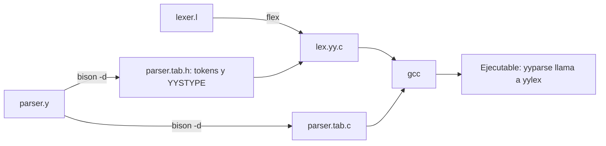

# Compiladores - Análisis léxico

## 2.6 Herramientas automáticas para la construcción de analizadores léxicos.

---

Un **generador de analizadores léxicos** recibe una especificación, una lista de expresiones regulares, cada una con una **acción**, y produce el código de un analizador que, al reconocer el lexema más largo de alguna expresión, ejecuta su acción. La herramienta implementa los algoritmos de los temas 2.3 y 2.4, de modo que quien escribe la especificación solo piensa en los tokens. Este tema presenta flex, el sucesor libre de lex, con su integración con bison, y JFlex, ANTLR y otras herramientas, con ejemplos reales generados y ejecutados.

### Estructura de una especificación de flex

Un archivo `.l` tiene tres secciones separadas por `%%`:

```lex
%{
/* declaraciones de C que se copian al inicio de lex.yy.c */
#include <stdio.h>
%}
DIGITO   [0-9]
%option noyywrap
%%
{DIGITO}+                { printf("ENTERO %s\n", yytext); }
[A-Za-z_][A-Za-z0-9_]*   { printf("ID %s\n", yytext); }
[ \t\n]+                 ;  /* sin acción: se descarta */
.                        { printf("ILEGAL %s\n", yytext); }
%%
int main(void) { yylex(); return 0; }
```

- La primera sección tiene código de C entre `%{` y `%}`, **definiciones** con nombre, como `DIGITO`, y opciones.
- La segunda tiene las **reglas**: una expresión al inicio de la línea y una acción de C. Dentro de la acción, `yytext` es el lexema y `yyleng` su longitud; la acción puede devolver un token con `return`, y entonces `yylex()` termina y la siguiente llamada continúa donde se quedó.
- La tercera es código de C que se copia al final.

Flex aplica las dos reglas de los temas anteriores: el **lexema más largo** y, en un empate, la **primera regla** de la lista. Por eso las palabras reservadas van antes del identificador y la regla `.` al final, para reportar cualquier carácter que no reconozcan las demás.

### Herramientas de flex para el contexto

- **Condiciones de inicio:** `%x NOMBRE` declara un modo exclusivo; una regla `<NOMBRE>r` solo se aplica en ese modo, y `BEGIN(NOMBRE)` cambia de modo. Sirven para las cadenas, los comentarios y el inicio de línea en lenguajes con sangría.
- **Contexto posterior:** `r/s` reconoce `r` solo si lo sigue `s`, sin consumir `s`.
- **`yyless(n)`** devuelve a la entrada todo menos los primeros `n` caracteres del lexema, y **`yymore()`** concatena el siguiente lexema con el actual.
- **`<<EOF>>`** es una regla para el fin del archivo, útil para cerrar los bloques pendientes o reportar un comentario sin cerrar.

### Integración con bison

Bison genera el analizador sintáctico y un archivo `parser.tab.h` con los números de los tokens y la unión `YYSTYPE` de sus atributos; el analizador léxico lo incluye, asigna el atributo a `yylval` y devuelve el token. El analizador sintáctico llama a `yylex()` cada vez que necesita un token.



Un fragmento de un analizador léxico para bison:

```lex
%{
#include "parser.tab.h"
%}
%option noyywrap
%%
[0-9]+                 { yylval.ival = atoi(yytext); return ENTERO; }
[A-Za-z_][A-Za-z0-9_]* { yylval.sval = strdup(yytext); return IDENTIFICADOR; }
"=="                   { return IGUAL; }
[-+*/=;()]             { return yytext[0]; }   /* los tokens de un carácter pueden ser el carácter */
[ \t\n]+               ;
.                      { fprintf(stderr, "carácter ilegal '%s'\n", yytext); }
```

### Cómo funciona flex por dentro

Flex construye un AFN con todas las reglas, lo convierte en un AFD, en el que cada estado de aceptación recuerda la primera regla que acepta, lo minimiza y emite tablas comprimidas con un intérprete en `lex.yy.c`. Las opciones `-C` eligen el compromiso entre tamaño y velocidad: `-Ce` agrupa los caracteres en **clases de equivalencia**, `-Cm` agrupa además las clases en **metaclases**, y `-Cf` o `-CF` generan tablas completas, sin compresión, más grandes y más rápidas. La compresión por omisión, `-Cem`, usa el esquema de **filas desplazadas**: las filas de la tabla se superponen en un solo arreglo, aprovechando que la mayoría de sus entradas están vacías o se repiten.

### Otras herramientas

| Herramienta | Lenguaje generado | Características |
| ----------- | ----------------- | --------------- |
| lex, flex | C, C++ | el estándar de UNIX y POSIX; tablas comprimidas; se integra con yacc y bison |
| JFlex | Java | Unicode completo, condiciones de inicio, se integra con CUP y BYACC/J |
| ANTLR 4 | Java, Python, C#, JavaScript, Go y otros | una sola gramática para los analizadores léxico y sintáctico; **modos** léxicos; `-> skip` y canales para los comentarios |
| re2c | C, C++, Go, Rust | genera código dirigido, sin tablas; muy rápido; lo usan PHP y Ninja |
| Ragel | C, C++, Go, Java y otros | máquinas de estados con acciones en las transiciones |
| PLY y SLY | Python | analizadores léxicos y sintácticos con expresiones de `re` |
| Logos | Rust | genera el analizador al compilar, con macros |

### Implementación en Python

El programa genera y ejecuta analizadores reales con flex 2.6, gcc 13, JFlex 1.7 y ANTLR 4.9 con Java 21. Para el ejercicio 1 escribe la especificación de flex de un subconjunto de Python con `INDENT` y `DEDENT` y compara sus tokens con los del módulo `tokenize` de Python; para el 2 compara su rendimiento; para el 3 genera con JFlex un analizador con hexadecimales, binarios y cadenas con escapes; para el 4 escribe la gramática de las expresiones regulares en ANTLR e imprime sus árboles; para el 5 usa los tokens para resaltar la sintaxis en HTML, y para el 6 compila el analizador con ocho opciones de compresión de tablas.

```python
import io, os, re, subprocess, tempfile, time, tokenize, html

TMP = tempfile.mkdtemp()
def corre(cmd, entrada=None, cwd=TMP):
    r = subprocess.run(cmd, input=entrada, capture_output=True, text=True, cwd=cwd)
    err = "\n".join(l for l in r.stderr.splitlines() if not l.startswith("Picked up"))
    return r.stdout, err, r.returncode
def escribe(nombre, texto): open(os.path.join(TMP, nombre), "w").write(texto)

# ---------- Ejercicio 1: analizador de un subconjunto de Python con flex, con INDENT y DEDENT ----------
ESPEC_FLEX = r'''
%option noyywrap nounput noinput
%{
#include <stdio.h>
static int pila[128] = {0}, tope = 0, parens = 0, error = 0, linea = 1;
static void emite(const char *t, const char *v) { printf("%s %s\n", t, v); }
%}
%x INICIO_LINEA
DIG      [0-9]
EXP      [eE][+-]?{DIG}+
NUMERO   0[xX][0-9a-fA-F]+|0[bB][01]+|{DIG}+(\.{DIG}*)?{EXP}?|\.{DIG}+{EXP}?
CADENA   \"([^"\\\n]|\\.)*\"|'([^'\\\n]|\\.)*'
RESERV   def|return|if|elif|else|while|for|in|and|or|not|True|False|None
%%
<INICIO_LINEA>[ ]*\n            { linea++; }                  /* línea en blanco */
<INICIO_LINEA>[ ]*"#"[^\n]*\n   { linea++; }                  /* línea con solo un comentario */
<INICIO_LINEA>[ ]*[^ \n#]       { yyless(yyleng - 1);          /* devuelve el primer carácter */
                                  BEGIN(INITIAL);
                                  if (yyleng > pila[tope]) { pila[++tope] = yyleng; emite("INDENT", ""); }
                                  else {
                                      while (yyleng < pila[tope]) { tope--; emite("DEDENT", ""); }
                                      if (yyleng != pila[tope]) { fprintf(stderr, "línea %d: sangría inconsistente\n", linea); error = 1; }
                                  } }
\n                              { linea++; if (parens == 0) { emite("NEWLINE", "\\n"); BEGIN(INICIO_LINEA); } }
\\\n                            { linea++; }                  /* unión explícita de líneas */
[ \t]+                          ;
"#"[^\n]*                       ;
{RESERV}                        { emite("RESERVADA", yytext); }
[A-Za-z_][A-Za-z0-9_]*          { emite("NAME", yytext); }
{NUMERO}                        { emite("NUMBER", yytext); }
{CADENA}                        { emite("STRING", yytext); }
\"([^"\\\n]|\\.)*|'([^'\\\n]|\\.)*  { fprintf(stderr, "línea %d: cadena sin cerrar\n", linea); error = 1; }
[(\[]                           { parens++; emite("OP", yytext); }
[)\]]                           { parens--; emite("OP", yytext); }
"**"|"//"|"=="|"!="|"<="|">="|"+="|"-="|"->"|[-+*/%<>=,:.] { emite("OP", yytext); }
.                               { fprintf(stderr, "línea %d: carácter ilegal '%s'\n", linea, yytext); error = 1; }
<INITIAL,INICIO_LINEA><<EOF>>   { while (tope > 0) { tope--; emite("DEDENT", ""); } emite("ENDMARKER", ""); return 0; }
%%
int main(void) { BEGIN(INICIO_LINEA); yylex(); return error; }
'''
escribe("python.l", ESPEC_FLEX)
_, err, rc = corre(["flex", "-o", "lex.yy.c", "python.l"]); assert rc == 0, err
_, err, rc = corre(["gcc", "-O2", "-o", "lexpy", "lex.yy.c"]); assert rc == 0, err
PROG = '''def f(n, base=0x10):
    # comentario
    if n <= 1:
        return 1

    total = 0b101 + 2.5e-3
    for i in [1, 2,
              3]:
        total += i ** 2
    s = "dice \\"hola\\"\\n" + 'x'
    return total // n
print(f(3))
'''
salida, err, rc = corre(["./lexpy"], PROG)
toks = [tuple(l.split(" ", 1)) for l in salida.splitlines()]
print(f"ejercicio 1: flex {len(toks)} tokens; código de salida {rc}")
for linea in [toks[i:i + 9] for i in range(0, 36, 9)]: print("   ", " ".join(f"{t}:{v}" if v else t for t, v in linea))
print("    ...", " ".join(f"{t}:{v}" if v else t for t, v in toks[-8:]))
def de_python(texto):
    res = []
    for t in tokenize.generate_tokens(io.StringIO(texto).readline):
        nombre = tokenize.tok_name[t.type]
        if nombre in ("NL", "COMMENT"): continue
        res.append((nombre, "" if nombre in ("INDENT", "DEDENT", "ENDMARKER", "NEWLINE") else t.string))
    return res
mios = [("NAME" if t == "RESERVADA" else t, "" if t == "NEWLINE" else v) for t, v in toks]
print("   igual al módulo tokenize de Python:", mios == de_python(PROG))
for malo in ["if x:\n        a = 1\n    b = 2\n", 's = "abierta\n', "x = 3 $ 4\n"]:
    _, err, rc = corre(["./lexpy"], malo); print(f"   {malo!r:32} -> {err.strip()} (código {rc})")

# ---------- Ejercicio 2: rendimiento, analizador generado en C contra tokenize de Python ----------
grande = PROG * 3000
t0 = time.perf_counter(); salida, _, _ = corre(["./lexpy"], grande); t_flex = time.perf_counter() - t0
t0 = time.perf_counter(); ref = de_python(grande); t_py = time.perf_counter() - t0
n_flex = len(salida.splitlines())
print(f"ejercicio 2: {len(grande)} caracteres; flex {n_flex} tokens, tokenize {len(ref)}; flex al menos 5 veces más rápido: {t_py / t_flex > 5}")

# ---------- Ejercicio 3: JFlex con hexadecimales, binarios y cadenas con secuencias de escape ----------
ESPEC_JFLEX = r'''
%%
%class Lexico
%unicode
%line
%column
%type String
%state CADENA
%{
  private StringBuilder cadena = new StringBuilder();
  private int lineaCadena, columnaCadena;
  private String token(String clase, Object valor) { return clase + "(" + valor + ")@" + (yyline + 1) + ":" + (yycolumn + 1); }
  public static void main(String[] args) throws java.io.IOException {
    Lexico l = new Lexico(new java.io.InputStreamReader(System.in, "UTF-8"));
    for (String t = l.yylex(); t != null; t = l.yylex()) System.out.println(t);
  }
%}
%eofval{
  if (yystate() == CADENA) { yybegin(YYINITIAL); return "ERROR(cadena sin cerrar)@" + lineaCadena + ":" + columnaCadena; }
  return null;
%eofval}
HEX = 0[xX][0-9a-fA-F]+
BIN = 0[bB][01]+
%%
<YYINITIAL> {
  {HEX}                 { return token("ENTERO", Long.parseLong(yytext().substring(2), 16)); }
  {BIN}                 { return token("ENTERO", Long.parseLong(yytext().substring(2), 2)); }
  [0-9]+                { return token("ENTERO", Long.parseLong(yytext())); }
  [A-Za-z_][A-Za-z0-9_]* { return token("ID", yytext()); }
  \"                    { cadena.setLength(0); lineaCadena = yyline + 1; columnaCadena = yycolumn + 1; yybegin(CADENA); }
  [=+;]                 { return token("OP", yytext()); }
  [ \t\r\n]+            { }
  [^]                   { return token("ERROR", "carácter ilegal " + yytext()); }
}
<CADENA> {
  \"                    { yybegin(YYINITIAL); return "CADENA(" + cadena.length() + " caracteres: " + cadena.toString().replace("\n", "<NL>").replace("\t", "<TAB>") + ")@" + lineaCadena + ":" + columnaCadena; }
  [^\n\"\\]+            { cadena.append(yytext()); }
  \\n                   { cadena.append('\n'); }
  \\t                   { cadena.append('\t'); }
  \\\"                  { cadena.append('"'); }
  \\\\                  { cadena.append('\\'); }
  \\u[0-9a-fA-F]{4}     { cadena.append((char) Integer.parseInt(yytext().substring(2), 16)); }
  \\.                   { return token("ERROR", "escape inválido " + yytext()); }
  \n                    { yybegin(YYINITIAL); return "ERROR(cadena sin cerrar)@" + lineaCadena + ":" + columnaCadena; }
}
'''
escribe("Lexico.flex", ESPEC_JFLEX)
_, err, rc = corre(["jflex", "-q", "Lexico.flex"]); assert rc == 0, err
_, err, rc = corre(["javac", "-encoding", "UTF-8", "Lexico.java"]); assert rc == 0, err
salida, err, _ = corre(["java", "-Dfile.encoding=UTF-8", "-Dstdout.encoding=UTF-8", "-cp", ".", "Lexico"],
                       'x = 0x1A3F + 0b1010;\ns = "di \\"sí\\"\\n\\tfin \\u00e9" + "mal \\q";\nt = "abierta')
print("ejercicio 3: JFlex"); [print("   ", l) for l in salida.splitlines()]

# ---------- Ejercicio 4: ANTLR, gramática de las expresiones regulares y árbol de análisis ----------
GRAMATICA = r'''
grammar Regex;
regex          : alternativa EOF ;
alternativa    : concatenacion ('|' concatenacion)* ;
concatenacion  : repeticion* ;
repeticion     : atomo cuantificador* ;
cuantificador  : '*' | '+' | '?' | '{' DIGITO+ (',' DIGITO*)? '}' ;
atomo          : '(' alternativa ')' | clase | '.' | ESCAPE | LITERAL | DIGITO ;
clase          : '[' '^'? rango+ ']' ;
rango          : simbolo ('-' simbolo)? ;
simbolo        : LITERAL | DIGITO | ESCAPE ;
ESCAPE         : '\\' . ;
DIGITO         : [0-9] ;
LITERAL        : ~[|*+?(){}[\]\\.^,\-0-9] ;
'''
PRINCIPAL = r'''
import org.antlr.v4.runtime.*;
import org.antlr.v4.runtime.tree.*;
public class Principal {
  public static void main(String[] args) {
    for (String s : args) {
      RegexLexer lex = new RegexLexer(CharStreams.fromString(s));
      CommonTokenStream toks = new CommonTokenStream(lex);
      RegexParser p = new RegexParser(toks);
      ParseTree arbol = p.regex();
      System.out.println(s + "  ->  " + arbol.toStringTree(p));
      if (p.getNumberOfSyntaxErrors() > 0) System.out.println("   errores: " + p.getNumberOfSyntaxErrors());
    }
  }
}
'''
escribe("Regex.g4", GRAMATICA); escribe("Principal.java", PRINCIPAL)
CP = ".:/usr/share/java/antlr4-runtime.jar"
_, err, rc = corre(["antlr4", "-no-listener", "Regex.g4"]); assert rc == 0, err
_, err, rc = corre(["javac", "-cp", CP, "Principal.java", "RegexLexer.java", "RegexParser.java"]); assert rc == 0, err
salida, err, _ = corre(["java", "-cp", CP, "Principal", "(a|b)*abb", "[0-9]{3}", "a(b|"])
print("ejercicio 4: ANTLR"); [print("   ", l) for l in salida.splitlines()]; [print("    stderr:", l) for l in err.splitlines()]

# ---------- Ejercicio 5: resaltado de sintaxis con los tokens del analizador generado ----------
COLOR = {"RESERVADA": "kw", "NAME": "id", "NUMBER": "num", "STRING": "str", "OP": "op"}
def resalta(texto):
    salida, _, _ = corre(["./lexpy"], texto); pos, partes = 0, []
    for l in salida.splitlines():
        t, v = l.split(" ", 1)
        if t not in COLOR: continue
        k = texto.index(v, pos)                       # los tokens llegan en orden: se ubican en el texto
        partes.append(html.escape(texto[pos:k])); partes.append(f'<span class="{COLOR[t]}">{html.escape(v)}</span>'); pos = k + len(v)
    return "".join(partes) + html.escape(texto[pos:])
print("ejercicio 5:", resalta("if n <= 1:\n    return 'uno'\n").replace("\n", "\\n"))

# ---------- Ejercicio 6: opciones de compresión de tablas de flex ----------
print("ejercicio 6: opción | bytes de código y datos del objeto | misma salida")
referencia, _, _ = corre(["./lexpy"], PROG)
for opcion in ["-Cem", "-Cm", "-Ce", "-C", "-Cfe", "-CFe", "-Cf", "-CF"]:
    _, err, rc = corre(["flex", opcion, "-o", "op.c", "python.l"]); assert rc == 0, err
    _, err, rc = corre(["gcc", "-O2", "-c", "op.c", "-o", "op.o"]); assert rc == 0, err
    _, err, rc = corre(["gcc", "op.o", "-o", "op"]); assert rc == 0, err
    tam = corre(["size", "op.o"])[0].splitlines()[1].split()
    print(f"   {opcion:5} | {int(tam[3]):6} | {corre(['./op'], PROG)[0] == referencia}")
```

Salida:

```text
ejercicio 1: flex 70 tokens; código de salida 0
    RESERVADA:def NAME:f OP:( NAME:n OP:, NAME:base OP:= NUMBER:0x10 OP:)
    OP:: NEWLINE:\n INDENT RESERVADA:if NAME:n OP:<= NUMBER:1 OP:: NEWLINE:\n
    INDENT RESERVADA:return NUMBER:1 NEWLINE:\n DEDENT NAME:total OP:= NUMBER:0b101 OP:+
    NUMBER:2.5e-3 NEWLINE:\n RESERVADA:for NAME:i RESERVADA:in OP:[ NUMBER:1 OP:, NUMBER:2
    ... OP:( NAME:f OP:( NUMBER:3 OP:) OP:) NEWLINE:\n ENDMARKER
   igual al módulo tokenize de Python: True
   'if x:\n        a = 1\n    b = 2\n' -> línea 3: sangría inconsistente (código 1)
   's = "abierta\n'                 -> línea 1: cadena sin cerrar (código 1)
   'x = 3 $ 4\n'                    -> línea 1: carácter ilegal '$' (código 1)
ejercicio 2: 678000 caracteres; flex 207001 tokens, tokenize 207001; flex al menos 5 veces más rápido: True
ejercicio 3: JFlex
    ID(x)@1:1
    OP(=)@1:3
    ENTERO(6719)@1:5
    OP(+)@1:12
    ENTERO(10)@1:14
    OP(;)@1:20
    ID(s)@2:1
    OP(=)@2:3
    CADENA(14 caracteres: di "sí"<NL><TAB>fin é)@2:5
    OP(+)@2:31
    ERROR(escape inválido \q)@2:38
    CADENA(4 caracteres: mal )@2:33
    OP(;)@2:41
    ID(t)@3:1
    OP(=)@3:3
    ERROR(cadena sin cerrar)@3:5
ejercicio 4: ANTLR
    (a|b)*abb  ->  (regex (alternativa (concatenacion (repeticion (atomo ( (alternativa (concatenacion (repeticion (atomo a))) | (concatenacion (repeticion (atomo b)))) )) (cuantificador *)) (repeticion (atomo a)) (repeticion (atomo b)) (repeticion (atomo b)))) <EOF>)
    [0-9]{3}  ->  (regex (alternativa (concatenacion (repeticion (atomo (clase [ (rango (simbolo 0) - (simbolo 9)) ])) (cuantificador { 3 })))) <EOF>)
    a(b|  ->  (regex (alternativa (concatenacion (repeticion (atomo a)) (repeticion (atomo ( (alternativa (concatenacion (repeticion (atomo b))) | concatenacion) <missing ')'>)))) <EOF>)
       errores: 1
    stderr: line 1:4 missing ')' at '<EOF>'
ejercicio 5: <span class="kw">if</span> <span class="id">n</span> <span class="op">&lt;=</span> <span class="num">1</span><span class="op">:</span>\n    <span class="kw">return</span> <span class="str">&#x27;uno&#x27;</span>\n
ejercicio 6: opción | bytes de código y datos del objeto | misma salida
   -Cem  |  10550 | True
   -Cm   |  12950 | True
   -Ce   |  11518 | True
   -C    |  20006 | True
   -Cfe  |  17092 | True
   -CFe  |  18856 | True
   -Cf   |  32940 | True
   -CF   |  32564 | True
```

### Ejercicios Propuestos

1. **Subconjunto de Python.** Implementa con flex un analizador para un subconjunto de Python, con identificadores, números, operadores y sangrías.

2. **Rendimiento.** Compara un analizador implementado a mano con uno generado por una herramienta, midiendo el tiempo de análisis para diferentes tamaños de entrada.

3. **JFlex.** Añade a una especificación de JFlex soporte para números hexadecimales y binarios, y cadenas con secuencias de escape.

4. **ANTLR.** Usa ANTLR para definir la gramática de las expresiones regulares y producir su árbol de análisis.

5. **Integración con un editor.** Usa el analizador generado para el resaltado de sintaxis.

6. **Optimización de tablas.** Experimenta con las opciones de optimización de flex y compara el tamaño de las tablas generadas.

### Soluciones

**Ejercicio 1.** La especificación usa una condición de inicio exclusiva, `INICIO_LINEA`, en la que el analizador entra después de cada salto de línea. Ahí, las líneas en blanco y las que solo tienen un comentario se descartan; en cualquier otra, la regla `[ ]*[^ \n#]` mide la sangría, devuelve el primer carácter con `yyless` y la compara con la **pila de sangrías**: si es mayor, la apila y emite `INDENT`; si es menor, desapila y emite un `DEDENT` por nivel hasta encontrar la misma, y si no la encuentra, reporta una sangría inconsistente. Un contador de paréntesis y corchetes abiertos implementa la **unión implícita de líneas**: dentro de `[1, 2,` el salto de línea no genera `NEWLINE`. La regla `<<EOF>>` cierra los bloques pendientes con `DEDENT`. El analizador generado produce 70 tokens para el programa de prueba, y, tomando las palabras reservadas como `NAME`, la secuencia es **idéntica** a la del módulo `tokenize` de Python, incluidos los `INDENT` y `DEDENT` del ciclo con la lista partida en dos líneas. Los tres errores, la sangría inconsistente, la cadena sin cerrar y el carácter ilegal, se reportan con su línea.

**Ejercicio 2.** Con el programa repetido 3 000 veces, 678 000 caracteres, ambos analizadores producen los mismos 207 001 tokens, y el generado por flex, en C, es más de 5 veces más rápido que `tokenize`, aun contando el arranque del proceso; en esta máquina la diferencia es mucho mayor. La comparación justa entre un analizador escrito a mano y uno generado debe hacerse **en el mismo lenguaje**: en C, un analizador a mano bien escrito, como los de GCC y Clang, es comparable o más rápido que uno de flex, y uno de re2c compite con ambos. Para medir, se repite cada análisis varias veces, se toma la mediana y se varía el tamaño, para comprobar que el tiempo crece linealmente; el `tokenize` de Python es más lento porque cada token pasa por expresiones de `re` y crea un objeto de Python.

**Ejercicio 3.** La especificación de JFlex reconoce los hexadecimales y los binarios con sus propias reglas, antes que los decimales, y convierte el valor con `Long.parseLong` en la base correspondiente, de modo que `0x1A3F` produce 6719 y `0b1010` produce 10. Las cadenas usan un estado `CADENA`: la comilla de apertura guarda la posición e inicia un `StringBuilder`; cada secuencia de escape agrega su carácter, incluida `é`, y la comilla de cierre devuelve el token con el valor ya traducido, de 14 caracteres en el ejemplo. Una secuencia inválida, como `\q`, se reporta y la cadena continúa, y una cadena sin cerrar se reporta en la posición de su comilla de apertura, tanto si termina la línea como si termina el archivo, con la directiva `%eofval`. Las posiciones salen de `%line` y `%column`, que JFlex cuenta desde 0.

**Ejercicio 4.** La gramática de ANTLR tiene la estructura del analizador descendente del tema 2.3, de menor a mayor precedencia: alternativa, concatenación, repetición con sus cuantificadores, y átomo, que puede ser un grupo, una clase, el punto, un escape o un literal. Las reglas en mayúsculas son las **léxicas**, y las de minúsculas las sintácticas; ANTLR genera los dos analizadores a partir del mismo archivo. El árbol de `(a|b)*abb` muestra la cerradura aplicada al grupo y la concatenación de los cuatro factores, y el de `[0-9]{3}` la clase con su rango y el cuantificador. Con `a(b|`, ANTLR reporta "missing ')'", **inserta** el token que falta, una de sus estrategias de recuperación, y construye el árbol de todos modos.

**Ejercicio 5.** El resaltado necesita la **clase** y la **posición** de cada token; el programa ubica los lexemas en el texto, que llegan en orden, y los envuelve en elementos `span` con una clase de CSS por tipo de token. Un editor real tiene requisitos adicionales: **análisis incremental**, para no volver a analizar todo el archivo con cada tecla, lo que se logra guardando el estado del autómata al inicio de cada línea y reanalizando desde la línea modificada hasta que el estado coincida; **tolerancia a errores**, porque el texto casi siempre está incompleto, y la integración con el protocolo de servidores de lenguaje, LSP, cuyos *semantic tokens* comunican las clases al editor. Los editores modernos usan gramáticas de TextMate, que son expresiones regulares con estados, o tree-sitter, un generador de analizadores incrementales.

**Ejercicio 6.** Con gcc 13, el tamaño del código y los datos del objeto compilado varía así:

| Opción | Bytes | Compresión |
| ------ | ----- | ---------- |
| `-Cem` | 10 550 | clases y metaclases, la opción por omisión |
| `-Ce` | 11 518 | clases de equivalencia |
| `-Cm` | 12 950 | metaclases |
| `-Cfe` | 17 092 | tablas completas sobre las clases |
| `-CFe` | 18 856 | tablas completas rápidas sobre las clases |
| `-C` | 20 006 | solo filas desplazadas |
| `-CF` | 32 564 | tablas completas rápidas |
| `-Cf` | 32 940 | tablas completas, una columna por carácter |

Las ocho versiones producen exactamente la misma salida, porque la compresión no cambia el autómata. Las tablas completas triplican el tamaño a cambio de eliminar indirecciones en el ciclo interno; para una especificación pequeña como esta, todas caben en la caché, y la diferencia de velocidad es pequeña, mientras que en especificaciones grandes las tablas completas pueden ocupar cientos de kilobytes.

El ejemplo completo del material original no podía generarse: en flex, la clase `[+\\-*/]` contiene el rango de `\` a `*`, que va hacia atrás, y flex la rechaza con "negative range in character class", y ANTLR rechaza la misma clase en su gramática; bison rechaza `declaracion+`, porque no admite el operador `+` de las gramáticas extendidas, y hay que escribir una regla recursiva. Las acciones imprimían `"\\n"`, que muestra una barra y una n en lugar del salto de línea, y la regla de los comentarios de ANTLR, `'//' ~[\\n]*`, termina en la primera barra invertida o letra n, en lugar del fin de línea. El ejemplo de JFlex usaba `new Integer(...)` y `new Double(...)`, obsoletos desde Java 9 y marcados para eliminación.

### Referencias

1. Levine, J. R., _flex & bison_. O'Reilly, 2009.
2. Paxson, V., et al., _Lexical Analysis With Flex, for Flex 2.6_. Manual.
3. Donnelly, C., and Stallman, R., _Bison: The Yacc-compatible Parser Generator_. Manual de GNU Bison 3.8.
4. Klein, G., Rowe, S., and Décamps, R., _JFlex User's Manual_, versión 1.7.
5. Parr, T., _The Definitive ANTLR 4 Reference_. 2a ed., Pragmatic Bookshelf, 2013.
6. Python Software Foundation, _tokenize — Tokenizer for Python source_ y _Lexical analysis_, documentación de Python 3.13.
7. Aho, A. V., Lam, M. S., Sethi, R., and Ullman, J. D., _Compilers: Principles, Techniques, and Tools_. 2a ed., Pearson, 2007. Sección 3.5.
