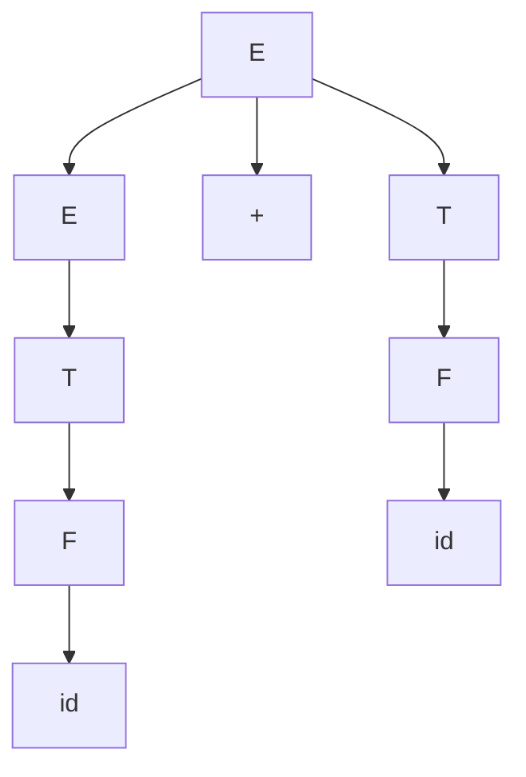
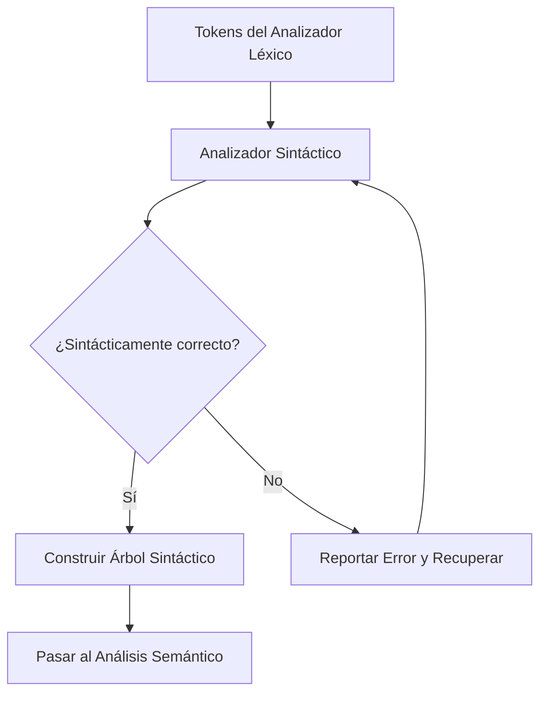

# Compiladores - Análisis sintáctico

## 3.1 Introducción.

---

El análisis sintáctico (parsing) es la segunda fase del proceso de compilación, que sigue al análisis léxico. Su objetivo principal es determinar si la secuencia de tokens producida por el analizador léxico forma una estructura sintácticamente válida según las reglas gramaticales del lenguaje de programación.

#### Definición Formal

Según Aho, Lam, Sethi y Ullman (2007), el analizador sintáctico obtiene una cadena de tokens del analizador léxico y verifica si dicha cadena puede ser generada por la gramática del lenguaje fuente. Si es así, typically construye un árbol de análisis sintáctico (parse tree) que representa la estructura gramatical.

#### Funciones del Analizador Sintáctico

1. **Verificación sintáctica**: Comprobar que los tokens forman expresiones válidas
2. **Construcción de estructura jerárquica**: Crear representaciones como árboles de sintaxis
3. **Detección de errores**: Identificar y reportar errores sintácticos
4. **Recuperación de errores**: Continuar el análisis después de encontrar errores

### Conceptos Fundamentales

#### Gramáticas Libres de Contexto (CFG)

Las gramáticas libres de contexto se definen mediante la cuádrupla $G = (N, T, P, S)$ donde:

- $N$: Conjunto de símbolos no terminales
- $T$: Conjunto de símbolos terminales (tokens)
- $P$: Conjunto de producciones de la forma $A \rightarrow \alpha$
- $S$: Símbolo inicial $(S \in N)$

**Ejemplo**: Gramática para expresiones aritméticas simples

$$ \begin{aligned} E &\rightarrow E + T \mid T \\\ T &\rightarrow T * F \mid F \\\ F &\rightarrow ( E ) \mid id \end{aligned} $$

#### Derivaciones y Árboles de Análisis

Una derivación es una secuencia de aplicaciones de reglas gramaticales:

$$ E \Rightarrow E + T \Rightarrow T + T \Rightarrow F + T \Rightarrow id + T \Rightarrow id + F \Rightarrow id + id $$



### Clasificación de Analizadores Sintácticos

#### Analizadores Descendentes (Top-Down)

Construyen el árbol de análisis desde la raíz hacia las hojas. Incluyen:

- Análisis por descenso recursivo
- Análisis LL (Left-to-right, Leftmost derivation)

#### Analizadores Ascendentes (Bottom-Up)

Construyen el árbol desde las hojas hacia la raíz. Incluyen:

- Análisis LR (Left-to-right, Rightmost derivation)
- Análisis SLR, LALR, LR(1)

### Algoritmos Básicos

#### Algoritmo de Análisis Descendente Recursivo

```python
def expresion():
    termino()
    while token_actual in ['+', '-']:
        obtener_siguiente_token()
        termino()

def termino():
    factor()
    while token_actual in ['*', '/']:
        obtener_siguiente_token()
        factor()

def factor():
    if token_actual == 'id':
        obtener_siguiente_token()
    elif token_actual == '(':
        obtener_siguiente_token()
        expresion()
        if token_actual == ')':
            obtener_siguiente_token()
        else:
            error("Se esperaba ')'")
    else:
        error("Token inesperado")
```

### Ejemplo Práctico

**Entrada**: `id + id * id`

**Tokens**: `[id, +, id, *, id]`

**Análisis**:

1. $E \Rightarrow E + T$
2. $E + T \Rightarrow T + T$
3. $T + T \Rightarrow F + T$
4. $F + T \Rightarrow id + T$
5. $id + T \Rightarrow id + T * F$
6. $id + T * F \Rightarrow id + F * F$
7. $id + F * F \Rightarrow id + id * F$
8. $id + id * F \Rightarrow id + id * id$

### Ejercicios Propuestos

1. Dada la gramática:

   $$ \begin{aligned} S &\rightarrow a S b \mid \epsilon \end{aligned} $$

   Construya el árbol de análisis para la cadena "aabb"

2. Para la gramática de expresiones mostrada anteriormente, realice el análisis descendente para la expresión: `(id + id) * id`

3. Clasifique las siguientes gramáticas como LL(1) o no LL(1) y justifique:
   - $A \rightarrow a A a \mid b$
   - $B \rightarrow a B \mid b B \mid \epsilon$

4. Implemente en pseudocódigo un analizador recursivo descendente para la gramática:

   $$ \begin{aligned} S &\rightarrow if E then S else S \mid id = E \\\ E &\rightarrow E + T \mid T \\\ T &\rightarrow id \mid num \end{aligned} $$

### Errores Sintácticos y Recuperación

El analizador sintáctico debe detectar errores como:

- Tokens inesperados
- Estructuras mal formadas
- Desbalances de paréntesis o llaves

**Estrategias de recuperación**:

- Modo pánico (panic mode)
- Recuperación por frases
- Producciones de error

### Diagrama de Proceso de Análisis Sintáctico



### Referencias

#### Bibliografía Básica

1. Aho, A. V., Lam, M. S., Sethi, R., & Ullman, J. D. (2007). _Compilers: Principles, Techniques, and Tools_ (2nd ed.). Pearson Education. (Capítulo 4: Syntax Analysis)
2. Cooper, K. D., & Torczon, L. (2004). _Engineering a Compiler_. Morgan Kaufmann.
3. Scott, M. L. (2009). _Programming Language Pragmatics_. Morgan Kaufmann.

#### Bibliografía Complementaria

1. Grune, D., Bal, H. E., Jacobs, C. J. H., & Langendoen, K. G. (2000). _Modern Compiler Design_. John Wiley & Sons.
2. Wilhelm, R., & Maurer, D. (1995). _Compiler Design_. Addison-Wesley.

#### Términos Clave

- **Token**: Unidad léxica con tipo y valor
- **Producción**: Regla gramatical de la forma $A \rightarrow \alpha$
- **Derivación**: Secuencia de aplicaciones de producciones
- **Árbol de análisis**: Representación jerárquica de la estructura sintáctica
- **Ambigüedad**: Cuando una cadena tiene múltiples árboles de análisis
- **Prefijo válido**: Secuencia inicial de tokens que puede extenderse a una cadena válida

Esta introducción sienta las bases para el estudio de técnicas específicas de análisis sintáctico que se verán en los siguientes temas de la asignatura.
