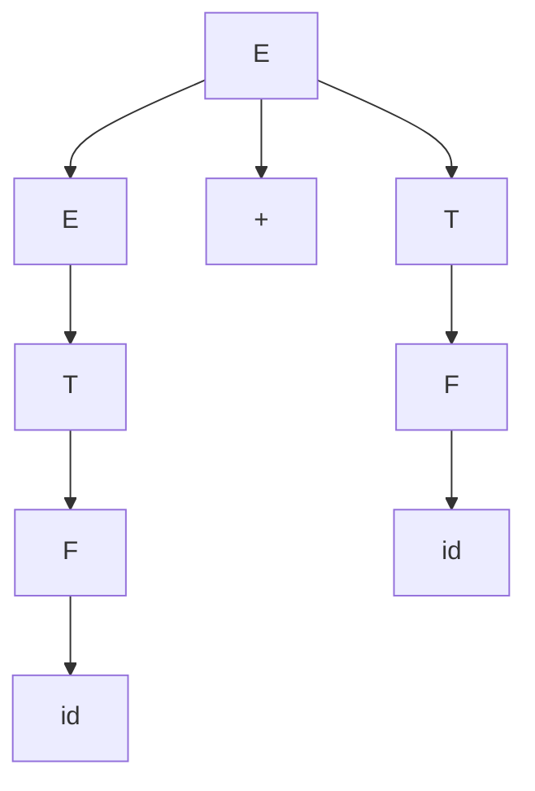
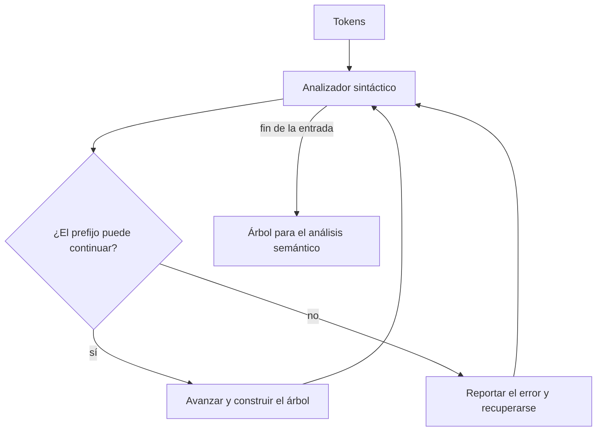

# Compiladores - Análisis sintáctico

## 3.1 Introducción.

---

El **análisis sintáctico** es la segunda fase del compilador: recibe la secuencia de tokens del analizador léxico, verifica que pueda generarse con la **gramática** del lenguaje y construye la estructura jerárquica del programa, el árbol sintáctico, sobre la que trabajan las fases siguientes. Las expresiones regulares no bastan para esto, porque las estructuras de los lenguajes de programación se **anidan** sin límite, como los paréntesis o los bloques, y para describirlas se usan las gramáticas libres de contexto. Este tema presenta las gramáticas, las derivaciones y los árboles, las dos grandes familias de analizadores y el manejo de errores, con un núcleo en Python que se reutiliza en todo el capítulo.

### Gramáticas libres de contexto

Una **gramática libre de contexto** es una cuádrupla $G = (N, T, P, S),$ donde $N$ es el conjunto de **no terminales**, $T$ el de **terminales**, que son los tokens, $P$ el de **producciones** $A \to \alpha,$ con $A \in N$ y $\alpha \in (N \cup T)^*,$ y $S \in N$ el símbolo inicial. Por ejemplo, para las expresiones aritméticas:

$$E \to E + T \mid T \qquad T \to T * F \mid F \qquad F \to ( E ) \mid \mathbf{id}$$

Una **derivación** reemplaza un no terminal por el lado derecho de una de sus producciones: $\alpha A \beta \Rightarrow \alpha \gamma \beta$ si $A \to \gamma \in P.$ El lenguaje de la gramática es $L(G) = \{w \in T^* : S \Rightarrow^* w\}.$ Las cadenas de $(N \cup T)^*$ que se derivan de $S$ son las **formas sentenciales**. En una derivación **más a la izquierda** se reemplaza siempre el no terminal de más a la izquierda, y en una **más a la derecha**, el de más a la derecha:

$$E \Rightarrow E + T \Rightarrow T + T \Rightarrow F + T \Rightarrow \mathbf{id} + T \Rightarrow \mathbf{id} + F \Rightarrow \mathbf{id} + \mathbf{id}$$

El **árbol de análisis** representa una derivación sin el orden de los reemplazos: la raíz es $S,$ cada nodo interior es un no terminal cuyos hijos forman el lado derecho de una producción, y las hojas, leídas de izquierda a derecha, forman la cadena. Cada árbol corresponde a exactamente una derivación más a la izquierda y a una más a la derecha. Una gramática es **ambigua** si alguna cadena tiene dos árboles distintos.



### Por qué no bastan las expresiones regulares

El lenguaje $\{a^n b^n : n \ge 0\},$ el de los paréntesis equilibrados con $a$ como apertura y $b$ como cierre, lo genera la gramática $S \to aSb \mid \varepsilon,$ pero ningún autómata finito lo reconoce: si tuviera $k$ estados, al leer $a^0, a^1, \ldots, a^k$ dos de esos prefijos, $a^i$ y $a^j$ con $i \ne j,$ llegarían al mismo estado, y entonces $a^i b^i$ y $a^j b^i$ serían ambas aceptadas o ambas rechazadas. Las gramáticas libres de contexto equivalen a los **autómatas de pila**, que agregan una pila a los autómatas finitos, y por eso todos los analizadores sintácticos usan una pila, explícita o la de las llamadas recursivas.

### Funciones del analizador sintáctico

1. **Verificar** que la secuencia de tokens pertenece al lenguaje.
2. **Construir la estructura**: el árbol de análisis o, más a menudo, un **árbol de sintaxis abstracta**, que omite los detalles de la gramática, como los paréntesis y los no terminales intermedios.
3. **Detectar los errores** lo antes posible: los analizadores LL y LR tienen la propiedad del **prefijo válido**, detectan el error en el primer token que no puede continuar ningún programa válido.
4. **Recuperarse** para seguir analizando y reportar varios errores.

### Las dos familias de analizadores

- **Descendentes:** construyen el árbol de la raíz hacia las hojas, siguiendo una derivación más a la izquierda. Incluyen el **descenso recursivo**, un procedimiento por no terminal, y los analizadores **LL(1)** guiados por tabla: leen la entrada de izquierda a derecha, *Left to right*, producen una derivación más a la izquierda, *Leftmost*, y deciden con un token de anticipación. No admiten la recursión por la izquierda, que debe eliminarse antes.
- **Ascendentes:** construyen el árbol de las hojas hacia la raíz, **reduciendo** lados derechos a su no terminal, y producen una derivación más a la derecha en orden inverso. Incluyen los analizadores **LR(1)**, **SLR(1)** y **LALR(1)**, los que generan yacc y bison, que admiten más gramáticas, incluidas las recursivas por la izquierda.

Para gramáticas arbitrarias, incluso ambiguas, existen algoritmos generales de costo $O(n^3),$ como CYK, Earley y GLR, que se usan para lenguajes naturales y algunos lenguajes de programación difíciles, como C++.



### Errores sintácticos

Los errores sintácticos son tokens inesperados, como un operador sin operando; estructuras incompletas, como un `if` sin su condición, y paréntesis o llaves sin equilibrar. Las estrategias de recuperación son las del tema 1.6: **modo de pánico**, que descarta tokens hasta uno de sincronización; **recuperación a nivel de frase**, que inserta o reemplaza un token; **producciones de error** en la gramática, como el token `error` de yacc, y **corrección global**, demasiado costosa en general. El tema 3.6 las implementa.

### Implementación en Python

El programa usa un núcleo de gramáticas que se reutiliza en los temas 3.2 a 3.7 y se incluye completo al inicio: lee una gramática en texto, calcula los anulables y los conjuntos FIRST y FOLLOW, construye la tabla LL(1) y su analizador con traza, las colecciones LR(0) y LR(1) con las tablas SLR(1), LR(1) y LALR(1), con resolución de conflictos por precedencia, y las transformaciones de gramáticas: eliminación de la recursión por la izquierda, factorización, eliminación de símbolos inútiles, forma normal de Chomsky y el algoritmo CYK. Con él resuelve los cuatro ejercicios.

```python
# ===== Núcleo de gramáticas: FIRST y FOLLOW, LL(1), LR(0), SLR(1), LR(1), LALR(1) y transformaciones =====
FIN = "$"

class Gramatica:
    """Producciones en texto: 'E -> E + T | T', símbolos separados por espacios, ε para la cadena vacía.
    Los no terminales son los lados izquierdos; el inicial es el primero."""
    def __init__(self, texto=None, prods=None, inicial=None):
        if texto is not None:
            prods = []
            for linea in texto.strip().splitlines():
                if not linea.strip(): continue
                izq, der = linea.split("->")
                for alt in der.split("|"):
                    s = tuple(x for x in alt.split() if x != "ε")
                    prods.append((izq.strip(), s))
        self.prods = list(dict.fromkeys(prods))
        self.inicial = inicial or self.prods[0][0]
        self.nt = list(dict.fromkeys([a for a, _ in self.prods]))
        self.t = list(dict.fromkeys(x for _, d in self.prods for x in d if x not in self.nt))
        self._calcula()
    def __str__(self):
        return "\n".join(f"   {a} -> " + " | ".join(" ".join(d) or "ε" for b, d in self.prods if b == a) for a in self.nt)
    def de(self, a): return [d for b, d in self.prods if b == a]
    def _calcula(self):
        self.anulable = set(); self.first = {a: set() for a in self.nt}
        cambio = True
        while cambio:
            cambio = False
            for a, d in self.prods:
                if a not in self.anulable and all(x in self.anulable for x in d): self.anulable.add(a); cambio = True
                f = self.first_de(d)
                if not f <= self.first[a]: self.first[a] |= f; cambio = True
        self.follow = {a: set() for a in self.nt}; self.follow[self.inicial].add(FIN)
        cambio = True
        while cambio:
            cambio = False
            for a, d in self.prods:
                for i, x in enumerate(d):
                    if x not in self.nt: continue
                    resto = d[i + 1:]; f = self.first_de(resto)
                    if all(y in self.anulable for y in resto): f = f | self.follow[a]
                    if not f <= self.follow[x]: self.follow[x] |= f; cambio = True
    def first_de(self, sec):
        f = set()
        for x in sec:
            if x not in self.nt: f.add(x); return f
            f |= self.first.get(x, set())
            if x not in self.anulable: return f
        return f
    def anulable_sec(self, sec): return all(x in self.anulable for x in sec)
    def conjuntos(self):
        orden = lambda s: sorted(s, key=lambda x: (x == FIN, x))
        return "\n".join(f"   {a:8} FIRST = {{{', '.join(orden(self.first[a]))}}}{' + ε' if a in self.anulable else ''}"
                         f"   FOLLOW = {{{', '.join(orden(self.follow[a]))}}}" for a in self.nt)

# ---------- LL(1) ----------
def tabla_ll1(g):
    M = {}
    for a, d in g.prods:
        dest = set(g.first_de(d))
        if g.anulable_sec(d): dest |= g.follow[a]
        for x in dest: M.setdefault((a, x), []).append(d)
    conflictos = {k: v for k, v in M.items() if len(v) > 1}
    return M, conflictos

def muestra_ll1(g, M):
    cols = g.t + [FIN]; filas = [[""] + cols]
    for a in g.nt:
        filas.append([a] + [" / ".join(f"{a}->{' '.join(d) or 'ε'}" for d in M.get((a, c), [])) for c in cols])
    anchos = [max(len(f[i]) for f in filas) for i in range(len(cols) + 1)]
    return "\n".join("   " + " | ".join(x.ljust(w) for x, w in zip(f, anchos)) for f in filas)

def analiza_ll1(g, M, tokens, traza=False):
    """Analizador predictivo con pila. Devuelve (acepta, árbol, filas de la traza)."""
    entrada = list(tokens) + [FIN]; raiz = [g.inicial, []]; pila = [(FIN, None), (g.inicial, raiz)]; i = 0; filas = []
    while True:
        x, nodo = pila[-1]; a = entrada[i]
        estado = (" ".join(s for s, _ in pila), " ".join(entrada[i:]))
        if x == FIN and a == FIN: filas.append(estado + ("aceptar",)); return True, raiz, filas
        if x not in g.nt:
            if x != a: filas.append(estado + (f"error: se esperaba {x}",)); return False, raiz, filas
            filas.append(estado + (f"coincide {a}",)); pila.pop(); i += 1; continue
        ds = M.get((x, a))
        if not ds: filas.append(estado + (f"error: M[{x}, {a}] vacía",)); return False, raiz, filas
        d = ds[0]; filas.append(estado + (f"{x} -> {' '.join(d) or 'ε'}",)); pila.pop()
        hijos = [[s, []] for s in d] or [["ε", []]]; nodo[1].extend(hijos)
        for s, h in reversed(list(zip(d, hijos))): pila.append((s, h))

def muestra_traza(filas, anchos=(None, None)):
    a = anchos[0] or max(len(f[0]) for f in filas); b = anchos[1] or max(len(f[1]) for f in filas)
    return "\n".join(f"   {f[0]:>{a}} | {f[1]:>{b}} | {f[2]}" for f in filas)

def arbol_texto(nodo):
    s, hijos = nodo
    return s if not hijos else f"{s}(" + " ".join(arbol_texto(h) for h in hijos) + ")"

# ---------- LR: elementos, colecciones y tablas ----------
class LR:
    """metodo: 'LR0', 'SLR', 'LR1' o 'LALR'. Los estados se numeran en orden de descubrimiento."""
    def __init__(self, g, metodo="SLR", precedencia=None, yacc=False):
        """yacc=True resuelve los conflictos restantes como yacc: desplazar antes que reducir,
        y entre dos reducciones, la producción listada primero."""
        self.g, self.metodo, self.yacc = g, metodo, yacc
        self.aum = g.inicial + "'"
        while self.aum in g.nt: self.aum += "'"
        self.P = [(self.aum, (g.inicial,))] + g.prods
        self.prec = precedencia or {}
        if metodo in ("LR0", "SLR"): self._lr0()
        else: self._lr1()
        self._tabla()
    def texto_item(self, it):
        p, k = it[0], it[1]; a, d = self.P[p]
        s = f"{a} -> " + " ".join(list(d[:k]) + ["·"] + list(d[k:]))
        return s + (f", {'/'.join(sorted(it[2], key=lambda x: (x == FIN, x)))}" if len(it) > 2 else "")
    # LR(0)
    def cierre0(self, I):
        I = set(I); cambio = True
        while cambio:
            cambio = False
            for p, k in list(I):
                d = self.P[p][1]
                if k < len(d) and d[k] in self.g.nt:
                    for q, (a, _) in enumerate(self.P):
                        if a == d[k] and (q, 0) not in I: I.add((q, 0)); cambio = True
        return frozenset(I)
    def ir0(self, I, x):
        return self.cierre0({(p, k + 1) for p, k in I if k < len(self.P[p][1]) and self.P[p][1][k] == x})
    def _simbolos(self): return self.g.nt + self.g.t
    def _lr0(self):
        I0 = self.cierre0({(0, 0)}); self.estados = [I0]; self.ir = {}; num = {I0: 0}; k = 0
        while k < len(self.estados):
            I = self.estados[k]
            for x in self._siguientes(I):
                J = self.ir0(I, x)
                if J not in num: num[J] = len(self.estados); self.estados.append(J)
                self.ir[(k, x)] = num[J]
            k += 1
        self.items = [{(p, d): None for p, d in sorted(I)} for I in self.estados]
    def _siguientes(self, I):
        vistos = []
        for it in sorted(I, key=lambda t: (t[0], t[1])):
            d = self.P[it[0]][1]
            if it[1] < len(d) and d[it[1]] not in vistos: vistos.append(d[it[1]])
        return vistos
    # LR(1): un estado es un diccionario núcleo -> conjunto de símbolos de anticipación
    def cierre1(self, I):
        I = {k: set(v) for k, v in I.items()}; cambio = True
        while cambio:
            cambio = False
            for (p, k), la in list(I.items()):
                d = self.P[p][1]
                if k < len(d) and d[k] in self.g.nt:
                    beta = d[k + 1:]; f = self.g.first_de(beta)
                    nuevos = f | (la if self.g.anulable_sec(beta) else set())
                    for q, (a, _) in enumerate(self.P):
                        if a == d[k]:
                            actual = I.setdefault((q, 0), set())
                            if not nuevos <= actual: actual |= nuevos; cambio = True
        return I
    def _lr1(self):
        def clave(I): return frozenset((k, frozenset(v)) for k, v in I.items())
        def nucleo(I): return frozenset(I)
        I0 = self.cierre1({(0, 0): {FIN}}); est = [I0]; ir = {}; num = {clave(I0): 0}; k = 0
        while k < len(est):
            I = est[k]
            for x in self._siguientes(I):
                J = {}
                for (p, d), la in I.items():
                    rhs = self.P[p][1]
                    if d < len(rhs) and rhs[d] == x: J.setdefault((p, d + 1), set()).update(la)
                J = self.cierre1(J); c = clave(J)
                if c not in num: num[c] = len(est); est.append(J)
                ir[(k, x)] = num[c]
            k += 1
        self.n_lr1 = len(est)
        if self.metodo == "LALR":                     # fundir los estados con el mismo núcleo
            grupo, fusion = {}, []
            for i, I in enumerate(est):
                n = nucleo(I)
                if n not in grupo: grupo[n] = len(fusion); fusion.append({kk: set(v) for kk, v in I.items()})
                else:
                    for kk, v in I.items(): fusion[grupo[n]][kk] |= v
            mapa = {i: grupo[nucleo(I)] for i, I in enumerate(est)}
            est = fusion; ir = {(mapa[i], x): mapa[j] for (i, x), j in ir.items()}
        self.estados = [frozenset(I) for I in est]; self.ir = ir
        self.items = [{k: frozenset(v) for k, v in sorted(I.items())} for I in est]
    def _tabla(self):
        self.accion = {}; self.conflictos = []; self.resueltos = []
        for i, I in enumerate(self.items):
            for (p, k), la in I.items():
                a, d = self.P[p]
                if k < len(d):
                    x = d[k]
                    if x not in self.g.nt: self._pon(i, x, ("d", self.ir[(i, x)]))
                elif p == 0: self._pon(i, FIN, ("acc",))
                else:
                    if self.metodo == "LR0": dest = self.g.t + [FIN]
                    elif self.metodo == "SLR": dest = self.g.follow[a]
                    else: dest = la
                    for x in sorted(dest): self._pon(i, x, ("r", p))
        for (i, x), v in sorted(self.accion.items()):
            if len(v) > 1:
                self.conflictos.append((i, x, list(v)))
                if self.yacc:
                    gana = next((a for a in v if a[0] == "d"), None) or min(v, key=lambda a: a[1])
                    self.resueltos.append((i, x, self.texto_accion(gana))); v[:] = [gana]
    def _nivel(self, p):
        """Precedencia de una producción: la de su último terminal con precedencia, como en yacc."""
        for x in reversed(self.P[p][1]):
            if x in self.prec: return self.prec[x]
        return None
    def _pon(self, i, x, act):
        v = self.accion.setdefault((i, x), [])
        if act in v: return
        if v and self.prec:
            despl = next((a for a in v + [act] if a[0] == "d"), None); red = next((a for a in v + [act] if a[0] == "r"), None)
            if despl and red and x in self.prec and self._nivel(red[1]):
                (nt, at), (nr, _) = self.prec[x], self._nivel(red[1])
                gana = red if nr > nt or (nr == nt and at == "izq") else despl
                self.resueltos.append((i, x, gana[0])); v[:] = [gana]; return
        v.append(act)
    def texto_accion(self, a):
        return {"d": lambda: f"d{a[1]}", "r": lambda: f"r{a[1]}", "acc": lambda: "acc"}[a[0]]()
    def tabla(self):
        ts = self.g.t + [FIN]; ns = self.g.nt
        filas = [["estado"] + ts + ns]
        for i in range(len(self.estados)):
            filas.append([str(i)] + ["/".join(self.texto_accion(a) for a in self.accion.get((i, x), [])) for x in ts]
                         + [str(self.ir.get((i, x), "")) for x in ns])
        anchos = [max(len(f[c]) for f in filas) for c in range(len(filas[0]))]
        return "\n".join("   " + " | ".join(x.rjust(w) for x, w in zip(f, anchos)) for f in filas)
    def coleccion(self):
        res = []
        for i, I in enumerate(self.items):
            its = [(k + ((la,) if la is not None else ())) for k, la in I.items()]
            res.append(f"   I{i}: " + "; ".join(self.texto_item(it) for it in its))
        return "\n".join(res)
    def analiza(self, tokens, traza=False):
        entrada = list(tokens) + [FIN]; pila = [0]; simbolos = []; nodos = []; i = 0; filas = []
        while True:
            s, a = pila[-1], entrada[i]
            acts = self.accion.get((s, a))
            estado = (" ".join(str(x) for x in pila), " ".join(simbolos), " ".join(entrada[i:]))
            if not acts:
                esperados = sorted({x for (e, x) in self.accion if e == s}, key=lambda x: (x == FIN, x))
                filas.append(estado + (f"error: se esperaba {', '.join(esperados)}",)); return False, None, filas
            act = acts[0]
            if act[0] == "d":
                filas.append(estado + (f"desplazar {act[1]}",)); pila.append(act[1]); simbolos.append(a); nodos.append([a, []]); i += 1
            elif act[0] == "r":
                b, d = self.P[act[1]]; n = len(d)
                hijos = nodos[len(nodos) - n:] if n else [["ε", []]]
                if n: del pila[-n:]; del simbolos[-n:]; del nodos[-n:]
                pila.append(self.ir[(pila[-1], b)]); simbolos.append(b); nodos.append([b, hijos])
                filas.append(estado + (f"reducir {b} -> {' '.join(d) or 'ε'}",))
            else:
                filas.append(estado + ("aceptar",)); return True, nodos[-1], filas

def muestra_traza_lr(filas):
    a = max(len(f[0]) for f in filas); b = max(len(f[1]) for f in filas); c = max(len(f[2]) for f in filas)
    return "\n".join(f"   {f[0]:<{a}} | {f[1]:<{b}} | {f[2]:>{c}} | {f[3]}" for f in filas)

# ---------- Transformaciones ----------
def sin_recursion_izquierda(g, orden=None):
    """Algoritmo de Aho y otros 4.19: ordena los no terminales, sustituye y elimina la recursión inmediata."""
    orden = orden or g.nt; P = {a: [list(d) for d in g.de(a)] for a in g.nt}; nuevos = []
    for i, ai in enumerate(orden):
        for aj in orden[:i]:
            nuevas = []
            for d in P[ai]:
                if d and d[0] == aj: nuevas += [dj + d[1:] for dj in P[aj]]
                else: nuevas.append(d)
            P[ai] = nuevas
        rec = [d[1:] for d in P[ai] if d and d[0] == ai]; resto = [d for d in P[ai] if not d or d[0] != ai]
        if rec:
            ap = ai + "'"; P[ai] = [d + [ap] for d in resto]; P[ap] = [d + [ap] for d in rec] + [[]]; nuevos.append((ai, ap))
    lista = []
    for a in orden:
        lista += [(a, tuple(d)) for d in P[a]]
        for x, ap in nuevos:
            if x == a: lista += [(ap, tuple(d)) for d in P[ap]]
    return Gramatica(prods=lista, inicial=g.inicial)

def factoriza(g):
    P = {a: [tuple(d) for d in g.de(a)] for a in g.nt}; orden = list(g.nt); cambio = True
    while cambio:
        cambio = False
        for a in list(orden):
            grupos = {}
            for d in P[a]: grupos.setdefault(d[:1], []).append(d)
            for pre, ds in grupos.items():
                if not pre or len(ds) < 2: continue
                k = 1
                while all(len(d) > k for d in ds) and len({d[k] for d in ds}) == 1: k += 1
                comun = ds[0][:k]; nuevo = a + "'"
                while nuevo in P: nuevo += "'"
                P[a] = [d for d in P[a] if d not in ds] + [comun + (nuevo,)]
                P[nuevo] = [d[k:] for d in ds]; orden.insert(orden.index(a) + 1, nuevo); cambio = True; break
            if cambio: break
    return Gramatica(prods=[(a, d) for a in orden for d in P[a]], inicial=g.inicial)

def sin_inutiles(g):
    gen = set(); cambio = True
    while cambio:
        cambio = False
        for a, d in g.prods:
            if a not in gen and all(x in gen or x not in g.nt for x in d): gen.add(a); cambio = True
    prods = [(a, d) for a, d in g.prods if a in gen and all(x in gen or x not in g.nt for x in d)]
    alc = {g.inicial}; cambio = True
    while cambio:
        cambio = False
        for a, d in prods:
            if a in alc:
                for x in d:
                    if x in g.nt and x not in alc: alc.add(x); cambio = True
    prods = [(a, d) for a, d in prods if a in alc]
    return Gramatica(prods=prods, inicial=g.inicial), sorted(set(g.nt) - gen), sorted(gen - alc)

def chomsky(g):
    """Forma normal de Chomsky: inicial nuevo, sin ε, sin unitarias, terminales aislados y lados derechos binarios."""
    S0 = g.inicial + "0"; prods = [(S0, (g.inicial,))] + list(g.prods); nt = [S0] + g.nt
    anul = set(g.anulable)
    nuevas = set()
    for a, d in prods:
        pos = [i for i, x in enumerate(d) if x in anul]
        for m in range(1 << len(pos)):
            quita = {pos[j] for j in range(len(pos)) if m >> j & 1}
            e = tuple(x for i, x in enumerate(d) if i not in quita)
            if e or a == S0: nuevas.add((a, e))
    if g.inicial in anul: nuevas.add((S0, ()))
    prods = sorted(nuevas, key=lambda p: (nt.index(p[0]), p[1]))
    unit = {a: {a} for a in nt}; cambio = True
    while cambio:
        cambio = False
        for a, d in prods:
            if len(d) == 1 and d[0] in nt:
                for b in nt:
                    if a in unit[b] and d[0] not in unit[b]: unit[b].add(d[0]); cambio = True
    prods = sorted({(a, d) for a in nt for b in unit[a] for c, d in prods if c == b and not (len(d) == 1 and d[0] in nt)},
                   key=lambda p: (nt.index(p[0]), p[1]))
    term = {}; final = []; cont = [0]; pares = {}
    def nt_de(t):
        if t not in term: term[t] = f"T_{t}"; final.append((term[t], (t,)))
        return term[t]
    for a, d in prods:
        if len(d) >= 2: d = tuple(nt_de(x) if x not in nt else x for x in d)
        while len(d) > 2:
            par = d[-2:]
            if par not in pares: cont[0] += 1; pares[par] = f"X{cont[0]}"; final.append((pares[par], par))
            d = d[:-2] + (pares[par],)
        final.append((a, d))
    orden = {a: i for i, a in enumerate(nt)}
    final.sort(key=lambda p: (orden.get(p[0], len(nt)), p[0], p[1]))
    return Gramatica(prods=final, inicial=S0)

def cyk(g, w):
    """Reconocimiento con el algoritmo CYK para una gramática en forma normal de Chomsky: O(n^3 |G|)."""
    n = len(w)
    if n == 0: return (g.inicial, ()) in g.prods, {}
    T = {}
    for i, a in enumerate(w): T[(i, i)] = {b for b, d in g.prods if d == (a,)}
    for l in range(2, n + 1):
        for i in range(n - l + 1):
            j = i + l - 1; T[(i, j)] = set()
            for k in range(i, j):
                for b, d in g.prods:
                    if len(d) == 2 and d[0] in T[(i, k)] and d[1] in T[(k + 1, j)]: T[(i, j)].add(b)
    return g.inicial in T[(0, n - 1)], T

def dibuja(nodo, prefijo="   ", ultimo=True, raiz=True):
    s, hijos = nodo
    lineas = [prefijo + ("" if raiz else ("└─ " if ultimo else "├─ ")) + s]
    sub = prefijo + ("" if raiz else ("   " if ultimo else "│  "))
    for k, h in enumerate(hijos): lineas += dibuja(h, sub, k == len(hijos) - 1, False)
    return lineas
def derivacion_izquierda(arbol):
    """Formas sentenciales de la derivación más a la izquierda que corresponde al árbol."""
    forma = [arbol]; pasos = []
    def texto(f): return " ".join(n[0] for n in f if n[0] != "ε") or "ε"
    pasos.append(texto(forma))
    while True:
        k = next((i for i, n in enumerate(forma) if n[1]), None)
        if k is None: return pasos
        forma = forma[:k] + forma[k][1] + forma[k + 1:]
        forma = [n for n in forma if n[0] != "ε"]; pasos.append(texto(forma))

# ---------- Ejercicio 1: S -> a S b | ε, árbol de aabb ----------
G1 = Gramatica("S -> a S b | ε")
M1, c1 = tabla_ll1(G1)
ok, arbol, _ = analiza_ll1(G1, M1, list("aabb"))
print("ejercicio 1: aabb aceptada:", ok); print("\n".join(dibuja(arbol)))
print("   derivación:", " => ".join(derivacion_izquierda(arbol)))
print("   aab:", analiza_ll1(G1, M1, list("aab"))[2][-1][2], "| abab:", analiza_ll1(G1, M1, list("abab"))[2][-1][2])

# ---------- Ejercicio 2: análisis descendente de (id + id) * id ----------
E = Gramatica("""E -> E + T | T
T -> T * F | F
F -> ( E ) | id""")
print("ejercicio 2: la gramática original es recursiva por la izquierda; conflictos LL(1):",
      sorted(f"M[{a}, {x}]" for a, x in tabla_ll1(E)[1]))
E2 = sin_recursion_izquierda(E); print("   sin recursión por la izquierda:"); print(E2)
M2, c2 = tabla_ll1(E2); print("   conflictos:", c2)
ok, arbol, filas = analiza_ll1(E2, M2, "( id + id ) * id".split())
print(muestra_traza(filas)); print("   árbol:", arbol_texto(arbol))

# ---------- Ejercicio 3: ¿LL(1)? ----------
for texto in ["A -> a A a | b", "B -> a B | b B | ε", "C -> a C | a", "D -> D a | b"]:
    g = Gramatica(texto); M, c = tabla_ll1(g)
    print(f"ejercicio 3: {texto:20} FIRST por alternativa:",
          [sorted(g.first_de(d)) or ["ε"] for d in g.de(g.inicial)],
          f"FOLLOW = {sorted(g.follow[g.inicial])}", "LL(1)" if not c else f"no LL(1), conflictos en {sorted(c)}")

# ---------- Ejercicio 4: descenso recursivo para if-then-else y asignaciones ----------
class ErrorSintactico(Exception): pass
class Descendente:
    """S -> if E then S else S | id = E;  E -> T { + T };  T -> id | num  (la repetición reemplaza la recursión izquierda)"""
    def __init__(self, tokens): self.t, self.i = list(tokens) + [FIN], 0
    def mira(self): return self.t[self.i]
    def come(self, esperado):
        if self.mira() != esperado: raise ErrorSintactico(f"token {self.i + 1}: se esperaba '{esperado}' y llegó '{self.mira()}'")
        self.i += 1; return [esperado, []]
    def S(self):
        if self.mira() == "if":
            return ["S", [self.come("if"), self.E(), self.come("then"), self.S(), self.come("else"), self.S()]]
        if self.mira() == "id":
            return ["S", [self.come("id"), self.come("="), self.E()]]
        raise ErrorSintactico(f"token {self.i + 1}: se esperaba una sentencia y llegó '{self.mira()}'")
    def E(self):
        nodo = self.T()
        while self.mira() == "+": nodo = ["E", [nodo, self.come("+"), self.T()]]
        return nodo if nodo[0] == "E" else ["E", [nodo]]
    def T(self):
        if self.mira() in ("id", "num"): return ["T", [self.come(self.mira())]]
        raise ErrorSintactico(f"token {self.i + 1}: se esperaba id o num y llegó '{self.mira()}'")
    def programa(self):
        s = self.S(); self.come(FIN); return s
for entrada in ["id = id + num + id", "if id then id = num else if num then id = id else id = num",
                "if id then id = num", "id = + num"]:
    try: print(f"ejercicio 4: {entrada!r}:", arbol_texto(Descendente(entrada.split()).programa()))
    except ErrorSintactico as e: print(f"ejercicio 4: {entrada!r}: error, {e}")
G4 = sin_recursion_izquierda(Gramatica("""S -> if E then S else S | id = E
E -> E + T | T
T -> id | num"""))
print("   la gramática sin recursión izquierda es LL(1):", not tabla_ll1(G4)[1])
```

Salida:

```text
ejercicio 1: aabb aceptada: True
   S
   ├─ a
   ├─ S
   │  ├─ a
   │  ├─ S
   │  │  └─ ε
   │  └─ b
   └─ b
   derivación: S => a S b => a a S b b => a a b b
   aab: error: se esperaba b | abab: error: se esperaba $
ejercicio 2: la gramática original es recursiva por la izquierda; conflictos LL(1): ['M[E, (]', 'M[E, id]', 'M[T, (]', 'M[T, id]']
   sin recursión por la izquierda:
   E -> T E'
   E' -> + T E' | ε
   T -> F T'
   T' -> * F T' | ε
   F -> ( E ) | id
   conflictos: {}
                  $ E | ( id + id ) * id $ | E -> T E'
               $ E' T | ( id + id ) * id $ | T -> F T'
            $ E' T' F | ( id + id ) * id $ | F -> ( E )
        $ E' T' ) E ( | ( id + id ) * id $ | coincide (
          $ E' T' ) E |   id + id ) * id $ | E -> T E'
       $ E' T' ) E' T |   id + id ) * id $ | T -> F T'
    $ E' T' ) E' T' F |   id + id ) * id $ | F -> id
   $ E' T' ) E' T' id |   id + id ) * id $ | coincide id
      $ E' T' ) E' T' |      + id ) * id $ | T' -> ε
         $ E' T' ) E' |      + id ) * id $ | E' -> + T E'
     $ E' T' ) E' T + |      + id ) * id $ | coincide +
       $ E' T' ) E' T |        id ) * id $ | T -> F T'
    $ E' T' ) E' T' F |        id ) * id $ | F -> id
   $ E' T' ) E' T' id |        id ) * id $ | coincide id
      $ E' T' ) E' T' |           ) * id $ | T' -> ε
         $ E' T' ) E' |           ) * id $ | E' -> ε
            $ E' T' ) |           ) * id $ | coincide )
              $ E' T' |             * id $ | T' -> * F T'
          $ E' T' F * |             * id $ | coincide *
            $ E' T' F |               id $ | F -> id
           $ E' T' id |               id $ | coincide id
              $ E' T' |                  $ | T' -> ε
                 $ E' |                  $ | E' -> ε
                    $ |                  $ | aceptar
   árbol: E(T(F(( E(T(F(id) T'(ε)) E'(+ T(F(id) T'(ε)) E'(ε))) )) T'(* F(id) T'(ε))) E'(ε))
ejercicio 3: A -> a A a | b       FIRST por alternativa: [['a'], ['b']] FOLLOW = ['$', 'a'] LL(1)
ejercicio 3: B -> a B | b B | ε   FIRST por alternativa: [['a'], ['b'], ['ε']] FOLLOW = ['$'] LL(1)
ejercicio 3: C -> a C | a         FIRST por alternativa: [['a'], ['a']] FOLLOW = ['$'] no LL(1), conflictos en [('C', 'a')]
ejercicio 3: D -> D a | b         FIRST por alternativa: [['b'], ['b']] FOLLOW = ['$', 'a'] no LL(1), conflictos en [('D', 'b')]
ejercicio 4: 'id = id + num + id': S(id = E(E(T(id) + T(num)) + T(id)))
ejercicio 4: 'if id then id = num else if num then id = id else id = num': S(if E(T(id)) then S(id = E(T(num))) else S(if E(T(num)) then S(id = E(T(id))) else S(id = E(T(num)))))
ejercicio 4: 'if id then id = num': error, token 7: se esperaba 'else' y llegó '$'
ejercicio 4: 'id = + num': error, token 3: se esperaba id o num y llegó '+'
   la gramática sin recursión izquierda es LL(1): True
```

### Ejercicios Propuestos

1. **Árbol de análisis.** Dada la gramática $S \to a S b \mid \varepsilon,$ construye el árbol de análisis para la cadena `aabb`.

2. **Análisis descendente.** Para la gramática de expresiones, realiza el análisis descendente de la expresión `(id + id) * id`.

3. **Clasificación.** Clasifica las siguientes gramáticas como LL(1) o no LL(1) y justifica:
    - $A \to a A a \mid b$
    - $B \to a B \mid b B \mid \varepsilon$

4. **Descenso recursivo.** Implementa un analizador por descenso recursivo para la gramática:

    $$S \to \mathbf{if}\ E\ \mathbf{then}\ S\ \mathbf{else}\ S \mid \mathbf{id} = E \qquad E \to E + T \mid T \qquad T \to \mathbf{id} \mid \mathbf{num}$$

### Soluciones

**Ejercicio 1.** El árbol tiene la raíz $S$ con hijos $a,$ $S$ y $b;$ el $S$ interior tiene a su vez $a,$ $S$ y $b,$ y el más profundo deriva $\varepsilon.$ La derivación es $S \Rightarrow aSb \Rightarrow aaSbb \Rightarrow aabb.$ Cada aplicación de $S \to aSb$ agrega una $a$ a la izquierda y una $b$ a la derecha, de modo que, por inducción sobre el número de pasos, la gramática genera exactamente $\{a^n b^n : n \ge 0\}.$ El analizador LL(1) rechaza `aab`, porque al terminar la entrada aún espera una $b,$ y `abab`, porque después de `ab` espera el fin.

**Ejercicio 2.** La gramática de expresiones no sirve directamente para el análisis descendente: es **recursiva por la izquierda**, $E \to E + T,$ y un analizador que quiera expandir $E$ volvería a expandir $E$ sin consumir nada; en la tabla LL(1) eso aparece como conflictos, porque $E \to E + T$ y $E \to T$ empiezan con los mismos tokens. Eliminando la recursión se obtiene

$$E \to T E' \qquad E' \to + T E' \mid \varepsilon \qquad T \to F T' \qquad T' \to * F T' \mid \varepsilon \qquad F \to ( E ) \mid \mathbf{id}$$

que es LL(1). La traza del programa muestra en cada paso la pila, con el tope a la derecha, la entrada restante y la acción: expandir con la producción de la tabla o hacer coincidir un terminal. Al ver `(`, la tabla elige $F \to ( E );$ dentro de los paréntesis, $E' \to + T E'$ consume el `+`, y al llegar `)`, como `)` está en FOLLOW de $T'$ y de $E',$ ambos se expanden a $\varepsilon.$ Después, $T' \to * F T'$ consume el `*`, y la entrada se acepta en 24 pasos.

**Ejercicio 3.** Una gramática es LL(1) si, para cada no terminal, los conjuntos de predicción de sus alternativas son disjuntos: FIRST de cada alternativa y, para la que deriva $\varepsilon,$ el FOLLOW del no terminal.

- $A \to aAa \mid b$ **es LL(1):** las alternativas empiezan con $a$ y con $b,$ y ninguna deriva $\varepsilon.$
- $B \to aB \mid bB \mid \varepsilon$ **es LL(1):** FIRST de las alternativas son $\{a\}$ y $\{b\},$ y para $\varepsilon$ cuenta el FOLLOW de $B,$ que solo contiene el fin de la entrada, `$`; los tres son disjuntos. Genera $(a \mid b)^*.$

Para contrastar, el programa analiza dos gramáticas que no son LL(1): $C \to aC \mid a,$ cuyas alternativas empiezan con $a,$ que se arregla factorizando, y $D \to Da \mid b,$ recursiva por la izquierda.

**Ejercicio 4.** La regla $E \to E + T$ es recursiva por la izquierda, así que el analizador la implementa como una **repetición**, $E \to T \{ + T \},$ que genera el mismo lenguaje: el ciclo `while` consume cada `+ T` y construye el árbol hacia la izquierda, de modo que la suma conserva su asociatividad por la izquierda, como muestra el árbol de `id = id + num + id`. Cada no terminal es un procedimiento que decide con el token actual: $S$ elige entre `if` e `id`, y $T$ entre `id` y `num`. La gramática es LL(1), como confirma el programa sobre la versión sin recursión, porque el `else` es obligatorio: no hay ambigüedad del `else` colgante, y `if id then id = num` es un error, reportado al llegar al fin. El mensaje dice qué token se esperaba y cuál llegó.

En el material original, el texto decía "typically" en inglés; el pseudocódigo del descenso recursivo usaba los operadores `-` y `/`, que no están en la gramática del ejemplo, y la lista de pasos del "análisis" de `id + id * id` era una derivación, no la traza de un analizador. El ejercicio 4 pedía un analizador descendente para una gramática recursiva por la izquierda sin advertir que hay que transformarla.

### Referencias

1. Aho, A. V., Lam, M. S., Sethi, R., and Ullman, J. D., _Compilers: Principles, Techniques, and Tools_. 2a ed., Pearson, 2007. Secciones 4.1 a 4.4.
2. Cooper, K. D., and Torczon, L., _Engineering a Compiler_. 3a ed., Morgan Kaufmann, 2022. Capítulo 3.
3. Hopcroft, J. E., Motwani, R., and Ullman, J. D., _Introduction to Automata Theory, Languages, and Computation_. 3a ed., Pearson, 2006. Capítulos 5 y 6.
4. Grune, D., and Jacobs, C. J. H., _Parsing Techniques: A Practical Guide_. 2a ed., Springer, 2008.
5. Scott, M. L., _Programming Language Pragmatics_. 4a ed., Morgan Kaufmann, 2016. Capítulo 2.
