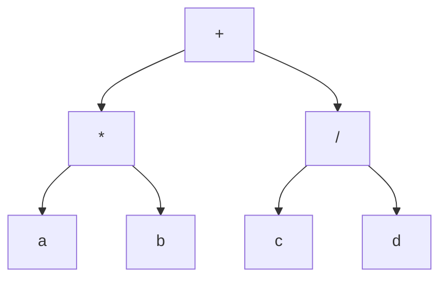

# Compiladores - Análisis sintáctico

## 3.2 Sintaxis de expresiones.

---

Las expresiones son la parte de la sintaxis donde más importa la **estructura**: en `a + b * c` el árbol decide si se multiplica antes de sumar, y en `a - b - c` si se resta de izquierda a derecha. Una gramática de expresiones debe codificar la **precedencia** y la **asociatividad** de los operadores, sin ambigüedad. Este tema presenta las gramáticas ambiguas y no ambiguas de expresiones, cómo se codifican la precedencia y la asociatividad, las notaciones infija, prefija y postfija, el árbol de sintaxis abstracta y los algoritmos clásicos para analizar expresiones.

### Una gramática ambigua

La gramática más natural para las expresiones es

$$E \to E + E \mid E - E \mid E * E \mid E / E \mid ( E ) \mid \mathbf{id}$$

pero es **ambigua**: `a + b * c` tiene un árbol en que la suma es la raíz, $a + (b \cdot c),$ y otro en que lo es la multiplicación, $(a + b) \cdot c;$ y `a - b - c` tiene uno que la agrupa por la izquierda y otro por la derecha, con valores distintos. Para una suma de $n$ operandos, el número de árboles es el número de Catalan $C_{n-1} = \frac{1}{n}\binom{2n-2}{n-1}:$ 1, 1, 2, 5, 14, 42, 132.

### Precedencia y asociatividad en la gramática

La solución clásica es un **no terminal por nivel de precedencia**, de menor a mayor, y la **recursión** del lado de la asociatividad:

$$E \to E + T \mid E - T \mid T \qquad T \to T * F \mid T / F \mid F \qquad F \to ( E ) \mid \mathbf{id}$$

- **Precedencia:** un término $T$ no puede contener un `+` fuera de paréntesis, así que en `a + b * c` el `*` queda más abajo en el árbol y se evalúa primero.
- **Asociatividad:** la regla $E \to E + T$ es recursiva por la **izquierda**, de modo que en `a - b - c` el subárbol izquierdo contiene `a - b`, y la expresión vale $(a - b) - c.$ Un operador asociativo por la **derecha**, como la exponenciación, se escribe con recursión por la derecha: $F \to P\ \texttt{**}\ F \mid P.$

**Proposición.** Esta gramática no es ambigua.

*Demostración.* Por inducción sobre la longitud de la cadena: si $w$ se deriva de $E$ y tiene un `+` o un `-` fuera de paréntesis, la raíz debe usar $E \to E \pm T,$ y como $T$ no genera esos operadores fuera de paréntesis, el operador de la raíz es necesariamente el **último** `+` o `-` fuera de paréntesis; la división de $w$ queda determinada, y por la hipótesis de inducción cada parte tiene un solo árbol. Si no hay ninguno, la raíz es $E \to T$ y el argumento se repite con `*` y `/` en $T,$ y con los paréntesis en $F.$ $\blacksquare$

| Nivel | Operadores | Asociatividad | No terminal |
| ----- | ---------- | ------------- | ----------- |
| 1, el más bajo | `+`, `-` | izquierda | $E$ |
| 2 | `*`, `/` | izquierda | $T$ |
| 3 | `**` | derecha | $F$ |
| 4, el más alto | paréntesis, identificadores | - | $P$ |

La alternativa, que usan yacc y bison, es conservar la gramática ambigua y **declarar** la precedencia y la asociatividad de cada operador, con las que el generador resuelve los conflictos de la tabla, como se ve en el tema 3.4.

### Notaciones

- **Infija:** el operador entre los operandos, `a + b * c`; necesita precedencia y paréntesis.
- **Prefija** o polaca, de Łukasiewicz: el operador antes, `+ a * b c`.
- **Postfija** o polaca inversa: el operador después, `a b c * +`.

Las notaciones prefija y postfija no necesitan paréntesis ni precedencia, siempre que cada operador tenga un número fijo de operandos: la expresión postfija se evalúa con una pila, apilando los operandos y aplicando cada operador a los dos últimos, y es la base de las máquinas de pila, como la JVM. Las tres notaciones son los recorridos en **inorden**, **preorden** y **postorden** del árbol.

### El árbol de sintaxis abstracta

El árbol de análisis contiene todos los no terminales de la gramática, como las cadenas $E \to T \to F \to \mathbf{id};$ el **árbol de sintaxis abstracta** conserva solo la estructura que importa: los operadores como nodos interiores y los operandos como hojas, sin paréntesis, porque la forma del árbol ya los representa.



### Algoritmos para expresiones

- **Descenso recursivo:** un procedimiento por nivel de precedencia, con la recursión por la izquierda reemplazada por un ciclo, como en el tema 3.1.
- **Análisis LR** con la gramática por niveles o con la gramática ambigua y declaraciones de precedencia.
- **Patio de maniobras** de Dijkstra: convierte de infija a postfija con una pila de operadores; al llegar un operador, saca de la pila los de mayor precedencia, o de la misma si es asociativo por la izquierda.
- **Precedencia de operadores** de Pratt, o *precedence climbing*: un solo procedimiento que recibe la precedencia mínima aceptable y que usan muchos compiladores escritos a mano, como Clang y el de Rust.

### Implementación en Python

El programa usa el núcleo de gramáticas del tema 3.1, incluido al inicio, para analizar con SLR(1) la gramática por niveles y la que agrega la exponenciación, convierte los árboles de análisis en árboles abstractos y los recorre en las tres notaciones; implementa el patio de maniobras y la evaluación postfija; analiza y evalúa expresiones booleanas por descenso recursivo, comparando con Python, y enumera todos los árboles de la gramática ambigua.

```python
# ===== Núcleo de gramáticas: FIRST y FOLLOW, LL(1), LR(0), SLR(1), LR(1), LALR(1) y transformaciones =====
FIN = "$"

class Gramatica:
    """Producciones en texto: 'E -> E + T | T', símbolos separados por espacios, ε para la cadena vacía.
    Los no terminales son los lados izquierdos; el inicial es el primero."""
    def __init__(self, texto=None, prods=None, inicial=None):
        if texto is not None:
            prods = []
            for linea in texto.strip().splitlines():
                if not linea.strip(): continue
                izq, der = linea.split("->")
                for alt in der.split("|"):
                    s = tuple(x for x in alt.split() if x != "ε")
                    prods.append((izq.strip(), s))
        self.prods = list(dict.fromkeys(prods))
        self.inicial = inicial or self.prods[0][0]
        self.nt = list(dict.fromkeys([a for a, _ in self.prods]))
        self.t = list(dict.fromkeys(x for _, d in self.prods for x in d if x not in self.nt))
        self._calcula()
    def __str__(self):
        return "\n".join(f"   {a} -> " + " | ".join(" ".join(d) or "ε" for b, d in self.prods if b == a) for a in self.nt)
    def de(self, a): return [d for b, d in self.prods if b == a]
    def _calcula(self):
        self.anulable = set(); self.first = {a: set() for a in self.nt}
        cambio = True
        while cambio:
            cambio = False
            for a, d in self.prods:
                if a not in self.anulable and all(x in self.anulable for x in d): self.anulable.add(a); cambio = True
                f = self.first_de(d)
                if not f <= self.first[a]: self.first[a] |= f; cambio = True
        self.follow = {a: set() for a in self.nt}; self.follow[self.inicial].add(FIN)
        cambio = True
        while cambio:
            cambio = False
            for a, d in self.prods:
                for i, x in enumerate(d):
                    if x not in self.nt: continue
                    resto = d[i + 1:]; f = self.first_de(resto)
                    if all(y in self.anulable for y in resto): f = f | self.follow[a]
                    if not f <= self.follow[x]: self.follow[x] |= f; cambio = True
    def first_de(self, sec):
        f = set()
        for x in sec:
            if x not in self.nt: f.add(x); return f
            f |= self.first.get(x, set())
            if x not in self.anulable: return f
        return f
    def anulable_sec(self, sec): return all(x in self.anulable for x in sec)
    def conjuntos(self):
        orden = lambda s: sorted(s, key=lambda x: (x == FIN, x))
        return "\n".join(f"   {a:8} FIRST = {{{', '.join(orden(self.first[a]))}}}{' + ε' if a in self.anulable else ''}"
                         f"   FOLLOW = {{{', '.join(orden(self.follow[a]))}}}" for a in self.nt)

# ---------- LL(1) ----------
def tabla_ll1(g):
    M = {}
    for a, d in g.prods:
        dest = set(g.first_de(d))
        if g.anulable_sec(d): dest |= g.follow[a]
        for x in dest: M.setdefault((a, x), []).append(d)
    conflictos = {k: v for k, v in M.items() if len(v) > 1}
    return M, conflictos

def muestra_ll1(g, M):
    cols = g.t + [FIN]; filas = [[""] + cols]
    for a in g.nt:
        filas.append([a] + [" / ".join(f"{a}->{' '.join(d) or 'ε'}" for d in M.get((a, c), [])) for c in cols])
    anchos = [max(len(f[i]) for f in filas) for i in range(len(cols) + 1)]
    return "\n".join("   " + " | ".join(x.ljust(w) for x, w in zip(f, anchos)) for f in filas)

def analiza_ll1(g, M, tokens, traza=False):
    """Analizador predictivo con pila. Devuelve (acepta, árbol, filas de la traza)."""
    entrada = list(tokens) + [FIN]; raiz = [g.inicial, []]; pila = [(FIN, None), (g.inicial, raiz)]; i = 0; filas = []
    while True:
        x, nodo = pila[-1]; a = entrada[i]
        estado = (" ".join(s for s, _ in pila), " ".join(entrada[i:]))
        if x == FIN and a == FIN: filas.append(estado + ("aceptar",)); return True, raiz, filas
        if x not in g.nt:
            if x != a: filas.append(estado + (f"error: se esperaba {x}",)); return False, raiz, filas
            filas.append(estado + (f"coincide {a}",)); pila.pop(); i += 1; continue
        ds = M.get((x, a))
        if not ds: filas.append(estado + (f"error: M[{x}, {a}] vacía",)); return False, raiz, filas
        d = ds[0]; filas.append(estado + (f"{x} -> {' '.join(d) or 'ε'}",)); pila.pop()
        hijos = [[s, []] for s in d] or [["ε", []]]; nodo[1].extend(hijos)
        for s, h in reversed(list(zip(d, hijos))): pila.append((s, h))

def muestra_traza(filas, anchos=(None, None)):
    a = anchos[0] or max(len(f[0]) for f in filas); b = anchos[1] or max(len(f[1]) for f in filas)
    return "\n".join(f"   {f[0]:>{a}} | {f[1]:>{b}} | {f[2]}" for f in filas)

def arbol_texto(nodo):
    s, hijos = nodo
    return s if not hijos else f"{s}(" + " ".join(arbol_texto(h) for h in hijos) + ")"

# ---------- LR: elementos, colecciones y tablas ----------
class LR:
    """metodo: 'LR0', 'SLR', 'LR1' o 'LALR'. Los estados se numeran en orden de descubrimiento."""
    def __init__(self, g, metodo="SLR", precedencia=None, yacc=False):
        """yacc=True resuelve los conflictos restantes como yacc: desplazar antes que reducir,
        y entre dos reducciones, la producción listada primero."""
        self.g, self.metodo, self.yacc = g, metodo, yacc
        self.aum = g.inicial + "'"
        while self.aum in g.nt: self.aum += "'"
        self.P = [(self.aum, (g.inicial,))] + g.prods
        self.prec = precedencia or {}
        if metodo in ("LR0", "SLR"): self._lr0()
        else: self._lr1()
        self._tabla()
    def texto_item(self, it):
        p, k = it[0], it[1]; a, d = self.P[p]
        s = f"{a} -> " + " ".join(list(d[:k]) + ["·"] + list(d[k:]))
        return s + (f", {'/'.join(sorted(it[2], key=lambda x: (x == FIN, x)))}" if len(it) > 2 else "")
    # LR(0)
    def cierre0(self, I):
        I = set(I); cambio = True
        while cambio:
            cambio = False
            for p, k in list(I):
                d = self.P[p][1]
                if k < len(d) and d[k] in self.g.nt:
                    for q, (a, _) in enumerate(self.P):
                        if a == d[k] and (q, 0) not in I: I.add((q, 0)); cambio = True
        return frozenset(I)
    def ir0(self, I, x):
        return self.cierre0({(p, k + 1) for p, k in I if k < len(self.P[p][1]) and self.P[p][1][k] == x})
    def _simbolos(self): return self.g.nt + self.g.t
    def _lr0(self):
        I0 = self.cierre0({(0, 0)}); self.estados = [I0]; self.ir = {}; num = {I0: 0}; k = 0
        while k < len(self.estados):
            I = self.estados[k]
            for x in self._siguientes(I):
                J = self.ir0(I, x)
                if J not in num: num[J] = len(self.estados); self.estados.append(J)
                self.ir[(k, x)] = num[J]
            k += 1
        self.items = [{(p, d): None for p, d in sorted(I)} for I in self.estados]
    def _siguientes(self, I):
        vistos = []
        for it in sorted(I, key=lambda t: (t[0], t[1])):
            d = self.P[it[0]][1]
            if it[1] < len(d) and d[it[1]] not in vistos: vistos.append(d[it[1]])
        return vistos
    # LR(1): un estado es un diccionario núcleo -> conjunto de símbolos de anticipación
    def cierre1(self, I):
        I = {k: set(v) for k, v in I.items()}; cambio = True
        while cambio:
            cambio = False
            for (p, k), la in list(I.items()):
                d = self.P[p][1]
                if k < len(d) and d[k] in self.g.nt:
                    beta = d[k + 1:]; f = self.g.first_de(beta)
                    nuevos = f | (la if self.g.anulable_sec(beta) else set())
                    for q, (a, _) in enumerate(self.P):
                        if a == d[k]:
                            actual = I.setdefault((q, 0), set())
                            if not nuevos <= actual: actual |= nuevos; cambio = True
        return I
    def _lr1(self):
        def clave(I): return frozenset((k, frozenset(v)) for k, v in I.items())
        def nucleo(I): return frozenset(I)
        I0 = self.cierre1({(0, 0): {FIN}}); est = [I0]; ir = {}; num = {clave(I0): 0}; k = 0
        while k < len(est):
            I = est[k]
            for x in self._siguientes(I):
                J = {}
                for (p, d), la in I.items():
                    rhs = self.P[p][1]
                    if d < len(rhs) and rhs[d] == x: J.setdefault((p, d + 1), set()).update(la)
                J = self.cierre1(J); c = clave(J)
                if c not in num: num[c] = len(est); est.append(J)
                ir[(k, x)] = num[c]
            k += 1
        self.n_lr1 = len(est)
        if self.metodo == "LALR":                     # fundir los estados con el mismo núcleo
            grupo, fusion = {}, []
            for i, I in enumerate(est):
                n = nucleo(I)
                if n not in grupo: grupo[n] = len(fusion); fusion.append({kk: set(v) for kk, v in I.items()})
                else:
                    for kk, v in I.items(): fusion[grupo[n]][kk] |= v
            mapa = {i: grupo[nucleo(I)] for i, I in enumerate(est)}
            est = fusion; ir = {(mapa[i], x): mapa[j] for (i, x), j in ir.items()}
        self.estados = [frozenset(I) for I in est]; self.ir = ir
        self.items = [{k: frozenset(v) for k, v in sorted(I.items())} for I in est]
    def _tabla(self):
        self.accion = {}; self.conflictos = []; self.resueltos = []
        for i, I in enumerate(self.items):
            for (p, k), la in I.items():
                a, d = self.P[p]
                if k < len(d):
                    x = d[k]
                    if x not in self.g.nt: self._pon(i, x, ("d", self.ir[(i, x)]))
                elif p == 0: self._pon(i, FIN, ("acc",))
                else:
                    if self.metodo == "LR0": dest = self.g.t + [FIN]
                    elif self.metodo == "SLR": dest = self.g.follow[a]
                    else: dest = la
                    for x in sorted(dest): self._pon(i, x, ("r", p))
        for (i, x), v in sorted(self.accion.items()):
            if len(v) > 1:
                self.conflictos.append((i, x, list(v)))
                if self.yacc:
                    gana = next((a for a in v if a[0] == "d"), None) or min(v, key=lambda a: a[1])
                    self.resueltos.append((i, x, self.texto_accion(gana))); v[:] = [gana]
    def _nivel(self, p):
        """Precedencia de una producción: la de su último terminal con precedencia, como en yacc."""
        for x in reversed(self.P[p][1]):
            if x in self.prec: return self.prec[x]
        return None
    def _pon(self, i, x, act):
        v = self.accion.setdefault((i, x), [])
        if act in v: return
        if v and self.prec:
            despl = next((a for a in v + [act] if a[0] == "d"), None); red = next((a for a in v + [act] if a[0] == "r"), None)
            if despl and red and x in self.prec and self._nivel(red[1]):
                (nt, at), (nr, _) = self.prec[x], self._nivel(red[1])
                gana = red if nr > nt or (nr == nt and at == "izq") else despl
                self.resueltos.append((i, x, gana[0])); v[:] = [gana]; return
        v.append(act)
    def texto_accion(self, a):
        return {"d": lambda: f"d{a[1]}", "r": lambda: f"r{a[1]}", "acc": lambda: "acc"}[a[0]]()
    def tabla(self):
        ts = self.g.t + [FIN]; ns = self.g.nt
        filas = [["estado"] + ts + ns]
        for i in range(len(self.estados)):
            filas.append([str(i)] + ["/".join(self.texto_accion(a) for a in self.accion.get((i, x), [])) for x in ts]
                         + [str(self.ir.get((i, x), "")) for x in ns])
        anchos = [max(len(f[c]) for f in filas) for c in range(len(filas[0]))]
        return "\n".join("   " + " | ".join(x.rjust(w) for x, w in zip(f, anchos)) for f in filas)
    def coleccion(self):
        res = []
        for i, I in enumerate(self.items):
            its = [(k + ((la,) if la is not None else ())) for k, la in I.items()]
            res.append(f"   I{i}: " + "; ".join(self.texto_item(it) for it in its))
        return "\n".join(res)
    def analiza(self, tokens, traza=False):
        entrada = list(tokens) + [FIN]; pila = [0]; simbolos = []; nodos = []; i = 0; filas = []
        while True:
            s, a = pila[-1], entrada[i]
            acts = self.accion.get((s, a))
            estado = (" ".join(str(x) for x in pila), " ".join(simbolos), " ".join(entrada[i:]))
            if not acts:
                esperados = sorted({x for (e, x) in self.accion if e == s}, key=lambda x: (x == FIN, x))
                filas.append(estado + (f"error: se esperaba {', '.join(esperados)}",)); return False, None, filas
            act = acts[0]
            if act[0] == "d":
                filas.append(estado + (f"desplazar {act[1]}",)); pila.append(act[1]); simbolos.append(a); nodos.append([a, []]); i += 1
            elif act[0] == "r":
                b, d = self.P[act[1]]; n = len(d)
                hijos = nodos[len(nodos) - n:] if n else [["ε", []]]
                if n: del pila[-n:]; del simbolos[-n:]; del nodos[-n:]
                pila.append(self.ir[(pila[-1], b)]); simbolos.append(b); nodos.append([b, hijos])
                filas.append(estado + (f"reducir {b} -> {' '.join(d) or 'ε'}",))
            else:
                filas.append(estado + ("aceptar",)); return True, nodos[-1], filas

def muestra_traza_lr(filas):
    a = max(len(f[0]) for f in filas); b = max(len(f[1]) for f in filas); c = max(len(f[2]) for f in filas)
    return "\n".join(f"   {f[0]:<{a}} | {f[1]:<{b}} | {f[2]:>{c}} | {f[3]}" for f in filas)

# ---------- Transformaciones ----------
def sin_recursion_izquierda(g, orden=None):
    """Algoritmo de Aho y otros 4.19: ordena los no terminales, sustituye y elimina la recursión inmediata."""
    orden = orden or g.nt; P = {a: [list(d) for d in g.de(a)] for a in g.nt}; nuevos = []
    for i, ai in enumerate(orden):
        for aj in orden[:i]:
            nuevas = []
            for d in P[ai]:
                if d and d[0] == aj: nuevas += [dj + d[1:] for dj in P[aj]]
                else: nuevas.append(d)
            P[ai] = nuevas
        rec = [d[1:] for d in P[ai] if d and d[0] == ai]; resto = [d for d in P[ai] if not d or d[0] != ai]
        if rec:
            ap = ai + "'"; P[ai] = [d + [ap] for d in resto]; P[ap] = [d + [ap] for d in rec] + [[]]; nuevos.append((ai, ap))
    lista = []
    for a in orden:
        lista += [(a, tuple(d)) for d in P[a]]
        for x, ap in nuevos:
            if x == a: lista += [(ap, tuple(d)) for d in P[ap]]
    return Gramatica(prods=lista, inicial=g.inicial)

def factoriza(g):
    P = {a: [tuple(d) for d in g.de(a)] for a in g.nt}; orden = list(g.nt); cambio = True
    while cambio:
        cambio = False
        for a in list(orden):
            grupos = {}
            for d in P[a]: grupos.setdefault(d[:1], []).append(d)
            for pre, ds in grupos.items():
                if not pre or len(ds) < 2: continue
                k = 1
                while all(len(d) > k for d in ds) and len({d[k] for d in ds}) == 1: k += 1
                comun = ds[0][:k]; nuevo = a + "'"
                while nuevo in P: nuevo += "'"
                P[a] = [d for d in P[a] if d not in ds] + [comun + (nuevo,)]
                P[nuevo] = [d[k:] for d in ds]; orden.insert(orden.index(a) + 1, nuevo); cambio = True; break
            if cambio: break
    return Gramatica(prods=[(a, d) for a in orden for d in P[a]], inicial=g.inicial)

def sin_inutiles(g):
    gen = set(); cambio = True
    while cambio:
        cambio = False
        for a, d in g.prods:
            if a not in gen and all(x in gen or x not in g.nt for x in d): gen.add(a); cambio = True
    prods = [(a, d) for a, d in g.prods if a in gen and all(x in gen or x not in g.nt for x in d)]
    alc = {g.inicial}; cambio = True
    while cambio:
        cambio = False
        for a, d in prods:
            if a in alc:
                for x in d:
                    if x in g.nt and x not in alc: alc.add(x); cambio = True
    prods = [(a, d) for a, d in prods if a in alc]
    return Gramatica(prods=prods, inicial=g.inicial), sorted(set(g.nt) - gen), sorted(gen - alc)

def chomsky(g):
    """Forma normal de Chomsky: inicial nuevo, sin ε, sin unitarias, terminales aislados y lados derechos binarios."""
    S0 = g.inicial + "0"; prods = [(S0, (g.inicial,))] + list(g.prods); nt = [S0] + g.nt
    anul = set(g.anulable)
    nuevas = set()
    for a, d in prods:
        pos = [i for i, x in enumerate(d) if x in anul]
        for m in range(1 << len(pos)):
            quita = {pos[j] for j in range(len(pos)) if m >> j & 1}
            e = tuple(x for i, x in enumerate(d) if i not in quita)
            if e or a == S0: nuevas.add((a, e))
    if g.inicial in anul: nuevas.add((S0, ()))
    prods = sorted(nuevas, key=lambda p: (nt.index(p[0]), p[1]))
    unit = {a: {a} for a in nt}; cambio = True
    while cambio:
        cambio = False
        for a, d in prods:
            if len(d) == 1 and d[0] in nt:
                for b in nt:
                    if a in unit[b] and d[0] not in unit[b]: unit[b].add(d[0]); cambio = True
    prods = sorted({(a, d) for a in nt for b in unit[a] for c, d in prods if c == b and not (len(d) == 1 and d[0] in nt)},
                   key=lambda p: (nt.index(p[0]), p[1]))
    term = {}; final = []; cont = [0]; pares = {}
    def nt_de(t):
        if t not in term: term[t] = f"T_{t}"; final.append((term[t], (t,)))
        return term[t]
    for a, d in prods:
        if len(d) >= 2: d = tuple(nt_de(x) if x not in nt else x for x in d)
        while len(d) > 2:
            par = d[-2:]
            if par not in pares: cont[0] += 1; pares[par] = f"X{cont[0]}"; final.append((pares[par], par))
            d = d[:-2] + (pares[par],)
        final.append((a, d))
    orden = {a: i for i, a in enumerate(nt)}
    final.sort(key=lambda p: (orden.get(p[0], len(nt)), p[0], p[1]))
    return Gramatica(prods=final, inicial=S0)

def cyk(g, w):
    """Reconocimiento con el algoritmo CYK para una gramática en forma normal de Chomsky: O(n^3 |G|)."""
    n = len(w)
    if n == 0: return (g.inicial, ()) in g.prods, {}
    T = {}
    for i, a in enumerate(w): T[(i, i)] = {b for b, d in g.prods if d == (a,)}
    for l in range(2, n + 1):
        for i in range(n - l + 1):
            j = i + l - 1; T[(i, j)] = set()
            for k in range(i, j):
                for b, d in g.prods:
                    if len(d) == 2 and d[0] in T[(i, k)] and d[1] in T[(k + 1, j)]: T[(i, j)].add(b)
    return g.inicial in T[(0, n - 1)], T

from functools import lru_cache
import itertools, random

def dibuja(nodo, prefijo="   ", ultimo=True, raiz=True):
    s, hijos = nodo
    lineas = [prefijo + ("" if raiz else ("└─ " if ultimo else "├─ ")) + s]
    sub = prefijo + ("" if raiz else ("   " if ultimo else "│  "))
    for k, h in enumerate(hijos): lineas += dibuja(h, sub, k == len(hijos) - 1, False)
    return lineas

EXPR = Gramatica("""E -> E + T | E - T | T
T -> T * F | T / F | F
F -> ( E ) | id""")
slr = LR(EXPR, "SLR")

def ast(nodo, hojas):
    """Del árbol de análisis al árbol abstracto: se eliminan los no terminales con un solo hijo y los paréntesis."""
    s, h = nodo
    if not h: return next(hojas) if s == "id" else s
    if len(h) == 1: return ast(h[0], hojas)
    if h[0][0] == "(": return ast(h[1], hojas)
    izq = ast(h[0], hojas); op = h[1][0]; der = ast(h[2], hojas)
    return (op, izq, der)
def tokens_de(expr):
    nombres = [c for c in expr.split() if c.isalnum()]
    return ["id" if c.isalnum() else c for c in expr.split()], iter(nombres)
def infija(a): return a if isinstance(a, str) else f"({infija(a[1])} {a[0]} {infija(a[2])})"
def postfija(a): return a if isinstance(a, str) else f"{postfija(a[1])} {postfija(a[2])} {a[0]}"
def prefija(a): return a if isinstance(a, str) else f"{a[0]} {prefija(a[1])} {prefija(a[2])}"

# ---------- Ejercicio 1: árbol de a * b + c / d ----------
toks, nombres = tokens_de("a * b + c / d")
ok, arbol, _ = slr.analiza(toks)
print("ejercicio 1: árbol de análisis de a * b + c / d"); print("\n".join(dibuja(arbol)))
a1 = ast(arbol, nombres); print("   árbol abstracto:", a1, "=", infija(a1))

# ---------- Ejercicio 2: postfija de (a + b) * (c - d) ----------
toks, nombres = tokens_de("( a + b ) * ( c - d )")
a2 = ast(slr.analiza(toks)[1], nombres)
print("ejercicio 2: postfija:", postfija(a2), "| prefija:", prefija(a2))
def patio(expr):
    """Algoritmo de patio de maniobras de Dijkstra: infija a postfija con una pila de operadores."""
    prec = {"+": 1, "-": 1, "*": 2, "/": 2}; salida, pila = [], []
    for t in expr.split():
        if t.isalnum(): salida.append(t)
        elif t == "(": pila.append(t)
        elif t == ")":
            while pila[-1] != "(": salida.append(pila.pop())
            pila.pop()
        else:
            while pila and pila[-1] != "(" and prec[pila[-1]] >= prec[t]: salida.append(pila.pop())
            pila.append(t)
    return " ".join(salida + pila[::-1])
def evalua_postfija(p, valores):
    pila = []
    for t in p.split():
        if t in "+-*/": b, a = pila.pop(), pila.pop(); pila.append({"+": a + b, "-": a - b, "*": a * b, "/": a / b}[t])
        else: pila.append(valores[t])
    return pila[0]
v = {"a": 2, "b": 3, "c": 7, "d": 4}
print("   patio de maniobras:", patio("( a + b ) * ( c - d )"), "| con", v, "vale", evalua_postfija(postfija(a2), v))

# ---------- Ejercicio 3: exponenciación con mayor precedencia y asociativa por la derecha ----------
POT = Gramatica("""E -> E + T | E - T | T
T -> T * F | T / F | F
F -> P ** F | P
P -> ( E ) | id""")
lp = LR(POT, "SLR")
print("ejercicio 3: conflictos SLR:", lp.conflictos, f"({len(lp.estados)} estados)")
for e in ["a ** b ** c", "a * b ** c", "( a ** b ) ** c"]:
    toks, nombres = tokens_de(e); print(f"   {e:16} ->", infija(ast(lp.analiza(toks)[1], nombres)))
print("   en Python: 2 ** 3 ** 2 =", 2 ** 3 ** 2, "| (2 ** 3) ** 2 =", (2 ** 3) ** 2, "| -2 ** 2 =", -2 ** 2)

# ---------- Ejercicio 4: expresiones booleanas ----------
class Booleana:
    """E -> T { or T }; T -> F { and F }; F -> not F | ( E ) | id | true | false; evalúa mientras analiza."""
    def __init__(self, texto, valores): self.t = texto.replace("(", " ( ").replace(")", " ) ").split() + [FIN]; self.i = 0; self.v = valores
    def mira(self): return self.t[self.i]
    def come(self, x):
        if self.mira() != x: raise SyntaxError(f"se esperaba {x} y llegó {self.mira()}")
        self.i += 1
    def E(self):
        r = self.T()
        while self.mira() == "or": self.come("or"); d = self.T(); r = r or d     # se evalúan ambos lados
        return r
    def T(self):
        r = self.F()
        while self.mira() == "and": self.come("and"); d = self.F(); r = r and d
        return r
    def F(self):
        x = self.mira()
        if x == "not": self.come("not"); return not self.F()
        if x == "(": self.come("("); r = self.E(); self.come(")"); return r
        if x in ("true", "false"): self.come(x); return x == "true"
        if x.isidentifier() and x not in ("and", "or", "not"): self.come(x); return self.v[x]
        raise SyntaxError(f"token inesperado {x}")
    def evalua(self):
        r = self.E(); self.come(FIN); return r
random.seed(1)
def aleatoria(p):
    if p == 0: return random.choice(["p", "q", "r", "true", "false"])
    k = random.choice(["and", "or", "not", "()"])
    if k == "not": return f"not {aleatoria(p - 1)}"
    if k == "()": return f"({aleatoria(p - 1)})"
    return f"{aleatoria(p - 1)} {k} {aleatoria(p - 1)}"
casos = [aleatoria(4) for _ in range(200)]; iguales = 0
for e in casos:
    for p, q, r in itertools.product([False, True], repeat=3):
        val = {"p": p, "q": q, "r": r}
        iguales += Booleana(e, val).evalua() == eval(e.replace("true", "True").replace("false", "False"), {}, val)
print(f"ejercicio 4: 200 expresiones aleatorias por 8 asignaciones: {iguales} de 1600 coinciden con Python")
print("   not p and q or r con p=q=r=falso:", Booleana("not p and q or r", {"p": False, "q": False, "r": False}).evalua(),
      "| árbol: ((not p) and q) or r")
try: Booleana("p and or q", {"p": True, "q": True}).evalua()
except SyntaxError as e: print("   p and or q: error,", e)

# ---------- Ejercicio 5: E -> E + E | E * E | ( E ) | id es ambigua ----------
AMB = Gramatica("E -> E + E | E * E | ( E ) | id")
def todos(g, toks):
    @lru_cache(maxsize=None)
    def arboles(sim, i, j):
        if sim not in g.nt: return [[sim, []]] if j == i + 1 and toks[i] == sim else []
        res = []
        for d in g.de(sim):
            for partes in reparte(d, i, j): res.append([sim, list(partes)])
        return res
    def reparte(d, i, j):
        if not d: return [()] if i == j else []
        if len(d) == 1: return [(t,) for t in arboles(d[0], i, j)]
        res = []
        for k in range(i + 1, j - len(d) + 2):
            for t in arboles(d[0], i, k):
                for resto in reparte(d[1:], k, j): res.append((t,) + resto)
        return res
    return arboles(g.inicial, 0, len(toks))
arbs = todos(AMB, tuple("id + id + id".split()))
print(f"ejercicio 5: id + id + id tiene {len(arbs)} árboles")
for a in arbs:
    nombres = iter("abc"); print("   ", arbol_texto(a), "  =", infija(ast(a, nombres)))
print("   número de árboles con n operandos:", [len(todos(AMB, tuple(" + ".join(["id"] * n).split()))) for n in range(1, 8)])
print("   conflictos LALR de la gramática ambigua:", len(LR(AMB, "LALR").conflictos))
```

Salida:

```text
ejercicio 1: árbol de análisis de a * b + c / d
   E
   ├─ E
   │  └─ T
   │     ├─ T
   │     │  └─ F
   │     │     └─ id
   │     ├─ *
   │     └─ F
   │        └─ id
   ├─ +
   └─ T
      ├─ T
      │  └─ F
      │     └─ id
      ├─ /
      └─ F
         └─ id
   árbol abstracto: ('+', ('*', 'a', 'b'), ('/', 'c', 'd')) = ((a * b) + (c / d))
ejercicio 2: postfija: a b + c d - * | prefija: * + a b - c d
   patio de maniobras: a b + c d - * | con {'a': 2, 'b': 3, 'c': 7, 'd': 4} vale 15
ejercicio 3: conflictos SLR: [] (19 estados)
   a ** b ** c      -> (a ** (b ** c))
   a * b ** c       -> (a * (b ** c))
   ( a ** b ) ** c  -> ((a ** b) ** c)
   en Python: 2 ** 3 ** 2 = 512 | (2 ** 3) ** 2 = 64 | -2 ** 2 = -4
ejercicio 4: 200 expresiones aleatorias por 8 asignaciones: 1600 de 1600 coinciden con Python
   not p and q or r con p=q=r=falso: False | árbol: ((not p) and q) or r
   p and or q: error, token inesperado or
ejercicio 5: id + id + id tiene 2 árboles
    E(E(id) + E(E(id) + E(id)))   = (a + (b + c))
    E(E(E(id) + E(id)) + E(id))   = ((a + b) + c)
   número de árboles con n operandos: [1, 1, 2, 5, 14, 42, 132]
   conflictos LALR de la gramática ambigua: 4
```

### Ejercicios Propuestos

1. **Árbol de análisis.** Construye el árbol de análisis sintáctico para la expresión `a * b + c / d`.

2. **Notación postfija.** Escribe en notación postfija la expresión `(a + b) * (c - d)`.

3. **Exponenciación.** Modifica la gramática para añadir el operador de exponenciación `**`, con mayor precedencia que la multiplicación y la división y asociatividad por la derecha.

4. **Expresiones booleanas.** Implementa el análisis para la siguiente gramática de expresiones booleanas:

    $$E \to E \lor T \mid T \qquad T \to T \land F \mid F \qquad F \to \neg F \mid ( E ) \mid \mathbf{id} \mid \mathbf{true} \mid \mathbf{false}$$

5. **Ambigüedad.** Demuestra que la siguiente gramática es ambigua encontrando dos árboles de análisis diferentes para la expresión `a + b + c`:

    $$E \to E + E \mid E * E \mid ( E ) \mid \mathbf{id}$$

### Soluciones

**Ejercicio 1.** En la gramática por niveles, la raíz es $E \to E + T,$ porque el `+` es el operador de menor precedencia fuera de paréntesis. El subárbol izquierdo deriva `a * b` con $E \to T$ y $T \to T * F,$ y el derecho, `c / d`, con $T \to T / F;$ cada operando llega a `id` por la cadena $T \to F \to \mathbf{id}.$ El árbol abstracto es $(a \cdot b) + (c / d).$

**Ejercicio 2.** El árbol tiene la multiplicación como raíz, con `a + b` a la izquierda y `c - d` a la derecha. Su recorrido en postorden da la postfija `a b + c d - *`, y en preorden, la prefija `* + a b - c d`. El patio de maniobras produce la misma postfija sin construir el árbol, y su evaluación con una pila da 15 para $a = 2,$ $b = 3,$ $c = 7$ y $d = 4,$ es decir, $5 \cdot 3.$

**Ejercicio 3.** Se agrega un nivel entre $T$ y los átomos:

$$F \to P\ \texttt{**}\ F \mid P \qquad P \to ( E ) \mid \mathbf{id}$$

y $T$ se define en términos de $F$ como antes. La recursión por la **derecha** en $F$ da la asociatividad por la derecha: `a ** b ** c` es $a^{(b^c)},$ como en matemáticas y en Python, donde `2 ** 3 ** 2` vale 512 y no 64. Como $F$ está debajo de $T,$ `a * b ** c` es $a \cdot b^c.$ La gramática es SLR(1), sin conflictos, con 19 estados. En Python, además, la exponenciación tiene mayor precedencia que el menos unario de su izquierda, de modo que `-2 ** 2` vale $-4.$

**Ejercicio 4.** El analizador sigue la gramática con la recursión por la izquierda reemplazada por ciclos: un procedimiento para $\lor,$ uno para $\land$ y uno para $F,$ donde la negación es recursiva por la derecha, porque es un operador prefijo. La negación tiene la mayor precedencia y $\lor$ la menor, de modo que `not p and q or r` es $((\neg p) \land q) \lor r.$ El analizador **evalúa** mientras analiza, una traducción dirigida por la sintaxis, y en 200 expresiones aleatorias, con las 8 asignaciones de $p,$ $q$ y $r,$ coincide con Python en las 1 600 evaluaciones. Una diferencia de diseño: el programa evalúa siempre ambos operandos, mientras que en Python, C o Java `and` y `or` hacen **cortocircuito**, lo que importa cuando los operandos tienen efectos secundarios; para implementarlo, el analizador debe construir el árbol y evaluarlo después, o generar saltos, como se verá en el capítulo 6.

**Ejercicio 5.** La cadena `a + b + c` tiene dos árboles: en uno, la raíz aplica $E \to E + E$ con `a + b` a la izquierda, $(a + b) + c;$ en el otro, con `b + c` a la derecha, $a + (b + c).$ Dos árboles distintos para la misma cadena demuestran la ambigüedad. Para la suma no cambia el valor, pero la misma gramática da dos árboles para `a + b * c`, con valores distintos, y para cadenas más largas el número crece como los números de Catalan, que el programa reproduce contando todos los árboles. En la tabla LALR(1), la ambigüedad aparece como 4 conflictos de desplazamiento contra reducción, que se resuelven declarando la precedencia y la asociatividad.

En el material original, la gramática con varios niveles escribía $Factor \to Primary^{**},$ que se lee como un superíndice, en lugar de $Factor \to Primary\ \texttt{**}\ Factor;$ los "ejemplos de análisis" escribían pasos como `E → T + T` y `F → id * id`, que mezclan producciones con formas sentenciales y no corresponden a ninguna producción de la gramática, y el diagrama de la jerarquía ponía la exponenciación en la gramática aunque esta no la incluía.

### Referencias

1. Aho, A. V., Lam, M. S., Sethi, R., and Ullman, J. D., _Compilers: Principles, Techniques, and Tools_. 2a ed., Pearson, 2007. Secciones 2.2 y 4.2.
2. Dijkstra, E. W., Algol 60 translation. _Supplement, ALGOL Bulletin_ 10, 1961.
3. Pratt, V. R., Top down operator precedence. _POPL_, 1973.
4. Cooper, K. D., and Torczon, L., _Engineering a Compiler_. 3a ed., Morgan Kaufmann, 2022. Capítulo 3.
5. Python Software Foundation, _The Python Language Reference_, sección 6.17, precedencia de operadores.
