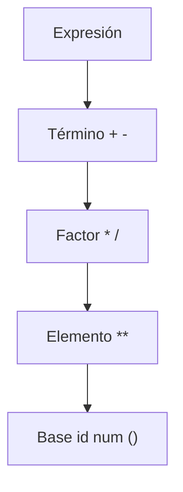
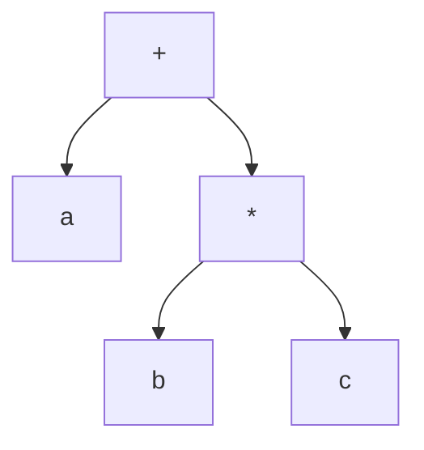

# Compiladores - Análisis sintáctico

## 3.2 Sintaxis de expresiones.

---

Las expresiones son construcciones sintácticas fundamentales en los lenguajes de programación que permiten realizar cálculos y evaluar valores. Según Aho et al. (2007), el análisis de expresiones presenta desafíos particulares debido a la necesidad de manejar correctamente la precedencia y asociatividad de los operadores.

### Gramáticas para Expresiones

#### Gramática Ambigua para Expresiones

Una gramática básica pero ambigua para expresiones aritméticas:

$$ \begin{aligned} E &\rightarrow E + E \\\   &\mid E - E \\\   &\mid E * E \\\   &\mid E / E \\\   &\mid ( E ) \\\   &\mid id \\\   &\mid num \end{aligned} $$

Esta gramática es ambigua porque no especifica precedencia ni asociatividad de operadores.

#### Gramática No Ambigua para Expresiones

Para eliminar la ambigüedad, podemos definir una gramática que incorpore explícitamente la precedencia:

$$ \begin{aligned} E &\rightarrow E + T \mid E - T \mid T \\\ T &\rightarrow T * F \mid T / F \mid F \\\ F &\rightarrow ( E ) \mid id \mid num \end{aligned} $$

**Precedencia**: Multiplicación/división > suma/resta
**Asociatividad**: Izquierda para todos los operadores

### Jerarquía de Precedencia de Operadores

La siguiente tabla muestra los niveles de precedencia típicos:



### Notaciones para Expresiones

#### Notación Infija (Infix)

Forma habitual: `operando1 operador operando2`
Ejemplo: `a + b * c`

#### Notación Prefija (Prefix)

Forma: `operador operando1 operando2`
Ejemplo: `+ a * b c`

#### Notación Postfija (Postfix)

Forma: `operando1 operando2 operador`
Ejemplo: `a b c * +`

### Análisis Sintáctico de Expresiones

#### Algoritmo de Análisis Recursivo Descendente

```python
class Parser:
    def __init__(self, tokens):
        self.tokens = tokens
        self.pos = 0
        self.current_token = tokens[0] if tokens else None

    def eat(self, token_type):
        if self.current_token and self.current_token.type == token_type:
            self.pos += 1
            self.current_token = self.tokens[self.pos] if self.pos < len(self.tokens) else None
        else:
            raise Exception(f"Error sintáctico: esperaba {token_type}")

    def expr(self):
        # E → T E'
        node = self.term()
        return self.expr_prime(node)

    def expr_prime(self, left):
        # E' → + T E' | - T E' | ε
        if self.current_token and self.current_token.type in ['PLUS', 'MINUS']:
            token = self.current_token
            if token.type == 'PLUS':
                self.eat('PLUS')
            else:
                self.eat('MINUS')
            right = self.term()
            # Crear nodo binario
            new_node = BinaryOpNode(left, token, right)
            return self.expr_prime(new_node)
        return left

    def term(self):
        # T → F T'
        node = self.factor()
        return self.term_prime(node)

    def term_prime(self, left):
        # T' → * F T' | / F T' | ε
        if self.current_token and self.current_token.type in ['MULT', 'DIV']:
            token = self.current_token
            if token.type == 'MULT':
                self.eat('MULT')
            else:
                self.eat('DIV')
            right = self.factor()
            new_node = BinaryOpNode(left, token, right)
            return self.term_prime(new_node)
        return left

    def factor(self):
        # F → ( E ) | id | num
        token = self.current_token
        if token.type == 'LPAREN':
            self.eat('LPAREN')
            node = self.expr()
            self.eat('RPAREN')
            return node
        elif token.type == 'ID':
            self.eat('ID')
            return VarNode(token)
        elif token.type == 'NUMBER':
            self.eat('NUMBER')
            return NumNode(token)
        else:
            raise Exception("Error sintáctico en factor")
```

### Árbol de Sintaxis Abstracta (AST)

Para la expresión `a + b * c`, el AST sería:



### Ejemplos de Análisis

#### Ejemplo 1: Expresión simple

**Expresión**: `x + y * z`

**Análisis**:

1. `E → E + T`
2. `E → T + T`
3. `T → F + T`
4. `F → id + T` (x)
5. `T → F * F` (y * z)
6. `F → id * id` (y, z)

#### Ejemplo 2: Expresión con paréntesis

**Expresión**: `(a + b) * c`

**Análisis**:

1. `E → T`
2. `T → T * F`
3. `T → F * F`
4. `F → (E) * F`
5. `E → E + T` dentro de paréntesis
6. `E → T + T`
7. `T → F + F` (a + b)
8. `F → id * id` (c)

### Ejercicios Propuestos

1. Construya el árbol de análisis sintáctico para la expresión: `a * b + c / d`

2. Escriba la equivalente en notación postfija para: `(a + b) * (c - d)`

3. Modifique la gramática para añadir el operador de exponenciación `**` con mayor precedencia que multiplicación/división y asociatividad a la derecha.

4. Implemente el algoritmo de análisis para la siguiente gramática de expresiones booleanas:

   $$    \begin{aligned}    E &\rightarrow E \lor T \mid T \\\    T &\rightarrow T \land F \mid F \\\    F &\rightarrow \neg F \mid ( E ) \mid id \mid true \mid false    \end{aligned}    $$

5. Demuestre que la siguiente gramática es ambigua encontrando dos árboles de análisis diferentes para la expresión: `a + b + c`

   $$ \begin{aligned}  E &\rightarrow E + E \mid E * E \mid ( E ) \mid id \end{aligned}  $$

### Eliminación de la Ambigüedad

#### Reglas de Precedencia y Asociatividad

Para eliminar ambigüedades, podemos usar:

1. **Reglas de precedencia**: Especificar qué operadores se evalúan primero
2. **Reglas de asociatividad**: Determinar el orden de evaluación para operadores con igual precedencia
3. **Gramáticas no ambiguas**: Rediseñar la gramática para reflejar explícitamente precedencia y asociatividad

#### Gramática para Expresiones con Múltiples Niveles de Precedencia

$$ \begin{aligned} Expr &\rightarrow Expr + Term \mid Expr - Term \mid Term \\\ Term &\rightarrow Term * Factor \mid Term / Factor \mid Factor \\\ Factor &\rightarrow Primary^{**} \mid Primary \\\ Primary &\rightarrow ( Expr ) \mid id \mid num \end{aligned} $$

### Referencias

#### Bibliografía Básica

1. Aho, A. V., Lam, M. S., Sethi, R., & Ullman, J. D. (2007). _Compilers: Principles, Techniques, and Tools_ (2nd ed.). Pearson Education. (Capítulo 4: Syntax Analysis)
2. Cooper, K. D., & Torczon, L. (2004). _Engineering a Compiler_. Morgan Kaufmann. (Capítulo 3: Parsing)
3. Scott, M. L. (2009). _Programming Language Pragmatics_. Morgan Kaufmann. (Capítulo 4: Semantic Analysis)

#### Bibliografía Complementaria

1. Grune, D., Bal, H. E., Jacobs, C. J. H., & Langendoen, K. G. (2000). _Modern Compiler Design_. John Wiley & Sons.
2. Wilhelm, R., & Maurer, D. (1995). _Compiler Design_. Addison-Wesley.

#### Términos Clave

- **Precedencia**: Orden en que se evalúan los operadores
- **Asociatividad**: Orden de evaluación cuando hay operadores de igual precedencia
- **Gramática ambigua**: Gramática que genera múltiples árboles de análisis para una misma cadena
- **Notación polaca**: Notación prefija propuesta por Jan Łukasiewicz
- **Árbol de sintaxis abstracta**: Representación simplificada de la estructura sintáctica
